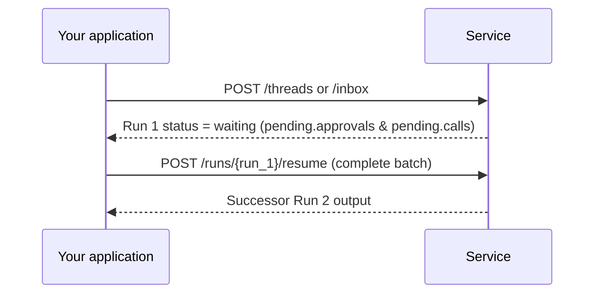

All execution endpoints live under `/api/v1` and use a [workspace API key](http.md#authentication) (`read` to inspect, `run` to execute/steer/stop, `write` to edit agents). For a copy-paste shell script, start with [Connect an application](connect-application.md#direct-http-integration).

- **Agent revision:** Immutable versioned configuration (`ap_...` + revision).
- **Session & Thread:** A thread holds one conversation history; a session groups related threads (forks and async children).
- **Run:** One accepted execution advancement over a thread's inbox.

## Agents

Create an agent in Console (**Agents → Create manually**) or via `POST /api/v1/agents` using a saved model key from `GET /api/v1/models`:

```json
{
  "name": "Support",
  "config": {
    "model": "your-model-key",
    "instructions": "Answer product questions precisely."
  }
}
```

Edits (`POST /api/v1/agents/{agent_id}/revisions` with `{config, note?, make_default?}` and `If-Match`) publish a new numbered revision; unpinned runs use the current default revision while active runs keep their captured revision. Validate drafts via `POST /api/v1/agents/validate`.

<span id="set-approvals-and-automatic-review"></span> <span id="configuration-fields"></span> <span id="context-compaction"></span> <span id="tool-permissions"></span> <span id="client-tools-and-questions"></span> <span id="subagents"></span>

- [Configure an agent](agent-configuration.md)

## Start a conversation

Call `POST /api/v1/threads` with a unique `Idempotency-Key` header to create a thread (and session if `session_id` is omitted) alongside its first inbox entry. Save `{thread.id, thread.session_id, entry.id}` from the receipt and follow `entry.assigned_run_id` ([read or stream results](stream-and-read-results.md#results)).

Search past conversations across `/sessions`, `/threads`, and `/runs` with `?text_query=...`.

## Start a realtime conversation from an app

Connect to the Service API on a `control` or `all` replica. Select a realtime model as the Agent's primary Model. You can start a fresh connection on the same Thread after a disconnect to continue from saved history.

1. From your app's backend, call `POST /api/v1/realtime/sessions` using a workspace API key with `run` permission. Send `{"agent_id":"…"}` to start a new conversation or include `thread_id` to continue an existing Thread. Set `audio: false` for text-only input with spoken output. Use `options.max_usage.requests` to limit model requests. New conversations accept `memory` for Session memory settings, plus `memories` and `environments` for initial Thread mounts.
2. Give the response to the client. Use `new WebSocket(url, [subprotocol, ticket])` in a browser, where `url` is the returned `websocket_path` resolved against the Service origin with the `wss:` scheme. Loopback development can use `ws:`. The ticket is single-use and expires after 30 seconds. Keep the long-lived API key on your backend.
3. Record the `session_id`, `thread_id`, and `run_id` from the HTTP response. The `accepted` frame confirms creation. Start sending input after `ready`. No separate start frame is needed for a ticket connection.

With the default `"transport":"websocket"`, the socket carries raw mono 24 kHz signed 16-bit little-endian PCM in both directions. For PCM barge-in, track the starting byte offset of each received binary frame, initially zero. Advance it by each frame’s length, including frames discarded locally. A JSON `{"type":"playback_position","offset":4800}` sets the starting offset of the next frame after an output gap. Stop playback immediately on interruption and send `{"type":"interrupt","played_bytes":6000}` if the device played 1,200 bytes of the frame starting at 4,800. Discard queued audio and resume on `interrupted`. Playback-only clients can continue reading raw binary frames and ignore position updates.

For OpenAI Realtime and GPT-Live you can request `"transport":"webrtc"` with audio enabled. Add a muted microphone track to an `RTCPeerConnection` and send its complete audio-only SDP as `{"type":"offer","sdp":"…"}` over the socket. Apply the SDP from the `answer` frame. Enable the microphone after the peer connects and Service reports `ready`. Audio then goes directly between the client and OpenAI. `GET /api/v1/realtime` reports the available transports. Grok Voice uses `"transport":"websocket"`. During WebRTC barge-in, mute local playback and send `{"type":"interrupt"}`. Unmute on `playback_start` for OpenAI Realtime or on `playback_end` when GPT-Live finishes the interrupted turn. GPT-Live keeps its provider transcript.

On either transport, send `{"type":"text","text":"Hello"}` for a text turn and read `transcript` frames for subtitles. When you receive `approval_required`, show the pending call to the user and return their decision as `{"type":"approval","call_id":"…","approve":true}` or with `approve: false`. On `approval_withdrawn`, remove the prompt with the matching `call_id`. Clear all remaining prompts when the connection ends. Send `{"type":"stop"}` to end the call and stop local media immediately. The `sealed` frame confirms the committed Run status. If the connection closes first, read `GET /api/v1/runs/{run_id}` and check Thread eligibility before reconnecting.

## Submit a message

Send follow-ups to `POST /api/v1/threads/{thread_id}/inbox` with `agent_id`, `payload`, optional `delivery`, and a fresh `Idempotency-Key`:

- **`delivery: "steer"` (default):** Joins an active compatible run at the next model boundary (or starts a run if idle).
- **`delivery: "next_run"`:** Waits in the inbox to start a separate run after the current run finishes.

Manage queued `pending` entries with the thread's `If-Match` via `PATCH` / `DELETE /api/v1/threads/{thread_id}/inbox/{entry_id}` and `PUT .../inbox/order`. Pass one-run overrides or request caps via `options`:

```json
{
  "options": {
    "max_usage": { "requests": 40 },
    "overrides": { "instructions": "Answer in German." }
  }
}
```

<span id="caller-headers"></span> <span id="command-environment-variables"></span> <span id="retained-tool-executions"></span>

See [Advanced execution options](execution-options.md) for imported history, caller headers, and execution policy.

### Attached files

Include 1–32 parts (`text`, uploaded [workspace `asset`](files-and-webhooks.md#assets), HTTP(S) URL, or JSON):

```json
{"content": [{"type": "text", "text": "Summarize this report."}, {"type": "asset", "asset_id": "ast_..."}]}
```

Service sends supported media natively when declared on the model, inlines text up to 64 KiB, or writes files to `/workspace/.a13n/attachments/` when a `workspace` environment is mounted.

## Waits, approvals and questions

When a run needs human approval (`pending.approvals`) or a client-tool / `ask_user_question` response (`pending.calls`), it seals as `waiting`.



### Resume a waiting run

Submit **both** `approvals` and `calls` covering every pending ID to `POST /api/v1/runs/{run_id}/resume` with a fresh `Idempotency-Key` (and optional supplemental `input`). Service creates a new successor run while leaving the paused run sealed as `waiting`:

```json
{
  "approvals": {"call_delete": {"action": "deny", "reason": "Keep the file"}},
  "calls": {
    "call_question": {
      "status": "returned",
      "value": {"answers": {"Which color?": "blue"}}
    }
  }
}
```

Approval actions are `{"action": "approve"}` or `{"action": "deny", "reason": "..."}`; call results are `{"status": "returned", "value": ...}` or `{"status": "failed", "message": "..."}`.

## Interrupt, fork and archive

| Goal                                       | Endpoint                                                          |
| ------------------------------------------ | ----------------------------------------------------------------- |
| Stop an active or queued run               | `POST /api/v1/runs/{run_id}/interrupt`                            |
| Branch into a new thread from an ended run | `POST /api/v1/runs/{run_id}/fork` (`fresh_environments` optional) |
| Permanently close a thread                 | `POST /api/v1/threads/{thread_id}/archive` (`If-Match` required)  |

<span id="follow-a-session-stream"></span> <span id="traces"></span> <span id="find-and-improve-execution-issues"></span> <span id="configure-plugins-in-console"></span>

- [Stream and read results](stream-and-read-results.md)
- [Inspect runs and improve agents](inspect-runs.md)
