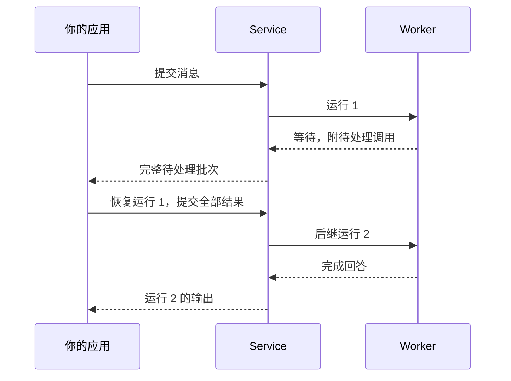

先用一个 agent 完成一段对话：保存配置、发送消息，再跟踪运行，直到它完成或请求输入。后续消息发送到同一线程，继续已有历史。

主线是[创建 agent](#agents) → [开始对话](#start-a-conversation) → [读取结果](#results) → [回应等待](#resume-a-waiting-run)或[发送下一条消息](#submit-a-message)。需要包含凭据和响应 ID 的完整 Shell 流程时，参阅[连接应用](connect-application.md#direct-http-integration)。

**Agent 修订版本**保存配置。**线程**保存一段持续推进的对话历史；**会话**组织相关线程，包括分叉和异步子线程。每次被接受的推进是一次**运行**。Worker 通过一次或多次**执行尝试**完成运行，因此故障恢复不必创建新运行。

下文 API 路径均以 `/api/v1` 开头。使用目标[工作空间](http.md#authentication)的密钥。读取需要 `read`，执行和停止需要 `run`，修改 agent 需要 `write`；参阅[角色](identity.md#roles)。

## Agent

1. 在 Console 打开 **Agents → 手动创建**。
2. 选择已验证可用的工作空间模型，编写任务指令。
3. 保存 agent，再用**试用 Agent**发送一条简短测试消息。
4. 检查完成的回答，再添加工具、环境或委派能力。

对应 API 是携带名称和配置的 `POST /agents`。将 `your-model-key` 替换为 `GET /models` 返回的模型 key：

```json
{
  "name": "Support",
  "config": {"model": "your-model-key", "instructions": "Answer product questions precisely."}
}
```

保留响应的 `id`（`ap_…`）用于提交消息。Agent 使用 ID 引用，模型使用 key。

配置变更创建不可变的编号修订版本。**版本 → 设为默认版本**选择后续未固定版本的运行所使用的配置，包括已有对话中的新运行。已接受的运行保留原有配置。**手动创建**菜单中的**导入 YAML**和**导出 Agent**用于迁移配置；需要在目标工作空间匹配引用资源。

通过 API 修改时，`POST /agents/{agent_id}/revisions` 接收 `{config, note?, make_default?}` 和 agent 的 `If-Match`。除非 `make_default` 为 false，新版本会成为默认版本。提交与当前默认版本相同的 config 会返回该版本，不另建版本。用 `POST /agents/validate` 检查草稿，或用 `POST /agents/{agent_id}/revisions/{revision_id}/set-default` 选择版本。元数据编辑、复制和归档端点见 [API 参考](api-reference/index.md)。

归档 agent 会阻止新运行，已接受的运行继续完成。内置 Agent Composer 和 Finding Agent 允许修改模型设置及补充指令，其余配置受保护。官方指令由当前 worker 在每次尝试时提供。需要自由配置时，将内置 agent 复制为自定义 agent。

### Agent 配置

先跑通纯模型对话，再按具体任务添加能力。手动编辑器直接提供配置项；[Agent Composer](agent-composer.md)可通过对话帮助构建配置。

#### 设置审批与自动审查

1. 展开**工具**下的工具集，为工具选择**允许**、**询问**、**自动审查**或**拒绝**。连接提供相同选项。
2. 使用自动审查时，打开**配置审查**，选择审查模型，设置风险阈值及处理方式：拒绝或询问用户。低于阈值的调用继续执行。
3. 用**单独设置审查规则**配置特定工具。高级设置控制 Shell 审查标准、失败处理、超时和模型参数。
4. 选择**应用到草稿**，再选择**保存更改**。取消面板会丢弃其中的草稿修改。

审查必须指定模型。默认拒绝极高风险，审查失败时询问用户；审查超时则拒绝执行。

#### 配置字段

按所需能力选择配置：

| 任务               | 配置                                                                                                 |
| ------------------ | ---------------------------------------------------------------------------------------------------- |
| 选择行为与模型     | `model`、`instructions`、`model_settings`、`model_characteristics`；参阅[模型](models.md)            |
| 提供工具           | `toolsets`、`connection_tools`、`tool_search`；参阅[工具与连接](tools.md)                            |
| 加载可复用指令     | `skills: [{skill_id, revision_id}]`；参阅 [Skill](skills.md)                                         |
| 向应用或用户提问   | `client_tools`、`user_questions`；参阅[客户端工具](#client-tools-and-questions)                      |
| 委派工作           | `subagents`、`subagent_mode`；参阅[子 agent](#subagents)                                             |
| 审查调用或理解媒体 | `reviewer`、`media_understanding`；参阅[媒体理解](models.md#media-understanding)                     |
| 要求结构化输出     | `output_spec`：一个 JSON Schema 或 2–32 个命名 `variants`；省略时返回文本                            |
| 限制重试           | `retries.tools` 和 `retries.output`，各为 0–100                                                      |
| 提供工作环境       | `default_environment_template_id`、`lazy_environment`；参阅[环境](environments.md)                   |
| 保留知识           | `memory`、`memory_mounts`；参阅[记忆](memory.md)                                                     |
| 调整长时间工作     | `background_compaction`、`execution`；参阅[压缩](#context-compaction)和[执行策略](#execution-policy) |
| 扩展运行时         | `plugins`；参阅 [Console 插件](#configure-plugins-in-console)                                        |

保存时按工作空间校验引用。省略的 skill 和子 agent 修订版本 ID 会固定到当前默认版本。模型、连接、provider 和模板仍是实时资源，使用时重新解析。`lazy_environment` 默认为 true，首次使用时准备实例。设为 false 会在 Harness 开始前准备实例；执行连接仍在首次使用时打开。

### 上下文压缩

对话增长时，Service 将较早的上下文压缩为摘要，默认同步执行。要在后台生成摘要，打开**高级设置 → 上下文压缩**，启用**启用后台压缩**，再保存修订版本：

```json
{"background_compaction": {"enabled": true, "blocking_threshold": 0.95}}
```

只要当前请求仍能放入上下文窗口，普通线程就可以在生成摘要期间继续执行。达到阻塞阈值时，运行等待已有摘要工作，或同步压缩。输出预留空间可能要求更早等待。就绪摘要可以在当前运行或同一线程的后续运行中应用；关闭新后台工作后，保留的摘要仍可应用。内联和异步子 agent 使用同步压缩。

摘要请求计入原始运行的请求预算，用量可能在该运行结束后到达。中断运行会保留其后台摘要工作。归档线程会终止该摘要的后续使用；分叉不继承待处理摘要。

上下文恢复默认启用，独立于 agent 修订版本的压缩配置。发生原生上下文窗口溢出后，Harness 先尝试正常压缩。摘要成功后，运行使用压缩后的历史继续执行。

只有普通执行和适用的压缩请求都溢出时，Service 才允许有界、有损的历史重建，每次运行最多一次，worker 接管也沿用这一额度。恢复请求发出前会提交重建历史和已消耗额度。历史文件尽力保存在主环境的 `/workspace/.a13n/history/<thread-id>/`，保留时间取决于该环境生命周期；存储或读取工具不可用不会阻止重建。

> [!WARNING]
> 每次有损重建都需要立即调查根因，即使续跑成功。先检查压缩配置和工具输出未受限的问题。Console 将警告和恢复结果与最终回答分开保留。

### 工具权限

用权限决定模型调用工具时如何处理：

| 权限      | 结果                                     |
| --------- | ---------------------------------------- |
| `allow`   | 执行调用。                               |
| `ask`     | 运行结束并等待批准。                     |
| `review`  | 按已配置的审查策略允许、拒绝或询问用户。 |
| `deny`    | 拒绝调用。                               |
| `inherit` | 使用工具默认值；内置工具默认为 `allow`。 |

内置和平台工具在 `toolsets.<toolset>.tools.<tool>.permission` 设置。连接使用 `connection_tools[].permission`，并可通过 `permissions` 单独覆盖工具。客户端工具在 `client_tools[].permission` 接受 `inherit`、`allow` 或 `deny`；允许的客户端调用仍需要应用返回结果。

### 客户端工具与问题

由应用负责执行的操作可声明为客户端工具。例如，在 agent config 中加入：

```json
{
  "client_tools": [{
    "name": "open_ticket",
    "description": "Open a support ticket in the customer's CRM.",
    "parameters_json_schema": {
      "type": "object",
      "properties": {"title": {"type": "string"}},
      "required": ["title"]
    }
  }]
}
```

调用发生后，运行以 `waiting` 结束，并在 `pending.calls` 中提供该调用。在应用中执行操作，再[携带结果恢复](#resume-a-waiting-run)。

设置 `user_questions: true` 后，模型可以调用 `ask_user_question`。问题也出现在 `pending.calls` 中。通过 resume 回应指定调用；普通聊天消息会留在收件箱中，直到等待解决。

### 子 agent

在 `subagents` 中配置工作空间 agent ID。每条命名调用边可指定描述、固定版本、上下文共享方式和用量限制。将下列片段中的 `ap_...` 替换为真实 agent ID：

```json
{
  "subagent_mode": "async",
  "subagents": {
    "researcher": {
      "agent_id": "ap_...",
      "description": "Finds and summarizes sources.",
      "usage_limits": {"request_limit": 20},
      "environment": {"mode": "shared"}
    }
  }
}
```

默认**内联**：子 agent 在父运行及其尝试内部执行。调用图不能回到发起委派的 agent。每次委派可限制请求数、token 和工具调用。

**异步**在同一会话中创建子线程，使用父运行的主体。父 agent 通过[委派工具](../a13n-harness/delegation-and-codeact.md#asynchronous-children)检查、等待、引导、取消或继续子 agent。子结果进入父收件箱，可以引导活跃运行或启动后续运行。等待用户的子运行在这些工具中显示为 `running`。异步调用边只应用 `usage_limits.request_limit`。

异步环境由调用边决定：`shared` 挂载父环境，`dedicated` 从 `template_id` 预留环境，`none` 不挂载。子 agent 自身的默认环境模板不生效。部署设置 `worker.child_count` 和 `worker.child_depth` 限制子 agent 数量及嵌套深度。

## 开始对话

在 Console 选择**会话 → 新建会话**，或在 agent 页选择**试用 Agent**。API 的 `POST /threads` 创建线程和第一条收件箱消息。省略 `session_id` 会同时创建会话；提供它则向已有会话添加线程。

为这次逻辑提交发送唯一的 `Idempotency-Key`。响应丢失后重试时，保留相同 key 和请求体。[HTTP 流程](connect-application.md#direct-http-integration)演示了保存回执和提取 ID。

响应为 `{thread, entry, run}`：首次提交返回 `201`，重放返回 `200`。即使 `run` 为 null，也要保存线程 ID、其会话 ID 和条目 ID。条目出现 `assigned_run_id` 后，跟踪该运行。分配可能早于实际纳入；只有条目已由该运行 `consumed`，该运行的完成结果才是这条消息的回答。

新线程请求还可设置[环境挂载](environments.md#mount-environments-on-a-thread)、[记忆挂载](memory.md#mount-a-memory-on-a-thread)、[调用方请求头](#caller-headers)和[导入历史](#import-conversation-context)。按对话需要添加。

查找已有工作时，列出会话或线程。`/sessions`、`/threads` 和 `/runs` 的 `text_query` 要求全部词在同一运行保留的用户及助手文本中命中，支持中文词和代码标识符。搜索不含工具、推理、附件和导入历史。索引保存有界摘录，而非全部原消息；参阅[设置参考](configuration-reference.md)的 `run_search`。会话 `q` 用于查询会话或线程 ID。会话列表按最近活动排序。

### 导入对话上下文

要继续外部对话，在 `POST /threads` 中将已完成历史放在当前消息旁，并替换 agent 占位符：

```json
{
  "agent_id": "ap_...",
  "message_history": [
    {"kind": "request", "parts": [{"part_kind": "user-prompt", "content": "We are planning a trip to Kyoto."}]},
    {"kind": "response", "parts": [{"part_kind": "text", "content": "How many days will you stay?"}]}
  ],
  "payload": {"content": [{"type": "text", "text": "Three days. Suggest an itinerary."}]}
}
```

`message_history` 使用 Pydantic AI 消息 JSON，最多 256 条消息、256 KiB 规范化 JSON。它接受用户文本、模型文本和已闭合的工具调用/结果交换。每个历史调用都必须在下一条响应、用户消息或导入结束前，有名称和 ID 匹配的返回。历史工具作为上下文，不会执行。

指令放在 agent config 中，媒体放在当前 payload 中。导入接受已完成对话内容，不接受系统指令或暂停中的执行。外部应用元数据以及运行/对话 ID 保留在提交 JSON 中供读取，但执行前会清除；导入用量不计入 Service 账目。

导入只初始化这个新线程。后续消息和分叉从已提交检查点继续。导入不会生成历史 Service 运行或显示项，已有线程历史不能替换。已经使用 Pydantic AI 的 Python 应用可通过 `ModelMessagesTypeAdapter.dump_json` 序列化，其他客户端可直接提供 JSON。

## 提交消息

通过 `POST /threads/{thread_id}/inbox` 继续对话。携新幂等 key 发送 `agent_id`、`payload` 和所需运行选项。响应与创建线程使用相同回执结构。

按目的选择投递方式：

- `steer` 为默认值。兼容消息在模型边界加入活跃运行：同一 agent、未固定版本或版本相同，提供的选项也须匹配。省略选项时保留活跃运行的设置。
- `next_run` 等待独立运行。消息需要自己的配置，或应在当前任务之后执行时，使用此方式。

线程空闲且可接受运行时，两种方式都可启动运行。排队消息按收件箱顺序推进。`waiting` 运行必须先显式恢复。运行失败或取消后，排队消息暂停，直到新提交的消息启动下一运行；该运行之后恢复正常队列处理。

需要指定修订版本时，固定 `agent_revision_id`。否则新运行在被接受时选择 agent 默认版本。配置已无法执行的条目会原地失败，不阻塞后续条目。归档工作空间会拒绝排队工作，并在 worker 下一次权限检查时撤销执行中的权限。

### 附件

Payload 包含 1–32 个部分，可使用文本、已上传的工作空间资产、HTTP(S) URL 或 JSON：

```json
{"content": [{"type": "text", "text": "Summarize this report."}, {"type": "asset", "asset_id": "ast_..."}]}
```

先上传文件，再将 `ast_...` 替换为[资产 ID](files-and-webhooks.md#assets)。Service 按[出站策略](configuration.md#outbound-requests)获取 URL 部分。

Service 为每个文件选择传递方式：

1. 模型声明对应理解能力时，原生发送支持的图片、音频、视频或 PDF。
2. 将支持的、最多 64 KiB 的文本文件直接作为文本提供。没有环境时，更长的 URL 文本截取此前缀，并说明已截断。
3. 将其他文件写入主 `workspace` 环境的 `/workspace/.a13n/attachments/`，把路径告知模型，再由工具读取或处理。

三种方式都不可用时，提供环境或选择理解该媒体的模型，以解决 `environment_required`。URL 的适用性在获取后检查；不可用 URL 会使其条目失败。落地文件属于该环境，替换环境或使用新环境分叉不会复制这些文件。

### 管理排队消息

读取 `GET /threads/{thread_id}/inbox` 或 `GET /threads/{thread_id}/inbox/{entry_id}`。条目状态为 `pending`、`assigned`、`consumed`、`failed` 和 `withdrawn`。`consumed` 记录输入已纳入提交的执行状态；成功或失败要另读运行。

修改 pending 条目时，使用线程的 `If-Match`：

- `PATCH /threads/{thread_id}/inbox/{entry_id}` 编辑自己消息的投递方式、payload、版本固定或选项。
- `DELETE /threads/{thread_id}/inbox/{entry_id}` 撤回条目，同时保留幂等身份。
- `PUT /threads/{thread_id}/inbox/order` 携带 `{"entry_ids": [...]}`，按目标顺序列出全部 pending 条目。

有 `run` 权限的调用方可以撤回和重排。达到收件箱数量或字节上限时返回 `429 rate_limited`。Console 提供**排队消息**，并将执行期间输入的消息作为 steer 发送。

### 单次运行选项

用 `options` 修改一次运行。例如，下列片段设置请求预算并替换指令：

```json
{"options": {"max_usage": {"requests": 40}, "overrides": {"instructions": "Answer in German."}}}
```

`max_usage.requests` 接受 1–10,000；超出后运行以 `usage_limit_exceeded` 失败。`labels` 标记运行。`overrides` 在提交和接受时校验，然后固定。大多数字段替换修订版本中的值；`toolsets` 替换所提供的各个工具集，`retries` 和每条 `subagents` 调用边合并指定字段。null 子 agent 调用边会将其移除。

Resume 和自动子结果续接保留前一运行的选项。Console 的**运行选项**为下次运行设置参数。工具交还和引导时机见[执行策略](#execution-policy)。

## 请求上下文头

通过消息正文传入模型与 MCP 请求共用的业务元数据：

```json
{"options": {"context": {"headers": {"x-trace-id": "trace-123", "x-tenant-id": "acme"}}}}
```

默认开启转发。只放入允许发送给这些 provider 和 MCP 服务器的值。值作为可读运行选项保存；密钥应放在 provider 或连接凭据中。入站 HTTP 头不会自动复制。映射最多 32 个不区分大小写且唯一的名称，值为最多 4096 字符的可打印 ASCII，合计 8 KiB；认证和传输名称属于保留字段。

故障恢复、resume 和子 agent 保留已接受的上下文。新消息和分叉使用自己的上下文，省略时为空。Steer 可以省略或重复上下文，不同值会排队等待后续运行。HTTP 读取提供这些值，MCP 查询投影则移除它们。提示词、历史和命令环境不会自动获得副本。

模型请求头和各连接的 `mcp_headers` 优先于共享同名字段；凭据和受保护协议头始终优先。转发需要同时启用部署类别开关及目标的 `config.forward_context_headers`。省略目标设置时使用 `A13N_HARNESS_FORWARD_CONTEXT_HEADERS`（默认 true）；MCP 保存时写入解析后的值。通过 `A13N_PROVIDERS__FORWARD_MODEL_CONTEXT_HEADERS=false` 或 `A13N_PROVIDERS__FORWARD_MCP_CONTEXT_HEADERS=false` 关闭相应类别。Fetch、浏览器和 Shell 操作不会自动转发这些头。

## 调用方请求头

只有某个 MCP 连接需要非敏感上下文时，使用线程级 `mcp_headers`。在线程创建时设置，或携 `If-Match` PATCH 线程：

```json
{"mcp_headers": {"conn_...": {"x-tenant-id": "acme"}}}
```

将占位符替换为工作空间中已启用的 MCP 连接 ID。最多 32 个连接、合计 16 KiB。认证和协议名称，以及连接凭据自身使用的名称，都会被拒绝。每次运行在接受时固定这些头；分叉和异步子线程继承它们。运行视图不显示这些值。

## 等待、审批与问题

需要外部决定或结果时，运行以 `waiting` 结束。读取 `pending.approvals` 和 `pending.calls` 两组；`wait_reason` 为 `approval`、`call` 或 `multiple`。问题属于 call，工具权限请求属于 approval。



### 恢复等待中的运行

1. 读取确切的等待运行及完整待处理批次。
2. 在应用中收集决定和结果。应用负责部分答案、编辑和审批人协作。
3. 向 `/runs/{run_id}/resume` POST 两个结果映射，为这批回复使用新幂等 key。
4. 跟踪响应返回的后继运行。原运行保持 `waiting`，作为当时暂停的历史记录。

若批次中只有审批 `call_delete`，完整回复可以是：

```json
{"approvals": {"call_delete": {"action": "deny", "reason": "Keep the file"}}, "calls": {}}
```

使用实际返回的 pending ID。审批值为 `{"action":"approve"}` 或 `{"action":"deny","reason":"..."}`。调用结果为 `{"status":"returned","value":...}` 或 `{"status":"failed","message":"..."}`。失败调用结果会成为 agent 可处理的工具失败，不一定导致后继运行失败。

名为 `call_question` 的问题可用自由文本回应：

```json
{"approvals": {}, "calls": {"call_question": {"status": "returned", "value": {"response": "Up to 200 dollars per night."}}}}
```

结构化回答使用 `{"answers":{"Which color?":"blue"}}`，多选用数组，且必须匹配该调用的问题。显式跳过问题时，返回失败调用结果。Console 的**跳过反馈继续**会在确认后提交拒绝和失败结果。

两个映射必须精确覆盖各自的 pending 类别，即使某一组为空也要提供。缺少结果、未知 ID 或类别错误都会拒绝整批请求，等待不变。只能恢复空闲线程的最新等待运行；过期请求返回 `409 conflict`，原因为 `not_idle_waiting_head`。响应丢失时，重放相同请求体和 key 会取得同一后继运行，状态码由 `201` 变为 `200`。

要补充说明或附件，添加与消息 payload 使用相同内容结构的 `input`。它补充而非替代必需结果。模型先收到工具结果，再收到用户输入。完整恢复体最多 256 KiB，原子接受，不创建额外收件箱条目。不可用输入可能使后继运行失败，需要检查该运行结果。

普通收件箱消息不能结束等待。Resume 后，兼容 steer 可加入后继运行，`next_run` 条目继续排队。后继运行失败时，下一条消息从该失败运行继续；先前等待已经解决。

## 中断、分叉与归档

按要保留的历史选择操作：

| 目标                     | 操作                                                   |
| ------------------------ | ------------------------------------------------------ |
| 停止当前工作             | `POST /runs/{run_id}/interrupt`，或 Console **停止**   |
| 从已结束运行探索另一方向 | `POST /runs/{run_id}/fork`，携新消息和幂等 key         |
| 永久关闭线程             | `POST /threads/{thread_id}/archive`，携线程 `If-Match` |

尚未开始的运行立即取消。执行中的运行在安全点停止，此前显示 `cancel_requested_at`。已完成、等待或失败的运行不能中断；中断已取消运行会返回该运行。

分叉在同一会话中创建线程。从等待运行分叉时，新分支拒绝审批并提供无响应结果，原等待不变。除非 `fresh_environments` 为 true，分叉共享源环境挂载。它复制记忆挂载，`environments` 和 `memories` 可添加挂载。分支需要独立文件系统状态时，使用新环境。

失败或取消后，从最后一个检查点继续；若没有保存检查点，则从运行开始时的状态继续。未完成调用显示为已中断，不重新执行。历史本身导致失败时，分叉更早的运行。归档撤回 pending 消息、移除挂载并中断活跃工作，历史仍可读取。

## 执行策略

分别设置工具交还与引导：

- `tools.mode: inline` 等待工具完成；`auto` 可在前台等待结束后返回保留执行回执。
- `steering: boundary` 在模型边界应用引导；`immediate` 可抢占前台等待。

Service 默认使用 `auto`、五秒前台等待和 `immediate`。以下 agent config 片段显式设置这些值：

```json
{"execution": {"tools": {"mode": "auto", "foreground_wait_seconds": 5}, "steering": "immediate"}}
```

每个字段按**运行覆盖 → 线程覆盖 → 所选 agent 修订版本 → 部署默认值**解析。Agent 使用 `config.execution`，线程创建或 PATCH 使用 `execution`，消息使用 `options.execution`。线程 PATCH 需要 `If-Match`：省略字段保持原值，null 字段恢复继承，`{"execution":null}` 清除全部覆盖。

运行在被接受时固定最终策略，排队消息也是如此。故障恢复、交接、resume 和自动续接保留它。Steer 可以省略或重复匹配字段；修改会返回 `execution_policy_immutable`。需要不同策略时，使用 `delivery: next_run` 提交。即使新运行使用 inline 模式，之前的保留调用仍可访问。

Console 在 agent 配置及线程的**会话操作**中提供**执行策略**。新会话的**选项**和空闲输入框策略控件只影响一次运行；**详情 → 执行策略**显示固定值。前台等待接受 0–300 秒，控制观测等待而非执行截止时间。

### 命令环境变量

在相同三层的 `execution.environment` 中设置非敏感命令默认值：

```json
{"execution": {"environment": {"APP_MODE": "staging", "EMPTY": ""}}}
```

每个变量按**命令 → 运行 → 线程 → agent → 已冻结环境 recipe**解析。线程 PATCH 替换传入的映射；null 或 `{}` 清除该层。空字符串设置空值，删除键则露出下层默认值，并非 unset。显式命令 unset 遵循 provider 支持。Windows 上保持名称拼写一致。

运行固定其 agent/线程/运行三层结果。Shell 命令、后台进程及其普通子进程接收这些值，不修改全局 sandbox 变量。内联子 agent 共享它；分叉和独立子线程使用自己的 agent 与选择。凭据保存在相应密钥存储中。

## 保留的工具执行

自动交还后，支持的调用可在模型收到 `exec-*` 回执后继续留在原 worker 上执行。读取该引用的结果，不要重新发起调用。保留的 CodeAct 执行包含其嵌套调用。后续运行可使用其他 worker；所有者丢失时，未完成工作标为 `lost`，副作用不确定，不自动重放。

从 Console 会话菜单或运行详情打开**工具执行**。用**检查**查看元数据，用**读取结果**获取有界结果片段。API 位于 `/threads/{thread_id}` 下：

| 端点                                          | 操作                                       |
| --------------------------------------------- | ------------------------------------------ |
| `GET /tool-executions`                        | 列出调用，可按 `run_id` 或 `active` 筛选。 |
| `GET /tool-executions/{execution_id}`         | 查看状态。                                 |
| `GET /tool-executions/{execution_id}/result`  | 使用 `offset`、`limit` 和 `version` 读取。 |
| `POST /tool-executions/{execution_id}/cancel` | 请求取消。                                 |

引用属于确切的一个线程。Agent 获取结果或首次邮箱投递会开始已交付结果的保留窗口，默认一小时，且不超过完成后 24 小时。Console 和 HTTP 检查（包括读取结果）不改变交付状态或保留期。重复读取不延长保留期，过期记录返回 404。

接受取消与完成清理是两件事。停止原始运行会请求取消其保留调用，并禁止迟到结果唤醒对话。停止后续运行影响的是该运行的调用，而非较早调用。保留工作与清理完成前，挂载仍处于使用中。

## 结果

读取 `GET /runs/{run_id}`，根据 `status` 选择后续操作：

| 状态                  | 操作                                                  |
| --------------------- | ----------------------------------------------------- |
| `accepted`、`running` | 继续观测该运行。                                      |
| `completed`           | 读取 `output`，它是文本或符合 `output_spec` 的 JSON。 |
| `waiting`             | 读取 `pending`，提交完整 resume 回复。                |
| `failed`              | 检查 `failure.code` 和 `failure.message`。            |
| `cancelled`           | 查看已保存历史，再决定继续或分叉。                    |

对于提交的消息，先确认哪个运行消费了收件箱条目。已分配但未纳入的条目可能返回 pending。线程最新运行不一定是某条消息的回答。

用 `/runs/{run_id}/items` 读取有序显示历史。响应包含最近显示项和 `complete`；以首项 ordinal 作为 `before` 向前翻页，或用 `after` 向后读取。超过 32 KiB 的字段使用 `content_refs`，通过 `/runs/{run_id}/contents/{content_id}` 读取已保存内容。每个字段最多保留 16 MiB，`truncated` 标记保存的是前缀。Console 的全文/已保存内容操作读取这些引用。

诊断时，`/runs/{run_id}/agent` 返回实际配置，`/lineage` 返回祖先，`/attempts` 说明首次执行、恢复或 worker 交接。`/threads/{thread_id}/runs` 按从新到旧列出运行。`current_run_id` 指向活跃工作；`last_run_id` 指向后续执行所接续的已结束历史。

## 跟踪会话事件流

用 `GET /sessions/{session_id}/stream` 显示整个会话的实时内容。它是 SSE 流，每次连接从当前状态开始，没有重连游标。

| 事件        | 客户端操作                                                                                  |
| ----------- | ------------------------------------------------------------------------------------------- |
| `thread`    | 替换线程及其中指向的当前/最后运行。                                                         |
| `items`     | 替换该运行从 ordinal `first` 起的显示项，保留更早的最终项；从 `continuation` 继续实时显示。 |
| `delta`     | 将临时输出应用到该运行显示。                                                                |
| `gap`       | 标记输出缺失，等待下一个 `items` 帧修复。                                                   |
| `app_ready` | 启用指定的 [MCP Apps](tools.md#mcp-apps-for-embedding-applications)。                       |

`complete: true` 的 `items` 帧是运行最终显示；运行结果要看 status。重连时丢弃未完成显示，从新快照重建活跃运行。断开期间结束的运行通过 `/runs/{run_id}/items` 读取。忽略未知事件名。

使用上限为 30 秒的随机退避重连，429 或 503 按 `Retry-After` 等待。其他 4xx 拒绝及无效帧需要修正原因，而非自动重试。事件流是临时观测，已保存显示项才是持久记录。帧 Schema 导出到 `proto/a13n-service/session-stream.schema.json`。

## 用量

用 `GET /usage?session_id=...` 获取完整模型总量，用 `GET /usage/runs?session_id=...&limit=50` 获取运行分页明细。总量覆盖全部匹配记录，不受 UI 已加载运行数量影响。两个端点也支持按运行、线程和入库时间筛选。

`/usage` 返回 `{models:[...]}`。`/usage/runs` 返回 `{items:[{run_id,thread_id,run_number,models}],next_cursor}`。保持筛选条件不变，读取游标直到 null。运行按从早到晚排列，同一运行的模型组放在一起。`run_number` 计入该线程全部运行，包括没有用量的运行。

每个模型总量按保存价格记录请求数、token 和费用。缓存输入计入输入 token。无法归属的模型 key，以及完全没有计价记录的费用，为 null。`average_time_to_first_chunk_seconds` 对符合条件的已完成流式请求求平均。`output_tokens_per_second` 将完整输出 token 除以已完成且时长为正的请求总时长，包含非流式请求和首个分片之前的等待。缺少相应观测时，各指标为 null。

运行的 `usage_at_seal` 是结束时的用量。延迟报告仍进入 `/usage`，时间筛选按它们的入库时间选择。

## Trace

配置 [trace 后端](configuration.md#logs-metrics-and-traces)，再在 Console 打开 **Traces**，调查缓慢、昂贵或失败的执行。每次尝试导出 Harness span，包括内联子 agent。没有后端时，查询返回 `503 unavailable`。

1. 选择时间范围。
2. 按运行/线程/会话或根属性筛选。
3. 设置以秒为单位的耗时限制或以 USD 为单位的费用限制，再按**耗时**、**费用**或**开始时间**排序。
4. 打开 trace，检查相关 span 和证据。

例如，耗时最小值 `60`、费用最小值 `0.01`，按费用降序排列，可找到上报耗时至少一分钟、费用至少 $0.01 的 trace。范围包含边界。Trace 费用累加上报的 span 费用；缺失费用表示未知，trace 总量与 Service 运行账目独立。

调用 `/traces/search` 时，提供明确的 `started_after`、`started_before`、`order_by` 和 `direction`。使用 keyset 游标时保持筛选条件不变。查询有收集上限和 30 秒截止时间，超限时缩小范围或增加 ID 条件。结果受后端采样、入库和保留期影响，分页不会冻结变化的数据。Trace、span 和尝试端点见 [API 参考](api-reference/index.md)。

## 发现并改进执行问题

通过**洞察 → 发现**，把 trace 证据转化为经过审阅的改进：

1. 选择**分析 traces**，设置规则及时间范围/数量，可补充**本次检查要求**。针对一条已结束 trace，使用**分析此 trace**。
2. 从**分析历史**打开分析运行，阅读摘要、证据及选择上限。
3. 打开发现项，选择**编辑审阅**，指定已确认、预期行为、证据不足或误判，填写**审阅理由**并**保存审阅**。
4. 对值得修改的发现项，选择**交给 Composer 审阅**，发送预填消息，检查建议，再按需要批准配置写入。

分析需要 trace 查询后端，使用内置 Finding Agent 当前选定的默认版本和模型。选择过程最多扫描 100 个根节点，选择最多 20 条 trace。执行/恢复规则在扫描内优先选择失败运行及 error/fatal 根节点。数量说明选择与引用范围，并非每条所选 trace 都已完整分析的证明。即使是严重发现，也要对照证据审阅。

类别区分请求不清、指令问题、工具设计、工具使用、工具执行、回答质量、上下文缺失、流程问题和边界违规。类别描述问题，不证明原因。正常权限拒绝不是边界违规；无依据的成功声明属于回答质量问题。

保存的结论和理由会提供给同一 agent 修订版本的后续分析。修改结论会清空旧理由；关闭或重开发现项保留已保存反馈。每次接受的分析保留原始输入，因此编辑只影响新分析。反馈有范围上限，用于比较诊断，不会合并已保存发现项。

Finding Agent 只读取选定 trace 证据并提交发现项，不修复或发布配置。外部提交方可调用 `POST /findings`，使用在工作空间/主体范围内唯一且稳定的 `source_key`。提交方负责 trace/span 引用；Service 校验所引运行和 agent 修订版本。

## 在 Console 中配置插件

1. 打开 agent 的**能力 → 插件**，选择**添加插件**。
2. 选择部署已启用的插件，设置唯一实例名，在表单或 JSON 编辑器中修改设置。
3. 保存 agent，验证草稿并发布修订版本。保存校验配置，但不执行插件。

多个实例可使用同一插件。重命名或移除实例会更新工具发现引用。预设只读。插件不可用时，其保存 JSON 仍然可见；保存前恢复插件或移除实例。

管理员应在 Control 和 worker 上安装一致的包并配置 `plugins.keys`。Control 的 `GET /plugins` 列出启用插件，worker 安装须与之匹配。
