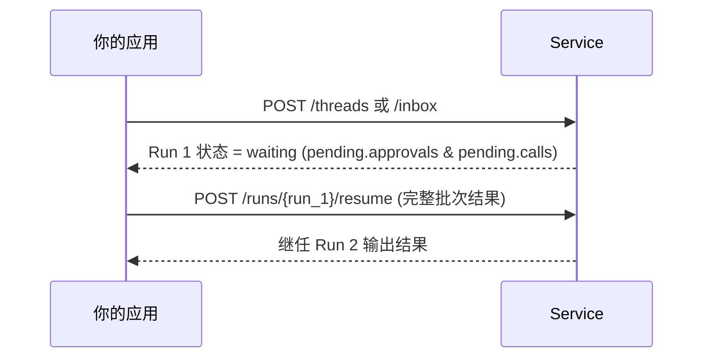

所有执行 API 均位于 `/api/v1` 下，使用[工作区 API 密钥](http.md#authentication)鉴权（查看需 `read`，运行/引导/中断需 `run`，修改智能体需 `write`）。如需可直接运行的 Shell 示例，请参阅[接入应用](connect-application.md#direct-http-integration)。

- **智能体版本（Agent revision）：** 不可变的版本化配置（`ap_...` + 版本号）。
- **会话与线程（Session & Thread）：** 线程承载单条对话历史；会话归组相关线程（分叉线程与异步子线程）。
- **运行（Run）：** 针对线程收件箱消息的一次已受理执行推进。

## 智能体

在 Console（**Agents → Create manually**）或调用 `POST /api/v1/agents`（填入 `GET /api/v1/models` 中的模型 `key`）创建智能体：

```json
{
  "name": "Support",
  "config": {"model": "your-model-key", "instructions": "Answer product questions precisely."}
}
```

每次修改配置（携带 `If-Match` 调用 `POST /api/v1/agents/{agent_id}/revisions` 传入 `{config, note?, make_default?}`）都会生成新的不可变版本号；未显式锁定版本的后续运行默认使用最新默认版本，已受理运行保持原版本。可通过 `POST /api/v1/agents/validate` 校验草稿。

<span id="set-approvals-and-automatic-review"></span> <span id="configuration-fields"></span> <span id="context-compaction"></span> <span id="tool-permissions"></span> <span id="client-tools-and-questions"></span> <span id="subagents"></span>

- [配置智能体](agent-configuration.md)

## 发起对话

携带唯一的 `Idempotency-Key` 调用 `POST /api/v1/threads` 创建线程（省略 `session_id` 时自动新建会话）并投递首条收件箱消息。保存响应中的 `{thread.id, thread.session_id, entry.id}`，跟进 `entry.assigned_run_id`（见[流式监听与读取结果](stream-and-read-results.md#results)）。

可通过 `/sessions`、`/threads` 与 `/runs` 上的 `?text_query=...` 检索历史对话文本。

## 提交消息

向 `POST /api/v1/threads/{thread_id}/inbox` 发送 `agent_id`、`payload`、可选 `delivery` 与新的 `Idempotency-Key` 继续对话：

- **`delivery: "steer"`（默认）：** 在下一个模型边界并入兼容的活动运行（若线程空闲则直接启动新运行）。
- **`delivery: "next_run"`：** 在收件箱排队，等待当前运行结束后单独启动新运行。

携带线程 `If-Match` 可对 `pending` 消息执行 `PATCH` / `DELETE /api/v1/threads/{thread_id}/inbox/{entry_id}` 或 `PUT .../inbox/order` 调整顺序。通过 `options` 传递单次运行限额或覆盖项：

```json
{"options": {"max_usage": {"requests": 40}, "overrides": {"instructions": "Answer in German."}}}
```

<span id="caller-headers"></span> <span id="command-environment-variables"></span> <span id="retained-tool-executions"></span>

历史导入、调用方请求头与执行策略详见[高级执行选项](execution-options.md)。

### 附加文件

单个 `payload` 支持 1–32 个片段（`text`、已上传的[工作区资产 `asset`](files-and-webhooks.md#assets)、HTTP(S) URL 或 JSON）：

```json
{"content": [{"type": "text", "text": "Summarize this report."}, {"type": "asset", "asset_id": "ast_..."}]}
```

当模型声明对应多模态能力时原生发送媒体，64 KiB 以内文本直接内联，其余文件写入挂载环境 `/workspace/.a13n/attachments/` 并向模型提供路径。

## 等待、审批与提问

当运行需要人工审批（`pending.approvals`）或客户端工具 / `ask_user_question` 回复（`pending.calls`）时，运行会以 `waiting` 状态封存。



### 恢复等待中的运行

携带新的 `Idempotency-Key` 向 `POST /api/v1/runs/{run_id}/resume` 同时提交完整覆盖所有待处理 ID 的 `approvals` 与 `calls`（以及可选补充 `input`），Service 会创建新的继任运行并保留原 `waiting` 记录供审计：

```json
{
  "approvals": {"call_delete": {"action": "deny", "reason": "Keep the file"}},
  "calls": {
    "call_question": {
      "status": "returned",
      "value": {"answers": {"Which color?": "blue"}}
    }
  }
}
```

审批取值为 `{"action": "approve"}` 或 `{"action": "deny", "reason": "..."}`；调用结果为 `{"status": "returned", "value": ...}` 或 `{"status": "failed", "message": "..."}`。

## 中断、分叉与归档

| 目标                       | 端点                                                            |
| -------------------------- | --------------------------------------------------------------- |
| 停止活动或排队中的运行     | `POST /api/v1/runs/{run_id}/interrupt`                          |
| 从已结束的运行分叉出新线程 | `POST /api/v1/runs/{run_id}/fork`（可选 `fresh_environments`）  |
| 永久归档关闭线程           | `POST /api/v1/threads/{thread_id}/archive`（需携带 `If-Match`） |

<span id="follow-a-session-stream"></span> <span id="traces"></span> <span id="find-and-improve-execution-issues"></span> <span id="configure-plugins-in-console"></span>

- [流式监听与读取结果](stream-and-read-results.md)
- [检查运行记录并优化智能体](inspect-runs.md)
