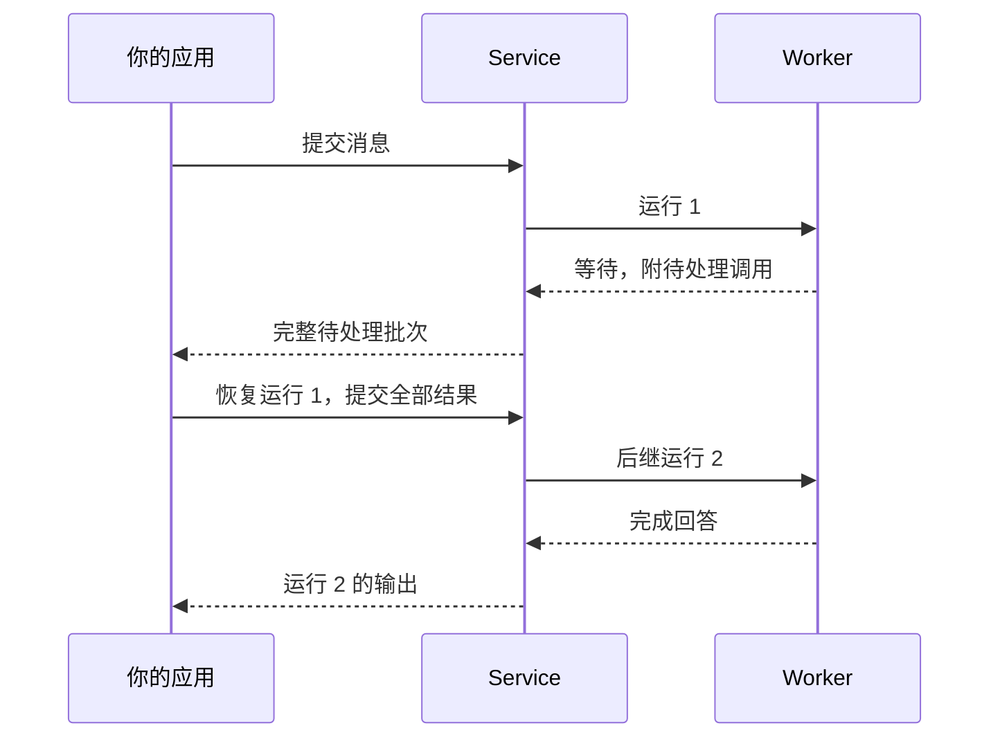

先用一个 agent 完成一段对话：保存配置、发送消息，再跟踪运行，直到它完成或请求输入。后续消息发送到同一线程，继续已有历史。

主线是[创建 agent](#agents) → [开始对话](#start-a-conversation) → [读取结果](stream-and-read-results.md#results) → [回应等待](#resume-a-waiting-run)或[发送下一条消息](#submit-a-message)。需要包含凭据和响应 ID 的完整 Shell 流程时，参阅[连接应用](connect-application.md#direct-http-integration)。

**Agent 修订版本**保存配置。**线程**保存一段持续推进的对话历史；**会话**组织相关线程，包括分叉和异步子线程。每次被接受的推进是一次**运行**。Worker 通过一次或多次**执行尝试**完成运行，因此故障恢复不必创建新运行。

下文 API 路径均以 `/api/v1` 开头。使用目标[工作空间](http.md#authentication)的密钥。读取需要 `read`，执行和停止需要 `run`，修改 agent 需要 `write`；参阅[角色](identity.md#roles)。

## Agent

1. 在 Console 打开 **Agents → 手动创建**。
2. 选择已验证可用的工作空间模型，编写任务指令。
3. 保存 agent，再用**试用 Agent**发送一条简短测试消息。
4. 检查完成的回答，再添加工具、环境或委派能力。

对应 API 是携带名称和配置的 `POST /agents`。将 `your-model-key` 替换为 `GET /models` 返回的模型 key：

```json
{
  "name": "Support",
  "config": {"model": "your-model-key", "instructions": "Answer product questions precisely."}
}
```

保留响应的 `id`（`ap_…`）用于提交消息。Agent 使用 ID 引用，模型使用 key。

配置变更创建不可变的编号修订版本。**版本 → 设为默认版本**选择后续未固定版本的运行所使用的配置，包括已有对话中的新运行。已接受的运行保留原有配置。**手动创建**菜单中的**导入 YAML**和**导出 Agent**用于迁移配置；需要在目标工作空间匹配引用资源。

通过 API 修改时，`POST /agents/{agent_id}/revisions` 接收 `{config, note?, make_default?}` 和 agent 的 `If-Match`。除非 `make_default` 为 false，新版本会成为默认版本。提交与当前默认版本相同的 config 会返回该版本，不另建版本。用 `POST /agents/validate` 检查草稿，或用 `POST /agents/{agent_id}/revisions/{revision_id}/set-default` 选择版本。元数据编辑、复制和归档端点见 [API 参考](api-reference/index.md)。

归档 agent 会阻止新运行，已接受的运行继续完成。内置 Agent Composer 和 Finding Agent 允许修改模型设置及补充指令，其余配置受保护。官方指令由当前 worker 在每次尝试时提供。需要自由配置时，将内置 agent 复制为自定义 agent。

### Agent 配置

<span id="set-approvals-and-automatic-review"></span> <span id="configuration-fields"></span> <span id="context-compaction"></span> <span id="tool-permissions"></span> <span id="client-tools-and-questions"></span> <span id="subagents"></span>

- [配置 agent](agent-configuration.md)

## 开始对话

在 Console 选择**会话 → 新建会话**，或在 agent 页选择**试用 Agent**。API 的 `POST /threads` 创建线程和第一条收件箱消息。省略 `session_id` 会同时创建会话；提供它则向已有会话添加线程。

为这次逻辑提交发送唯一的 `Idempotency-Key`。响应丢失后重试时，保留相同 key 和请求体。[HTTP 流程](connect-application.md#direct-http-integration)演示了保存回执和提取 ID。

响应为 `{thread, entry, run}`：首次提交返回 `201`，重放返回 `200`。即使 `run` 为 null，也要保存线程 ID、其会话 ID 和条目 ID。条目出现 `assigned_run_id` 后，跟踪该运行。分配可能早于实际纳入；只有条目已由该运行 `consumed`，该运行的完成结果才是这条消息的回答。

新线程请求还可设置[环境挂载](environments.md#mount-environments-on-a-thread)、[记忆挂载](standalone-memory.md#mount-a-memory-on-a-thread)、[调用方请求头](execution-options.md#caller-headers)和[导入历史](execution-options.md#import-conversation-context)。按对话需要添加。

查找已有工作时，列出会话或线程。`/sessions`、`/threads` 和 `/runs` 的 `text_query` 要求全部词在同一运行保留的用户及助手文本中命中，支持中文词和代码标识符。搜索不含工具、推理、附件和导入历史。索引保存有界摘录，而非全部原消息；参阅[设置参考](configuration-reference.md)的 `run_search`。会话 `q` 用于查询会话或线程 ID。会话列表按最近活动排序。

### 导入对话上下文

- [高级执行选项](execution-options.md)

## 提交消息

通过 `POST /threads/{thread_id}/inbox` 继续对话。携新幂等 key 发送 `agent_id`、`payload` 和所需运行选项。响应与创建线程使用相同回执结构。

按目的选择投递方式：

- `steer` 为默认值。兼容消息在模型边界加入活跃运行：同一 agent、未固定版本或版本相同，提供的选项也须匹配。省略选项时保留活跃运行的设置。
- `next_run` 等待独立运行。消息需要自己的配置，或应在当前任务之后执行时，使用此方式。

线程空闲且可接受运行时，两种方式都可启动运行。排队消息按收件箱顺序推进。`waiting` 运行必须先显式恢复。运行失败或取消后，排队消息暂停，直到新提交的消息启动下一运行；该运行之后恢复正常队列处理。

需要指定修订版本时，固定 `agent_revision_id`。否则新运行在被接受时选择 agent 默认版本。配置已无法执行的条目会原地失败，不阻塞后续条目。归档工作空间会拒绝排队工作，并在 worker 下一次权限检查时撤销执行中的权限。

### 附件

Payload 包含 1–32 个部分，可使用文本、已上传的工作空间资产、HTTP(S) URL 或 JSON：

```json
{"content": [{"type": "text", "text": "Summarize this report."}, {"type": "asset", "asset_id": "ast_..."}]}
```

先上传文件，再将 `ast_...` 替换为[资产 ID](files-and-webhooks.md#assets)。Service 按[出站策略](configuration.md#outbound-requests)获取 URL 部分。

Service 为每个文件选择传递方式：

1. 模型声明对应理解能力时，原生发送支持的图片、音频、视频或 PDF。
2. 将支持的、最多 64 KiB 的文本文件直接作为文本提供。没有环境时，更长的 URL 文本截取此前缀，并说明已截断。
3. 将其他文件写入主 `workspace` 环境的 `/workspace/.a13n/attachments/`，把路径告知模型，再由工具读取或处理。

三种方式都不可用时，提供环境或选择理解该媒体的模型，以解决 `environment_required`。URL 的适用性在获取后检查；不可用 URL 会使其条目失败。落地文件属于该环境，替换环境或使用新环境分叉不会复制这些文件。

### 管理排队消息

读取 `GET /threads/{thread_id}/inbox` 或 `GET /threads/{thread_id}/inbox/{entry_id}`。条目状态为 `pending`、`assigned`、`consumed`、`failed` 和 `withdrawn`。`consumed` 记录输入已纳入提交的执行状态；成功或失败要另读运行。

修改 pending 条目时，使用线程的 `If-Match`：

- `PATCH /threads/{thread_id}/inbox/{entry_id}` 编辑自己消息的投递方式、payload、版本固定或选项。
- `DELETE /threads/{thread_id}/inbox/{entry_id}` 撤回条目，同时保留幂等身份。
- `PUT /threads/{thread_id}/inbox/order` 携带 `{"entry_ids": [...]}`，按目标顺序列出全部 pending 条目。

有 `run` 权限的调用方可以撤回和重排。达到收件箱数量或字节上限时返回 `429 rate_limited`。Console 提供**排队消息**，并将执行期间输入的消息作为 steer 发送。

### 单次运行选项

用 `options` 修改一次运行。例如，下列片段设置请求预算并替换指令：

```json
{"options": {"max_usage": {"requests": 40}, "overrides": {"instructions": "Answer in German."}}}
```

`max_usage.requests` 接受 1–10,000；超出后运行以 `usage_limit_exceeded` 失败。`labels` 标记运行。`overrides` 在提交和接受时校验，然后固定。大多数字段替换修订版本中的值；`toolsets` 替换所提供的各个工具集，`retries` 合并指定字段。`subagents` 整体替换命名和动态设置，null override 表示继承。

Resume 和自动子结果续接保留前一运行的选项。Console 的**运行选项**为下次运行设置参数。工具交还和引导时机见[执行策略](execution-options.md#execution-policy)。

## 请求上下文头

<span id="caller-headers"></span>

- [高级执行选项](execution-options.md)

## 等待、审批与问题

需要外部决定或结果时，运行以 `waiting` 结束。读取 `pending.approvals` 和 `pending.calls` 两组；`wait_reason` 为 `approval`、`call` 或 `multiple`。问题属于 call，工具权限请求属于 approval。



### 恢复等待中的运行

1. 读取确切的等待运行及完整待处理批次。
2. 在应用中收集决定和结果。应用负责部分答案、编辑和审批人协作。
3. 向 `/runs/{run_id}/resume` POST 两个结果映射，为这批回复使用新幂等 key。
4. 跟踪响应返回的后继运行。原运行保持 `waiting`，作为当时暂停的历史记录。

若批次中只有审批 `call_delete`，完整回复可以是：

```json
{"approvals": {"call_delete": {"action": "deny", "reason": "Keep the file"}}, "calls": {}}
```

使用实际返回的 pending ID。审批值为 `{"action":"approve"}` 或 `{"action":"deny","reason":"..."}`。调用结果为 `{"status":"returned","value":...}` 或 `{"status":"failed","message":"..."}`。失败调用结果会成为 agent 可处理的工具失败，不一定导致后继运行失败。

名为 `call_question` 的问题可用自由文本回应：

```json
{"approvals": {}, "calls": {"call_question": {"status": "returned", "value": {"response": "Up to 200 dollars per night."}}}}
```

结构化回答使用 `{"answers":{"Which color?":"blue"}}`，多选用数组，且必须匹配该调用的问题。显式跳过问题时，返回失败调用结果。Console 的**跳过反馈继续**会在确认后提交拒绝和失败结果。

两个映射必须精确覆盖各自的 pending 类别，即使某一组为空也要提供。缺少结果、未知 ID 或类别错误都会拒绝整批请求，等待不变。只能恢复空闲线程的最新等待运行；过期请求返回 `409 conflict`，原因为 `not_idle_waiting_head`。响应丢失时，重放相同请求体和 key 会取得同一后继运行，状态码由 `201` 变为 `200`。

要补充说明或附件，添加与消息 payload 使用相同内容结构的 `input`。它补充而非替代必需结果。模型先收到工具结果，再收到用户输入。完整恢复体最多 256 KiB，原子接受，不创建额外收件箱条目。不可用输入可能使后继运行失败，需要检查该运行结果。

普通收件箱消息不能结束等待。Resume 后，兼容 steer 可加入后继运行，`next_run` 条目继续排队。后继运行失败时，下一条消息从该失败运行继续；先前等待已经解决。

## 中断、分叉与归档

按要保留的历史选择操作：

| 目标                     | 操作                                                   |
| ------------------------ | ------------------------------------------------------ |
| 停止当前工作             | `POST /runs/{run_id}/interrupt`，或 Console **停止**   |
| 从已结束运行探索另一方向 | `POST /runs/{run_id}/fork`，携新消息和幂等 key         |
| 永久关闭线程             | `POST /threads/{thread_id}/archive`，携线程 `If-Match` |

尚未开始的运行立即取消。执行中的运行在安全点停止，此前显示 `cancel_requested_at`。已完成、等待或失败的运行不能中断；中断已取消运行会返回该运行。

分叉在同一会话中创建线程。从等待运行分叉时，新分支拒绝审批并提供无响应结果，原等待不变。除非 `fresh_environments` 为 true，分叉共享源环境挂载。它复制记忆挂载，`environments` 和 `memories` 可添加挂载。分支需要独立文件系统状态时，使用新环境。

失败或取消后，从最后一个检查点继续；若没有保存检查点，则从运行开始时的状态继续。未完成调用显示为已中断，不重新执行。历史本身导致失败时，分叉更早的运行。归档撤回 pending 消息、移除挂载并中断活跃工作，历史仍可读取。

## 执行策略

<span id="command-environment-variables"></span> <span id="retained-tool-executions"></span>

- [高级执行选项](execution-options.md)

## 结果

<span id="follow-a-session-stream"></span>

[读取结果、保存的历史并处理重连](stream-and-read-results.md)。

## 用量

<span id="traces"></span> <span id="find-and-improve-execution-issues"></span> <span id="configure-plugins-in-console"></span>

- [检查运行并改进 agent](inspect-runs.md)
- [配置 agent](agent-configuration.md)
