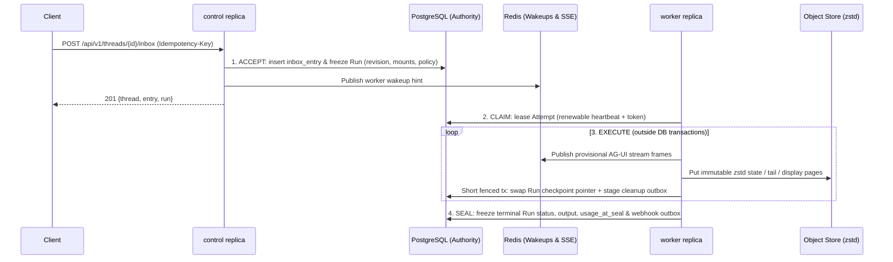

This page explains how `a13n-service` scales multi-tenant agent execution horizontally across stateless `control` replicas and leased `worker` replicas while preserving strict tenant isolation, crash recovery, and zero-long-transaction database discipline. For operational commands and API usage, see [Operate the Service](operations.md) and [Agents, conversations and runs](agents-and-runs.md).

## Four-stage Run state machine (`accept` → `claim` → `execute` → `seal`)

A Service conversation never executes inside an HTTP request handler, and **no PostgreSQL session or transaction is ever held across LLM inference, tool waits, object uploads, or SSE streams**. Every thread advances exclusively through four short, atomic database transitions:

1. **Accept:** Validates caller RBAC (`run` verb) and `(workspace_id, principal_id, request_key)` idempotency, inserts the `inbox_entries` row (`message`, `child_result`, `child_message`, `tool_result`, `browser_handback`, or `desktop_handback`), and—when the thread can start a Run—freezes `agent_revision_id`, `app_activation`, `execution` policy, `RunConfiguration`, and `RequestContext` on the new `runs` row.
2. **Claim:** A `worker` replica claims an eligible Run by creating a numbered `Attempt` row with a renewable lease deadline, leaving the DB connection immediately before constructing `ExecutableAgent`.
3. **Execute:** The worker drives Harness in memory, streams provisional events to Redis, uploads zstd-compressed checkpoint objects to S3 under unique per-attempt random keys, and commits pointer swaps in millisecond PostgreSQL transactions that verify the worker still holds the active Attempt lease.
4. **Seal:** Records the immutable terminal outcome (`completed`, `waiting`, `failed`, or `cancelled`), marks incorporated inbox entries `consumed` (`incorporated_checkpoint_seq`), snapshots `usage_at_seal`, and stages lifecycle webhooks in the transactional Outbox.

## `Run` vs. `Attempt` and zombie-worker fencing

Separating a logical **Run** from its physical worker **Attempts** allows seamless crash takeover without split-brain corruption:

- **Worker crash or preemption:** When a worker dies and its Attempt lease expires, a sweep makes the Run claimable again (`attempts < max_attempts`). A new worker claims `Attempt N+1`, downloads the last committed `runs.checkpoint` from S3, re-supplies any assigned inbox entries or `resume` decisions not yet recorded in `incorporated_checkpoint_seq`, and continues the **same** `run_id` on its originally pinned Agent revision.
- **Pre-upload lease guard & pointer fencing:** An Attempt refuses to start an S3 checkpoint upload if fewer than `objects.timeout` seconds remain on its local lease. Even if a network stall delays a zombie worker's upload, S3 keys are write-once (`orgs/{org}/runs/{run}/state/{attempt}/{128-bit-random}`) so two workers never overwrite the same object key—and the zombie worker's subsequent PostgreSQL pointer transaction is rejected because `runs.current_attempt_id` has already moved to the successor Attempt.

## Owner-driven object storage and isolated cleanup pools

Service maintains **no mutable object-catalog table** and uses plain unconditional S3 `PUT`s: an object is reachable if and only if it is referenced by a Run's committed `checkpoint`, `tail`, display `pages` catalog, or `compactions` row:

| Object prefix                                              | Contents                                                                 | Reclamation trigger                                                                |
| ---------------------------------------------------------- | ------------------------------------------------------------------------ | ---------------------------------------------------------------------------------- |
| `orgs/{org}/runs/{run}/state/{attempt}/{random}`           | Compressed `HarnessState` (with `a13n.usage` stripped)                   | Replaced state/tail keys staged in `checkpoint_cleanup` outbox on pointer swap     |
| `orgs/{org}/runs/{run}/tail/{attempt}/{random}` & `pages/` | Live display tail and sealed paginated AG-UI transcript pages            | Superseded/orphan attempt keys swept on Attempt takeover and final Run seal        |
| `orgs/{org}/runs/{run}/contents/` & `subagents/`           | Offloaded large binary parts and finished inline subagent checkpoints    | Retained in the sealed Run's frozen keep-set so later forks and continuations work |
| `compactions/{workspace}/{hash}/{kind}.json`               | Self-contained hydrated background compaction inputs and summary results | Cleaned via `checkpoint_cleanup` once `disposition` settles and leases expire      |

On S3 deployments, `control` / `all` replicas allocate a dedicated connection pool (`objects.cleanup_max_pool_connections`, default `4`) separate from foreground read connections (`objects.max_pool_connections`, default `32`) so heavy prefix-scan garbage collection can never starve user API reads.

## Dual-plane observation, monotonic delta usage, and full-text search

Service strictly separates **immutable database facts** (enforced by PostgreSQL `BEFORE UPDATE/DELETE` triggers on `audit_events`, `agent_revisions`, `skill_revisions`, `uploads`, `usage_records`, and sealed `runs`) from **derived real-time projections**:

- **Provisional Redis session streams vs. canonical display pages:** `GET /api/v1/sessions/{id}/stream` tails Redis Streams for instant token streaming across any `control` replica. Reconnecting clients and Console Debug views read committed display pages + tail pointers from PostgreSQL/S3, ensuring clean convergence even if Redis restarts.
- **Reservation-backed `model_dispatches` & delta `usage_records`:** Before each LLM call, the worker records a `model_dispatches(call_id, ...)` reservation against `max_usage.requests` in a short transaction. Usage deltas ingest monotonically per single-writer scope (`after_sequence <= stored_sequence`) with dispatch-time `price_snapshot` locked in—and late usage reports from an expired Attempt are still recorded without allowing that Attempt to mutate checkpoints!
- **Zero-extension Jieba `tsvector` Run search:** `text_query` filtering on `/sessions`, `/threads`, and `/runs` uses an internal GIN-indexed PostgreSQL `tsvector` column (`runs.search_vector`) populated in Python outside DB sessions using a pinned deterministic `jieba` tokenizer (with identifier camelCase/snake_case splitting and bounded 8 KiB user / 16 KiB assistant head+tail excerpts, capped at a 512 KiB vector budget via FIFO intermediate-turn eviction)—requiring zero custom PostgreSQL C extensions.
