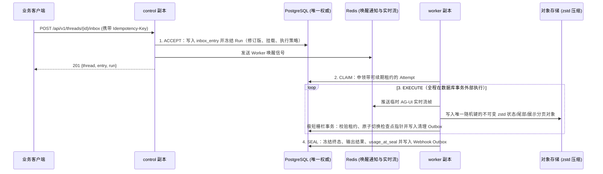

本文解析 `a13n-service` 如何在无状态 `control` 副本与带租约的 `worker` 副本之间实现多租户水平扩展与崩溃接管，并将数据库事务严格收敛在毫秒级原子状态跃迁之内。日常运维与接口调用请先参阅[运维 Service](operations.md)及[智能体、会话与运行](agents-and-runs.md)。

## 四阶段运行状态机（`accept` → `claim` → `execute` → `seal`）

Service 的智能体执行在独立的带租约 `worker` 副本上异步推进，将模型推理、工具等待、对象存储上传与 SSE 流推送置于数据库事务外部，仅通过四个毫秒级原子数据库跃迁推进线程状态：

1. **受理（Accept）：** 校验调用方 RBAC（`run` 权限）与 `(workspace_id, principal_id, request_key)` 幂等键，写入 `inbox_entries`（支持 `message`、`child_result`、`child_message`、`tool_result`、`browser_handback`、`desktop_handback`），并在满足启动条件时创建 `runs` 行，一次性冻结 `agent_revision_id`、`app_activation`、`execution` 策略、`RunConfiguration` 与业务请求头 `RequestContext`。
2. **认领（Claim）：** `worker` 副本通过短事务创建递增编号的 `Attempt` 记录并获取租约令牌，在构造 `ExecutableAgent` 前立即归还数据库连接。
3. **执行（Execute）：** Worker 在内存中驱动 Harness，向 Redis 推送低延迟实时帧，将 zstd 压缩后的检查点上传到 S3 唯一随机键，再通过带租约校验的短事务原子切换 PostgreSQL 指针。
4. **封存（Seal）：** 冻结终态（`completed`、`waiting`、`failed` 或 `cancelled`），将已纳入检查点的收件箱条目标记为 `consumed`（记录 `incorporated_checkpoint_seq`），定格 `usage_at_seal`，并在同一事务内将生命周期 Webhook 写入持久化发件箱（Outbox）。

## `Run` 与 `Attempt` 分离及僵尸 Worker 栅栏（Fencing）

将逻辑 **Run**（运行）与物理 **Attempt**（执行尝试）解耦，使节点崩溃接管天然避免脑裂（Split-brain）覆盖：

- **节点崩溃后的确定性续跑：** 当某个 Worker 因 OOM 或节点抢占失联且租约到期后，后台巡检会将该 Run 重新置为可认领状态（`attempts < max_attempts`）。新 Worker 认领 `Attempt N+1` 后，从 S3 拉取最近一次已提交的 `runs.checkpoint`，自动补齐尚未写入 `incorporated_checkpoint_seq` 的已分配收件箱条目或 `resume` 审批结果，在**同一个** `run_id` 和原锁定的智能体修订版上无缝续跑。
- **上传前租约余量守卫与指针栅栏：** 若本地租约剩余有效期不足 `objects.timeout`，Attempt 会在发起 S3 上传前主动放弃。即便旧 Worker 因网络延迟写完了 S3 对象，每个对象键均包含 `orgs/{org}/runs/{run}/state/{attempt}/{128位随机数}`，各 Worker 写入互不重叠的独立键；同时旧 Worker 随后发起的 PostgreSQL 指针切换事务会因 `runs.current_attempt_id` 已推进至新 Attempt 而被数据库拒绝。

## 所有者驱动的对象存储与独立清理连接池

Service 直接使用无条件 S3 `PUT`，无需维护中心化可变对象目录表：一个对象当且仅当被已提交的 `checkpoint`、`tail`、展示分页目录或 `compactions` 行引用时才视为可达：

| 对象键前缀                                                  | 存储内容                                                         | 异步回收机制                                                                  |
| ----------------------------------------------------------- | ---------------------------------------------------------------- | ----------------------------------------------------------------------------- |
| `orgs/{org}/runs/{run}/state/{attempt}/{random}`            | zstd 压缩的 `HarnessState`（剥离 `a13n.usage` 由数据库独立记账） | 每次切换检查点指针时，在同一事务内将旧键写入 `checkpoint_cleanup` Outbox      |
| `orgs/{org}/runs/{run}/tail/{attempt}/{random}` 与 `pages/` | 活跃展示尾部及已封存的 AG-UI 对话历史分页                        | 在新 Attempt 接管及最终 Seal 时按保留集扫描前缀，清理废弃或失败尝试遗留的对象 |
| `orgs/{org}/runs/{run}/contents/` 与 `subagents/`           | 卸载的大体积二进制内容与已完成的内联子智能体状态                 | 永久保留在已封存 Run 的冻结保留集中，确保后续续聊与分支 `fork` 随时可读       |
| `compactions/{workspace}/{hash}/{kind}.json`                | 自包含的后台异步历史压缩输入与摘要结果载荷                       | 在 `disposition` 落定且租约窗口结束后通过 `checkpoint_cleanup` 幂等清理       |

在 S3 部署模式下，`control` / `all` 副本为 `checkpoint_cleanup` 分配独立的客户端连接池（`objects.cleanup_max_pool_connections`，默认 `4`），与前台读取连接池（`objects.max_pool_connections`，默认 `32`）隔离，使大批量前缀扫描删除不影响前台用户读取容量。

## 双平面观测、单调增量记账与免扩展全文检索

Service 通过数据库触发器（`BEFORE UPDATE/DELETE`）将 `audit_events`、`agent_revisions`、`skill_revisions`、`uploads`、`usage_records` 与已封存 `runs` 固化为**不可变事实**，并与派生实时视图严格解耦：

- **Redis 临时会话流与规范分页历史：** `GET /api/v1/sessions/{id}/stream` 订阅 Redis Streams 实现跨 `control` 副本的低延迟流式输出；而断线重连与调试面板则直接读取 PostgreSQL/S3 已提交的分页与尾部对象，即使 Redis 重启也不会丢失任何已提交历史。
- **预留占位的 `model_dispatches` 与单调增量 `usage_records`：** 每次发起模型请求前，Worker 先通过短事务写入 `model_dispatches(call_id, ...)` 预占 `max_usage.requests` 配额。用量增量按单写者作用域游标单调合入（`after_sequence <= stored_sequence`），并锁定派发时刻的价格快照 `price_snapshot`。即便已过期的旧 Attempt 迟到了用量上报，系统仍会如实入账，同时禁止其篡改检查点或封存结果（新接管的 Attempt 开启独立新作用域，杜绝相互覆盖）。
- **零数据库扩展的 Jieba `tsvector` 全文检索：** `/sessions`、`/threads` 与 `/runs` 上的 `text_query` 检索基于内置 GIN 索引列 `runs.search_vector` 实现。分词在数据库事务外部使用锁定词典的 `jieba`（结合驼峰/下划线标识符切分及用户 8 KiB / 助手 16 KiB 首尾摘要预算，总向量超 512 KiB 时按 FIFO 淘汰早期中间轮次）预先算好，随展示指针原子提交，无需安装任何第三方 PostgreSQL C 语言分词插件。
