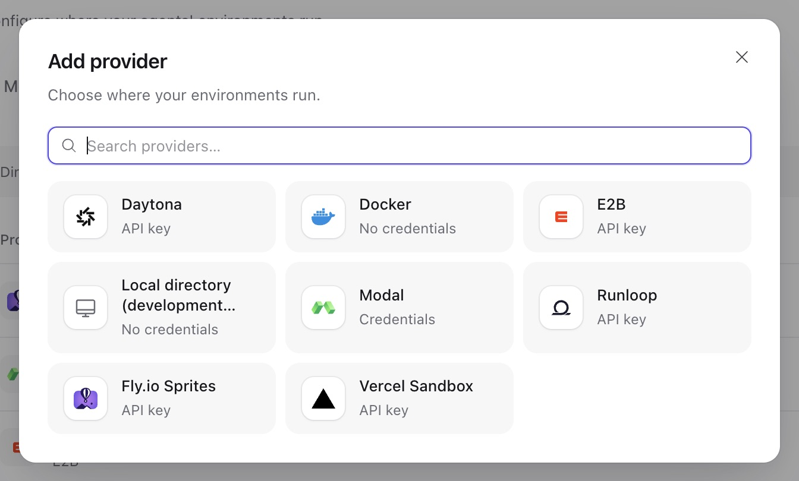

Give an agent an environment when its task needs files, commands or a desktop. Start with one template and one thread: ask the agent to write a file, then read it in a follow-up message. That checks both execution and file reuse.

Three resources connect the workflow:

| Resource     | What you choose                                         | Result                             |
| ------------ | ------------------------------------------------------- | ---------------------------------- |
| Provider     | A Docker engine or cloud account                        | Service can manage resources there |
| Template     | Image, resources, environment variables and idle policy | A recipe for new managed instances |
| Thread mount | An instance, name, directory and permissions            | Later runs can use that instance   |

For a computer you already operate, [register its Envd endpoint](#register-an-external-target) instead. Service connects to that computer; you own its lifecycle. Every accepted run captures its mounts and permissions, so changes apply to later runs.

## Workspace provisioning

Check **Environments → Templates** before creating anything. The single-host Compose deployment with a Docker socket prepares a **Docker** provider and **Linux Sandbox** template when the Engine is reachable. Select that template for the first file task. Its image includes Python, Node.js, Git and common development tools; commands run as `sandbox`, with writable `/workspace` and `/tmp/a13n`.

The socket-free quickstart has no automatic Docker setup. For source development, `make dev` enables **Local** and creates a **Local Workspace** template under the checkout's `var/dev/environments`. Each instance gets its own subdirectory. Local commands run directly as the Service process's operating-system user, without isolation.

Generic Service settings leave both provisioning options off. To enable them or use a locally built image, follow [workspace provisioning configuration](workspace-provisioning.md#workspace-provisioning). The `all` role prepares missing defaults at workspace creation and startup. If setup fails, repair Engine access and restart. Successful provisioning preserves subsequent template edits, disabling and deletion. It creates configuration resources; an instance is allocated when requested.

## Providers

Add or edit an environment provider under **Workspace settings → Providers → Environment**. You need workspace `write` permission and access to the selected engine or cloud account. A template's **Manage providers** action opens the same list while preserving its draft.

1. Choose the runtime and enter its account settings and credentials.
2. Save the provider and leave it enabled.
3. For Docker, test the connection. This pings the Engine; creating an instance verifies image and execution setup.
4. Select the provider when creating a template.



The [provider guide](../environments/providers.md) covers Docker, E2B, Daytona, Modal, Vercel, Sprites, Runloop and Local setup. The [configuration reference](../environments/configuration-reference.md) owns their recipe fields. API clients create providers at `/api/v1/environment-providers` and obtain type schemas from `GET /api/v1/provider-types/environment`.

Docker defaults to the operator's `environments.docker_host`. A provider-specific address must be a remote TCP or HTTPS Engine permitted by the [outbound policy](configuration.md#outbound-requests). Engine access grants host-level authority. Host bind sources must be under `environments.docker_mount_roots`, which permits none by default; privileged containers and host namespaces are unavailable.

Cloud instances use the saved account and are billed there. Configure idle stop or deletion to bound their lifetime. Service renews supported ready sandboxes, but vendor hard limits still apply. A stopped instance can resume with its retained files; a lost instance requires recovery or replacement. Sprites has no explicit stop operation, so use idle deletion when needed.

When editing a provider, an omitted credential stays unchanged; a new value replaces it and `null` removes it. Retained template or instance references block provider deletion. Deleting an unused provider removes its saved configuration and credentials, not the underlying engine or cloud account.

## Templates

Create the first workspace through Console:

1. Open **Environments → Templates → Create template**. Name it **Python sandbox**.
2. Choose Docker and an enabled provider. Set the resource limits and idle policy, then save. Saving a template starts no container.
3. Edit an agent that already has a working model. Enable its **Files** and **Shell** toolsets, select this default environment template, and save the agent configuration.
4. Start a new conversation. Ask: “Write `hello.txt` in the workspace with the text `Hello from Service`, then read it back.” Inspect the tool results.
5. Send a follow-up asking the agent to read the same file. It should use the same thread workspace.

The agent field is `default_environment_template_id`. On acceptance of a root-thread run without a `workspace` mount, Service reserves an instance and mounts it as `workspace`. A `reserved` instance has an ID but no vendor resource yet. First use prepares it. Reservations count toward the managed-environment quota.

For API setup, use the URL and workspace API key from [direct HTTP integration](connect-application.md#direct-http-integration). Replace `eprov_...` with your Docker provider ID. Creating or editing a template requires `write`:

```sh
curl -sS -X POST "$A13N_URL/api/v1/environment-templates" \
  -H "Authorization: Bearer $A13N_API_KEY" \
  -H "Content-Type: application/json" \
  -d '{"name":"Python sandbox","provider_id":"eprov_...",
       "config":{"recipe":{"cpus":2,"memory_gb":4},
                 "stop_after_seconds":1800,"delete_after_seconds":604800}}'
```

Save the returned template ID. This example stops idle instances after 30 minutes and deletes them after seven days. Both timers count from last use; `null` disables the corresponding policy. Idle deletion removes thread mounts and the instance's files. A thread with a default template can receive a new workspace on its next run.

Template updates use the template's ETag in `If-Match`. The recipe freezes when creation is first claimed, so edit it before that point or create a new instance. Idle policies apply immediately to existing instances. Disabling a template blocks new reservations and first creation of still-reserved instances; already-created instances keep working.

### Default environment variables

In the template's **Environment variables**, add ordinary command defaults such as `APP_MODE=agent`. The API location is `config.recipe.environment`:

```json
{"environment":{"APP_MODE":"agent","TOOL_ENDPOINT":"https://tools.example.com"}}
```

This is a recipe fragment. Commands and their child processes receive these values. [Execution policy](execution-options.md#execution-policy) and explicit command values can override them without changing the shared instance. Local also requires the names in `allowed_environment_keys`, unless that allowlist is unrestricted.

Use portable names and string values. Keep secrets in their credential or secret-binding controls: template variables are readable configuration. Platform bootstrap, desktop and telemetry names are reserved. Defaults freeze with the instance recipe; stop/start preserves them. Create a new instance to apply changed template defaults.

### Docker image versions

With `recipe.image` omitted, Service selects its reviewed `ghcr.io/converge-ai-labs/a13n-sandbox` image:

| Service build                                         | Image tag |
| ----------------------------------------------------- | --------- |
| Stable or RC                                          | `0.5.1`   |
| Source (`0.0.0`, including local suffixes) or `.devN` | `dev`     |

Sandbox versions belong to Envd and are independent of Service versions. Set an explicit tag or digest to choose another image. `pull_policy: if_missing` uses the Engine's local image or pulls it at first creation; `never` requires the image to be present. Provisioned templates save an explicit image, so upgrades preserve that choice.

Instances retain their resolved image across retries and upgrades. Recreate an instance to use a new image. Legacy handles without a saved image keep `ghcr.io/converge-ai-labs/a13n-docker-environment:dev`; recreate those instances before removing the old image.

## Instances

Open **Environments → Instances** to inspect creation and use. API clients use `GET /api/v1/environments`, or fetch one instance by ID. Deleted records appear in listings only with `status=deleted`.

| Status                 | What to do                                               |
| ---------------------- | -------------------------------------------------------- |
| `reserved`             | Use it in a run to trigger preparation                   |
| `creating`, `starting` | Wait for readiness; inspect a reported failure           |
| `ready`                | Mount it and run the task                                |
| `stopping`, `stopped`  | Wait for stopping to finish; a later run starts it again |
| `deleting`, `deleted`  | Select another instance                                  |

A failure reports its code, message and whether the operation outcome is known. Service reconciles unfinished operations using their existing identity. For `provider_credential_changed`, restore access to the instance's original account. For a permanent failure such as `environment_lost`, repair the cause where possible or delete the failed instance and create another.

### Reserve a managed environment

Create an instance explicitly when you want to inspect it before a task or share it across threads. Replace the template placeholder:

```sh
curl -sS -X POST "$A13N_URL/api/v1/environments" \
  -H "Authorization: Bearer $A13N_API_KEY" \
  -H "Content-Type: application/json" \
  -d '{"template_id":"envtpl_...","name":"Shared data"}'
```

This operation requires `run` and starts creation immediately: the response is `creating`, followed by `ready` in the background. Save its `id` as `ENVIRONMENT`, inspect `GET /api/v1/environments/$ENVIRONMENT`, then mount it below. This differs from the lazy reservation made at run acceptance. Both count toward `environments.managed_count`; exceeding that limit returns `409 conflict` with reason `environment_limit`.

### Register an external target

1. Run an [HTTP Envd daemon](../environments/remote-envd.md#connect-to-an-existing-http-daemon) on the target computer with a stable device ID and token.
2. Make its endpoint reachable from Service workers and allow it in the outbound policy. Plain HTTP is accepted only on loopback; use HTTPS elsewhere.
3. Register its origin and token with workspace `write` permission:

```sh
curl -sS -X POST "$A13N_URL/api/v1/environments" \
  -H "Authorization: Bearer $A13N_API_KEY" \
  -H "Content-Type: application/json" \
  -d '{"endpoint":"https://build-box.example.com:8443","token":"YOUR_ENVD_TOKEN","name":"Build box"}'
```

Service verifies the device, stores the token encrypted, and returns a `ready` instance. Mount it as the registering user or service account: external targets are private to that principal for execution. The owner or a workspace administrator can manage the registration.

To rotate the token or move the endpoint, `PATCH /api/v1/environments/{id}` with the environment's ETag. Include the token when changing the endpoint. Service verifies that the new connection reaches the same device; another device is refused with `provider_device_mismatch`. Deleting the registration forgets its token and leaves the computer running.

Worker recovery makes a best-effort attempt to reuse a checkpointed Envd Session. A closed or expired Session requires a fresh one. Recovery does not restore run-local process references or output observations; inspect current state before retrying an uncertain command. Normal cleanup closes the Session, and later runs use separate Sessions.

### Stop, rename and delete

Read the environment first and send its ETag in `If-Match`. These operations require `write`:

| Operation                                                    | Result                                                         |
| ------------------------------------------------------------ | -------------------------------------------------------------- |
| `PATCH /api/v1/environments/{id}` with `{"name":"New name"}` | Rename the instance                                            |
| `POST /api/v1/environments/{id}/stop`                        | Stop a supported, ready managed instance while retaining files |
| `DELETE /api/v1/environments/{id}`                           | Destroy a managed instance, or forget an external registration |

Finish active runs and desktop control before stopping or deleting. For deletion, also remove thread mounts. A permanently failed instance is the exception: deletion removes its mounts too. Unsettled operations can block deletion with `operation_unresolved`. Removing a mount alone preserves the instance; deleting a managed instance destroys its files.

## Mount environments on a thread

Use a mount to attach the instance to an existing open thread:

1. Set `THREAD` to the thread ID and `ENVIRONMENT` to the instance ID.
2. Read `GET /api/v1/threads/$THREAD/environments` and save its response ETag as `THREAD_ETAG`, including the quotes.
3. Add the mount. Omit `working_directory` to use the provider's default directory:

```sh
curl -sS -X POST "$A13N_URL/api/v1/threads/$THREAD/environments" \
  -H "Authorization: Bearer $A13N_API_KEY" \
  -H "Content-Type: application/json" -H "If-Match: $THREAD_ETAG" \
  -d "{\"name\":\"data\",\"environment_id\":\"$ENVIRONMENT\"}"
```

4. Send a new message asking the agent to list files on `data`. Inspect the selected mount in the tool call. Earlier accepted runs keep their previous mounts.

Mount edits require `run` and the **thread's** ETag. `workspace` appears at `/workspace`; named mounts such as `data` appear at `/mnt/data`. Each thread can mount an instance and a name only once. Remove a mount with `DELETE /api/v1/threads/{thread_id}/environments/{name}` before replacing it. Several threads can share one instance and its files concurrently.

The default mount is `workspace`, or the sole user mount when there is no `workspace`. Multiple named mounts without `workspace` have no default. Before the first model request, Service reads an available default-directory `AGENTS.md` and lists nearby guidance and skill directories for on-demand inspection. This can activate the default mount before a tool call. Attachments and environment-backed skills can also trigger preparation.

`lazy_environment` defaults to `true`. First use creates a reserved instance or starts a stopped one, waiting up to `environments.wait_seconds`. Set it to `false` to prepare every mounted instance before execution; execution connections still open on first dependent use. Override it for one message with:

```json
{"options":{"overrides":{"lazy_environment":false}}}
```

Retries and continuations retain the accepted choice. Forks share mounts unless `fresh_environments` is selected; archiving removes the thread's mounts. Async [subagents](agent-configuration.md#subagents) use their edge's `shared`, `dedicated` or no-environment policy. Inline children share the parent's environment.

### Reuse an instance with a project directory

In a new conversation's **Options**, choose **Reuse existing** and enter an optional **Working directory**. For an existing conversation, use **Environments and memory → Add environment**. Leave the directory empty for the provider default.

Choose an existing path inside the environment. For Local, `/projects/app` means `{template root}/{environment ID}/projects/app`, not a browser-computer path. Service checks the directory on activation and reports missing or inaccessible paths without creating them. The API field is `working_directory` on mount creation.

Relative files, the mount route and command cwd use that directory. Two threads can organize work in different directories on the same instance, but still share processes, ports, installed software and operating-system permissions. For isolation, choose an isolated backend and give each task its own instance.

## Computer Use

<span id="create-a-docker-desktop"></span> <span id="automatic-vercel-desktops"></span> <span id="enable-observation-and-interaction"></span> <span id="computer-coordinate-mode"></span> <span id="desktop-access-prerequisites"></span> <span id="get-and-return-desktop-control"></span> <span id="upgrade-desktop-control"></span> <span id="automatic-sprites-desktops"></span>

- [Work with a desktop](computer-use.md)
