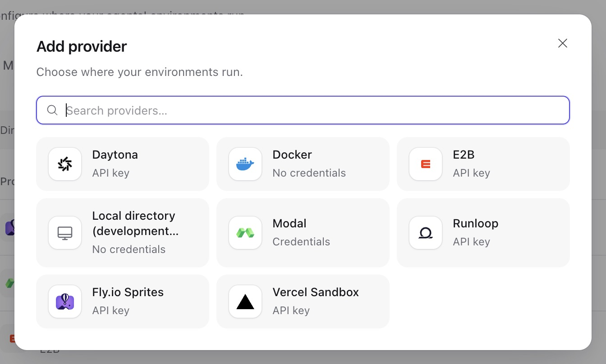

Give an agent an environment when a task needs files, shell commands, or a desktop.

Four concepts connect the workflow:

| Concept      | What you configure                                       | Result                               |
| ------------ | -------------------------------------------------------- | ------------------------------------ |
| Provider     | A Docker engine, Kubernetes cluster, or cloud account    | Service can create instances there   |
| Template     | Image, CPU/memory, env vars, and idle stop/delete policy | A reusable recipe for new instances  |
| Instance     | A running, stopped, or reserved sandbox                  | Holds workspace files and processes  |
| Thread mount | An instance, mount name, directory, and permissions      | Makes the instance available to runs |

You can also connect a machine you already operate via [outbound Envd](#connect-a-client-computer) or [direct HTTP](#register-an-external-target).

## Workspace provisioning

Before creating anything manually, check **Environments → Templates**.

- **Docker Compose quickstart (with Docker socket):** Automatically creates a **Docker** provider and a **Linux Sandbox** template with Python, Node.js, Git, and writable `/workspace`.
- **Source development (`make dev`):** Creates a **Local** provider and **Local Workspace** template under `var/dev/environments` (runs directly as the Service OS user without isolation).

For custom defaults or locally built images, see [workspace provisioning configuration](workspace-provisioning.md#workspace-provisioning).

## Providers

Add an environment provider under **Workspace settings → Providers → Environment** (requires workspace `write` permission):

1. Choose a runtime (Docker, E2B, Daytona, Modal, Vercel, Sprites, Runloop, boxd, or Local) and enter its credentials.
2. Save and leave the provider enabled.
3. For Docker, click **Test connection** to verify Engine access.



For Cloudflare Containers, select **Cloudflare Containers**, enter your Account ID and API token, and click **Deploy provider**.

- See the [provider guide](../environments/providers.md) for backend-specific setup and the [configuration reference](../environments/configuration-reference.md) for recipe fields.
- API clients manage providers at `/api/v1/environment-providers` and inspect schemas at `GET /api/v1/provider-types/environment`.
- Remote Docker engines must pass the deployment's [outbound policy](configuration.md#outbound-requests), and host bind mounts are restricted to `environments.docker_mount_roots`.

## Templates

Create a template and attach it to an agent:

1. Open **Environments → Templates → Create template** and name it (for example, **Python sandbox**).
2. Select a provider, set CPU/memory limits and idle policies, and save.
3. Open your agent, enable **Files** and **Shell**, select the template as **Default environment template**, and save.
4. Start a conversation and ask the agent to write `hello.txt`, then read it back in a follow-up message to verify persistence.

When a thread has no `workspace` mount, Service reserves an instance from the agent's `default_environment_template_id` (or reuses `default_environment_id`) and prepares it on first use.

Create a template via API:

```sh
curl -sS -X POST "$A13N_URL/api/v1/environment-templates" \
  -H "Authorization: Bearer $A13N_API_KEY" \
  -H "Content-Type: application/json" \
  -d '{"name":"Python sandbox","provider_id":"eprov_...",
       "config":{"recipe":{"cpus":2,"memory_gb":4},
                 "stop_after_seconds":1800,"delete_after_seconds":604800}}'
```

This stops idle instances after 30 minutes and deletes them after 7 days (set either to `null` to disable). Idle-policy updates apply to existing instances; recipe changes apply to new instances.

### Default environment variables

Add non-secret command defaults in the template's **Environment variables** (`config.recipe.environment`):

```json
{"environment":{"APP_MODE":"agent","TOOL_ENDPOINT":"https://tools.example.com"}}
```

Commands inherit these values and can override them per run via [execution policy](execution-options.md#execution-policy). Store secrets in [egress credentials](#https-credentials-in-commands); template variables hold readable run configuration.

### Docker image versions

When `recipe.image` is omitted, Service uses its reviewed `ghcr.io/converge-ai-labs/a13n-sandbox` image:

| Service build                                         | Default tag |
| ----------------------------------------------------- | ----------- |
| Stable or RC                                          | `0.8.4`     |
| Source (`0.0.0`, including local suffixes) or `.devN` | `dev`       |

Set an explicit tag or digest to pin another image, and use `pull_policy` (`if_missing` or `never`) to control pulls. Existing instances keep their resolved image until recreated.

## Instances

Inspect instances under **Environments → Instances** or via `GET /api/v1/environments`.

| Status                 | Meaning                                         |
| ---------------------- | ----------------------------------------------- |
| `reserved`             | Allocated to a thread; starts on first use      |
| `creating`, `starting` | Provisioning or resuming                        |
| `ready`                | Available for runs                              |
| `stopping`, `stopped`  | Paused with files retained; resumes on next run |
| `deleting`, `deleted`  | Retired; select another instance                |

If a provider reports `environment_lost` on a template-backed `workspace` mount, the next run automatically creates a fresh replacement from the same template. Set `"auto_recreate_lost_environment": false` on the session if your app requires the original disk.

### Reserve a managed environment

Create an instance ahead of time to inspect it or share it across threads:

```sh
curl -sS -X POST "$A13N_URL/api/v1/environments" \
  -H "Authorization: Bearer $A13N_API_KEY" \
  -H "Content-Type: application/json" \
  -d '{"template_id":"envtpl_...","name":"Shared data"}'
```

For an E2B template, select existing volumes in **Create environment** or pass `"recipe_overrides":{"volume_mounts":{"/data":"project-123"}}` in the request. Each key is an absolute path inside the sandbox. Omit the override to inherit template mounts, or pass an empty map to clear them. Automatic replacements keep your selection. To use the files after deleting an instance, mount the same volume on a new one. The E2B account must have Volumes enabled.

For a Daytona template, select an existing volume in **Create environment** or supply this fragment in the create request. Use a ready Daytona volume ID and an absolute path inside the sandbox. The optional `subpath` mounts one folder from the volume. Omit `volumes` to inherit the template's mounts, or pass `[]` to clear them. Replacements retain the instance selection. After deleting the sandbox, mount the same volume and subpath on a new one to read the files again.

```json
{
  "recipe_overrides": {
    "volumes": [
      {
        "volume_id": "<daytona-volume-id>",
        "mount_path": "/data",
        "subpath": "projects/a"
      }
    ]
  }
}
```

For a Modal template, select existing volumes by name in **Create environment** or send the following override. The provider looks up names in its configured Modal environment. `mount_path` is the directory in the sandbox. Use `sub_path` to mount a directory inside the volume and `read_only: true` for read-only access. Omit `volumes` to inherit template mounts or send `[]` to clear them. Resume and automatic replacement reuse the instance selection. After deletion, mount the same volume and subdirectory on the next instance to read the saved files.

```json
{
  "recipe_overrides": {
    "volumes": [
      { "volume_name": "project-files", "mount_path": "/data", "sub_path": "/projects/a" }
    ]
  }
}
```

For a boxd template, select an existing disk by ID in **Create environment** or pass the override below. Use a disk in the provider’s region that is free to attach. Each disk can attach to one machine at a time. Stopping the machine keeps the disk attached. After deleting the machine, mount the same disk on a new instance to read its files. Omit `volumes` to inherit the template mounts or pass `[]` to clear them. Templates with `from_snapshot` cannot attach disks at creation.

```json
{
  "recipe_overrides": {
    "volumes": [
      {
        "disk_id": "<boxd-disk-id>",
        "mount_path": "/home/boxd/data",
        "read_only": false
      }
    ]
  }
}
```

### Stop, rename and delete

Send the environment's current ETag in `If-Match` (requires `write`):

| Operation                                                    | Effect                                                        |
| ------------------------------------------------------------ | ------------------------------------------------------------- |
| `PATCH /api/v1/environments/{id}` with `{"name":"New name"}` | Rename the instance                                           |
| `POST /api/v1/environments/{id}/stop`                        | Stop a supported managed instance while keeping files         |
| `DELETE /api/v1/environments/{id}`                           | Destroy a managed instance or remove an external registration |

Finish active runs and remove thread mounts before deleting an instance.

## Mount environments on a thread

Attach an existing instance to a thread using the **thread's** ETag:

```sh
curl -sS -X POST "$A13N_URL/api/v1/threads/$THREAD/environments" \
  -H "Authorization: Bearer $A13N_API_KEY" \
  -H "Content-Type: application/json" -H "If-Match: $THREAD_ETAG" \
  -d "{\"name\":\"data\",\"environment_id\":\"$ENVIRONMENT\"}"
```

- `workspace` mounts at `/workspace`; named mounts (such as `data`) mount at `/mnt/data`.
- Remove a mount with `DELETE /api/v1/threads/{thread_id}/environments/{name}`.
- By default (`lazy_environment: true`), reserved or stopped mounts prepare on first use. Pass `{"options":{"overrides":{"lazy_environment":false}}}` to prepare all mounts before execution.
- Forks share mounts unless `fresh_environments` is set; async [subagents](agent-configuration.md#subagents) follow their edge's environment policy.

### Reuse an instance with a project directory

In Console, choose **Reuse existing** (new chat) or **Environments and memory → Add environment** (existing chat) and optionally set **Working directory** (`working_directory` in the API). Relative paths and shell commands start in that directory. Multiple threads can share one instance in different directories, though they share the same OS process and filesystem space.

## Run-only environment selection

Override the primary `workspace` mount for a single run without changing the thread's saved mounts by passing `options.environment`:

```json
{"mode":"fresh","template_id":"envtpl_..."}
```

```json
{"mode":"existing","environment_id":"env_..."}
```

Pass `{"mode":"none"}` (or select **No primary environment**) to skip `workspace` for that run while keeping named mounts.

## Connect your own machine

### Connect a client computer

Use outbound Envd when your computer can reach Control over HTTPS/WSS but Service workers cannot dial your computer.

**From Console (recommended):** Open **Environments → Instances → Connect my computer**, install the [macOS launcher](../a13n-envd/installation.md#connect-this-computer-from-console) (or run the printed terminal command), enter the verification code, and approve.

**From CLI / API:** Run `a13n-envd connect-service` (see [Connect to Service](../a13n-envd/configuration.md#connect-to-service)), or pre-register with `POST /api/v1/client-environments?workspace_id=…`:

```json
{
  "device_id": "dev-example",
  "name": "Laptop",
  "default_working_directory": "/Users/example/project",
  "permission_ceiling": {"operations": ["environment.file.list", "environment.file.read_text"]}
}
```

Save the returned `token` in a private file (`0600`) and run Envd with `A13N_ENVD_TRANSPORT=reverse_websocket`, `A13N_ENVD_REVERSE_WS_URL`, and `A13N_ENVD_REVERSE_WS_CREDENTIAL_FILE`. Users with workspace `run` permission can select the connected computer; press `Ctrl+C` in Envd to disconnect.

### Register an external target

If Service workers can reach your computer directly over HTTPS (or loopback HTTP):

1. Run an [HTTP Envd daemon](../environments/remote-envd.md#connect-to-an-existing-http-daemon) with a stable device ID and token.
2. Allow the endpoint in the [outbound policy](configuration.md#outbound-requests).
3. Register it with workspace `write` permission:

```sh
curl -sS -X POST "$A13N_URL/api/v1/environments" \
  -H "Authorization: Bearer $A13N_API_KEY" \
  -H "Content-Type: application/json" \
  -d '{"endpoint":"https://build-box.example.com:8443","token":"YOUR_ENVD_TOKEN","name":"Build box"}'
```

External HTTP targets are private to the registering principal. Rotate the token or endpoint with `PATCH /api/v1/environments/{id}` and `If-Match`.

## Advanced options

### Kubernetes sandboxes

Kubernetes runs each instance as a Pod with Envd in a designated container.

1. Have your operator configure `environments.kubernetes_clusters` (or use the Helm opt-in in [Kubernetes operator configuration](configuration.md#kubernetes-environments)).
2. Create a Kubernetes provider in **Workspace settings → Providers → Environment**, pick the cluster profile and namespace, and click **Check connection**.
3. Build and push (or `kind load`) a matching `a13n-sandbox` image:

```sh
make image-sandbox SANDBOX_IMAGE=a13n-sandbox:local
kind load docker-image a13n-sandbox:local --name my-cluster
```

4. Create a template in Console (or via API `config`):

```json
{
  "recipe": {
    "execution_container": "envd",
    "envd_launcher": "non_root",
    "connection": "direct",
    "pod_template": {
      "spec": {
        "restartPolicy": "Never",
        "containers": [{"name": "envd", "image": "a13n-sandbox:local"}]
      }
    }
  },
  "reclamation": {
    "idle_delete_seconds": 1800,
    "preparation_seconds": 600,
    "failed_retention_seconds": 3600
  }
}
```

- **Startup mode (`envd_launcher`):** `non_root` (default) complies with Restricted Pod Security (UID/GID 1000, `inherit` egress, no desktop/sudo); `root` requires a namespace allowing root containers.
- **Connection:** `direct` connects to the Pod IP; `port_forward` uses `kubectl` for local debugging.
- **Storage & diagnostics:** Add persistent volumes with `recipe.storage`, inspect Pod events and logs via `GET /api/v1/environments/{id}/kubernetes/diagnostics` and `/kubernetes/logs`, or postpone idle deletion with `PUT /api/v1/environments/{id}/debug-hold`.

### Outbound WebSocket for managed sandboxes

Set `execution: "envd_ws"` in a Docker, E2B, Daytona, Modal, Sprites, or Vercel template so the sandbox's Envd connects outbound to Control without exposing an inbound HTTP port. Configure `server.public_url` as an HTTPS origin reachable from the sandbox with WebSocket forwarding enabled (standalone Console desktop preview requires `envd_http`).

### Envd installation and upgrades

Managed recipes accept `envd_management`:

| Value          | Ownership                                                                              |
| -------------- | -------------------------------------------------------------------------------------- |
| `managed`      | Service installs its pinned Envd release and restarts it on create, resume, or upgrade |
| `preinstalled` | You provide Envd and its startup command; Service only checks readiness                |

Automatic preparation and official Docker images default to `managed`; custom images, templates, and snapshots default to `preinstalled`. Upgrading a managed instance ends active Envd sessions and processes; if an upgrade fails, use **Retry preparation** (`POST /api/v1/environments/{id}/retry-creation`).

### HTTPS credentials in commands

To inject secrets into HTTPS requests without exposing real tokens in environment variables, create a workspace [egress credential](resources.md#egress-credentials) and reference it in the session configuration:

```json
{
  "egress_mode": "controlled",
  "egress": {
    "destinations": { "mode": "allowlist", "hosts": ["api.github.com"] },
    "secrets": [
      {
        "env": "GH_TOKEN",
        "credential_id": "ecred_your_credential_id",
        "inject_hosts": ["api.github.com"]
      }
    ]
  }
}
```

Attach this policy via an agent's `default_session_configuration`, a thread binding (`PUT /api/v1/threads/{thread_id}/session-bindings/{environment_id}/{name}`), or `options.environment.session_configuration`. Envd exposes a placeholder in `$GH_TOKEN` and substitutes the real secret only in HTTPS headers sent to `inject_hosts`.

### Envd settings

Every template includes an **Envd settings** panel (API `recipe.envd`) to tune device/session concurrency limits, file/output sizes, and session timeouts:

```json
{
  "envd": {
    "limits": {
      "max_concurrent_file_transfers": 32
    },
    "idle_timeout_ms": 3600000
  }
}
```

Settings freeze when an instance is created; create a new instance to apply template changes.

## Computer Use

<span id="create-a-docker-desktop"></span> <span id="automatic-vercel-desktops"></span> <span id="enable-observation-and-interaction"></span> <span id="computer-coordinate-mode"></span> <span id="desktop-access-prerequisites"></span> <span id="get-and-return-desktop-control"></span> <span id="upgrade-desktop-control"></span> <span id="automatic-sprites-desktops"></span>

- [Work with a desktop](computer-use.md)
