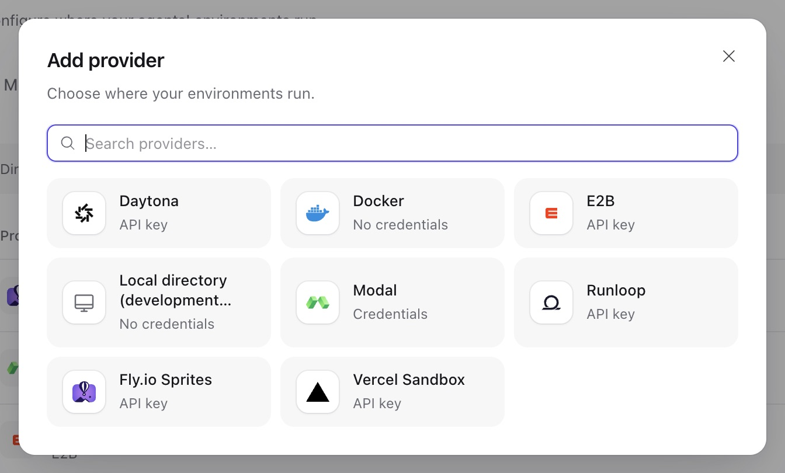

当智能体任务需要读写文件、执行 Shell 命令或操作桌面时，为其分配运行环境。

整个工作流围绕四个核心概念展开：

| 概念     | 配置内容                                    | 作用                          |
| -------- | ------------------------------------------- | ----------------------------- |
| 提供方   | Docker 引擎、Kubernetes 集群或云账号        | 让 Service 能在该平台创建实例 |
| 模板     | 镜像、CPU/内存、环境变量与空闲停止/删除策略 | 创建新实例的可复用配方        |
| 实例     | 运行中、已停止或已预留的沙箱                | 承载工作区文件与进程          |
| 线程挂载 | 实例、挂载名称、工作目录与权限              | 让后续运行可以访问该实例      |

你也可以通过[出站 Envd](#connect-a-client-computer) 或[直连 HTTP](#register-an-external-target) 接入自有机器。

## 工作区自动预置

手动创建资源前，先检查 **Environments → Templates**：

- **Docker Compose 快速启动（带 Docker socket）：** 自动创建 **Docker** 提供方和 **Linux Sandbox** 模板，内置 Python、Node.js、Git 及可写 `/workspace`。
- **源码开发模式（`make dev`）：** 在 `var/dev/environments` 下创建 **Local** 提供方和 **Local Workspace** 模板（直接以 Service 进程所在系统用户运行，无隔离）。

如需自定义默认模板或本地镜像，请参阅[工作区预置配置](workspace-provisioning.md#workspace-provisioning)。

## 提供方

在 **Workspace settings → Providers → Environment** 添加环境提供方（需要工作区 `write` 权限）：

1. 选择运行时（Docker、E2B、Daytona、Modal、Vercel、Sprites、Runloop、boxd 或 Local）并填写凭据。
2. 保存并保持启用状态。
3. 若为 Docker，点击 **Test connection** 验证引擎连通性。



若使用 Cloudflare Containers，选择 **Cloudflare Containers**，填入 Account ID 与 API Token，点击 **Deploy provider** 即可自动部署。

- 各后端详细配置见[提供方指南](../environments/providers.md)，配方字段见[配置参考](../environments/configuration-reference.md)。
- API 客户端通过 `/api/v1/environment-providers` 管理提供方，并通过 `GET /api/v1/provider-types/environment` 获取类型 Schema。
- 远程 Docker 引擎需符合部署的[出站策略](configuration.md#outbound-requests)，宿主机绑定挂载受 `environments.docker_mount_roots` 限制。

## 模板

创建模板并绑定到智能体：

1. 打开 **Environments → Templates → Create template** 并命名（例如 **Python sandbox**）。
2. 选择提供方、配置 CPU/内存限制和空闲策略后保存。
3. 编辑智能体，启用 **Files** 和 **Shell** 工具集，将该模板设为 **Default environment template** 并保存。
4. 新建对话，让智能体写入 `hello.txt`，再在下一轮让它读回内容，验证持久化生效。

当线程没有 `workspace` 挂载时，Service 会按智能体的 `default_environment_template_id` 预留实例（或复用 `default_environment_id`），并在首次使用时自动准备。

通过 API 创建模板：

```sh
curl -sS -X POST "$A13N_URL/api/v1/environment-templates" \
  -H "Authorization: Bearer $A13N_API_KEY" \
  -H "Content-Type: application/json" \
  -d '{"name":"Python sandbox","provider_id":"eprov_...",
       "config":{"recipe":{"cpus":2,"memory_gb":4},
                 "stop_after_seconds":1800,"delete_after_seconds":604800}}'
```

上述配置会在空闲 30 分钟后停止实例、7 天后删除实例（设为 `null` 可禁用对应策略）。空闲策略更新立即对已有实例生效；配方修改仅对新实例生效。

### 默认环境变量

在模板的 **Environment variables**（`config.recipe.environment`）中配置非敏感默认变量：

```json
{"environment":{"APP_MODE":"agent","TOOL_ENDPOINT":"https://tools.example.com"}}
```

命令会继承这些变量，并可通过[执行策略](execution-options.md#execution-policy)按次覆盖。敏感凭据请使用[出站凭据](#https-credentials-in-commands)，不要写入模板变量。

### Docker 镜像版本

省略 `recipe.image` 时，Service 默认使用经过验证的 `ghcr.io/converge-ai-labs/a13n-sandbox` 镜像：

| Service 构建类型                         | 默认标签 |
| ---------------------------------------- | -------- |
| 稳定版或 RC                              | `0.8.3`  |
| 源码构建（`0.0.0` 及本地后缀）或 `.devN` | `dev`    |

可指定明确标签或 digest 固定镜像，并通过 `pull_policy`（`if_missing` 或 `never`）控制拉取行为。已有实例保持其已解析镜像，需重建实例才能切换版本。

## 实例

在 **Environments → Instances** 或通过 `GET /api/v1/environments` 查看实例状态：

| 状态                   | 含义                               |
| ---------------------- | ---------------------------------- |
| `reserved`             | 已分配给线程，首次使用时启动       |
| `creating`, `starting` | 正在创建或恢复                     |
| `ready`                | 可用于运行任务                     |
| `stopping`, `stopped`  | 已暂停并保留文件，下次运行自动恢复 |
| `deleting`, `deleted`  | 已销毁，请选择其他实例             |

当提供方确认模板型 `workspace` 实例发生 `environment_lost` 时，下一次运行会自动按同一模板创建替代实例。若应用必须依赖原磁盘数据，请在会话上设置 `"auto_recreate_lost_environment": false`。

### 预创建托管环境

提前创建实例以便检查或在多个线程间共享：

```sh
curl -sS -X POST "$A13N_URL/api/v1/environments" \
  -H "Authorization: Bearer $A13N_API_KEY" \
  -H "Content-Type: application/json" \
  -d '{"template_id":"envtpl_...","name":"Shared data"}'
```

### 停止、重命名和删除

操作时需在 `If-Match` 中携带环境当前的 ETag（需要 `write` 权限）：

| 操作                                                         | 效果                           |
| ------------------------------------------------------------ | ------------------------------ |
| `PATCH /api/v1/environments/{id}` 携带 `{"name":"New name"}` | 重命名实例                     |
| `POST /api/v1/environments/{id}/stop`                        | 停止托管实例并保留文件         |
| `DELETE /api/v1/environments/{id}`                           | 销毁托管实例或移除外部环境注册 |

删除实例前，请先结束活动运行并移除线程挂载。

## 在线程上挂载环境

使用**线程**的 ETag 将已有实例挂载到线程：

```sh
curl -sS -X POST "$A13N_URL/api/v1/threads/$THREAD/environments" \
  -H "Authorization: Bearer $A13N_API_KEY" \
  -H "Content-Type: application/json" -H "If-Match: $THREAD_ETAG" \
  -d "{\"name\":\"data\",\"environment_id\":\"$ENVIRONMENT\"}"
```

- `workspace` 挂载在 `/workspace`；命名挂载（如 `data`）位于 `/mnt/data`。
- 通过 `DELETE /api/v1/threads/{thread_id}/environments/{name}` 移除挂载。
- 默认 `lazy_environment: true`，仅在首次使用时准备实例；传入 `{"options":{"overrides":{"lazy_environment":false}}}` 可在执行前预热所有挂载。
- 分叉线程默认共享挂载（除非指定 `fresh_environments`）；异步[子智能体](agent-configuration.md#subagents)遵循其边配置的环境策略。

### 在指定项目目录中复用实例

在 Console 中选择 **Reuse existing**（新对话）或 **Environments and memory → Add environment**（已有对话），并可选填写 **Working directory**（API 字段为 `working_directory`）。相对路径与 Shell 命令均从该目录启动。多个线程可共用同一实例的不同目录，但共享同一操作系统进程与文件系统空间。

## 单次运行环境覆盖

通过 `options.environment` 仅覆盖当前运行的 `workspace` 挂载，不修改线程保存的挂载配置：

```json
{"mode":"fresh","template_id":"envtpl_..."}
```

```json
{"mode":"existing","environment_id":"env_..."}
```

传入 `{"mode":"none"}`（或选择 **No primary environment**）可跳过本次运行的 `workspace`，同时保留命名挂载。

## 接入自有机器

### 连接客户端计算机

当本机可经 HTTPS/WSS 访问 Control、但 Worker 无法直连本机时，使用出站 Envd：

**通过 Console（推荐）：** 打开 **Environments → Instances → Connect my computer**，安装 [macOS 启动器](../a13n-envd/installation.md#connect-this-computer-from-console)（或执行提示的终端命令），输入验证码并批准。

**通过 CLI / API：** 运行 `a13n-envd connect-service`（见[连接到 Service](../a13n-envd/configuration.md#connect-to-service)），或调用 `POST /api/v1/client-environments?workspace_id=…` 预注册：

```json
{
  "device_id": "dev-example",
  "name": "Laptop",
  "default_working_directory": "/Users/example/project",
  "permission_ceiling": {"operations": ["environment.file.list", "environment.file.read_text"]}
}
```

将返回的 `token` 保存到权限为 `0600` 的本地文件，配置 `A13N_ENVD_TRANSPORT=reverse_websocket`、`A13N_ENVD_REVERSE_WS_URL` 和 `A13N_ENVD_REVERSE_WS_CREDENTIAL_FILE` 后启动 Envd。拥有工作区 `run` 权限的成员均可使用该计算机；在 Envd 终端按 `Ctrl+C` 即可断开连接。

### 注册外部目标

若 Service Worker 可通过 HTTPS（或本机回环 HTTP）直连目标计算机：

1. 在目标机启动 [HTTP Envd 守护进程](../environments/remote-envd.md#connect-to-an-existing-http-daemon)，配置稳定的设备 ID 与 Token。
2. 在[出站策略](configuration.md#outbound-requests)中放行该地址。
3. 使用工作区 `write` 权限注册：

```sh
curl -sS -X POST "$A13N_URL/api/v1/environments" \
  -H "Authorization: Bearer $A13N_API_KEY" \
  -H "Content-Type: application/json" \
  -d '{"endpoint":"https://build-box.example.com:8443","token":"YOUR_ENVD_TOKEN","name":"Build box"}'
```

外部 HTTP 目标仅限注册主体使用。可通过 `PATCH /api/v1/environments/{id}`（携带 `If-Match`）轮换 Token 或更新地址。

## 高级选项

### Kubernetes 沙箱

Kubernetes 将每个实例作为 Pod 运行，并在指定容器中启动 Envd：

1. 请运维人员配置 `environments.kubernetes_clusters`（或使用 [Kubernetes 运维配置](configuration.md#kubernetes-environments) 中的 Helm 选项）。
2. 在 **Workspace settings → Providers → Environment** 创建 Kubernetes 提供方，选择集群配置与命名空间，点击 **Check connection**。
3. 构建并推送（或 `kind load`）匹配的 `a13n-sandbox` 镜像：

```sh
make image-sandbox SANDBOX_IMAGE=a13n-sandbox:local
kind load docker-image a13n-sandbox:local --name my-cluster
```

4. 在 Console 创建模板（或通过 API 传入 `config`）：

```json
{
  "recipe": {
    "execution_container": "envd",
    "envd_launcher": "non_root",
    "connection": "direct",
    "pod_template": {
      "spec": {
        "restartPolicy": "Never",
        "containers": [{"name": "envd", "image": "a13n-sandbox:local"}]
      }
    }
  },
  "reclamation": {
    "idle_delete_seconds": 1800,
    "preparation_seconds": 600,
    "failed_retention_seconds": 3600
  }
}
```

- **启动模式（`envd_launcher`）：** `non_root`（默认）满足 Restricted Pod Security（UID/GID 1000、`inherit` 出站、无桌面与 sudo）；`root` 需命名空间允许 root 容器。
- **连接方式：** `direct` 直连 Pod IP；`port_forward` 通过 `kubectl` 转发，适合本地调试。
- **存储与诊断：** 通过 `recipe.storage` 挂载持久卷，调用 `GET /api/v1/environments/{id}/kubernetes/diagnostics` 与 `/kubernetes/logs` 排查 Pod 状态，或通过 `PUT /api/v1/environments/{id}/debug-hold` 暂缓空闲回收。

### 托管沙箱的出站 WebSocket

在 Docker、E2B、Daytona、Modal、Sprites 或 Vercel 模板中设置 `execution: "envd_ws"`，即可让沙箱内的 Envd 主动出站连接 Control，无需暴露 HTTP 端口。需将 `server.public_url` 配置为沙箱可达且支持 WebSocket 转发的 HTTPS 地址。当前 `envd_ws` 暂不支持独立 Console 桌面预览。

### Envd 安装与升级

托管配方支持 `envd_management` 字段：

| 取值           | 管理方式                                               |
| -------------- | ------------------------------------------------------ |
| `managed`      | Service 在创建、恢复或升级时安装固定版本的 Envd 并重启 |
| `preinstalled` | 由你自行提供 Envd 及启动命令，Service 仅检查就绪状态   |

自动准备与官方 Docker 镜像默认为 `managed`；自定义镜像、模板和快照默认为 `preinstalled`。升级托管实例会终止当前 Envd 会话和进程；若升级失败，可通过 **Retry preparation**（`POST /api/v1/environments/{id}/retry-creation`）重试。

### 命令中的 HTTPS 凭据

如需在命令中自动注入 HTTPS 凭据而不把真实 Token 暴露给环境变量，先创建工作区[出站凭据](resources.md#egress-credentials)，再在会话配置中引用：

```json
{
  "egress_mode": "controlled",
  "egress": {
    "destinations": { "mode": "allowlist", "hosts": ["api.github.com"] },
    "secrets": [
      {
        "env": "GH_TOKEN",
        "credential_id": "ecred_your_credential_id",
        "inject_hosts": ["api.github.com"]
      }
    ]
  }
}
```

可通过智能体的 `default_session_configuration`、线程绑定（`PUT /api/v1/threads/{thread_id}/session-bindings/{environment_id}/{name}`）或 `options.environment.session_configuration` 应用该策略。Envd 在 `$GH_TOKEN` 中仅提供占位符，只在发往 `inject_hosts` 的 HTTPS 请求头中替换为真实凭据。

### Envd 设置

每个模板都提供 **Envd settings** 面板（API 为 `recipe.envd`），用于调整设备/会话并发上限、文件与输出大小及会话超时：

```json
{
  "envd": {
    "limits": {
      "max_concurrent_file_transfers": 32
    },
    "idle_timeout_ms": 3600000
  }
}
```

设置会在实例创建时固化，修改模板后需创建新实例生效。

## 计算机使用

<span id="create-a-docker-desktop"></span> <span id="automatic-vercel-desktops"></span> <span id="enable-observation-and-interaction"></span> <span id="computer-coordinate-mode"></span> <span id="desktop-access-prerequisites"></span> <span id="get-and-return-desktop-control"></span> <span id="upgrade-desktop-control"></span> <span id="automatic-sprites-desktops"></span>

- [使用桌面环境](computer-use.md)
