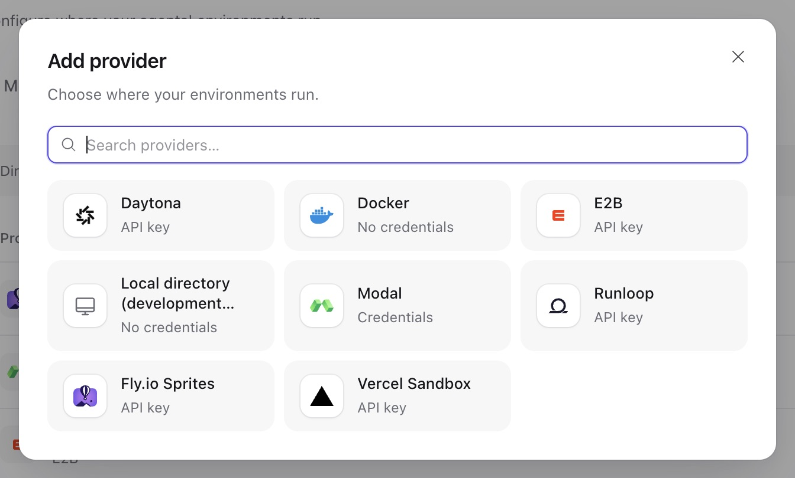

任务需要文件、命令或桌面时，为 agent 配置环境。先用一个模板和一个线程走通流程：让 agent 写入文件，再在后续消息中读取。这样可以同时验证执行能力和文件复用。

三个资源连接起这条流程：

| 资源     | 你选择的内容                   | 结果                       |
| -------- | ------------------------------ | -------------------------- |
| Provider | Docker Engine 或云账号         | Service 可以在其中管理资源 |
| 模板     | 镜像、资源、环境变量和空闲策略 | 用于创建托管实例的配方     |
| 线程挂载 | 实例、名称、目录和权限         | 后续运行可以使用该实例     |

已有自行维护的计算机时，可以让 Envd 主动连接 Control（见下文“连接客户端电脑”）；如果 Service 可以直连电脑，也可以注册其 HTTP 端点。计算机的生命周期由你管理。每次接收运行都会固定其挂载和权限，因此修改对后续运行生效。

## 托管沙箱主动连接 WebSocket

在 Docker、E2B、Daytona、Modal、Sprites 或 Vercel 的模板 recipe 中设置 `execution: "envd_ws"`，即可让沙箱内的 Envd 主动连接 Control。创建、停止、启动和销毁仍由原 Provider 管理。Run 继续通过原 environment ID 选择环境，不需要再注册客户端环境，也不用把普通 API token 放进沙箱。

`envd_ws` 暂不支持 Console 中独立的桌面预览，按钮会显示原因。Agent 的 Computer 工具仍取决于设备能力和执行权限。设备保持在线但执行 Session 失效时，工具会报告失败，Run 可以在下一次使用工具时准备新 Session；不会自动重放之前的命令，也不会恢复旧进程句柄。

将 `server.public_url` 配置为沙箱能够访问的 HTTPS 地址，并允许 WebSocket 转发。镜像或模板需包含更新后的兼容 Envd 和 `a13n-sandbox-entrypoint`。自动准备支持无桌面和桌面配置：E2B 可在兼容的所选模板中安装，Vercel 在最终持久 Ubuntu 目标中安装，Sprites 在最终 Sprite 中安装。显式自定义镜像、模板或快照保留各自的预装要求。Console 的模板配置可以选择执行连接方式；Docker 需先选择自定义环境。

Service 自动下发该环境的专用连接凭据，完成 EIP 初始化后才将创建或启动标记为成功。连接失败时保留已分配的沙箱，便于重试或清理。Worker 调用工具无需访问沙箱的 Envd HTTP 端口。Provider 生命周期接口、人工桌面访问和监控仍有各自的网络要求。文件和截图在 Worker 与 Control 之间通过 Redis Stream 传输，Control 与 Envd 之间继续使用现有 WebSocket。

已有模板的 native 或 HTTP 默认行为保持不变。此连接方式需要 Service，独立 Harness 的 Provider 连接器会明确拒绝。修改模板只影响新环境，不改变已经创建的实例。

## Envd 安装与升级

Docker、E2B、Modal、Daytona、Vercel 和 Sprites 的 recipe 支持 `envd_management`：

| 值             | 安装与启动管理权                                                                 |
| -------------- | -------------------------------------------------------------------------------- |
| `managed`      | Service 在准备阶段安装其固定版本，并重启运行时。                                 |
| `preinstalled` | 自行提供 Envd 及启动命令。Service 检查就绪状态，不安装、不替换启动方式、不升级。 |

自动准备的 Envd 以及官方 Docker Envd 镜像默认使用 `managed`。显式自定义镜像、模板和快照默认使用 `preinstalled`。自动资源选择器要求 `managed`；冲突配置会被拒绝。Native 执行不接受 `managed`。Kubernetes 继续使用操作者编写的 Pod 和 init-container 启动配方。

例如，E2B 可以在兼容的所选模板上安装并托管 Envd 二进制：

```json
{"execution":"envd_http","template":"my-debian13-template","preparation":"headless","envd_management":"managed"}
```

自行维护兼容的自定义运行时时，选择 `preinstalled`：

- E2B：自定义 `template`，并使用 `preparation: "preinstalled"`。
- Modal：自定义 `image` 及 `startup_command`，例如 `["/usr/local/bin/start-envd"]`。创建及快照恢复均原样使用这个 argv。
- Daytona：提供启动命令会运行 Envd 的自定义快照。
- Vercel：提供自定义 `snapshot` 及 `startup_command`，例如 `["/usr/local/bin/start-envd"]`。命令需在后台启动运行时后返回。创建和原生会话恢复时，Service 使用实例启动环境变量，以 root 执行这个 argv。每个原生会话记录一个启动任务，管理操作在回执丢失后可重新加入，而不会重放命令；文件系统快照不会保留进程。
- Sprites：使用 `envd_http`，自行安装运行时、配置 Device 身份和服务；Service 不注册标准启动器。`preinstalled` 与 `envd_ws` 组合会被拒绝，因为私有 outbound 启动配置目前需要 Service 启动器。
- Docker：提供包含自定义启动命令的镜像。

Modal/Daytona 可通过 `base_image` 选择支持的基础镜像并自动托管准备。将已有自定义运行时设为 `managed` 时，目标须具备标准的 root 所有安装/运行目录、GNU/Linux 安装器依赖和原生监督进程；该字段不会替换镜像入口或补装桌面。

Service 在创建、启动/恢复，以及固定版本推进后首次使用已有托管实例时升级。它先取得现有持久化准备操作，再安装经过校验的发布版本、请求重启，并验证认证 EIP 就绪状态。并发调用者加入同一操作。已有人工桌面保留和查看会推迟首次使用升级。空闲实例不通过定时任务升级，Service 也不选择 `latest`。

**升级会结束已有 Envd Session，以及其中的进程和输出句柄。** 工作区文件遵循 Provider 原有的持久化规则。Session 恢复可以打开新 Session，但不会重放命令。安装失败会保留旧二进制并记录准备失败。检查目标中受保护的 `/var/lib/a13n-envd/update-<version>/output`，核对结果后，对确认失败的升级使用 Console 的**重试准备**。API 客户端使用 `POST /api/v1/environments/{id}/retry-creation` 并携带当前 `If-Match`。重试保留原实例和选定版本，创建新的客体尝试；仍在执行、结果未知或实例已确认丢失时会被拒绝。升级失败会使此前已就绪的托管实例停留在 `starting`，直到显式重试成功才能使用，但不会启动首次准备失败的自动回收。若缺少发布版本或运行时不兼容，应先修复原因再重试。原生实例确认丢失后需替换或删除。缺少回执不代表命令没有执行。

外部服务管理器运行 `a13n-envd daemon` 并负责重启。没有外部管理器时，准备的运行时使用 `a13n-envd supervise`；Service 安装二进制后请求该原生监督进程重启。局部重启命令见 [Envd 运维](../a13n-envd/operations.md#restart-after-installing-a-release)。

## 工作空间自动配置

创建资源前，先检查**环境 → 模板**。挂载 Docker socket 的单机 Compose 部署会在 Engine 可达时准备 **Docker** provider 和 **Linux Sandbox** 模板。首次文件任务可以直接选择该模板。镜像包含 Python、Node.js、Git 和常用开发工具；命令以 `sandbox` 用户运行，可写目录为 `/workspace` 和 `/tmp/a13n`。

不挂载 socket 的快速入门部署不会自动配置 Docker。源码开发的 `make dev` 会启用 **Local**，在检出目录的 `var/dev/environments` 下创建 **Local Workspace** 模板。每个实例使用独立子目录。Local 命令直接以 Service 进程的操作系统用户身份执行，不提供隔离。

通用 Service 设置默认关闭这两种自动配置。启用它们或使用本地构建镜像时，参阅[工作空间自动配置](workspace-provisioning.md#workspace-provisioning)。`all` 角色在创建工作空间和启动时补建缺失的默认资源。失败时，修复 Engine 访问并重启。成功配置后会保留后续模板修改、禁用和删除结果。自动配置创建的是配置资源；实际实例在收到请求后分配。

## Provider

在**工作空间设置 → 供应商 → 环境**中添加或编辑环境 provider。你需要工作空间 `write` 权限，以及所选 Engine 或云账号的访问权限。模板中的**管理供应商**会打开同一列表，并保留模板草稿。

1. 选择运行方式，填写账号设置和凭据。
2. 保存 provider，并保持启用。
3. Docker 可测试连接。测试只 ping Engine；创建实例才能验证镜像与执行配置。
4. 创建模板时选择该 provider。



[Provider 指南](../environments/providers.md)介绍 Docker、E2B、Daytona、Modal、Vercel、Sprites、Runloop、boxd 和 Local 的配置；[配置参考](../environments/configuration-reference.md)列出各自的 recipe 字段。API 客户端通过 `/api/v1/environment-providers` 创建 provider，通过 `GET /api/v1/provider-types/environment` 获取类型 schema。

Docker 默认使用运维设置的 `environments.docker_host`。provider 单独指定的地址必须是[出站策略](configuration.md#outbound-requests)允许的远程 TCP 或 HTTPS Engine。Engine 访问授予宿主机级权限。宿主机绑定源必须位于 `environments.docker_mount_roots` 下，该设置默认不允许任何路径；不提供特权容器或宿主机命名空间。

云实例使用已保存的账号，并向该账号计费。配置空闲停止或删除来限制保留时间。Service 会续期受支持的就绪沙箱，但仍受厂商硬性时限约束。已停止的实例可以带着保留的文件恢复；丢失的实例需要恢复或替换。Sprites 不支持显式停止，需要时使用空闲删除。

编辑 provider 时，省略凭据会保留原值，新值会替换原值，`null` 会移除凭据。保留的模板或实例引用会阻止删除 provider。删除无引用的 provider 只移除已保存的配置和凭据，不删除底层 Engine 或云账号。

## Kubernetes 沙箱

Kubernetes 将实例运行为原生 Pod，由选定容器中的 Envd 提供执行能力。运维配置受信任的集群 profile、允许的命名空间和沙箱 ServiceAccount 后，Kubernetes 才会出现在 provider 目录中。工作空间用户选择 profile 和命名空间；Kubernetes API 凭据由运维持有。

1. 请运维在 Control 和 Worker 上配置 `environments.kubernetes_clusters`，或按 [Kubernetes 运维配置](configuration.md#kubernetes-environments)中的说明启用 Helm 选项。
2. 在**工作空间设置 → Providers → 环境**中创建 Kubernetes provider。选择运维配置的集群 profile，并填写获准的命名空间。Helm 示例对应 `config: {"cluster":"in-cluster","namespace":"agent-sandboxes"}`。保存 provider 后，重新打开并选择 **Check connection（检查连接）**。
3. 按下方说明准备沙箱镜像，然后创建模板。选择 **Pod 直连**或**本地端口转发**，通过卡片配置容器、资源请求与限制、变量、持久存储和调度。**生命周期**单独控制回收策略。常规配置无需编写 YAML 或 JSON；**编辑原生 JSON**提供其他原生字段，返回表单后修改配置也会保留这些字段。下方 JSON 是等价的 API 模板 `config`。
4. 在已配置可用模型的 agent 上启用 **Files** 和 **Shell**，并选择此默认模板。新建会话，让 agent 写入 `hello.txt`，再发一条消息读取文件。只覆盖一次运行时，选择**运行选项 → 本次运行环境 → 从模板创建**。

```json
{
  "recipe": {
    "execution_container": "envd",
    "connection": "direct",
    "pod_template": {
      "spec": {
        "restartPolicy": "Never",
        "containers": [{"name": "envd", "image": "a13n-sandbox:local"}]
      }
    }
  },
  "reclamation": {
    "idle_delete_seconds": 1800,
    "preparation_seconds": 600,
    "failed_retention_seconds": 3600
  }
}
```

**首次运行前先准备镜像。** 示例中的 `a13n-sandbox:local` 是本地构建，不是仓库镜像。在本 checkout 中构建并加载到已有 kind 集群（将 `my-cluster` 替换为实际名称）：

```sh
make image-sandbox SANDBOX_IMAGE=a13n-sandbox:local
kind load docker-image a13n-sandbox:local --name my-cluster
```

其他集群需要按节点架构构建本 checkout 的沙箱镜像并推送到仓库，再把准确的 tag 或 digest 写入 `pod_template.spec.containers[].image`：

```sh
make image-sandbox SANDBOX_IMAGE=registry.example.com/team/a13n-sandbox:reviewed
# Authenticate to your registry before pushing.
docker push registry.example.com/team/a13n-sandbox:reviewed
```

私有仓库还需配置原生 `imagePullSecrets`。镜像必须启动 Envd，并使用 Service 注入的凭据文件路径；使用与 Service 相同 checkout 构建的沙箱镜像。`make k8s-up K8S_ENVIRONMENTS=1` 会构建并加载自己的镜像 tag；请读取其 `K8S_STATE_DIR` 下 `deployment.json` 中的 `sandbox_image`，不要假定它是 `:local`。默认目录是 `~/.config/a13n-service-kind`；使用非默认 `K8S_CLUSTER` 时追加 `-<cluster>`。

资源请求与限制、init 容器、sidecar、调度、安全上下文及 ConfigMap、Secret 引用保留在 `pod_template.spec` 中，由 Kubernetes admission 校验这些原生字段。Service 管理 Pod 身份、沙箱 ServiceAccount 和私有 Envd 凭据注入。选定的执行容器必须启动 Envd；Pod 处于 Running 并不代表执行能力已经就绪。

`direct` 从 Service 连接 Pod IP，Service 可以部署在集群内或集群外。集群外部署时，运维在 Control 和 Worker 上提供 kubeconfig profile。直连要求两个进程都能访问 Pod IP。没有 Pod IP 路由的本地调试可使用 `port_forward`，前提是 kubeconfig profile 明确允许且已安装 `kubectl`；隧道仅属于使用它的进程。两种方式目前都使用 Bearer 认证的 HTTP，需要 profile 显式设置 `allow_plaintext_envd = true`。此类流量应保留在可信私有网络内。provider 检查成功代表配置、认证和 Pod 列举权限正常；镜像拉取、Pod 创建、调度、存储和 Envd 就绪仍需通过真实实例验证。

需要持久文件时，在 `recipe.storage` 中添加绑定，包含 `name`、`mount_path`，以及原生 `claim_template` 或 `existing_claim` 二选一。新建 PVC 默认使用 `disposition: retain`；选择 `delete` 会在回收时删除拥有的 PVC。已有 PVC 始终视为借用资源，即使绑定指定删除也会保留。`shared_directory: true` 在已有 PVC 中使用实例专属目录，并保留该目录。引用的 ConfigMap 和 Secret 也属于借用资源。`recipe.network_policy` 接受原生 NetworkPolicy 模板，Pod selector 由 Service 填入；实际执行网络策略需要兼容的集群网络实现。

Kubernetes 支持创建、复用和删除。回收设置在预留实例时复制到实例。默认空闲 30 分钟后删除，准备时间上限为 10 分钟，准备失败后保留一小时。Kubernetes 没有停止/恢复操作。删除会等待所拥有的资源消失；finalizer 可能使实例保持 `deleting`。保留和借用的资源仍可在回收记录中查看。

在实例的 Kubernetes 面板查看 Pod UID、调度和容器状态、Events、存储处置与 Envd 就绪状态。`GET /api/v1/environments/{id}/kubernetes/diagnostics` 和 `/kubernetes/logs` 需要工作空间 `run` 权限。日志有大小限制，可选择容器和上一轮容器日志。这些查询不重置空闲计时。调试时，可用当前 `If-Match` 向 `PUT /api/v1/environments/{id}/debug-hold` 提交 `{"seconds":3600}`，暂缓自动回收；`{"seconds":null}` 清除保留。每次保留最长一天。Pod 被替换且 UID 改变时属于目标丢失，应创建新实例，不会静默接管替代 Pod。

## 仅本次运行的环境选择

会话的运行选项可以为一次运行新建工作空间，或选择已有实例。API 客户端提交 `options.environment`：

```json
{"mode":"fresh","template_id":"envtpl_..."}
```

```json
{"mode":"existing","environment_id":"env_..."}
```

接收后的运行固定实例 ID 和权限。同一次已接收运行的重试保留原选择。覆盖只替换本次运行的 `workspace` 挂载，不修改线程的期望挂载。省略该选项时，继续使用正常的线程挂载和 agent 默认行为。选择不可用的已有实例会失败，不会自动创建替代实例。

## 模板

通过 Console 创建第一个工作空间：

1. 打开**环境 → 模板 → 创建模板**，命名为 **Python sandbox**。
2. 选择 Docker 和已启用的 provider，设置资源限制和空闲策略后保存。保存模板不会启动容器。
3. 编辑一个已经能调用模型的 agent，启用其 **Files** 和 **Shell** 工具集，选择此默认环境模板并保存 agent 配置。
4. 开始新会话，要求：“在工作空间写入 `hello.txt`，内容为 `Hello from Service`，然后读回。”检查工具结果。
5. 发送后续消息，要求再次读取同一文件。agent 应使用该线程原有的工作空间。

agent 字段为 `default_environment_template_id`。根线程没有 `workspace` 挂载时，Service 在接收运行时预留实例，并以 `workspace` 挂载。`reserved` 实例有 ID，但还没有厂商资源，首次使用才准备环境。预留记录计入托管环境额度。

要复用已有环境，可以改为设置 `agent.config.default_environment_id`，两个字段只能选择一个。线程已有的 `workspace` 挂载优先；修改 Agent 默认值不会替换它，也不会改变已接收的运行。客户端环境离线时也可以选择。同一工作空间中拥有 `run` 权限的用户和服务账号都能使用客户端环境。外部 HTTP 目标仍只允许注册主体使用。子运行仍使用创建它的子 Agent 配置项中的环境策略。

API 配置使用[直接 HTTP 集成](connect-application.md#direct-http-integration)中的 URL 和工作空间 API Key。将 `eprov_...` 替换为 Docker provider ID。创建或编辑模板需要 `write`：

```sh
curl -sS -X POST "$A13N_URL/api/v1/environment-templates" \
  -H "Authorization: Bearer $A13N_API_KEY" \
  -H "Content-Type: application/json" \
  -d '{"name":"Python sandbox","provider_id":"eprov_...",
       "config":{"recipe":{"cpus":2,"memory_gb":4},
                 "stop_after_seconds":1800,"delete_after_seconds":604800}}'
```

保存返回的模板 ID。此例在空闲 30 分钟后停止实例，七天后删除实例。两个计时器都从最后使用时间起算；`null` 关闭对应策略。空闲删除会移除线程挂载和实例文件。配置了默认模板的线程可以在下次运行时获得新工作空间。

更新模板时，将模板 ETag 放入 `If-Match`。Recipe 在首次认领创建任务时固定，应在此之前修改，或创建新实例。使用 `stop_after_seconds` 和 `delete_after_seconds` 的 provider，其空闲策略修改立即适用于已有实例。Kubernetes 的 `reclamation` 在预留时固定；修改仅影响新的预留。禁用模板会阻止新预留，也会阻止尚处于预留状态的实例首次创建；已经创建的实例继续可用。

### 默认环境变量

在模板的**环境变量**中添加普通命令默认值，例如 `APP_MODE=agent`。API 位置为 `config.recipe.environment`：

```json
{"environment":{"APP_MODE":"agent","TOOL_ENDPOINT":"https://tools.example.com"}}
```

这是 recipe 片段。命令及其子进程接收这些值。[执行策略](execution-options.md#execution-policy)和命令显式指定的值可以覆盖默认值，而不修改共享实例。Local 还要求变量名列入 `allowed_environment_keys`，除非该白名单不设限制。

使用可移植的变量名和字符串值。秘密值应保留在凭据或 secret binding 控制中：模板变量是可读取的配置。平台启动、桌面和遥测变量名由平台保留。默认变量随实例 recipe 固定，停止后启动仍保留原值。要应用修改后的模板默认值，请创建新实例。

### Docker 镜像版本

省略 `recipe.image` 时，Service 选择审定的 `ghcr.io/converge-ai-labs/a13n-sandbox` 镜像：

| Service 构建                            | 镜像标签 |
| --------------------------------------- | -------- |
| 稳定版或 RC                             | `0.8.1`  |
| 源码（`0.0.0`，包括本地后缀）或 `.devN` | `dev`    |

Sandbox 版本归 Envd 管理，与 Service 版本独立。设置明确的标签或 digest 可选择其他镜像。`pull_policy: if_missing` 使用 Engine 本地镜像，缺失时在首次创建时拉取；`never` 要求镜像已经存在。自动配置的模板保存明确镜像，因此升级会保留这一选择。

实例在重试和升级中保留已解析的镜像。要使用新镜像，请重新创建实例。未保存镜像的旧 handle 保留 `ghcr.io/converge-ai-labs/a13n-docker-environment:dev`；移除旧镜像前应重新创建这些实例。

## 实例

打开**环境 → 实例**查看创建和使用状态。API 客户端使用 `GET /api/v1/environments`，或按 ID 获取单个实例。列表只有在 `status=deleted` 时才包含已删除记录。

| 状态                   | 下一步                           |
| ---------------------- | -------------------------------- |
| `reserved`             | 在运行中使用，触发准备           |
| `creating`, `starting` | 等待就绪；有失败时查看原因       |
| `ready`                | 挂载并执行任务                   |
| `stopping`, `stopped`  | 等待停止完成；后续运行会再次启动 |
| `deleting`, `deleted`  | 选择其他实例                     |

失败信息包含代码、消息和操作结果是否确定。Service 使用原有操作标识核对未完成操作。出现 `provider_credential_changed` 时，恢复实例原账号的访问。如果供应方确认线程的 `workspace` 挂载对应的模板环境已经丢失（`environment_lost`），下次使用该挂载的运行会从同一模板获得新实例。旧沙箱中的文件和进程无法恢复。新沙箱的启动时机仍由运行的 `lazy_environment` 设置决定。已经使用旧实例的运行可能失败。

原本共享同一实例的线程（包括 fork）会在各自的下一次运行中使用同一个替代实例。如果实例再次丢失，较晚恢复运行的线程会接入最新实例。替换丢失的实例会沿用它的配额，所以配额为 1 时也能连续恢复。如果替代实例因空闲被删除，配额就会释放。下次有线程运行并允许恢复时，需要一个空闲名额来创建新的共享实例。如果配额已满，本次运行会收到 `environment_limit`；名额释放后可重试。

如果应用需要原来的磁盘，请在创建会话时设置 `"auto_recreate_lost_environment": false`，也可以通过 `PATCH /api/v1/sessions/{id}` 修改，请求需携带会话当前的 `If-Match`。默认值为 `true`。指定确切实例的运行、共享父环境的子智能体及其他名称的挂载仍会报告原实例的故障。

### 预留托管环境

需要在任务前检查实例，或在线程之间共享时，可以显式创建。替换模板占位符：

```sh
curl -sS -X POST "$A13N_URL/api/v1/environments" \
  -H "Authorization: Bearer $A13N_API_KEY" \
  -H "Content-Type: application/json" \
  -d '{"template_id":"envtpl_...","name":"Shared data"}'
```

此操作需要 `run`，并立即开始创建：响应状态为 `creating`，随后在后台转为 `ready`。将返回的 `id` 保存为 `ENVIRONMENT`，查看 `GET /api/v1/environments/$ENVIRONMENT`，再按下文挂载。这与接收运行时的延迟预留不同。两种方式都计入 `environments.managed_count`；超过限制返回 `409 conflict`，原因为 `environment_limit`。

### 注册外部目标

1. 在目标计算机运行 [HTTP Envd 守护进程](../environments/remote-envd.md#connect-to-an-existing-http-daemon)，使用稳定的设备 ID 和 token。
2. 确保 Service worker 可以访问端点，且出站策略允许。明文 HTTP 只接受回环地址，其他地址使用 HTTPS。
3. 使用工作空间 `write` 权限注册 origin 和 token：

```sh
curl -sS -X POST "$A13N_URL/api/v1/environments" \
  -H "Authorization: Bearer $A13N_API_KEY" \
  -H "Content-Type: application/json" \
  -d '{"endpoint":"https://build-box.example.com:8443","token":"YOUR_ENVD_TOKEN","name":"Build box"}'
```

Service 验证设备，加密保存 token，并返回 `ready` 实例。使用注册时的用户或服务账号挂载：外部目标的执行权限仅属于注册主体。所有者或工作空间管理员可以管理此注册。

轮换 token 或迁移端点时，向 `PATCH /api/v1/environments/{id}` 提交环境 ETag。修改端点时同时提交 token。Service 验证新连接仍指向同一设备；设备不同时以 `provider_device_mismatch` 拒绝。删除注册会忘记 token，计算机继续运行。

每个 Thread 在 Environment 上拥有具名 Session 绑定。使用同一绑定的目录挂载跨 Run 共享 Session；不同绑定名在同一 Device 上选择独立 Session。最后清理时分离连接并保留恢复描述符。普通新工作在确认原 Session 丢失后可以新建；保留的 Shell 工作必须恢复原 Session 和原进程，恢复绝不替代或重放命令。端点和 token 轮换保留逻辑绑定。

挂载通过 `session_binding` 选择绑定（默认 `default`），通过 `session_configuration` 初始化启动策略。使用 `GET` 或 `PUT /api/v1/threads/{thread_id}/session-bindings/{environment_id}/{name}?workspace_id=…` 查看或替换期望策略；PUT 使用 Thread ETag 和 `configuration` 对象。启动策略变化后，只有没有已接纳 Run 或未完成保留工具使用该绑定时，接纳才会替换 Session；否则返回 `environment_busy`。目录选择仍属于单个挂载。

### 命令中的 HTTPS 凭据

先创建工作空间的[出站凭据](resources.md#egress-credentials)，再在 Session 配置中引用其 ID。例如：

```json
{
  "egress_mode": "controlled",
  "egress": {
    "destinations": { "mode": "allowlist", "hosts": ["api.github.com"] },
    "secrets": [
      {
        "env": "GH_TOKEN",
        "credential_id": "ecred_your_credential_id",
        "inject_hosts": ["api.github.com"]
      }
    ]
  }
}
```

在 Agent 的 `default_session_configuration` 中设置这段策略，可以初始化新的主 Session 绑定；在 Thread 绑定的 `configuration` 中设置，供后续 Run 使用；在 `options.environment.session_configuration` 中设置，只对本次 Run 生效。已有 Thread 绑定优先于 Agent 默认值。Run 覆盖不会改写 Thread 的期望配置；不同配置不能同时使用同一个绑定。

环境必须支持 Envd controlled egress。Service 在允许命令执行前检查当前凭据；不支持时会明确失败，不会把真实 token 放进普通环境变量。Envd 提供占位值，仅在发往指定域名的 HTTPS 请求头中替换为真实值。命令仍需按服务要求构造请求头，例如 `curl -H "Authorization: Bearer $GH_TOKEN" https://api.github.com/user`。保持 TLS 校验开启，使用环境配置的证书信任。Host 的 web 和 browser 工具不会继承这些绑定。

Agent 在每次模型请求中获得当前选定的变量名、域名和使用说明，只有一份当前说明，上下文压缩不会将其移除。说明不包含真实值或占位值；仅轮换 token 时无需更改命令或说明。

轮换先同步保存新值，再异步更新活跃 Session。现有 Session 持有者也会定期比较版本，默认间隔十秒，因此通知丢失后仍会补偿。受跟踪的后台任务可以在 Run 结束后继续保持同步。空闲 Session 不会为了更新凭据而被连接；它在下次 attach 时、执行命令前取得最新版本。detach 保留 Session 及其凭据，原生 close 或过期负责清理。

撤销后，Service 接纳流程立即阻止新使用；活跃 Session 异步删除绑定。空闲 Session 可能保留旧值直到再次 attach 或原生清理。需要立即失效时，应同时在上游服务撤销 token。保存或撤销接口成功，不代表所有原生 Session 都已应用。

### 升级到 Session 绑定

切换 schema 前，完成或取消并收尾所有使用环境挂载的已接纳 Run（包括等待中的 Run），以及全部保留的环境或 Shell 工具。仅 drain 或移交 Worker 不够。停止全部旧 Control 和 Worker，执行迁移，再仅启动新版本。迁移保留注册、provider 状态、文件和历史 Run 捕获，但不会将旧 Session 恢复提示导入新绑定头。新工作打开新 Session。升级期间不要混用新旧进程。

### 连接客户端电脑

此工作空间中拥有 `run` 权限的用户和服务账号都能使用客户端电脑，包括已有登记和新登记。登记仍要求 `write`；轮换或撤销凭据、修改状态仍要求所有者或拥有 `write` 权限的工作空间管理员操作。文件、Shell 和桌面操作仍受登记、运行以及本机 Envd 配置的权限限制。

在**环境 → 实例 → 连接我的电脑**中，可以使用当前 Console 登录状态完成配对。先[安装 macOS 启动器](../a13n-envd/installation.md)，从对话框打开它，再填入 App 显示的验证码并批准。对话框也提供终端连接命令，此流程不需要普通 API key。环境在线后，在 Agent 或对话设置中选择它。自动化配置仍可使用下方的 API token 流程。

当 Envd 能主动连接 Control，但 Worker 无法直接访问这台电脑时，使用客户端环境。设备离线时也可以登记环境并挂载到线程。

升级到客户端环境 schema 时，先等待活跃任务结束并停止全部旧 Control 和 Worker，再执行迁移。已有托管环境和 HTTP 环境会保留，但旧版本不能写入新 schema。一旦创建过客户端注册（包括已删除的注册），应向前修复，不能降级 schema。

首次自动登记可使用 `a13n-envd connect-service`，传入普通 API token、工作空间 ID 和本地工作目录。命令与凭据恢复步骤见[连接 Service](../a13n-envd/configuration.md#connect-to-service)。接入接口为 `POST /api/v1/client-environments/connect?workspace_id=…`，接受下方的登记字段和可选的 `environment_id`。不传 ID 时，只有当前所有者、工作空间和设备的绑定不存在才会创建；传 ID 时必须匹配该已有环境。已有配置不会修改，禁用、删除或撤销凭据的环境会被拒绝。重复请求不返回 token；丢失凭据时使用显式轮换接口。

如果要在电脑离线时登记，或在连接前限制操作权限，可按以下步骤：

1. 使用拥有工作空间 `write` 权限的账号调用 `POST /api/v1/client-environments?workspace_id=…`。传入安装时保存在本地的设备 ID、电脑上已有的目录，以及允许的操作。例如：

   ```json
   {
     "device_id": "dev-example",
     "name": "我的电脑",
     "default_working_directory": "/Users/example/project",
     "permission_ceiling": {"operations": ["environment.file.list", "environment.file.read_text"]}
   }
   ```

2. 保存响应里的 `client.environment.id`，并把 `token` 写入仅当前用户可读的本地凭据文件（Unix 权限 `0600`）。首次登记返回 201；重复登记同一安装返回 200，不返回旧 token。丢失凭据时，使用当前 Environment ETag 调用 `rotate-credential`。设备 ID 标识的是安装实例，不验证物理硬件；如果 ID 和 token 一起被复制，另一台电脑也可以使用该身份。

   按 Service 地址、账号和工作空间分别保存环境 ID 与 token 文件，切换账号时使用对应登记。

3. 使用同一设备 ID 和本地访问策略启动 Envd。设置 `A13N_ENVD_TRANSPORT=reverse_websocket`，将 `A13N_ENVD_REVERSE_WS_URL` 设为 Control 的 `wss://` 地址加上响应的 `connection_path`，将 `A13N_ENVD_REVERSE_WS_CREDENTIAL_FILE` 指向凭据文件。[Envd 配置](../a13n-envd/configuration.md)介绍了运行目录、安装身份和本地权限设置。不要将 token 放进 URL。

4. 将环境挂载到线程。run 接受时固定目录和权限。`ready` 仅表示可选择；首次实际使用时才检查连接、打开 Session 并验证工作目录。设备上线不会自动加入任何 run。

客户端可复用 Envd 安装状态目录中的 `device-id`。如果安装器负责生成并保存 ID，请在登记和启动时使用相同的值（Envd 支持 `A13N_ENVD_DEVICE_ID`）。启用 Computer Use 时，Envd 会在本机检查桌面权限。注册不会运行测试命令，握手成功也不能保证某个程序已安装。

离线时工具会说明本次操作未派发。只有当前 run 已感知过连接失败，后续正常的 agent 循环才会提示该挂载恢复连接。恢复不会重试旧命令。长命令应先启动进程，再使用句柄查询或等待；单次等待到期不会终止进程。命令派发后若丢失回复，结果未知。

在实例详情中可以查看连接状态及检查时间。电脑离线时仍保留登记。如果 envd 提示 `device_id_mismatch`，请核对目标环境，用 `--device-id` 传入该环境登记的设备 ID。按 Ctrl+C 可停止连接。

文件和截图通过 Redis Stream 传输，Worker 不再需要访问各 Control 副本的独立地址。升级时移除旧的 `A13N_CLIENT_ENVIRONMENTS__TRANSFER_ORIGIN` 配置，等待活动任务结束后一起更新 Worker 和 Control。设备连接凭据不会下发给 Worker。

每次传输创建 `a13n:client-environment:{environment_id}:transfer:{epoch}:{transfer_id}:w2c` 和对应的 `:c2w` 两个 key，分别传递两个方向的帧。每个 Stream 最多保留 8 个未消费帧，5 分钟无活动后过期；正常关闭、取消或失败时会删除。`A13N_CLIENT_ENVIRONMENTS__TRANSFER_SECONDS` 限制一次传输的总时长，包括等待发送方和接收方的时间，默认 120 秒。传输中断时明确失败，不自动续传，也不重复提交文件。

### 停止、重命名与删除

先读取环境，再将其 ETag 放入 `If-Match`。以下操作需要 `write`：

| 操作                                                          | 结果                                 |
| ------------------------------------------------------------- | ------------------------------------ |
| `PATCH /api/v1/environments/{id}`，传入 `{"name":"New name"}` | 重命名实例                           |
| `POST /api/v1/environments/{id}/stop`                         | 停止受支持且就绪的托管实例，保留文件 |
| `DELETE /api/v1/environments/{id}`                            | 销毁托管实例，或忘记外部注册         |

停止或删除前，结束活跃运行和桌面控制。删除还需要先移除线程挂载。永久失败的实例是例外：删除时会一并移除挂载。未确定结果的操作可能以 `operation_unresolved` 阻止删除。只移除挂载会保留实例；删除托管实例会销毁文件。

## 在线程上挂载环境

通过挂载将实例连接到已有的开放线程：

1. 将 `THREAD` 设为线程 ID，`ENVIRONMENT` 设为实例 ID。
2. 读取 `GET /api/v1/threads/$THREAD/environments`，将响应 ETag 保存为 `THREAD_ETAG`，保留引号。
3. 添加挂载。省略 `working_directory` 可使用 provider 默认目录：

```sh
curl -sS -X POST "$A13N_URL/api/v1/threads/$THREAD/environments" \
  -H "Authorization: Bearer $A13N_API_KEY" \
  -H "Content-Type: application/json" -H "If-Match: $THREAD_ETAG" \
  -d "{\"name\":\"data\",\"environment_id\":\"$ENVIRONMENT\"}"
```

4. 发送新消息，要求 agent 列出 `data` 中的文件。检查工具调用选择的挂载。先前已接收的运行保留原挂载。

修改挂载需要 `run` 和**线程**的 ETag。`workspace` 显示为 `/workspace`；`data` 等命名挂载显示为 `/mnt/data`。同一线程中，每个实例和名称只能挂载一次。替换前，通过 `DELETE /api/v1/threads/{thread_id}/environments/{name}` 移除原挂载。多个线程可以同时共享实例及其文件。

默认挂载为 `workspace`；没有 `workspace` 时，唯一的用户挂载作为默认挂载。存在多个命名挂载且没有 `workspace` 时，没有默认挂载。首次模型请求前，Service 读取默认目录中可用的 `AGENTS.md`，并列出附近的指导文件和 skill 目录，供按需查看。这可能在工具调用前激活默认挂载。附件和依赖环境的 skill 也可能触发准备。

`lazy_environment` 默认为 `true`。首次使用会创建预留实例或启动已停止实例，最多等待 `environments.wait_seconds`。设为 `false` 可在执行前准备全部挂载实例；执行连接仍在首次相关使用时打开。单次消息可以这样覆盖：

```json
{"options":{"overrides":{"lazy_environment":false}}}
```

重试和继续执行保留已接受的选择。分叉默认共享挂载，除非选择 `fresh_environments`；归档会移除线程挂载。异步[子 agent](agent-configuration.md#subagents) 使用调用边的 `shared`、`dedicated` 或无环境策略。内联子 agent 共享父运行环境。

### 复用实例并选择项目目录

新会话的**选项**中选择**复用现有实例**，可填写**工作目录**。已有会话使用**环境与记忆 → 添加环境**。留空即使用 provider 默认目录。

选择环境内已经存在的路径。Local 的 `/projects/app` 表示 `{模板根目录}/{环境 ID}/projects/app`，不是浏览器所在计算机的路径。Service 在激活时检查目录；目录不存在或不可访问时报告错误，不会创建目录。对应 API 字段是创建挂载时的 `working_directory`。

相对文件、挂载路由和命令 cwd 都使用该目录。两个线程可以在同一实例的不同目录组织工作，但仍共享进程、端口、已安装软件和操作系统权限。任务需要隔离时，选择提供隔离的后端，并为每个任务使用独立实例。

## Computer Use

<span id="create-a-docker-desktop"></span> <span id="automatic-vercel-desktops"></span> <span id="enable-observation-and-interaction"></span> <span id="computer-coordinate-mode"></span> <span id="desktop-access-prerequisites"></span> <span id="get-and-return-desktop-control"></span> <span id="upgrade-desktop-control"></span> <span id="automatic-sprites-desktops"></span>

- [使用桌面](computer-use.md)

## Envd 设置

每个环境模板都有统一的 **Envd 设置**面板，可配置 Device 总预算、每个 Session 的预算、文件和输出大小、记录保留及传输清理、操作和启动超时、Session 生命周期默认值，以及高级协议大小限制。大小输入以字节为单位；时长输入以秒为单位，保存为毫秒。留空表示继承显示的默认值。容量摘要会指出限制独立 Session worker 数量的资源预算；这是记账上限，不保证 CPU、内存或磁盘足够。

例如，Envd 默认给每个 worker Session 预留 64 个传输槽位，Device 总共 128 个。将**最大并发文件传输数**设为 `32`，即可允许超过两个 worker。其他默认预算仍将准入上限限制为四个。可以增大 Device 总预算、降低每个 Session 的预算，或组合调整以满足工作负载。

API 调用使用相同的强类型 recipe 对象：

```json
{
  "envd": {
    "limits": {
      "max_concurrent_file_transfers": 32
    },
    "idle_timeout_ms": 3600000
  }
}
```

Service 通过 `A13N_ENVD_CONFIG_JSON` 注入这些覆盖值。不要在普通环境变量区域添加保留的 `A13N_ENVD_*` 名称。Provider 连接、身份、凭据和执行策略保留各自的配置入口；Metrics Data Sources 继续负责监控及导出配置。Daemon 配置从低到高的优先级为：内置默认值、JSON 文件、JSON 环境变量覆盖、单独的 daemon 环境变量、显式 CLI 参数。

设置在创建新环境时生效，并在创建重试和快照恢复时保持冻结。修改已有环境时，先保存模板，再创建新实例、切换相关绑定，确认旧实例中的文件和工作不再需要后再将其退役。Native 执行模式可以保存这些设置，但不会因此启动 daemon。Local 目录分配不启动 Envd；Sprites 在准备 Envd 启动脚本时应用设置。外部目标仍由部署方配置。

Session 空闲超时和最大存活时长是 Host 未显式提供 Session 生命周期时使用的 daemon 默认值。它们不控制环境的空闲停止或删除，也不会覆盖 Thread Session 绑定。
