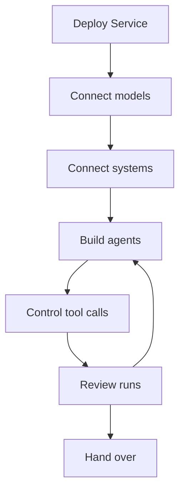

Deliver one customer workflow end to end before expanding the platform. For example, build an agent that reads project notes and proposes follow-up work, then let customer staff test the result and approve any changes to their systems. This guide walks through deployment, integration, acceptance and handover.

Service runs Console, the HTTP API, workers and Service-managed storage on the customer's infrastructure. Choose model, tool, trace and record-memory backends that meet the customer's data requirements: those backends receive the data sent to them. If the customer wants agent execution inside an existing application rather than a managed platform, embed [Harness](../a13n-harness/index.md).

## Deploy in the customer's cloud

Start with a customer-owned deployment account, an agreed public URL, and owners for PostgreSQL, Redis, object storage and encryption keys. Every Service process must use the same durable stores and key ring. Object storage can be an S3-compatible bucket or a shared volume.

1. Choose [Docker Compose on one host](https://github.com/converge-ai-labs/agent-foundation/tree/main/deploy/docker/compose#single-host-deployment-with-native-docker) or [Helm on Kubernetes](https://github.com/converge-ai-labs/agent-foundation/tree/main/deploy/kubernetes). Service also ships as the `a13n-service` Python package; published container images support `linux/amd64` and `linux/arm64`. The Helm chart runs control and worker Deployments plus a migration Job; provide the customer's database, Redis and object storage separately.
2. Set the [required infrastructure](configuration.md#required-infrastructure) and any [outbound proxy](configuration.md#outbound-proxies). Apply proxy variables to each Service process that needs them.
3. [Bootstrap the first administrator](get-started.md#initialize-a-shared-deployment) before opening the deployment to other people.
4. Check `/readyz` on the deployed processes and sign in to Console. A ready process has completed startup; test model access separately in the next step. Resolve a `degraded: ["redis"]` response before accepting the shared deployment.

Keep the selected release, configuration location and infrastructure owners in the handover record. Use the deployment guide for the customer's platform-specific networking and storage setup.

## Use the customer's model accounts

Connect an approved model account in the customer's workspace, save an enabled model, and send a short text request with that model. A successful reply verifies the inference path; a saved provider alone does not.

| Customer setup                                | Configuration to check                                                                                                                                   |
| --------------------------------------------- | -------------------------------------------------------------------------------------------------------------------------------------------------------- |
| Azure OpenAI, AWS Bedrock or Google Vertex AI | Select `azure_openai`, `aws_bedrock` or `google_vertex`. Vertex AI supports a Google Cloud service account or an API-key gateway.                        |
| Model gateway                                 | Set `base_url` where the provider type supports it. Up to 32 extra headers can carry routing or billing values; values are encrypted and never returned. |
| Model server on the customer's network        | Set its origin as `base_url`. Add a plain-HTTP origin to `providers.http_origins`.                                                                       |

Follow [Model providers](models.md#model-providers) for the selected type's fields. Set [model prices](models.md#usage-and-prices) and inspect the recorded usage and calculated cost after the test request.

## Connect the customer's systems

Choose the integration needed by the first task:

| Task needs                                         | Set up                                                                                                                                                      |
| -------------------------------------------------- | ----------------------------------------------------------------------------------------------------------------------------------------------------------- |
| Read or change a business system through its tools | A remote MCP [connection](tools.md#connections), authenticated with OAuth, a bearer token or static headers. Use `config.tools` to select the named tools.  |
| Work on a customer's existing computer             | Run `a13n-envd` there and [register an external target](environments.md#register-an-external-target). Only the registering principal can mount that target. |
| Create files or run commands in a sandbox          | An [environment provider](environments.md#providers) backed by the customer's Docker Engine or hosted sandbox account.                                      |

Test one harmless operation with the identity that will run the workflow, such as reading a known project note. Check both the returned result and the customer's system. Resolve authentication, network or tool-selection failures before adding the integration to the agent.

## Build agents with the customer

1. Open [Agent Composer](agent-composer.md) and describe the input and expected result: “Read these project notes and propose follow-up actions with owners. Ask before creating tasks in our system.”
2. Review the proposed instructions, selected model and tools. Approve the resource writes that match the agreed task.
3. Have customer staff [try the saved agent in Console](use-platform.md) with representative notes. Check that the output identifies real actions and preserves unknown owners instead of inventing them.
4. Adjust the agent and repeat the same sample. Record the accepted agent revision and test result; each run identifies its saved revision.

When an application will call the agent, repeat the accepted workflow through its own credentials using [Connect your application](connect-application.md).

## Control tool calls

Start the customer-system write tools with **Ask**, then exercise both approval and denial. A waiting run should continue only after the pending responses are submitted. Choose **Allow**, **Deny** or **Automatic review** where the workflow requires them. Automatic review uses a model to assess risk: calls below the threshold proceed; calls at or above it are denied or wait for a person. See [Tool permissions](agents-and-runs.md#tool-permissions).

Set `allowed_hosts` for supported [outbound requests](configuration.md#outbound-requests). Enforce shell and other opaque traffic limits at the deployment or environment boundary.

Include connection disablement in the operating procedure. Service checks the connection before dispatching a tool call, so disabling it blocks subsequent calls even from a run already in progress. It does not recall a request already sent to the customer's system. See [Connections](tools.md#connections).

## Review the agent's work

For each acceptance sample, record the input, expected result, actual result and run ID. Use Console's Debug view to check the configuration, execution details, usage and cost.

- To explain a tool call or failure, open **Traces** after configuring a [trace backend](agents-and-runs.md#traces). Each attempt exports its spans.
- To investigate a recurring execution problem, open **Insights → Findings** for evidence and suggested changes. See [Find and improve execution issues](agents-and-runs.md#find-and-improve-execution-issues).
- To review access or account-security changes, use [audit events](identity.md#audit).
- To establish operational checks, follow [Monitor and troubleshoot](monitoring.md) for logs, metrics and workspace usage.

## Hand over operations

Complete the handover with a customer administrator:

1. Assign customer teams their [workspaces and roles](identity.md#organizations-and-workspaces). Have a customer user run the accepted task without relying on your login.
2. Give each application a [service account](identity.md#service-accounts) and its own API keys. Verify the application with those credentials.
3. Record the release, configuration, integration owners, accepted agent revision and troubleshooting path. Back up PostgreSQL, object bytes and the encryption key ring together, then verify the customer's [restore procedure](operations.md#backups). Stored credentials require the key that encrypted them.
4. Remove your [grants](identity.md#members-and-grants) when the engagement ends. Recheck the customer-owned workflow after removal.

The handover is complete when the customer can run, inspect and maintain the agreed workflow with customer-owned access.
