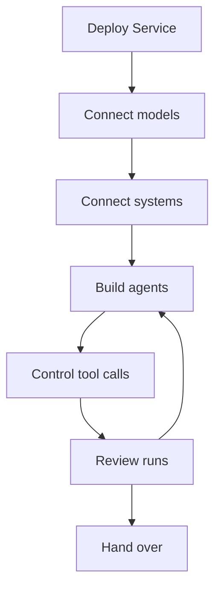

A forward deployed engineer (FDE) builds agents together with a customer and puts them into production in the customer's environment. Service is open source and self-hosted: deploy Console, the HTTP API, workers and Service-managed storage on the customer's infrastructure. Model, tool, trace and record-memory data goes to the backends you configure; select those backends to meet the customer's data requirements. This page connects each step of that work to the Service guide that describes it. To run agents inside an application that the customer already operates, embed the [Harness](../a13n-harness/index.md) library instead.

## Deploy in the customer's cloud

Service ships as the `a13n-service` Python package, a container image for `linux/amd64` and `linux/arm64`, and a Helm chart. Choose the deployment guide that fits the customer's platform:

- [Single host with Docker Compose](https://github.com/converge-ai-labs/agent-foundation/tree/main/deploy/docker/compose#single-host-deployment-with-native-docker): Service, PostgreSQL, Redis, and Console on one machine.
- [Kubernetes with Helm](https://github.com/converge-ai-labs/agent-foundation/tree/main/deploy/kubernetes): control and worker Deployments and a migration Job. The chart uses the customer's PostgreSQL, Redis, and object storage; it does not provision them.

Then prepare the deployment for the customer's network:

- Every deployment needs a public URL, PostgreSQL, Redis, shared object storage, and an encryption key. Object storage is an S3-compatible bucket or a volume that every Service process shares. See [Required infrastructure](configuration.md#required-infrastructure).
- When outbound traffic must pass the customer's proxy, set the standard proxy variables on each Service process. See [Outbound proxies](configuration.md#outbound-proxies).
- Before other people can reach the deployment, create the first administrator with `bootstrap`. See [Initialize a shared deployment](get-started.md#initialize-a-shared-deployment).

## Use the customer's model accounts

Agents call models through model providers that belong to a workspace. Connect the accounts that the customer has already approved:

- Cloud accounts: Azure OpenAI (`azure_openai`), AWS Bedrock (`aws_bedrock`), and Google Vertex AI (`google_vertex`). Vertex AI connects with a Google Cloud service account or through an API-key gateway.
- Model gateways: most provider types accept a `base_url`. A provider can also send up to 32 extra request headers for gateways that route or bill by header. Header values are encrypted and never returned.
- A model server in the customer's network: set its origin as `base_url`. Plain HTTP needs the origin in `providers.http_origins`.

See [Model providers](models.md#model-providers). Each model call is recorded as usage and priced with the model's pricing; see [Usage and prices](models.md#usage-and-prices).

## Connect the customer's systems

- Business systems with a remote MCP server: a connection authenticates with OAuth, a bearer token, or static headers, and `config.tools` limits it to named tools. See [Connections](tools.md#connections).
- Computers in the customer's network: run the `a13n-envd` daemon on the computer and register it as an external target. Only the principal that registered the target can mount it. See [Register an external target](environments.md#register-an-external-target).
- Sandboxes for files and commands: a Docker Engine that the customer runs, or a hosted sandbox account. See [Environment providers](environments.md#providers).

## Build agents with the customer

- Describe the agent in [Agent Composer](agent-composer.md). Composer proposes each resource change, and you approve it before it is written.
- Customer staff try the agent in Console and guide its work. See [Use an existing platform](use-platform.md).
- Applications call the same agents through a Service SDK or the HTTP API. See [Connect your application](connect-application.md).
- Each run uses a saved agent revision, so each result points to the configuration that produced it.

## Control tool calls

- Set a permission for each tool: **Allow**, **Ask**, **Automatic review**, or **Deny**. With **Ask**, the run waits until a person approves or denies the call. With **Automatic review**, a review model assesses the risk of each call; calls below a threshold proceed, and calls at or above it are denied or wait for a person. See [Tool permissions](agents-and-runs.md#tool-permissions).
- Limit the hosts that a run can reach with `allowed_hosts`. Enforce limits for shell commands and other opaque traffic at the deployment or environment boundary. See [Outbound requests](configuration.md#outbound-requests).
- Disable a connection to stop all use of it at once, including the tool calls of runs in progress. See [Connections](tools.md#connections).

## Review the agent's work

- Console's Debug view shows the execution details, configuration, usage, and cost of each run.
- With a trace backend configured, each attempt exports its spans, and Console shows them under **Traces**. See [Traces](agents-and-runs.md#traces).
- **Insights → Findings** lists diagnostic findings with trace evidence and a suggestion. See [Find and improve execution issues](agents-and-runs.md#find-and-improve-execution-issues).
- Changes to access and account security are recorded as audit events. See [Audit](identity.md#audit).
- For logs, metrics, and workspace usage, see [Monitor and troubleshoot](monitoring.md).

## Hand over operations

- Give each customer team its own workspace and roles. See [Organizations and workspaces](identity.md#organizations-and-workspaces).
- Give each application a service account with its own API keys. See [Service accounts](identity.md#service-accounts).
- Back up PostgreSQL, the object store, and the encryption key ring together. Stored credentials cannot be decrypted without the key that wrote them. See [Backups](operations.md#backups).
- When the engagement ends, a customer administrator removes your grants. See [Members and grants](identity.md#members-and-grants).
