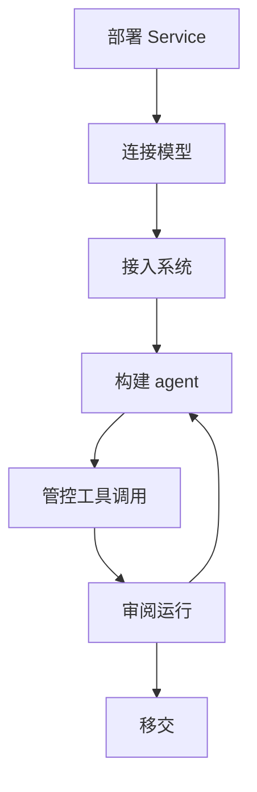

前线部署工程师（FDE，Forward Deployed Engineer）与客户一起构建 agent，并在客户的环境中把 agent 投入生产。Service 开源且可自托管：Console、HTTP API、worker 和全部存储数据都运行在客户掌控的基础设施上。本页把这项工作的每个步骤对应到相应的 Service 指南。如果要在客户已运营的应用内运行 agent，请改为嵌入 [Harness](../a13n-harness/index.md) 库。

## 部署到客户的云中

Service 以 `a13n-service` Python 包、支持 `linux/amd64` 和 `linux/arm64` 的容器镜像以及 Helm Chart 发布。按客户的平台选择部署指南：

- [使用 Docker Compose 单机部署](https://github.com/converge-ai-labs/agent-foundation/tree/main/deploy/docker/compose#single-host-deployment-with-native-docker)：Service、PostgreSQL、Redis 和 Console 运行在同一台机器上。
- [使用 Helm 部署到 Kubernetes](https://github.com/converge-ai-labs/agent-foundation/tree/main/deploy/kubernetes)：control 和 worker 两个 Deployment 加一个迁移 Job。Chart 使用客户的 PostgreSQL、Redis 和对象存储，不负责创建它们。

然后根据客户的网络准备部署：

- 每个部署都需要公开 URL、PostgreSQL、Redis、共享对象存储和加密密钥。对象存储可以是兼容 S3 的存储桶，也可以是所有 Service 进程共享的卷。参阅[必需的基础设施](configuration.md#required-infrastructure)。
- 出站流量必须经过客户的代理时，在每个 Service 进程上设置标准代理环境变量。参阅[出站代理](configuration.md#outbound-proxies)。
- 在其他人能访问部署之前，用 `bootstrap` 创建第一个管理员。参阅[初始化共享部署](get-started.md#initialize-a-shared-deployment)。

## 使用客户的模型账号

agent 通过属于工作空间的模型 provider 调用模型。连接客户已经批准使用的账号：

- 云账号：Azure OpenAI（`azure_openai`）、AWS Bedrock（`aws_bedrock`）和 Google Vertex AI（`google_vertex`）。Vertex AI 可以使用 Google Cloud 服务账号连接，也可以通过 API 密钥网关连接。
- 模型网关：大多数 provider 类型接受 `base_url`。provider 还可以携带最多 32 个额外请求头，供按请求头路由或计费的网关使用。请求头的值会加密保存，且永不返回。
- 客户网络中的模型服务器：把它的源地址设为 `base_url`。使用明文 HTTP 时，需要把该源地址加入 `providers.http_origins`。

参阅[模型 provider](models.md#model-providers)。每次模型调用都记录为用量，并按该模型的价格计费；参阅[用量与价格](models.md#usage-and-prices)。

## 接入客户的系统

- 通过远程 MCP 服务器接入业务系统：连接可以使用 OAuth、bearer token 或静态请求头认证，`config.tools` 可以把连接限制为指定工具。参阅[连接](tools.md#connections)。
- 客户网络中的计算机：在计算机上运行 `a13n-envd` 守护进程，并注册为外部目标。只有注册该目标的主体可以挂载它。参阅[注册外部目标](environments.md#register-an-external-target)。
- 用于文件和命令的沙箱：客户运行的 Docker Engine，或托管沙箱账号。参阅[环境 provider](environments.md#providers)。

## 与客户一起构建 agent

- 在 [Agent Composer](agent-composer.md) 中描述 agent。Composer 为每项资源修改提出方案，你批准后才会写入。
- 客户员工在 Console 中试用 agent 并指导它的工作。参阅[使用已有平台](use-platform.md)。
- 应用通过 Service SDK 或 HTTP API 调用同一批 agent。参阅[连接你的应用](connect-application.md)。
- 每次运行都使用一个已保存的 agent 修订版本，因此每个结果都能对应到产生它的配置。

## 管控工具调用

- 为每个工具设置权限：**允许**、**询问**、**自动审查**或**拒绝**。设为**询问**时，运行会等待，直到有人批准或拒绝该调用。设为**自动审查**时，审查模型评估每次调用的风险；低于阈值的调用继续执行，达到或超过阈值的调用被拒绝或等待人工处理。参阅[工具权限](agents-and-runs.md#tool-permissions)。
- 用 `allowed_hosts` 限制一次运行可以访问的主机。Shell 命令和其他不透明流量的限制，需要在部署或环境边界上实施。参阅[出站请求](configuration.md#outbound-requests)。
- 禁用连接可以立即停止它的全部使用，包括进行中运行的工具调用。参阅[连接](tools.md#connections)。

## 审阅 agent 的工作

- Console 的 Debug 视图展示每次运行的执行细节、配置、用量和费用。
- 配置 trace 后端后，每次尝试都会导出 span，Console 在 **Traces** 中显示它们。参阅 [Trace](agents-and-runs.md#traces)。
- 在 **改进 → 发现（Improve → Findings）** 中查看诊断发现项，每项附带 trace 证据和改进建议。参阅[发现并改进执行问题](agents-and-runs.md#find-and-improve-execution-issues)。
- 访问权限和账号安全的变更都记录为审计事件。参阅[审计](identity.md#audit)。
- 日志、指标和工作空间用量，参阅[监控与排障](monitoring.md)。

## 移交运维

- 为客户的每个团队分配独立的工作空间和角色。参阅[组织与工作空间](identity.md#organizations-and-workspaces)。
- 为每个应用创建服务账号，并使用它自己的 API 密钥。参阅[服务账号](identity.md#service-accounts)。
- 同时备份 PostgreSQL、对象存储和加密密钥环。没有写入时使用的密钥，已存储的凭据就无法解密。参阅[备份](operations.md#backups)。
- 项目结束时，由客户的管理员移除你的授权。参阅[成员与授权](identity.md#members-and-grants)。
