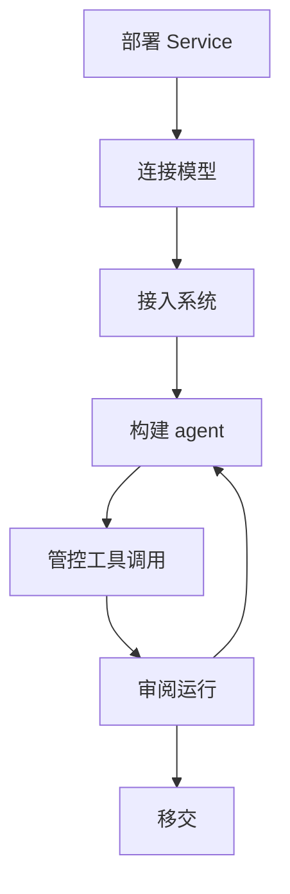

先完整交付一个客户工作流程，再扩大平台范围。例如，构建一个读取项目笔记并提出后续行动的 agent，让客户员工测试结果，并批准对业务系统的修改。本指南依次介绍部署、集成、验收和移交。

Service 将 Console、HTTP API、worker 和 Service 管理的存储运行在客户的基础设施上。选择符合客户数据要求的模型、工具、trace 和记录型记忆后端：发给这些后端的数据会进入相应系统。如果客户需要在已有应用内执行 agent，而不是搭建托管平台，请嵌入 [Harness](../a13n-harness/index.md)。

## 部署到客户的云中

先准备客户持有的部署账号，确定公开 URL，以及 PostgreSQL、Redis、对象存储和加密密钥的负责人。所有 Service 进程必须使用同一套持久存储和密钥环。对象存储可以是兼容 S3 的存储桶或共享卷。

1. 选择 [Docker Compose 单机部署](https://github.com/converge-ai-labs/agent-foundation/tree/main/deploy/docker/compose#single-host-deployment-with-native-docker)或 [Helm Kubernetes 部署](https://github.com/converge-ai-labs/agent-foundation/tree/main/deploy/kubernetes)。Service 也以 `a13n-service` Python 包发布；发布的容器镜像支持 `linux/amd64` 和 `linux/arm64`。Helm chart 运行 control 和 worker Deployment，以及迁移 Job；客户的数据库、Redis 和对象存储需另行提供。
2. 配置[必需的基础设施](configuration.md#required-infrastructure)和所需的[出站代理](configuration.md#outbound-proxies)。为每个需要代理的 Service 进程设置代理环境变量。
3. 在向其他人开放部署前，[初始化第一个管理员](get-started.md#initialize-a-shared-deployment)。
4. 检查已部署进程的 `/readyz`，并登录 Console。就绪表示进程已完成启动；下一步还要单独测试模型访问。如果响应包含 `degraded: ["redis"]`，先排除故障再验收共享部署。

在移交记录中写明所选发布版本、配置位置和基础设施负责人。客户平台特有的网络和存储设置，按对应部署指南完成。

## 使用客户的模型账号

在客户工作空间中连接已获准使用的模型账号，保存一个已启用模型，并用它发送简短文本请求。收到成功回复才能验证推理链路；保存 provider 本身不足以证明调用成功。

| 客户配置                                      | 需要检查的设置                                                                                               |
| --------------------------------------------- | ------------------------------------------------------------------------------------------------------------ |
| Azure OpenAI、AWS Bedrock 或 Google Vertex AI | 选择 `azure_openai`、`aws_bedrock` 或 `google_vertex`。Vertex AI 支持 Google Cloud 服务账号或 API 密钥网关。 |
| 模型网关                                      | 在 provider 类型支持时设置 `base_url`。最多 32 个额外请求头可用于路由或计费；值会加密保存，且永不返回。      |
| 客户网络中的模型服务器                        | 将其源地址设为 `base_url`。明文 HTTP 源地址需加入 `providers.http_origins`。                                 |

按[模型 provider](models.md#model-providers)填写所选类型的字段。设置[模型价格](models.md#usage-and-prices)，在测试请求后检查记录的用量和计算出的费用。

## 接入客户的系统

根据第一个任务选择集成方式：

| 任务需要                   | 配置方式                                                                                                                    |
| -------------------------- | --------------------------------------------------------------------------------------------------------------------------- |
| 通过工具读取或修改业务系统 | 创建远程 MCP [连接](tools.md#connections)，使用 OAuth、bearer token 或静态请求头认证。用 `config.tools` 选择指定工具。      |
| 操作客户已有的计算机       | 在计算机上运行 `a13n-envd`，并[注册外部目标](environments.md#register-an-external-target)。只有注册该目标的主体可以挂载它。 |
| 在沙箱中创建文件或运行命令 | 配置[环境 provider](environments.md#providers)，使用客户的 Docker Engine 或托管沙箱账号。                                   |

使用将来执行该流程的身份，测试一次无害操作，例如读取一份已知项目笔记。同时检查返回结果和客户系统。先解决认证、网络或工具选择问题，再将集成加入 agent。

## 与客户一起构建 agent

1. 打开 [Agent Composer](agent-composer.md)，描述输入和预期结果：“读取这些项目笔记，提出带负责人的后续行动。在我们的系统中创建任务前先询问。”
2. 检查提出的指令、模型和工具。批准符合约定任务的资源写入。
3. 让客户员工使用有代表性的笔记，[在 Console 中试用保存后的 agent](use-platform.md)。检查输出是否找出了真实行动，并保留未知负责人，而不是编造人选。
4. 调整 agent，重复同一份样例。记录验收通过的 agent 修订版本和测试结果；每次运行都会标明所用的保存版本。

如果最终由应用调用 agent，按[连接你的应用](connect-application.md)，使用应用自己的凭据重复已验收的流程。

## 管控工具调用

先将客户系统的写入工具设为**询问**，分别测试批准和拒绝。等待中的运行应在提交待处理回复后才继续。根据流程需要选择**允许**、**拒绝**或**自动审查**。自动审查由模型评估风险：低于阈值的调用继续执行；达到或超过阈值的调用被拒绝或等待人工处理。参阅[工具权限](agents-and-runs.md#tool-permissions)。

用 `allowed_hosts` 限制受支持的[出站请求](configuration.md#outbound-requests)。Shell 和其他不透明流量的限制应在部署或环境边界实施。

把禁用连接写入操作规程。Service 在分派工具调用前检查连接，因此禁用后会阻止后续调用，包括来自进行中运行的调用。已经发给客户系统的请求不会被撤回。参阅[连接](tools.md#connections)。

## 审阅 agent 的工作

为每份验收样例记录输入、预期结果、实际结果和运行 ID。在 Console 的 Debug 视图中检查配置、执行细节、用量和费用。

- 要解释工具调用或失败原因，配置 [trace 后端](agents-and-runs.md#traces)后打开 **Traces**。每次尝试都会导出 span。
- 要调查反复出现的执行问题，打开**洞察 → 发现（Insights → Findings）**，查看证据和修改建议。参阅[发现并改进执行问题](agents-and-runs.md#find-and-improve-execution-issues)。
- 要检查访问权限或账号安全变更，查看[审计事件](identity.md#audit)。
- 要建立日常运维检查，按[监控与排障](monitoring.md)配置日志、指标和工作空间用量观测。

## 移交运维

与客户管理员一起完成移交：

1. 为客户团队分配[工作空间和角色](identity.md#organizations-and-workspaces)。让客户用户不依赖你的登录，独立执行已验收的任务。
2. 为每个应用创建[服务账号](identity.md#service-accounts)，使用各自的 API 密钥。用这些凭据验证应用。
3. 记录发布版本、配置、集成负责人、验收通过的 agent 修订版本和排障路径。同时备份 PostgreSQL、对象内容和加密密钥环，再验证客户的[恢复流程](operations.md#backups)。已存储凭据需要使用加密时的密钥才能解密。
4. 项目结束时移除你的[授权](identity.md#members-and-grants)，随后再次检查客户自己持有访问权限的工作流程。

客户能够使用自己持有的访问权限运行、检查和维护约定流程，才算完成移交。
