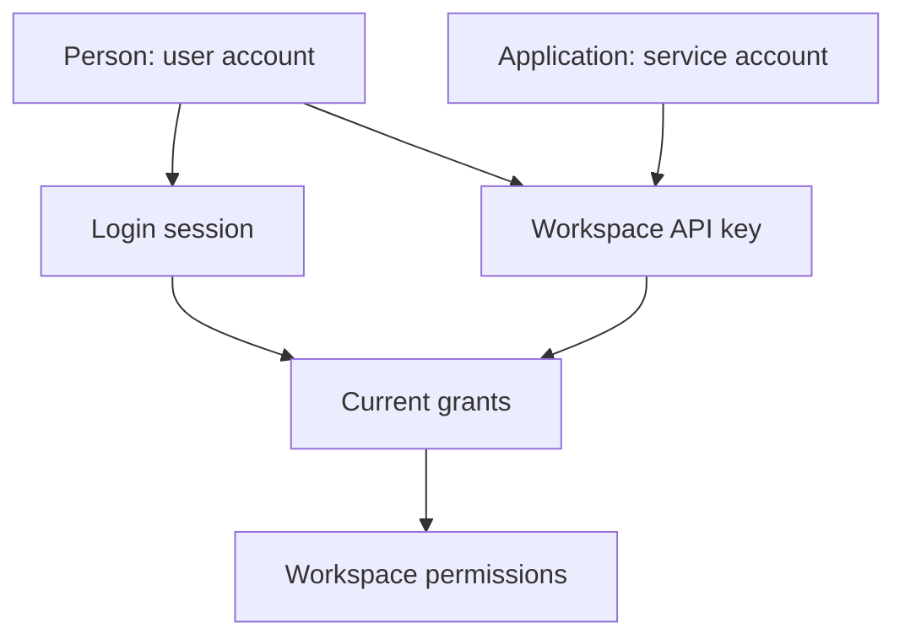

To give someone access, choose a workspace and a role. Invite a person through Console; give an application a service account and an API key. This guide takes you through both paths, then shows how to check and remove access.

A user or service account is a **principal**. A **grant** assigns that principal a role in an organization or workspace. A login session or API key authenticates the principal; the principal's current grants determine what the request can do.



## Organizations and workspaces

Start with the workspace where the person or application will work. Each agent, session, provider, model, connection and environment belongs to one workspace. The organization groups those workspaces and their members.

[Bootstrap](get-started.md#register-your-administrator-account) creates the first organization, workspace and administrator. To add a workspace, sign in as an organization administrator and open **Organization settings → Workspaces**. The API equivalent is `POST /api/v1/organizations/{organization_id}/workspaces` with a `name` field. Further organizations cannot be created through the API.

Use the workspace ID when managing access. For ordinary resource requests, a login session selects the workspace with `X-Workspace-ID`; an API key already selects its workspace. See [workspace selection](http.md#workspace).

Administrators can rename organizations and workspaces and set PNG, JPEG or WebP icons. Archive a workspace only when its work is finished: `POST /api/v1/workspaces/{workspace_id}/archive` is permanent and requires an organization administrator. Archiving revokes pending invitations and leaves resources readable. Changes return `disabled`, while access-removal operations remain available.

## Roles

Choose the role from the work the recipient needs to do:

| Role      | Permissions             | Choose it to…                                     |
| --------- | ----------------------- | ------------------------------------------------- |
| `viewer`  | read                    | Inspect configuration, conversations and results. |
| `runner`  | read, run               | Use existing agents and steer their runs.         |
| `builder` | read, run, write        | Create and change agents and resources.           |
| `admin`   | read, run, write, admin | Manage access, workspace settings and audit.      |

Grant a workspace role for access to that workspace. Grant an organization role when the person needs that role across **every workspace** in the organization. Workspace grants also allow reading the organization itself.

The permissions from organization and workspace grants are combined. For example, a workspace `viewer` grant does not reduce an organization `builder` grant. To reduce access, change the grant that supplies the higher permission. Read a workspace's `permissions` list to see the effective verbs for the credential making the request.

## Invitations

To invite a teammate, sign in as an administrator of the intended scope:

1. Open **Invitations** in workspace or organization settings.
2. Enter the person's email address and choose a role. A workspace invitation is enough when the person needs only that workspace.
3. Send the invitation. With [SMTP configured](configuration.md#identity-and-mail), Service mails the link. Without SMTP, copy the one-time invitation link and share it with the recipient.
4. Ask the recipient to open the link. A new user sets a name and password; an existing user confirms with their own password. Acceptance signs the user in and grants the invited role.
5. Have the user open the workspace and check that the intended actions are available.

The API equivalent is `POST /api/v1/workspaces/{workspace_id}/invitations` with `{email, role}`, or the organization equivalent. The response reports `delivery: "queued"` for email or `delivery: "manual"` with a one-time `invitation_url`. Sending and resending require a login session; API keys may revoke invitations but cannot send them.

An invitation replaces any existing grant at its scope when accepted. It expires after `auth.invitation_seconds` (seven days by default). Resending replaces the link and restarts expiry. Revoke an invitation when access is no longer wanted. API resend and revoke operations require the invitation's current [If-Match value](http.md#concurrency-control).

If acceptance returns `409 conflict`, check whether the invitation was already used, revoked or expired, or whether its sender lost administrative access. A background sweep removes expired and revoked invitations; their links then return `404`. Each email address can have one pending invitation per scope. New accounts join through invitations or bootstrap; there is no public sign-up.

## API keys

Use a personal key for a script acting as you, or a [service-account key](#service-accounts) for an application. Each key is confined to one workspace. It uses the principal's current grants on every request, so role changes affect existing keys too. Even an organization administrator's key has at most `read` on the organization itself.

To create a personal key:

1. Sign in and open **API keys** in the sidebar.
2. Choose a workspace where you have at least `read`, name the key and optionally set an expiry.
3. Copy the secret before closing the result. The API returns it once in `secret`, alongside key metadata in `key`; Service stores only its hash.
4. Set `A13N_URL` to the Service base URL, `A13N_API_KEY` to the secret and `WORKSPACE_ID` to that key's workspace ID. Verify the workspace permissions, then read the agents:

```sh
curl "$A13N_URL/api/v1/workspaces/$WORKSPACE_ID" \
  -H "Authorization: Bearer $A13N_API_KEY"
curl "$A13N_URL/api/v1/agents" \
  -H "Authorization: Bearer $A13N_API_KEY"
```

The workspace response's `permissions` should match the intended role. The agent list confirms resource access; it may be empty in a new workspace. Continue with [application integration](connect-application.md) when access is correct.

The issuance API is `POST /api/v1/users/me/keys` with `{name, workspace_id, expires_at?}`. Issuing any key requires a login session: API keys cannot create more keys. List or revoke your keys under **API keys**, or use `GET /api/v1/users/me/keys` and `DELETE /api/v1/users/me/keys/{key_id}`. Workspace administrators use **Member keys** or `/api/v1/workspaces/{workspace_id}/keys` for all keys in that workspace.

API revocation requires the key's current [If-Match value](http.md#concurrency-control), derived from its `id` and `version`. To rotate a key, issue a replacement, verify the application with it, then revoke the old key. `last_used_at` helps check use, with updates at most once a minute.

## Service accounts

Create a service account when an application needs its own access, independent of a person's keys. Sign in as a workspace administrator and open **Workspace settings → Service accounts**:

1. Create an account with a descriptive name. Choose `runner` to use existing agents, or `builder` if the application must also create resources.
2. Open the account and create an API key. Copy the secret from the one-time result.
3. Give the application that key and run the two [verification requests](#api-keys) above. Check the permissions before starting work.

For API automation, create the account with `POST /api/v1/workspaces/{workspace_id}/service-accounts` and this body:

```json
{"name": "Support application", "description": "Runs the support agent", "role": "runner"}
```

Then issue its key with `POST …/service-accounts/{account_id}/keys` and `{name, expires_at?}`. Key issuance requires an administrator's login session. The account belongs to this workspace for its whole life and can receive roles only there.

Choose how to stop access:

- **Pause:** `PATCH …/service-accounts/{account_id}` with `{"status": "disabled"}`. Keys remain stored but stop authenticating. Setting `status` back to `active` restores their use, subject to expiry and revocation.
- **Retire:** `DELETE …/service-accounts/{account_id}` removes grants, revokes keys and disables the account. Its record remains for audit. Restoring it requires an active status, a new role grant and a fresh key.

Both update and delete require the account's current [If-Match value](http.md#concurrency-control). Read the account first to obtain its `ETag`. Updates can also change its name, description or role. In an archived workspace, disabling and retiring remain available; restoring access does not.

## Members and grants

Use grants to change access for an existing member; use [invitations](#invitations) to bring in a new person. Organization administrators can find members with `GET /api/v1/organizations/{organization_id}/members`, optionally filtered by `kind=user` or `kind=service_account`.

For a workspace, manage `/api/v1/workspaces/{workspace_id}/grants`:

1. Create a grant with `POST` and `{principal_id, role}`. A principal has at most one grant per scope.
2. Change its role with `PATCH …/grants/{grant_id}` and `{role}`. A role change replaces the grant; use the new ID returned by the response for subsequent operations.
3. Remove access with `DELETE …/grants/{grant_id}`. Check organization grants too: their permissions still apply in the workspace.

Organization grants use the equivalent `/api/v1/organizations/{organization_id}/grants` paths. Grant routes take no `If-Match`. The last active organization administrator cannot be removed, demoted or disabled; the request returns `409 conflict` with reason `last_organization_admin`. Removing a service account's last grant retires that account and revokes its keys.

## Sign in and login sessions

Console handles login cookies and CSRF tokens. Sign in with your email address and password. Under **Personal settings → Login sessions**, review active logins and revoke those you no longer use. Logging out ends the current login session.

For a custom client, `POST /api/v1/auth/login` accepts `{email, password}` and returns a CSRF token while setting the login cookie. Send `X-CSRF-Token` on cookie-authenticated requests that change state. Browser origins must match the Service's public origin; loopback deployments accept `localhost` and `127.0.0.1`. See [HTTP authentication](http.md#authentication).

The HTTPS cookie is `__Host-a13n_session` with `Secure`, `HttpOnly` and `SameSite=Strict`. Plain HTTP uses `a13n_session` without `Secure`. Sessions expire after `auth.session_seconds` of inactivity (12 hours by default), and login attempts are rate limited per client address and email.

`GET /api/v1/auth/session` reads the current login session and CSRF token; `POST /api/v1/auth/logout` ends it. Both require the session cookie. `GET /api/v1/users/me/login-sessions` lists your logins for management. These operations reject API keys with `403 forbidden`.

## Your account

Use a login session for profile changes, password and email changes, login-session management and account disabling. An API key can read its principal's profile, but cannot make these account changes.

| Task                       | What to expect                                                                                                                                                                                                  |
| -------------------------- | --------------------------------------------------------------------------------------------------------------------------------------------------------------------------------------------------------------- |
| Change your profile        | Update your name or upload a PNG, JPEG or WebP avatar.                                                                                                                                                          |
| Change your password       | Supply the current password. The new password needs at least eight characters; other login sessions end.                                                                                                        |
| Reset a forgotten password | Use the sign-in page's password-reset flow. SMTP delivers a one-use link valid for `auth.link_seconds`; resetting ends all login sessions.                                                                      |
| Change your email          | Supply the new address and current password. SMTP sends a confirmation link to the new address; opening it applies the change and ends all login sessions.                                                      |
| Disable your account       | `POST /api/v1/users/me/disable` with the current password stops authentication and revokes outstanding reset and email-change links. Grants and keys remain stored. Only an operator can re-enable the account. |

Current-password checks share a rate limit per client address and account. Runs started by a disabled user stop at their next authority check.

## Operator account control

An operator with deployment access can disable or re-enable a user, including one who disabled their own account. Run the appropriate command with the deployment's configuration:

```sh
a13n-service --config service.toml user disable --email person@example.com
a13n-service --config service.toml user enable --email person@example.com
```

These are alternative actions. Disabling stops the user's credentials; accepted runs stop at their next authority refresh. Enabling restores use of the retained grants and keys, subject to expiry and revocation. The commands require no organization or workspace role. Audit events have no actor and record `details.authority = "operator"`.

## Audit

After changing access, use the audit trail to check who performed the action, its target and its outcome. Security and access changes produce immutable events with `actor_id`, `action`, `outcome` (`ok`, `denied` or `failed`) and bounded details. Refused administrative changes appear as `denied`.

| Scope                           | Where to read it                                                                              | Required access            |
| ------------------------------- | --------------------------------------------------------------------------------------------- | -------------------------- |
| Organization and its workspaces | **Organization settings → Audit**, `GET /api/v1/organizations/{organization_id}/audit-events` | Organization administrator |
| One workspace                   | **Workspace settings → Audit**, `GET /api/v1/workspaces/{workspace_id}/audit-events`          | Workspace administrator    |
| Your actions and account events | `GET /api/v1/users/me/audit-events`                                                           | Your login session         |

Events are newest first. Follow the returned cursor to inspect older events.
