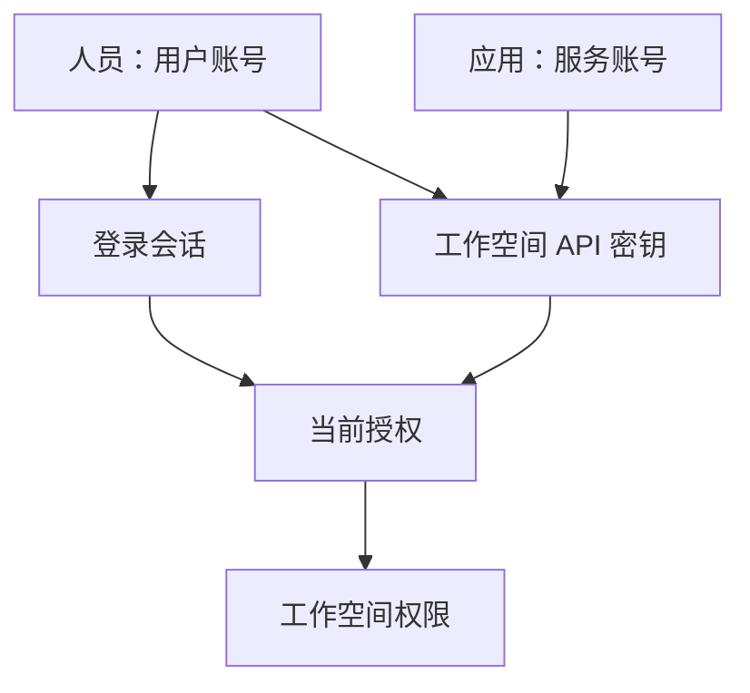

授予访问权限时，先选择工作空间和角色。通过 Console 邀请用户；为应用创建服务账号和 API 密钥。本页带你完成这两条路径，再检查和移除访问权限。

用户或服务账号称为**主体**。**授权** 为主体分配组织或工作空间中的角色。登录会话或 API 密钥用于认证主体；主体当前的授权决定请求可以执行哪些操作。



## 组织与工作空间

先确定用户或应用将在哪个工作空间开展工作。每个 agent、会话、provider、模型、连接和环境都属于一个工作空间。组织管理这些工作空间及其成员。

[初始化](get-started.md#register-your-administrator-account)会创建首个组织、工作空间和管理员。要添加工作空间，请以组织管理员身份登录，打开 **组织设置 → 工作区**。对应 API 是 `POST /api/v1/organizations/{organization_id}/workspaces`，请求体包含 `name` 字段。API 不支持创建其他组织。

管理访问权限时使用工作空间 ID。普通资源请求中，登录会话通过 `X-Workspace-ID` 选择工作空间；API 密钥已绑定工作空间。参阅[工作空间选择](http.md#workspace)。

管理员可以重命名组织和工作空间，并设置 PNG、JPEG 或 WebP 图标。只有工作结束后才应归档工作空间：`POST /api/v1/workspaces/{workspace_id}/archive` 是永久操作，需要组织管理员权限。归档会撤销待处理邀请，资源仍可读取。修改请求返回 `disabled`，移除访问权限的操作仍然可用。

## 角色

根据接收者要完成的工作选择角色：

| 角色      | 权限                    | 适用任务                           |
| --------- | ----------------------- | ---------------------------------- |
| `viewer`  | read                    | 查看配置、对话和结果。             |
| `runner`  | read, run               | 使用已有 agent 并引导运行。        |
| `builder` | read, run, write        | 创建和修改 agent 与资源。          |
| `admin`   | read, run, write, admin | 管理访问权限、工作空间设置和审计。 |

工作空间角色授予该工作空间的访问权限。用户需要在组织内的**每个工作空间**拥有该角色时，再授予组织角色。工作空间授权还允许读取所属组织。

组织授权与工作空间授权的权限会合并。例如，工作空间的 `viewer` 授权不会降低组织 `builder` 授权带来的权限。要降低权限，必须修改提供较高权限的授权。读取工作空间的 `permissions` 列表，可以看到当前请求凭据实际拥有的操作权限。

## 邀请

邀请团队成员时，以目标范围的管理员身份登录：

1. 在工作空间或组织设置中打开 **邀请**。
2. 输入对方邮箱并选择角色。只需要访问一个工作空间时，发送工作空间邀请即可。
3. 发送邀请。[配置 SMTP](configuration.md#identity-and-mail) 后，Service 会通过邮件发送链接。未配置 SMTP 时，复制一次性显示的邀请链接并分享给接收者。
4. 请接收者打开链接。新用户设置名称和密码；已有用户使用自己的密码确认。接受后，用户会自动登录并获得邀请中的角色。
5. 请用户打开工作空间，检查所需操作是否可用。

对应 API 是 `POST /api/v1/workspaces/{workspace_id}/invitations`，请求体为 `{email, role}`；组织邀请使用对应的组织路径。邮件发送的响应为 `delivery: "queued"`；手动分享的响应为 `delivery: "manual"`，并一次性提供 `invitation_url`。发送和重发需要登录会话；API 密钥可以撤销邀请，但不能发送邀请。

接受邀请会替换该范围内已有的授权。邀请在 `auth.invitation_seconds` 后过期，默认七天。重发会替换链接并重新计算有效期。不再需要授权时，撤销邀请。通过 API 重发或撤销时，需要邀请当前的 [If-Match 值](http.md#concurrency-control)。

接受邀请返回 `409 conflict` 时，检查邀请是否已使用、撤销或过期，以及发送者是否失去管理权限。后台会清理过期和已撤销的邀请，之后链接返回 `404`。同一邮箱在每个范围内最多有一条待处理邀请。新账号通过邀请或初始化创建，没有公开注册入口。

## API 密钥

以你的身份执行的脚本使用个人密钥；应用使用[服务账号密钥](#service-accounts)。每个密钥限定在一个工作空间内。每次请求都读取主体当前的授权，因此角色变更也会影响已有密钥。即使密钥属于组织管理员，该密钥在组织本身也最多只有 `read` 权限。

创建个人密钥：

1. 登录后打开侧边栏的 **API 密钥**。
2. 选择你至少拥有 `read` 权限的工作空间，填写密钥名称，并按需设置过期时间。
3. 关闭结果前复制密钥值。API 在 `secret` 中一次性返回密钥值，在 `key` 中返回元数据；Service 只存储其哈希。
4. 将 `A13N_URL` 设为 Service 基础 URL，`A13N_API_KEY` 设为密钥值，`WORKSPACE_ID` 设为该密钥的工作空间 ID。先验证工作空间权限，再读取 agent：

```sh
curl "$A13N_URL/api/v1/workspaces/$WORKSPACE_ID" \
  -H "Authorization: Bearer $A13N_API_KEY"
curl "$A13N_URL/api/v1/agents" \
  -H "Authorization: Bearer $A13N_API_KEY"
```

工作空间响应中的 `permissions` 应与预期角色一致。agent 列表确认资源可访问；新工作空间的列表可能为空。访问权限正确后，继续[应用集成](connect-application.md)。

签发 API 为 `POST /api/v1/users/me/keys`，请求体是 `{name, workspace_id, expires_at?}`。签发任何密钥都需要登录会话，API 密钥不能创建更多密钥。在 **API 密钥** 中列出或撤销自己的密钥，或者使用 `GET /api/v1/users/me/keys` 和 `DELETE /api/v1/users/me/keys/{key_id}`。工作空间管理员通过 **成员密钥** 或 `/api/v1/workspaces/{workspace_id}/keys` 管理该工作空间的所有密钥。

通过 API 撤销密钥时，需要根据其 `id` 和 `version` 得到当前 [If-Match 值](http.md#concurrency-control)。轮换密钥时，先签发新密钥并验证应用，再撤销旧密钥。`last_used_at` 可帮助检查使用情况，最多每分钟更新一次。

## 服务账号

应用需要独立于个人密钥的访问权限时，创建服务账号。以工作空间管理员身份登录，打开 **工作区设置 → 服务账号**：

1. 创建账号并填写明确的名称。使用已有 agent 时选择 `runner`；应用还需要创建资源时选择 `builder`。
2. 打开该账号并创建 API 密钥。从一次性结果中复制密钥值。
3. 将密钥提供给应用，并运行上面的两条[验证请求](#api-keys)。开始工作前检查实际权限。

通过 API 自动化时，调用 `POST /api/v1/workspaces/{workspace_id}/service-accounts`，请求体如下：

```json
{"name": "Support application", "description": "Runs the support agent", "role": "runner"}
```

然后调用 `POST …/service-accounts/{account_id}/keys`，传入 `{name, expires_at?}` 签发密钥。签发需要管理员的登录会话。账号在整个生命周期内属于该工作空间，也只能获得该工作空间中的角色。

按需要选择停止访问的方式：

- **暂停：** 调用 `PATCH …/service-accounts/{account_id}`，传入 `{"status": "disabled"}`。密钥仍保留，但不能认证。将 `status` 改回 `active` 后，未过期且未撤销的密钥恢复可用。
- **停用：** 调用 `DELETE …/service-accounts/{account_id}`，移除授权、撤销密钥并禁用账号。账号记录保留供审计。恢复时需要启用状态、重新授予角色并签发新密钥。

更新和删除都需要账号当前的 [If-Match 值](http.md#concurrency-control)。先读取账号以获取 `ETag`。更新还可修改名称、描述或角色。在已归档的工作空间中，禁用和停用仍然可用，恢复访问则不可用。

## 成员与授权

通过授权调整已有成员的访问权限；通过[邀请](#invitations)引入新成员。组织管理员可以调用 `GET /api/v1/organizations/{organization_id}/members` 查找成员，并按 `kind=user` 或 `kind=service_account` 筛选。

工作空间授权使用 `/api/v1/workspaces/{workspace_id}/grants`：

1. 用 `POST` 和 `{principal_id, role}` 创建授权。每个主体在同一范围内最多有一条授权。
2. 用 `PATCH …/grants/{grant_id}` 和 `{role}` 修改角色。角色变更会替换授权；后续操作使用响应返回的新 ID。
3. 用 `DELETE …/grants/{grant_id}` 移除访问权限。同时检查组织授权：组织授权提供的权限在该工作空间中仍然生效。

组织授权使用对应的 `/api/v1/organizations/{organization_id}/grants` 路径。授权路由不接受 `If-Match`。最后一位活跃的组织管理员不能被移除、降级或禁用；这类请求返回 `409 conflict`，原因为 `last_organization_admin`。移除服务账号的最后一条授权会停用该账号并撤销其密钥。

## 登录与登录会话

Console 负责处理登录 cookie 和 CSRF token。使用邮箱和密码登录后，在 **个人设置 → 登录会话** 中检查活跃登录，并撤销不再使用的登录会话。退出登录会结束当前登录会话。

自定义客户端调用 `POST /api/v1/auth/login`，传入 `{email, password}`；Service 设置登录 cookie 并返回 CSRF token。使用 cookie 认证的状态修改请求需要发送 `X-CSRF-Token`。浏览器源必须匹配 Service 的公共源；回环部署接受 `localhost` 和 `127.0.0.1`。参阅 [HTTP 认证](http.md#authentication)。

HTTPS cookie 名为 `__Host-a13n_session`，带有 `Secure`、`HttpOnly` 和 `SameSite=Strict`。明文 HTTP 使用不带 `Secure` 的 `a13n_session`。登录会话在闲置 `auth.session_seconds` 后过期，默认 12 小时；登录尝试按客户端地址和邮箱限流。

`GET /api/v1/auth/session` 读取当前登录会话和 CSRF token；`POST /api/v1/auth/logout` 结束当前登录会话，两者都需要会话 cookie。`GET /api/v1/users/me/login-sessions` 列出你的登录会话供管理。这些操作拒绝 API 密钥，返回 `403 forbidden`。

## 你的账号

修改个人资料、密码和邮箱，管理登录会话以及禁用账号，都使用登录会话。API 密钥可以读取其主体的个人资料，但不能执行这些账号修改。

| 任务           | 操作结果                                                                                                                                                |
| -------------- | ------------------------------------------------------------------------------------------------------------------------------------------------------- |
| 修改个人资料   | 更新名称，或上传 PNG、JPEG、WebP 头像。                                                                                                                 |
| 修改密码       | 提供当前密码。新密码至少八个字符；其他登录会话会结束。                                                                                                  |
| 重置遗忘的密码 | 使用登录页的密码重置流程。SMTP 发送有效期为 `auth.link_seconds` 的一次性链接；重置后结束所有登录会话。                                                  |
| 修改邮箱       | 提供新地址和当前密码。SMTP 向新地址发送确认链接；打开后修改生效，并结束所有登录会话。                                                                   |
| 禁用账号       | 调用 `POST /api/v1/users/me/disable` 并提供当前密码，会停止认证，撤销尚未使用的密码重置和邮箱修改链接。授权和密钥仍保留。只有运维人员可以重新启用账号。 |

当前密码检查共享按客户端地址和账号计算的限流额度。被禁用用户启动的运行会在下次权限检查时停止。

## 运维账号控制

具有部署访问权限的运维人员可以禁用或重新启用用户，包括自行禁用账号的用户。使用部署配置运行所需命令：

```sh
a13n-service --config service.toml user disable --email person@example.com
a13n-service --config service.toml user enable --email person@example.com
```

这是两种供选择的操作。禁用会停止用户凭据；已接收的运行会在下次权限刷新时停止。启用后，保留的授权及未过期、未撤销的密钥恢复可用。这些命令不需要组织或工作空间角色。审计事件没有 actor，并记录 `details.authority = "operator"`。

## 审计

修改访问权限后，通过审计记录检查执行者、目标和结果。安全与访问权限变更会产生不可变事件，包含 `actor_id`、`action`、`outcome`（`ok`、`denied` 或 `failed`）及有界详情。被拒绝的管理修改显示为 `denied`。

| 范围               | 读取入口                                                                        | 所需权限       |
| ------------------ | ------------------------------------------------------------------------------- | -------------- |
| 组织及其工作空间   | **组织设置 → 审计**、`GET /api/v1/organizations/{organization_id}/audit-events` | 组织管理员     |
| 单个工作空间       | **工作区设置 → 审计**、`GET /api/v1/workspaces/{workspace_id}/audit-events`     | 工作空间管理员 |
| 你的操作和账号事件 | `GET /api/v1/users/me/audit-events`                                             | 你的登录会话   |

事件按从新到旧排列。使用返回的游标继续读取较早的事件。
