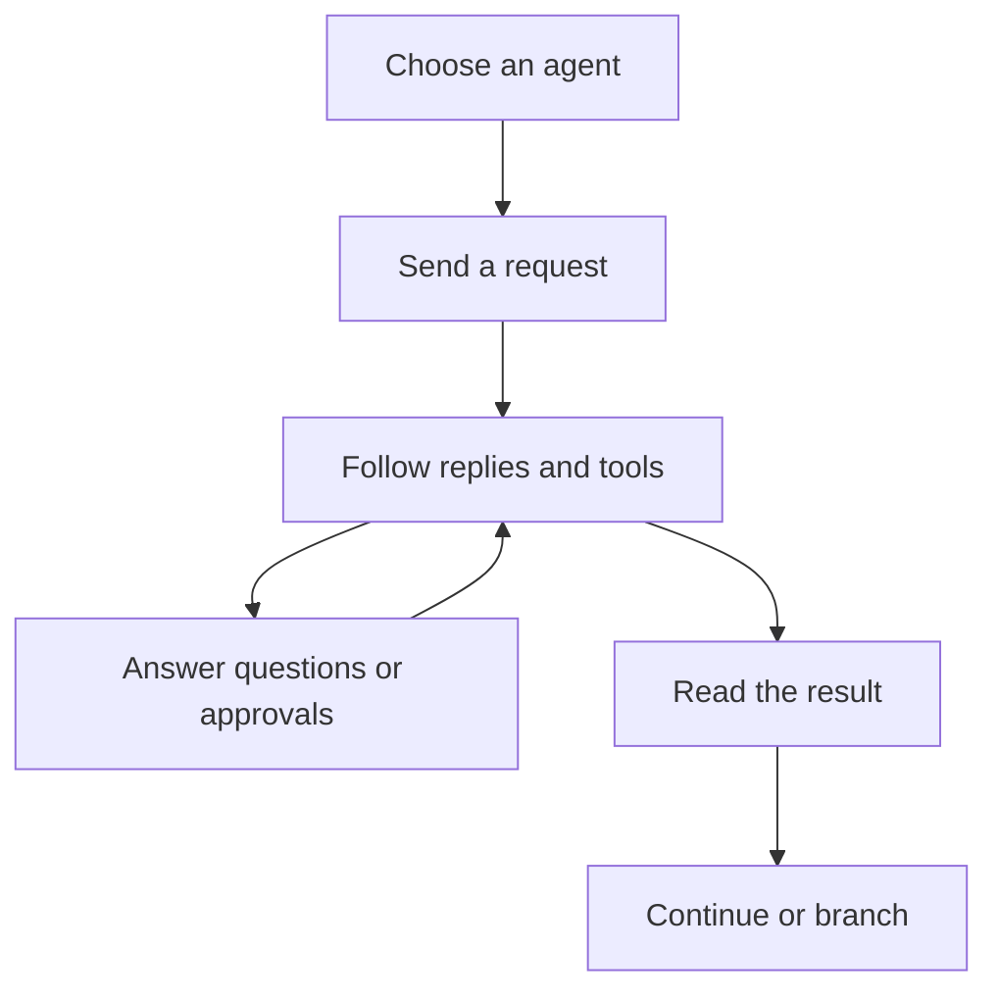

Service gives your team a shared place to build agents and run them from a browser or application. It manages access, saves conversations, and continues work after clients disconnect.

## Start here

| Your goal                                    | First step                                         |
| -------------------------------------------- | -------------------------------------------------- |
| Set up a deployment and get a first response | [Deploy Service locally](get-started.md)           |
| Work with agents on your team's deployment   | [Use Console](use-platform.md)                     |
| Add agents to an application                 | [Connect your application](connect-application.md) |

## Build an agent for your work

Start with a model and instructions. Add resources as the task calls for them:

| Task                                                           | Guide                                    |
| -------------------------------------------------------------- | ---------------------------------------- |
| Describe an agent and build its configuration conversationally | [Agent Composer](agent-composer.md)      |
| Connect a model account and choose models                      | [Models](models.md)                      |
| Connect business systems or MCP tools                          | [Tools and connections](tools.md)        |
| Give the agent reusable instructions and supporting files      | [Skills](skills.md)                      |
| Work with files, commands, or a desktop                        | [Environments](environments.md)          |
| Share project knowledge across sessions                        | [Memory Spaces](memory.md#memory-spaces) |

Composer can create and update resources with your approval. Provider credentials go into private Console cards; [configure a provider](agent-composer.md#configure-a-provider) from the same conversation.

## Work in conversations

Choose an agent, send a message, and follow its replies and tool activity. Add guidance while it works, answer questions and approvals, or create a branch to explore another direction. Open the saved conversation to continue later.

A **session** groups related **threads**. Each thread has its own history, and each **run** advances that history using a saved agent revision. Console's Chat view focuses on the conversation; Debug shows execution details, configuration, usage, and cost.

For a waiting run, collect every pending answer or approval and select **Submit responses**. API clients submit the complete batch through `/resume`. See [Use Console](use-platform.md) for the workflow and [Agents, threads and runs](agents-and-runs.md) for the execution contract.

## Connect your application

Use the [SDKs or CLI](sdks.md) to submit work and read results, or call the [HTTP API](http.md) directly. The [application guide](connect-application.md) follows authentication, a first message, live output, and continuation.

Connect an MCP client to the [Service MCP endpoint](mcp.md) to inspect and configure workspace resources. Use [webhooks](files-and-webhooks.md) to deliver execution events to your application.

## Operate a shared deployment

An **organization** manages members. A **workspace** contains agents, resources, and conversations, with roles controlling who can use or change them. Start with [Identity and access](identity.md), then use these guides:

- [Configuration](configuration.md): connect storage, model providers, and deployment services.
- [Operations](operations.md): deploy, upgrade, back up, and recover Service.
- [Monitoring](monitoring.md): inspect usage, traces, and failed requests or runs.
- [Settings reference](configuration-reference.md) and [API reference](api-reference/index.md): look up exact fields and operations.

Console and the API share one origin. The `a13n-service` executable runs control and worker roles together or separately. [Operations](operations.md) explains how to size and run them.
