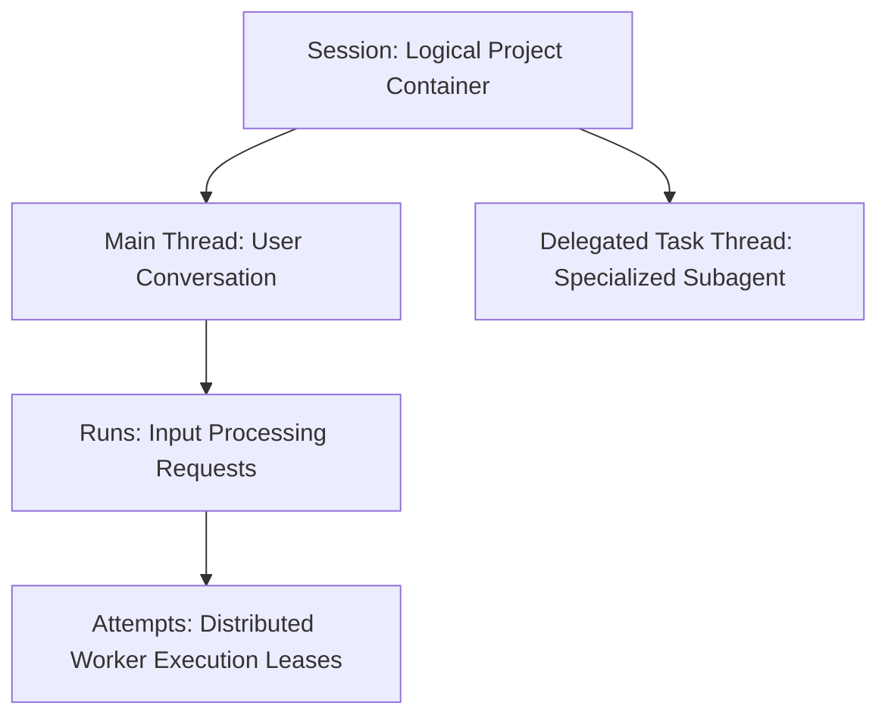

**Service** is a resilient, self-hosted agent platform designed for platform engineers, infrastructure teams, and enterprise organizations. It manages identity, workspace isolation, durable execution, long-term memory, and background scheduling across distributed infrastructure.

In **Console**, its intuitive browser interface, team members configure and test agents interactively. Applications and microservices integrate with the identical agents through official language SDKs or standard HTTP/SSE APIs. The Service architecture decouples control planes from compute worker nodes: tasks continue executing reliably in the background even when users disconnect.

## Start here

Choose the deployment or onboarding guide that aligns with your current infrastructure:

| Operational stage | Recommended path | Outcome |
| :--- | :--- | :--- |
| **Local trial & proof of concept** | [Deploy Service with Docker Compose](get-started.md) | Running Console, PostgreSQL, Redis, and your first executed agent response |
| **Team member onboarding** | [Use Console](use-platform.md) | Access an existing workspace, explore configured agents, and start collaborative threads |
| **Application integration** | [Connect your application](connect-application.md) | Authenticate via API keys, dispatch background runs, and consume streaming events |
| **Production deployment** | [Deploy via Helm on Kubernetes](operations.md) | Horizontally scalable control and worker tiers with external managed PostgreSQL and S3 storage |

## Build an agent for your work

Constructing an agent begins with selecting instructions and models, then attaching resources tailored to your organization's business needs:

| Capability | Purpose | Configuration guide |
| :--- | :--- | :--- |
| **Visual creation** | Describe workflows naturally and generate agents with AI assistance | [Agent Composer](agent-composer.md) |
| **Model connections** | Configure OpenAI, Anthropic, Gemini, or self-hosted vLLM/Ollama endpoints | [Models](models.md) |
| **Enterprise integrations** | Mount remote Model Context Protocol (MCP) servers and business tools | [Tools and connections](tools.md) |
| **Standard operating procedures** | Attach version-controlled procedural files and domain guidelines | [Skills](skills.md) |
| **Sandboxed execution** | Grant isolated container environments for shell commands and computer automation | [Environments](environments.md) |
| **Team memory spaces** | Persist project decisions, preferences, and documentation across sessions | [Memory](memory.md) |

Every configuration modification produces an immutable, auditable **Revision**, allowing seamless rollback and safe production deployment.

## Work in conversations

Conversations are structured into hierarchical primitives that provide clean operational isolation:

- **Sessions:** Group related collaborative threads under a shared project context.
- **Threads:** Retain full conversation history, attachments, and tool audit logs.
- **Runs:** Represent discrete requests to process user inputs or resume paused tasks.
- **Attempts:** Individual worker node execution leases. If a worker fails or restarts, the scheduler automatically recovers execution from the last durable checkpoint.

When an agent pauses for user confirmation, pending items are presented as interactive cards in Console or returned as suspended payloads via the API. Completing and submitting the batch resumes execution cleanly.

## Connect your application

External systems integrate easily using the Service HTTP API and official client SDKs:

- **SDKs:** Integrate using official libraries for Python, TypeScript/Node.js, Go, or Rust. See [SDKs and CLI](sdks.md).
- **Streaming endpoints:** Subscribe to `/api/v1/sessions/{id}/stream` to receive typed AG-UI and SSE events in real time.
- **Webhooks:** Register HTTPS endpoints to receive push notifications for run completions, failures, or schedule triggers via [Webhooks](webhooks.md).
- **Platform MCP:** Connect IDEs and client tools directly to the Service MCP endpoint to discover and manage workspace resources.

## Operate a shared deployment

Service is built for production enterprise operations:

- **Identity & RBAC:** Control access using fine-grained [Organization and Workspace roles](identity.md).
- **Configuration:** Connect external PostgreSQL clusters, Redis caches, S3-compatible object storage, and egress proxies via [Configuration](configuration.md).
- **High availability & operations:** Scale stateless control nodes and worker pools independently, perform zero-downtime upgrades, and configure automated backups via [Operations](operations.md).
- **Monitoring & telemetry:** Audit token consumption, request latency, and distributed traces using OpenTelemetry collectors via [Monitoring](monitoring.md).
- **API reference:** Review endpoints, schemas, and error codes in the [API reference](api-reference/index.md).

Console assets ship precompiled inside the Python distribution image (`ghcr.io/converge-ai-labs/a13n-service`), requiring no Node.js runtime in production.
