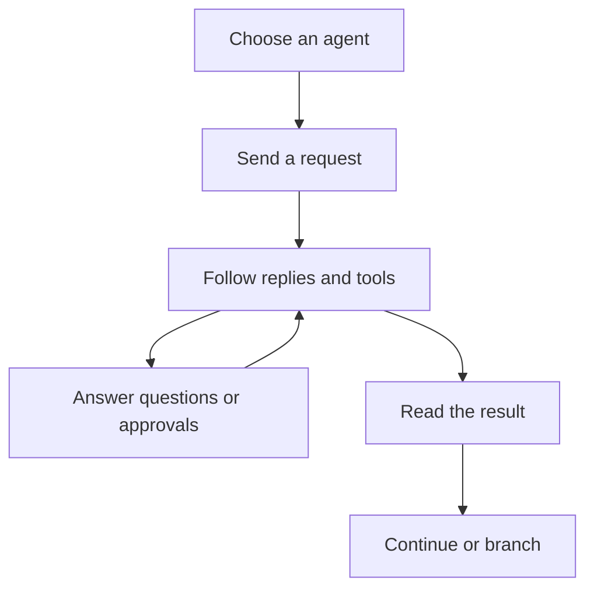

Service runs agents for your team and applications. Build an agent in Console, try it in a conversation, then call the same agent through the HTTP API. Service manages access, saves conversation history, and keeps accepted work running when a client disconnects.

## Start here

Choose the path that matches what you already have:

| Starting point                         | Follow this guide                                  | Finish with                                                      |
| -------------------------------------- | -------------------------------------------------- | ---------------------------------------------------------------- |
| Docker and a model provider account    | [Deploy Service locally](get-started.md)           | A running Console and your first agent response                  |
| Access to your team's Service          | [Use Console](use-platform.md)                     | A conversation you can return to and continue                    |
| A working agent to use in your product | [Connect your application](connect-application.md) | An authenticated application that submits work and reads results |

## Build an agent for your work

Start with one model and instructions. For example, create an agent that turns project notes into concrete next steps. Test its response before adding more resources.

| Add this when the task needs it                   | Guide                                    |
| ------------------------------------------------- | ---------------------------------------- |
| Help creating or changing the agent configuration | [Agent Composer](agent-composer.md)      |
| A different model or provider account             | [Models](models.md)                      |
| Business-system actions or MCP tools              | [Tools and connections](tools.md)        |
| Reusable procedures and supporting files          | [Skills](skills.md)                      |
| Files, commands, or a desktop                     | [Environments](environments.md)          |
| Knowledge shared across conversations             | [Memory Spaces](memory.md#memory-spaces) |

Composer proposes resource changes for your approval. Enter provider credentials in its [private configuration cards](agent-composer.md#configure-a-provider).

## Work in conversations

Send a request, inspect the reply, and follow up in the same thread. A **session** groups related threads; a **thread** holds a conversation's history; each **run** advances that history with a saved agent revision.

Use Chat for the conversation and Debug for execution details, configuration, usage, and cost. Return to saved threads to continue, or create a branch to try a different direction.

When a run waits for your input, complete every pending question and approval, then select **Submit responses**. API clients send the complete batch through `/resume`. [Use Console](use-platform.md) walks through these actions; [Agents, threads and runs](agents-and-runs.md) explains how they affect execution.

## Connect your application

Open an agent's **Connect to app** action to get its ID and your Service URL. Follow [Connect your application](connect-application.md) to create credentials, send a first message, read live output, and continue the thread. Use an [SDK or remote CLI](sdks.md), or call the [HTTP API](http.md) directly.

For other integrations, connect an MCP client to the [Service MCP endpoint](mcp.md) to inspect and configure workspace resources. Use [webhooks](files-and-webhooks.md) to deliver execution events to your application.

## Operate a shared deployment

An **organization** manages members. A **workspace** holds agents, resources, and conversations. Assign [roles](identity.md#roles) to control who can run agents, build resources, or administer access.

- [Configuration](configuration.md): connect storage, providers, and deployment services.
- [Operations](operations.md): deploy, upgrade, back up, and recover Service.
- [Monitoring](monitoring.md): investigate usage, traces, and failed requests or runs.
- [Settings reference](configuration-reference.md) and [API reference](api-reference/index.md): look up exact fields and operations.

Console and the API share one origin. The `a13n-service` executable can run control and worker roles together or separately; use the [operations guide](operations.md) when sizing a deployment.
