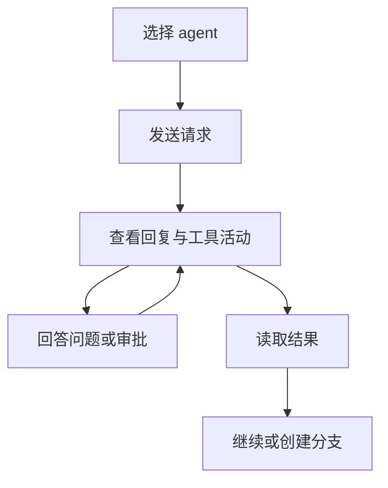

Service 为团队提供构建 agent 的共享平台，让用户从浏览器或应用中运行它们。平台管理访问权限、保存对话，并在客户端断开连接后继续工作。

## 从这里开始

| 你的目标                     | 第一步                                 |
| ---------------------------- | -------------------------------------- |
| 部署平台并获得首次回复       | [本地部署 Service](get-started.md)     |
| 在团队已有的平台上使用 agent | [使用 Console](use-platform.md)        |
| 将 agent 接入应用            | [连接你的应用](connect-application.md) |

## 为你的工作构建 agent

从模型和指令开始，按任务需要添加资源：

| 任务                              | 指南                                    |
| --------------------------------- | --------------------------------------- |
| 描述需求，通过对话构建 agent 配置 | [Agent Composer](agent-composer.md)     |
| 连接模型账号并选择模型            | [模型](models.md)                       |
| 接入业务系统或 MCP 工具           | [工具与连接](tools.md)                  |
| 提供可复用的操作指引和配套文件    | [Skill](skills.md)                      |
| 操作文件、命令或桌面              | [环境](environments.md)                 |
| 在多个会话间共享项目知识          | [Memory Space](memory.md#memory-spaces) |

Composer 在获得批准后创建和更新资源。Provider 凭据通过 Console 的私密卡片填写，可以直接在同一段对话中[配置 provider](agent-composer.md#configure-a-provider)。

## 在对话中工作

选择 agent、发送消息，然后查看回复和工具活动。在执行过程中补充指导，回答问题或审批请求，或创建分支尝试另一种方向。之后打开保存的对话即可继续。

**会话（session）**组织相关的**线程（thread）**。每个线程保存自己的历史，每次运行（run）使用一个已保存的 agent 修订版本推进历史。Console 的 Chat 视图侧重对话，Debug 视图展示执行细节、配置、用量和费用。

运行等待回应时，完成所有待处理问题和审批，再选择**提交回应**。API 客户端通过 `/resume` 提交完整批次。[使用 Console](use-platform.md)介绍操作流程，[Agent、线程与运行](agents-and-runs.md)说明执行约定。

## 连接你的应用

使用 [SDK 或 CLI](sdks.md) 提交工作并读取结果，也可以直接调用 [HTTP API](http.md)。[应用接入指南](connect-application.md)依次介绍身份验证、第一条消息、实时输出和继续对话。

将 MCP 客户端连接到 [Service MCP 端点](mcp.md)，可以查看和配置工作空间资源。通过 [webhook](files-and-webhooks.md) 将执行事件传递给应用。

## 运维共享部署

**组织**管理成员，**工作空间**保存 agent、资源和对话，角色决定谁可以使用或修改它们。先阅读[身份与访问](identity.md)，再按需要查阅：

- [配置](configuration.md)：连接存储、模型 provider 和部署服务。
- [运维](operations.md)：部署、升级、备份和恢复 Service。
- [监控](monitoring.md)：查看用量、追踪及失败的请求或运行。
- [设置参考](configuration-reference.md)和 [API 参考](api-reference/index.md)：查找准确的字段和操作。

Console 和 API 使用同一个源。`a13n-service` 可执行程序支持合并或分别运行 control 与 worker 角色。[运维指南](operations.md)介绍部署规模和运行方式。
