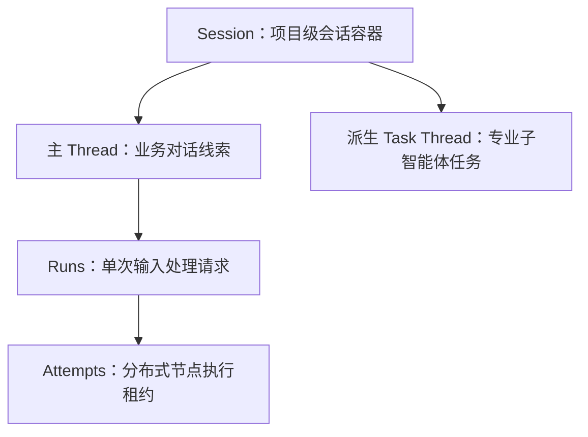

**Service** 是专为平台系统工程师、基础设施运维团队与企业组织量身打造的高韧性私有化 Agent 运行平台。它在分布式基础设施之上统一管理身份认证、多租户工作区隔离、任务持久化调度、长期记忆治理以及周期性定时任务。

在简洁直观的 **Console** 网页控制台中，业务人员与工程师可以可视化配置、调试和管理智能体。外部业务系统与微服务则能通过多语言官方 SDK 或标准 HTTP/SSE 接口无缝接入相同的智能体。Service 架构将无状态的控制面（Control）与计算执行节点（Worker）完全解耦：即使用户关闭网页，任务依然会在后台集群中可靠执行直至完成。

## 从这里开始

根据您当前的基础设施建设阶段，选择最适合的部署或接入指南：

| 实施阶段                      | 推荐路线                                               | 预期交付成果                                                           |
| :---------------------------- | :----------------------------------------------------- | :--------------------------------------------------------------------- |
| **本地体验与概念验证（PoC）** | [通过 Docker Compose 部署本地 Service](get-started.md) | 秒级拉起 Console、PostgreSQL 与 Redis，完成首次智能体对话              |
| **团队业务成员上手**          | [使用 Console 控制台](use-platform.md)                 | 登录现有工作空间，熟悉智能体配置并开启协作对话                         |
| **外部业务系统接入**          | [连接您的应用程序](connect-application.md)             | 通过 API Key 完成鉴权，发起异步任务并实时消费 SSE 流式输出             |
| **生产级企业集群落地**        | [通过 Helm 部署至 Kubernetes 集群](operations.md)      | 拥有独立弹性扩缩容的 Control/Worker 集群，对接企业自建数据库与 S3 存储 |

## 为你的工作构建 agent

在 Service 中构建智能体从挑选提示词与模型开始，并根据具体业务场景灵活挂载底层企业资源：

| 核心能力             | 业务作用                                                     | 配置参考手册                             |
| :------------------- | :----------------------------------------------------------- | :--------------------------------------- |
| **自然语言辅助创建** | 通过 AI 对话自动推导配置并生成专属智能体                     | [Agent Composer](agent-composer.md)      |
| **主流大模型接入**   | 对接 OpenAI、Anthropic、Gemini 或企业私有化 vLLM/Ollama 实例 | [模型管理 Models](models.md)             |
| **企业工具生态集成** | 挂载远程 Model Context Protocol (MCP) 服务与业务连接器       | [工具与连接 Connections](tools.md)       |
| **标准操作流程沉淀** | 挂载带版本保护的工程规范与专业操作指引文件                   | [技能 Skills](skills.md)                 |
| **安全隔离沙箱环境** | 为 Agent 分配隔离的容器运行环境，执行代码审查与桌面自动化    | [执行环境 Environments](environments.md) |
| **跨会话团队记忆**   | 跨多轮会话长期持久化沉淀团队决策、用户偏好与业务知识         | [记忆空间 Memory](memory.md)             |

任何配置调整均会自动产生不可篡改、可审计的 **Revision（版本）**，支持一键无感回滚与灰度发布。

## 在对话中工作

会话在 Service 底层被严谨地组织为四个分层清晰的概念模型：

- **Session（会话）：** 将属于同一个业务目标的一组协作流程聚合在共享上下文中。
- **Thread（线程）：** 严格维系有序的消息历史、输入附件与底层工具审计轨迹。
- **Run（运行）：** 代表针对单次用户输入或恢复指令的完整逻辑调度。
- **Attempt（执行尝试）：** 分布式 Worker 节点认领的物理计算租约。即便某台 Worker 节点遭遇硬件故障重启，调度器也会自动认领并从上一个检查点无缝恢复。

当智能体需要人工确认时，待处理项会以交互卡片形式展现在 Console 中或通过 API 返回挂起状态。审批完成后批量提交即可继续推进。

## 连接你的应用

外部业务系统可通过标准接口无缝集成 Service 平台能力：

- **官方多语言 SDK：** 支持 Python、TypeScript/Node.js、Go 与 Rust 官方客户端。详见 [SDK 与 CLI](sdks.md)。
- **实时事件推送：** 客户端可直接监听 `/api/v1/sessions/{id}/stream`，以 SSE 形式实时接收类型化的 AG-UI 事件流。
- **自动化 Webhook：** 在工作区配置 HTTPS 端点，在任务完成、执行失败或定时调度触发时接收精准事件推送，详见 [Webhooks](webhooks.md)。
- **平台级 MCP 服务：** 支持各类外部 IDE 或客户端直接连接 Service MCP 接口，可编程地检索与管理工作区资产。

## 运维共享部署

Service 专为生产级企业级运维打造：

- **多租户 RBAC 鉴权：** 基于[组织与工作区角色](identity.md)实现精细化权限矩阵隔离。
- **生产配置规范：** 通过[配置指南](configuration.md)灵活接入生产级 PostgreSQL 集群、Redis 缓存、S3 兼容对象存储与企业出网代理。
- **高可用与运维扩容：** 控制面与计算 Worker 池支持独立横向水平扩容，提供零停机平滑升级与自动化容灾备份，详见[运维指南](operations.md)。
- **全链路可观测性：** 原生集成 OpenTelemetry，实时审计 Token 消耗、接口延迟与分布式调用链追踪，详见[监控与可观测性](monitoring.md)。
- **标准化 API 文档：** 在 [API 参考手册](api-reference/index.md)中查阅完整接口端点定义、请求体契约与错误状态码。

Console 网页端资产已完整预编译并打包在官方 Docker 镜像（`ghcr.io/converge-ai-labs/a13n-service`）中，生产部署无需任何 Node.js 运行时依赖。
