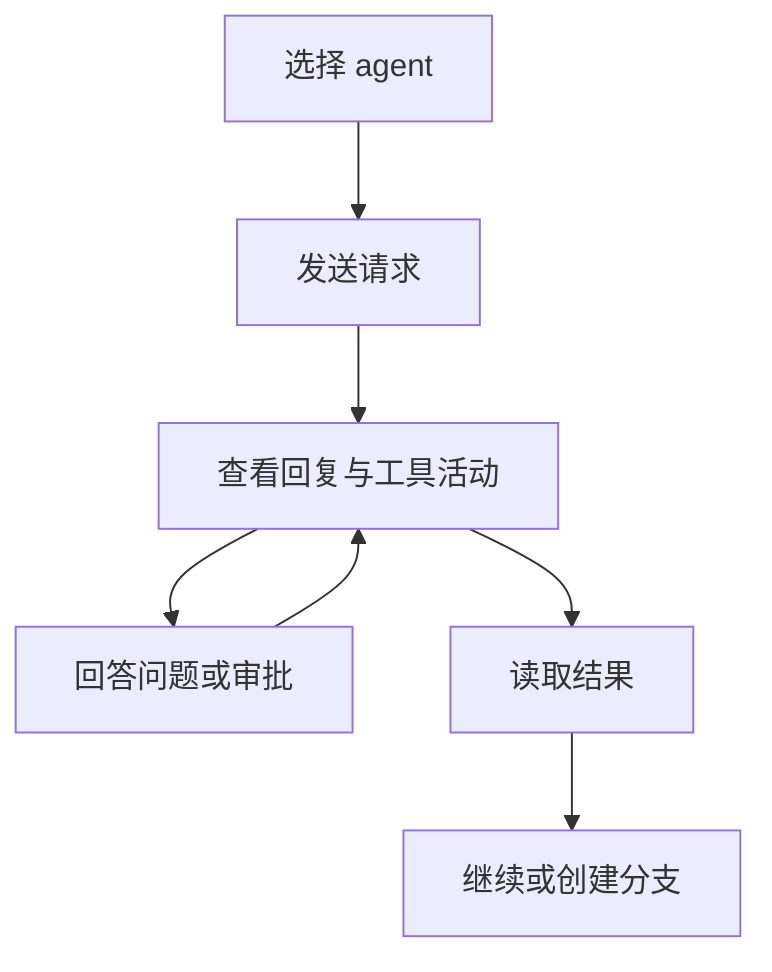

Service 为团队和应用运行 agent。在 Console 中构建 agent，通过对话试用，再通过 HTTP API 调用同一个 agent。Service 管理访问权限、保存对话历史，并在客户端断开连接后继续执行已接受的工作。

## 从这里开始

根据已有条件选择路径：

| 已有条件                    | 指南                                   | 完成后的结果                             |
| --------------------------- | -------------------------------------- | ---------------------------------------- |
| Docker 和模型 provider 账号 | [本地部署 Service](get-started.md)     | 可用的 Console 和 agent 的首次回复       |
| 团队 Service 的访问权限     | [使用 Console](use-platform.md)        | 可以返回并继续的对话                     |
| 想接入产品的可用 agent      | [连接你的应用](connect-application.md) | 能通过身份验证、提交工作并读取结果的应用 |

## 为你的工作构建 agent

从一个模型和指令开始。例如，创建一个将项目笔记整理成具体后续行动的 agent。先验证回复，再添加其他资源。

| 按任务需要添加             | 指南                                    |
| -------------------------- | --------------------------------------- |
| 协助创建或修改 agent 配置  | [Agent Composer](agent-composer.md)     |
| 其他模型或 provider 账号   | [模型](models.md)                       |
| 业务系统操作或 MCP 工具    | [工具与连接](tools.md)                  |
| 可复用的操作流程和配套文件 | [Skill](skills.md)                      |
| 文件、命令或桌面           | [环境](environments.md)                 |
| 在多个对话间共享的知识     | [Memory Space](memory.md#memory-spaces) |

Composer 会提出资源变更方案，等待你的批准。Provider 凭据填写在它的[私密配置卡片](agent-composer.md#configure-a-provider)中。

## 在对话中工作

发送请求、检查回复，再在同一线程中追问。**会话**（session）组织相关线程；**线程**（thread）保存一段对话的历史；每次**运行**（run）使用一个已保存的 agent 修订版本推进历史。

使用 Chat 进行对话，使用 Debug 查看执行细节、配置、用量和费用。返回保存的线程即可继续，也可以创建分支尝试另一种方向。

运行等待输入时，完成所有待处理问题和审批，再选择**提交回应**。API 客户端通过 `/resume` 提交完整批次。[使用 Console](use-platform.md)介绍这些操作，[Agent、线程与运行](agents-and-runs.md)说明它们如何影响执行。

## 连接你的应用

打开 agent 的**接入应用**操作，获取其 ID 和你的 Service URL。按照[连接你的应用](connect-application.md)创建凭据、发送第一条消息、读取实时输出并继续线程。可以使用 [SDK 或远程 CLI](sdks.md)，也可以直接调用 [HTTP API](http.md)。

其他集成方式包括：将 MCP 客户端连接到 [Service MCP 端点](mcp.md)，查看和配置工作空间资源；使用 [webhook](files-and-webhooks.md)，将执行事件传递给应用。

## 运维共享部署

**组织**管理成员，**工作空间**保存 agent、资源和对话。通过[角色](identity.md#roles)控制谁可以运行 agent、构建资源或管理访问权限。

- [配置](configuration.md)：连接存储、provider 和部署服务。
- [运维](operations.md)：部署、升级、备份和恢复 Service。
- [监控](monitoring.md)：调查用量、追踪及失败的请求或运行。
- [设置参考](configuration-reference.md)和 [API 参考](api-reference/index.md)：查找准确的字段和操作。

Console 和 API 使用同一个源。`a13n-service` 可执行程序支持合并或分别运行 control 与 worker 角色；规划部署规模时请参阅[运维指南](operations.md)。
