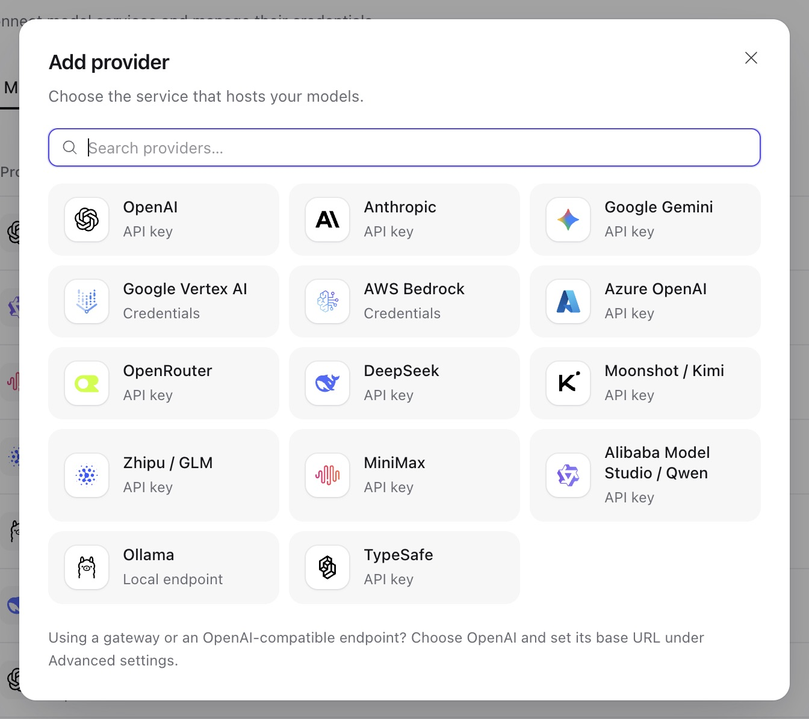

Use this reference for provider-specific setup after choosing your [model workflow](models.md).

## Model providers

1. Open **Models → Add model**. An empty workspace opens the connection form directly. If providers already exist, select one or choose **Connect a new provider**.
2. Choose the provider type and enter its connection details. Put API keys in the credential fields, not in model settings or agent instructions.
3. Save the provider, then continue to [Add a model](models.md#add-a-model). To manage the account later, open **Workspace settings → Providers**.



The provider type determines which calling APIs a model may use. The first API in each row is the default:

| Provider type                                                      | Model APIs                                                                        |
| ------------------------------------------------------------------ | --------------------------------------------------------------------------------- |
| `openai`, `azure_openai`                                           | `openai.responses`, `openai.chat_completions`                                     |
| `anthropic`                                                        | `anthropic.messages`                                                              |
| `google_gemini`, `google_vertex`                                   | `google.generate_content`                                                         |
| `aws_bedrock`                                                      | `bedrock.converse`, `bedrock_mantle.responses`, `bedrock_mantle.chat_completions` |
| `openrouter`                                                       | `openrouter.chat_completions`                                                     |
| `fireworks`, `together`, `cerebras`, `sambanova`, `vercel`, `xai`  | `openai.chat_completions`                                                         |
| `ollama`                                                           | `ollama.chat_completions`                                                         |
| `alibaba_model_studio`, `deepseek`, `moonshot`, `minimax`, `zhipu` | `openai.chat_completions`                                                         |
| `cloudflare_ai_gateway`                                            | `openai.chat_completions`                                                         |
| `typesafe`                                                         | `typesafe.system_one`                                                             |
| `openai_chatgpt`                                                   | `openai.responses`; authorize as described below                                  |

API clients create accounts at `/api/v1/model-providers`. Read `GET /api/v1/provider-types/model` for the deployment's configuration, credential, and request-setting schemas. Most API-key types accept `credential: {"api_key": "..."}` and an optional `config.base_url`. [Provider operations](resources.md#providers) covers saving, testing, and rotating credentials.

For these Chat Completions providers, keep the full upstream model ID and use the default endpoint unless your account needs an override:

| Provider type | Default endpoint                        | Catalog channel |
| ------------- | --------------------------------------- | --------------- |
| `fireworks`   | `https://api.fireworks.ai/inference/v1` | `fireworks-ai`  |
| `together`    | `https://api.together.xyz/v1`           | `togetherai`    |
| `cerebras`    | `https://api.cerebras.ai/v1`            | `cerebras`      |
| `sambanova`   | `https://api.sambanova.ai/v1`           | `sambanova`     |
| `vercel`      | `https://ai-gateway.vercel.sh/v1`       | `vercel`        |
| `xai`         | `https://api.x.ai/v1`                   | `xai`, `x-ai`   |

For example, Fireworks uses IDs such as `accounts/fireworks/models/llama-v3p3-70b-instruct`, Together uses `meta-llama/Llama-3.3-70B-Instruct-Turbo`, and Vercel uses gateway IDs such as `anthropic/claude-sonnet-4.6`. Choose an ID available to your account. These integrations use HTTP Chat Completions, without Responses API or xAI native server-side search tools. All except Vercel offer a connection-only test; Vercel's public model list cannot validate credentials, so verify access with a model request.

For **Google Vertex AI**, match the credential to your access method:

- **API key:** use this for an API-key gateway or Vertex Express Mode. Leave Project ID and Location empty. For a gateway, set Base URL to its origin without `/v1beta1` or a model path. The SDK sends `x-goog-api-key` to `/v1beta1/publishers/google/models/...`.
- **Service account:** enter the flat service-account credential object and the required Project ID and Location. Switching credential types clears the previous form draft.

For **Cloudflare AI Gateway**, set `account_id` to the 32-character Cloudflare account ID and save its API token as `api_key`. The token needs **Account → Workers AI → Read** permission. Configure default-alias BYOK credentials or unified billing in Cloudflare. Set `gateway_id` to choose a gateway, or omit it for the default gateway's third-party models. Use full IDs such as `openai/gpt-5.4` or `anthropic/claude-sonnet-4.6`; both use `openai.chat_completions`. A custom `base_url` replaces the account-derived endpoint and must end in `/ai`, without `/v1`, a method path, query, or fragment. Test with a model request: this integration has no connection-only probe, native server tools, or separate Workers AI catalog. See [Cloudflare's unified REST API](https://developers.cloudflare.com/ai-gateway/usage/rest-api/).

For a gateway that routes or bills by header, add up to 32 **extra request headers** to the provider. Values are encrypted; reads expose only `header_names`. In a provider `PATCH`, a value sets that name, `null` removes it, and omission keeps it. Transport, authentication, and protocol header names are reserved. Use these encrypted headers for secrets; [request-level headers](models.md#advanced-request-settings) are readable configuration.

## ChatGPT subscription provider

Use `openai_chatgpt` to authorize ChatGPT plan usage for the workspace. Authorization belongs to the provider and is shared by the workspace, rather than stored as a personal connection.

1. In **Workspace settings → Providers**, add a **ChatGPT** provider. The default flow dynamically registers a public OAuth client and needs no static credential.
2. Choose **Continue with ChatGPT** and open the authorization link. Approve ChatGPT plan usage; website identity access alone does not grant model access.
3. Copy the entire callback URL from the browser address bar into **Complete callback URL**, then choose **Complete sign-in**. Copy it even if the loopback page cannot be reached. Keep the URL private.
4. Add a model using `openai.responses` and an account model slug. Select an account-visible choice or enter an ID manually, then send a test message through an agent.

The Service can run remotely: it validates and exchanges the pasted callback without fetching that URL or requiring the browser to reach the server's loopback listener. Invalid callback input can be corrected and retried. Once code exchange starts, a failed sign-in needs a new authorization attempt.

For an API integration, use these operations in order:

| Task                | Request under `/api/v1/model-providers/{id}`                                 | What to retain or inspect                                          |
| ------------------- | ---------------------------------------------------------------------------- | ------------------------------------------------------------------ |
| Start sign-in       | `POST /authorize` with `{}`                                                  | Open `authorization_url`; retain `attempt_id`                      |
| Finish sign-in      | `POST /authorization/callback` with `attempt_id` and the full `callback_url` | Authorization state                                                |
| Check status        | `GET /authorization`                                                         | Credential-free state and account metadata                         |
| List account models | `GET /models`                                                                | `slug` and `display_name`; visibility is not inference entitlement |
| Disconnect          | `DELETE /authorization`                                                      | Local tokens are cleared; manage remote access in ChatGPT settings |

Returning login reuses registration metadata. **Use another ChatGPT account**, or `POST /authorize` with `{"new_registration": true}`, omits retained account hints. It creates a new dynamic registration when no client is configured and retains an explicitly configured client. Codex credentials cannot replace this authorization.

This provider has a fixed endpoint and stores tokens and pending authorization in encrypted provider-owned state. Its requests always use `store: false` and streaming; a non-streaming caller receives the collected stream. Temperature, Top P, and output-token limits are omitted. Other settings and tools follow the official ChatGPT profile, so API-key model behavior does not carry over automatically.

### Self-hosted callback

Use a public client with `http://127.0.0.1:<port>/auth/callback`. The provider editor's **OAuth client ID** and loopback callback configuration override deployment defaults; blank fields inherit them. Save changes before restarting sign-in.

```sh
export A13N_PROVIDERS__CHATGPT_REDIRECT_URI="http://127.0.0.1:1456/auth/callback"
# Optional: reuse an issued public-client registration.
export A13N_PROVIDERS__CHATGPT_CLIENT_ID="issued-public-client"
```

If upgrading from a confidential client or hosted HTTPS callback, clear the old credential, configure a public loopback flow, and authorize again. Client secrets and the former hosted callback route are unsupported. Existing public-client tokens remain readable; restart pending sign-ins after an upgrade. Changing client ID avoids another client's retained account hints.

The official provider handles expiry and 401 refresh. Service saves complete replacement credentials and rejects stale saves after disconnect or replacement. Multiple Workers can still race to spend a refresh token: monitor refresh failures under concurrent subscription use and reauthorize when needed. An active provider can retain cached tokens after local disconnect. Inference, refresh, and discovery use Service's model transport limits; authorization-code exchange uses the official fixed-endpoint client. [Model authentication](../a13n-harness/model-authentication.md) explains the shared integration.
