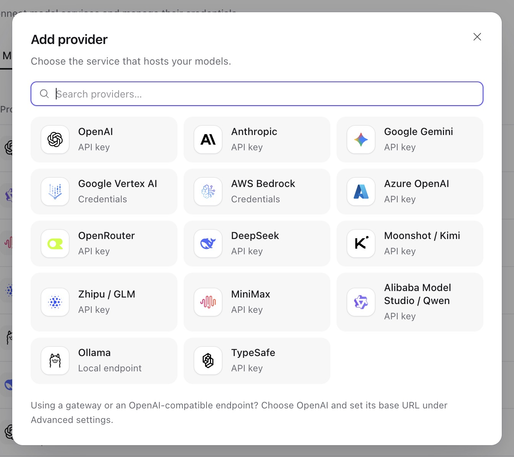

选择[模型工作流程](models.md)后，使用本页配置具体 provider。

## 模型 provider

1. 打开**模型 → 添加模型**。空工作空间会直接打开连接表单。已有 provider 时，选择一个，或点击**接入新的供应商**。
2. 选择 provider 类型并填写连接信息。API key 放在凭据字段中，不放在模型设置或 agent 指令里。
3. 保存 provider，继续[添加模型](models.md#add-a-model)。以后可在**工作区设置 → 供应商**管理该账号。



Provider 类型决定模型可用的调用 API。每行第一项是默认值：

| Provider 类型                                                      | 模型 API                                                                          |
| ------------------------------------------------------------------ | --------------------------------------------------------------------------------- |
| `openai`, `azure_openai`                                           | `openai.responses`, `openai.chat_completions`                                     |
| `anthropic`                                                        | `anthropic.messages`                                                              |
| `google_gemini`, `google_vertex`                                   | `google.generate_content`                                                         |
| `aws_bedrock`                                                      | `bedrock.converse`, `bedrock_mantle.responses`, `bedrock_mantle.chat_completions` |
| `openrouter`                                                       | `openrouter.chat_completions`                                                     |
| `fireworks`, `together`, `cerebras`, `sambanova`, `vercel`, `xai`  | `openai.chat_completions`                                                         |
| `ollama`                                                           | `ollama.chat_completions`                                                         |
| `alibaba_model_studio`, `deepseek`, `moonshot`, `minimax`, `zhipu` | `openai.chat_completions`                                                         |
| `cloudflare_ai_gateway`                                            | `openai.chat_completions`                                                         |
| `typesafe`                                                         | `typesafe.system_one`                                                             |
| `openai_chatgpt`                                                   | `openai.responses`；按下文完成授权                                                |

API 客户端在 `/api/v1/model-providers` 创建账号。读取 `GET /api/v1/provider-types/model`，获取当前部署的配置、凭据和请求设置 schema。多数 API key 类型接受 `credential: {"api_key": "..."}` 和可选的 `config.base_url`。[Provider 操作](resources.md#providers)介绍保存、测试和轮换凭据的流程。

以下 Chat Completions provider 应保留完整的上游模型 ID；除非账号需要覆盖端点，否则使用默认地址：

| Provider 类型 | 默认端点                                | 目录渠道       |
| ------------- | --------------------------------------- | -------------- |
| `fireworks`   | `https://api.fireworks.ai/inference/v1` | `fireworks-ai` |
| `together`    | `https://api.together.xyz/v1`           | `togetherai`   |
| `cerebras`    | `https://api.cerebras.ai/v1`            | `cerebras`     |
| `sambanova`   | `https://api.sambanova.ai/v1`           | `sambanova`    |
| `vercel`      | `https://ai-gateway.vercel.sh/v1`       | `vercel`       |
| `xai`         | `https://api.x.ai/v1`                   | `xai`, `x-ai`  |

例如，Fireworks 使用 `accounts/fireworks/models/llama-v3p3-70b-instruct` 这样的 ID，Together 使用 `meta-llama/Llama-3.3-70B-Instruct-Turbo`，Vercel 使用 `anthropic/claude-sonnet-4.6` 这样的网关 ID。请选择账号可用的 ID。这些集成使用 HTTP Chat Completions，不提供 Responses API 或 xAI 原生服务端搜索工具。除 Vercel 外均支持独立连接测试；Vercel 的公开模型列表不能验证凭据，应通过模型请求验证访问权限。

使用 **Google Vertex AI** 时，让凭据类型与接入方式一致：

- **API key**：用于 API key 网关或 Vertex Express Mode。Project ID 和 Location 留空。接入网关时，Base URL 填网关 origin，不含 `/v1beta1` 或模型路径。SDK 向 `/v1beta1/publishers/google/models/...` 发送 `x-goog-api-key`。
- **Service account**：填写扁平的服务账号凭据对象，以及必填的 Project ID 和 Location。切换凭据类型会清空上一种类型的表单草稿。

使用 **Cloudflare AI Gateway** 时，将 `account_id` 设为 32 位 Cloudflare 账号 ID，并将 API token 保存为 `api_key`。Token 需要 **Account → Workers AI → Read** 权限。在 Cloudflare 配置默认别名的 BYOK 凭据或统一计费。设置 `gateway_id` 以选择网关，省略则使用默认网关的第三方模型。使用 `openai/gpt-5.4` 或 `anthropic/claude-sonnet-4.6` 等完整 ID，两者均通过 `openai.chat_completions` 调用。自定义 `base_url` 替代按账号生成的端点，必须以 `/ai` 结尾，不含 `/v1`、方法路径、查询参数或片段。请用模型请求测试：此集成不提供独立连接探测、原生服务端工具或单独的 Workers AI 目录。参见 [Cloudflare 统一 REST API](https://developers.cloudflare.com/ai-gateway/usage/rest-api/)。

网关按请求头路由或计费时，可在 provider 上添加最多 32 个**额外请求头**。值会加密，读取时只返回 `header_names`。Provider `PATCH` 中，填写值表示设置该名称，`null` 表示移除，省略表示保留。传输、认证和协议请求头名称保留给系统。密钥应放在这些加密请求头中；[请求级请求头](models.md#advanced-request-settings)是可读取配置。

## ChatGPT 订阅 provider

使用 `openai_chatgpt` 为工作空间授权 ChatGPT 订阅额度。授权属于 provider，由工作空间共享，不保存在个人连接中。

1. 在**工作区设置 → 供应商**添加 **ChatGPT** provider。默认流程动态注册公共 OAuth client，不需要静态凭据。
2. 点击**使用 ChatGPT 继续**，打开授权链接。批准使用 ChatGPT 订阅额度；仅授予网站身份权限不能调用模型。
3. 将浏览器地址栏的完整回调 URL 复制到**完整回调 URL**，再点击**完成登录**。即使回环页面无法访问，也要复制地址。不要公开该 URL。
4. 使用 `openai.responses` 和账号模型 slug 添加模型。从账号可见选项中选择，或手动输入 ID，再通过 agent 发送测试消息。

Service 可以部署在远端：它校验并交换粘贴的回调，不请求该 URL，也不要求浏览器访问服务器的回环监听器。回调输入无效时可修改后重试。一旦开始交换授权码，登录失败就需要新的授权尝试。

API 集成按顺序使用以下操作：

| 任务         | `/api/v1/model-providers/{id}` 下的请求                                 | 需要保留或检查的结果                             |
| ------------ | ----------------------------------------------------------------------- | ------------------------------------------------ |
| 开始登录     | `POST /authorize`，请求体为 `{}`                                        | 打开 `authorization_url`，保留 `attempt_id`      |
| 完成登录     | `POST /authorization/callback`，提交 `attempt_id` 和完整 `callback_url` | 授权状态                                         |
| 检查状态     | `GET /authorization`                                                    | 不含凭据的状态和账号元数据                       |
| 列出账号模型 | `GET /models`                                                           | `slug` 和 `display_name`；可见不代表有推理权限   |
| 断开连接     | `DELETE /authorization`                                                 | 本地 token 已清除；远端访问在 ChatGPT 设置中管理 |

再次登录会复用注册信息。**使用另一个 ChatGPT 账号**，或以 `{"new_registration": true}` 调用 `POST /authorize`，会忽略保留的账号提示。未配置 client 时会创建新的动态注册；显式配置的 client 则继续保留。Codex 凭据不能代替此授权。

此 provider 使用固定端点，将 token 和待完成授权保存在加密的 provider 自有状态中。请求始终设置 `store: false` 并使用流式响应；非流式调用方收到收集完成的流。Temperature、Top P 和输出 token 上限不会发送。其他设置和工具遵循官方 ChatGPT profile，因此 API key 模型的行为不会自动沿用。

### 自托管回调

使用公共 client 和 `http://127.0.0.1:<port>/auth/callback`。Provider 编辑器中的 **OAuth client ID** 和回环回调配置覆盖部署默认值；留空则继承。先保存修改，再重新登录。

```sh
export A13N_PROVIDERS__CHATGPT_REDIRECT_URI="http://127.0.0.1:1456/auth/callback"
# Optional: reuse an issued public-client registration.
export A13N_PROVIDERS__CHATGPT_CLIENT_ID="issued-public-client"
```

从机密 client 或 HTTPS 托管回调升级时，清除旧凭据，配置公共 client 回环流程，再重新授权。不支持 client secret 或旧托管回调路由。已有公共 client token 仍可读取；升级后重新开始待完成登录。修改 client ID 后不会复用另一 client 的账号提示。

官方 provider 负责到期刷新和 401 刷新。Service 保存完整的替换凭据，并拒绝断开或替换授权后的过期保存。多个 Worker 仍可能竞争使用同一个 refresh token：并发使用订阅时关注刷新失败，必要时重新授权。本地断开后，活动 provider 可能仍持有缓存 token。推理、刷新和发现使用 Service 的模型传输限制；授权码交换使用官方固定端点客户端。[模型认证](../a13n-harness/model-authentication.md)介绍共享集成机制。
