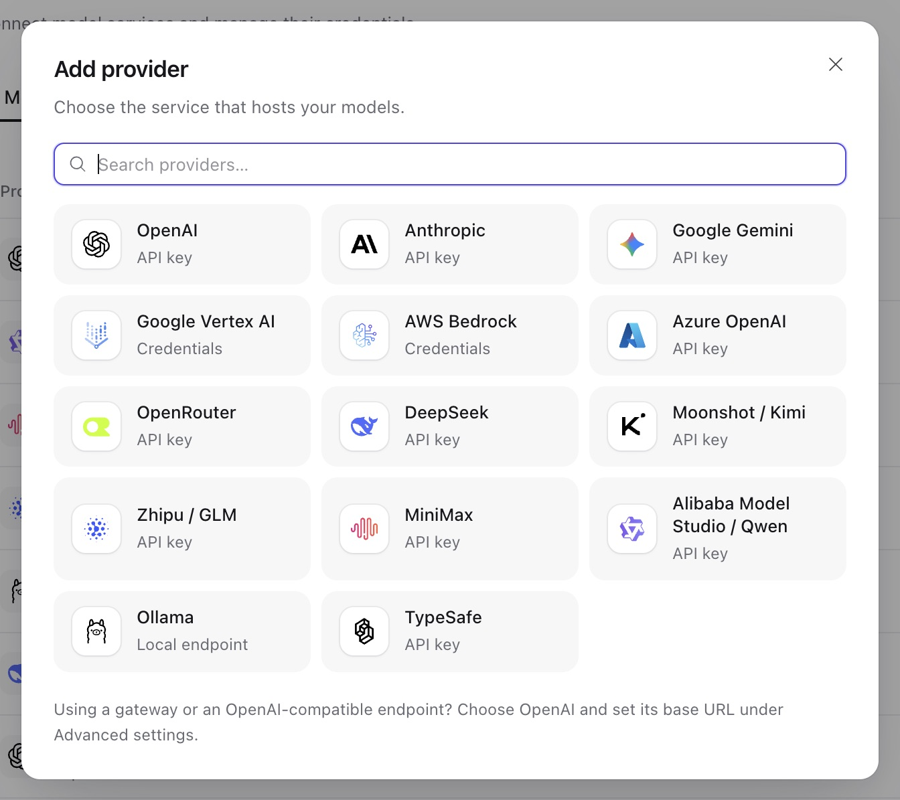

Connect an upstream account once as a **model provider**, then save the **models** agents can use through it. The provider holds credentials and connection settings. Each model holds an upstream ID, calling API, input capabilities, request defaults, and optional prices. Both belong to one [workspace](resources.md#workspaces); an agent selects the model by its stable key.

Start with one model and one successful text response. You need workspace `write` permission, access to the provider account, and an endpoint reachable from the Service Worker. A catalog entry helps fill the form; a response verifies inference access. After that, tune [request settings](#advanced-request-settings) or add [media understanding](#media-understanding).

## Model providers

1. Open **Models → Add model**. An empty workspace opens the connection form directly. If providers already exist, select one or choose **Connect a new provider**.
2. Choose the provider type and enter its connection details. Put API keys in the credential fields, not in model settings or agent instructions.
3. Save the provider, then continue to [Add a model](#add-a-model). To manage the account later, open **Workspace settings → Providers**.



The provider type determines which calling APIs a model may use. The first API in each row is the default:

| Provider type                                                      | Model APIs                                                                        |
| ------------------------------------------------------------------ | --------------------------------------------------------------------------------- |
| `openai`, `azure_openai`                                           | `openai.responses`, `openai.chat_completions`                                     |
| `anthropic`                                                        | `anthropic.messages`                                                              |
| `google_gemini`, `google_vertex`                                   | `google.generate_content`                                                         |
| `aws_bedrock`                                                      | `bedrock.converse`, `bedrock_mantle.responses`, `bedrock_mantle.chat_completions` |
| `openrouter`                                                       | `openrouter.chat_completions`                                                     |
| `fireworks`, `together`, `cerebras`, `sambanova`, `vercel`, `xai`  | `openai.chat_completions`                                                         |
| `ollama`                                                           | `ollama.chat_completions`                                                         |
| `alibaba_model_studio`, `deepseek`, `moonshot`, `minimax`, `zhipu` | `openai.chat_completions`                                                         |
| `cloudflare_ai_gateway`                                            | `openai.chat_completions`                                                         |
| `typesafe`                                                         | `typesafe.system_one`                                                             |
| `openai_chatgpt`                                                   | `openai.responses`; authorize as described below                                  |

API clients create accounts at `/api/v1/model-providers`. Read `GET /api/v1/provider-types/model` for the deployment's configuration, credential, and request-setting schemas. Most API-key types accept `credential: {"api_key": "..."}` and an optional `config.base_url`. [Provider operations](resources.md#providers) covers saving, testing, and rotating credentials.

For these Chat Completions providers, keep the full upstream model ID and use the default endpoint unless your account needs an override:

| Provider type | Default endpoint                        | Catalog channel |
| ------------- | --------------------------------------- | --------------- |
| `fireworks`   | `https://api.fireworks.ai/inference/v1` | `fireworks-ai`  |
| `together`    | `https://api.together.xyz/v1`           | `togetherai`    |
| `cerebras`    | `https://api.cerebras.ai/v1`            | `cerebras`      |
| `sambanova`   | `https://api.sambanova.ai/v1`           | `sambanova`     |
| `vercel`      | `https://ai-gateway.vercel.sh/v1`       | `vercel`        |
| `xai`         | `https://api.x.ai/v1`                   | `xai`, `x-ai`   |

For example, Fireworks uses IDs such as `accounts/fireworks/models/llama-v3p3-70b-instruct`, Together uses `meta-llama/Llama-3.3-70B-Instruct-Turbo`, and Vercel uses gateway IDs such as `anthropic/claude-sonnet-4.6`. Choose an ID available to your account. These integrations use HTTP Chat Completions, without Responses API or xAI native server-side search tools. All except Vercel offer a connection-only test; Vercel's public model list cannot validate credentials, so verify access with a model request.

For **Google Vertex AI**, match the credential to your access method:

- **API key:** use this for an API-key gateway or Vertex Express Mode. Leave Project ID and Location empty. For a gateway, set Base URL to its origin without `/v1beta1` or a model path. The SDK sends `x-goog-api-key` to `/v1beta1/publishers/google/models/...`.
- **Service account:** enter the flat service-account credential object and the required Project ID and Location. Switching credential types clears the previous form draft.

For **Cloudflare AI Gateway**, set `account_id` to the 32-character Cloudflare account ID and save its API token as `api_key`. The token needs **Account → Workers AI → Read** permission. Configure default-alias BYOK credentials or unified billing in Cloudflare. Set `gateway_id` to choose a gateway, or omit it for the default gateway's third-party models. Use full IDs such as `openai/gpt-5.4` or `anthropic/claude-sonnet-4.6`; both use `openai.chat_completions`. A custom `base_url` replaces the account-derived endpoint and must end in `/ai`, without `/v1`, a method path, query, or fragment. Test with a model request: this integration has no connection-only probe, native server tools, or separate Workers AI catalog. See [Cloudflare's unified REST API](https://developers.cloudflare.com/ai-gateway/usage/rest-api/).

For a gateway that routes or bills by header, add up to 32 **extra request headers** to the provider. Values are encrypted; reads expose only `header_names`. In a provider `PATCH`, a value sets that name, `null` removes it, and omission keeps it. Transport, authentication, and protocol header names are reserved. Use these encrypted headers for secrets; [request-level headers](#advanced-request-settings) are readable configuration.

## ChatGPT subscription provider

Use `openai_chatgpt` to authorize ChatGPT plan usage for the workspace. Authorization belongs to the provider and is shared by the workspace, rather than stored as a personal connection.

1. In **Workspace settings → Providers**, add a **ChatGPT** provider. The default flow dynamically registers a public OAuth client and needs no static credential.
2. Choose **Continue with ChatGPT** and open the authorization link. Approve ChatGPT plan usage; website identity access alone does not grant model access.
3. Copy the entire callback URL from the browser address bar into **Complete callback URL**, then choose **Complete sign-in**. Copy it even if the loopback page cannot be reached. Keep the URL private.
4. Add a model using `openai.responses` and an account model slug. Select an account-visible choice or enter an ID manually, then send a test message through an agent.

The Service can run remotely: it validates and exchanges the pasted callback without fetching that URL or requiring the browser to reach the server's loopback listener. Invalid callback input can be corrected and retried. Once code exchange starts, a failed sign-in needs a new authorization attempt.

For an API integration, use these operations in order:

| Task                | Request under `/api/v1/model-providers/{id}`                                 | What to retain or inspect                                          |
| ------------------- | ---------------------------------------------------------------------------- | ------------------------------------------------------------------ |
| Start sign-in       | `POST /authorize` with `{}`                                                  | Open `authorization_url`; retain `attempt_id`                      |
| Finish sign-in      | `POST /authorization/callback` with `attempt_id` and the full `callback_url` | Authorization state                                                |
| Check status        | `GET /authorization`                                                         | Credential-free state and account metadata                         |
| List account models | `GET /models`                                                                | `slug` and `display_name`; visibility is not inference entitlement |
| Disconnect          | `DELETE /authorization`                                                      | Local tokens are cleared; manage remote access in ChatGPT settings |

Returning login reuses registration metadata. **Use another ChatGPT account**, or `POST /authorize` with `{"new_registration": true}`, omits retained account hints. It creates a new dynamic registration when no client is configured and retains an explicitly configured client. Codex credentials cannot replace this authorization.

This provider has a fixed endpoint and stores tokens and pending authorization in encrypted provider-owned state. Its requests always use `store: false` and streaming; a non-streaming caller receives the collected stream. Temperature, Top P, and output-token limits are omitted. Other settings and tools follow the official ChatGPT profile, so API-key model behavior does not carry over automatically.

### Self-hosted callback

Use a public client with `http://127.0.0.1:<port>/auth/callback`. The provider editor's **OAuth client ID** and loopback callback configuration override deployment defaults; blank fields inherit them. Save changes before restarting sign-in.

```sh
export A13N_PROVIDERS__CHATGPT_REDIRECT_URI="http://127.0.0.1:1456/auth/callback"
# Optional: reuse an issued public-client registration.
export A13N_PROVIDERS__CHATGPT_CLIENT_ID="issued-public-client"
```

If upgrading from a confidential client or hosted HTTPS callback, clear the old credential, configure a public loopback flow, and authorize again. Client secrets and the former hosted callback route are unsupported. Existing public-client tokens remain readable; restart pending sign-ins after an upgrade. Changing client ID avoids another client's retained account hints.

The official provider handles expiry and 401 refresh. Service saves complete replacement credentials and rejects stale saves after disconnect or replacement. Multiple Workers can still race to spend a refresh token: monitor refresh failures under concurrent subscription use and reauthorize when needed. An active provider can retain cached tokens after local disconnect. Inference, refresh, and discovery use Service's model transport limits; authorization-code exchange uses the official fixed-endpoint client. [Model authentication](../a13n-harness/model-authentication.md) explains the shared integration.

## Add a model

**In Console:**

1. Open **Models → Add model** and choose the connected provider.
2. Select a catalog model or enter the upstream model ID. Choose the calling API your endpoint serves.
3. Review the name, input capabilities, request defaults, and prices. Catalog selection fills these values; you can change them before saving.
4. Save the enabled model, select it in an agent, and send a short text request. Continue with [agents and runs](agents-and-runs.md) once the agent returns a response.

The public catalog lists recent text models from models.dev, with one row per model and alternate IDs where needed, such as Bedrock regions. Generic `openai` providers also offer **Other models (compatible)** for another vendor's model behind an OpenAI-compatible endpoint. If the catalog is unavailable, enter the ID manually. For providers with account discovery, use the account choices rather than assuming the public catalog grants access.

**Through the API:** set `A13N_URL` to your Service origin and `A13N_API_KEY` to a [workspace API key](identity.md#api-keys) with `write` access. The following example assumes an enabled Ollama provider in that workspace, reachable from the Worker and serving `llama3.3`.

Save this body as `model.json`, replacing `mprov_...` with the provider's ID:

```json
{
  "provider_id": "mprov_...",
  "key": "local-llama",
  "name": "Llama (local)",
  "description": "Served by the team's Ollama host",
  "config": {
    "model_name": "llama3.3",
    "model_api": "ollama.chat_completions",
    "characteristics": {"context_window_tokens": 131072},
    "settings": {"max_tokens": 4096}
  }
}
```

Create it and read it back:

```sh
curl -fsS "$A13N_URL/api/v1/models" \
  -H "Authorization: Bearer $A13N_API_KEY" -H "Content-Type: application/json" \
  --data-binary @model.json
curl -fsS "$A13N_URL/api/v1/models/local-llama" \
  -H "Authorization: Bearer $A13N_API_KEY"
```

Creation returns `201` and the saved model. Use `local-llama` in the agent's `config.model`, not `mprov_...` or `llama3.3`. Creating a model or changing its configuration also needs `write` on the provider, whose credentials it uses.

Choose the fields by their role:

| Field                                   | What you configure                                                                                                                                                                                                                                       |
| --------------------------------------- | -------------------------------------------------------------------------------------------------------------------------------------------------------------------------------------------------------------------------------------------------------- |
| `key`                                   | Immutable workspace address used in agents, usage, and `/models/{key}`. If omitted, Service derives it from provider type and upstream name, lowercases it, and replaces disallowed character runs with `-`. Choose another key on `409 already_exists`. |
| `config.model_name`, `config.model_api` | Exact upstream ID and a calling API supported by this provider type                                                                                                                                                                                      |
| `config.characteristics`                | Context window, context-management thresholds, and actual input capabilities: `image_understanding`, `video_understanding`, `audio_understanding`, or `document_understanding` for PDFs                                                                  |
| `config.settings`                       | Request defaults for all uses of this model; agent settings may override them                                                                                                                                                                            |
| `pricing`                               | Prices for this model's own calls; copy catalog prices or supply your own                                                                                                                                                                                |
| `catalog_ref`                           | Optional `{provider, model}` provenance from the catalog, used by Console for identity display; checked for shape, not catalog membership                                                                                                                |
| `enabled`                               | Defaults to `true`; set `false` to save a disabled model                                                                                                                                                                                                 |

To seed a model from public metadata, query the catalog with exact, case-sensitive filters:

```sh
curl -fsS --get "$A13N_URL/api/v1/model-catalog" \
  -H "Authorization: Bearer $A13N_API_KEY" \
  --data-urlencode "provider=openai" \
  --data-urlencode "model=gpt-5.5"
```

Copy the selected item's `characteristics`, `pricing`, and `ref` into the model's `config.characteristics`, `pricing`, and `catalog_ref`. The response status is `ready`, `stale` (the last catalog after a failed refresh), or `unavailable` (none fetched yet). Filters combine with AND; no match returns empty `items`. Omit `model` to list a channel, or both filters for the full catalog. Refreshes share the full catalog cache. Reading it never updates saved models or prices.

To edit a saved model, `GET /api/v1/models/{key}`, preserve its configuration, and `PATCH` with the returned ETag in `If-Match`. You can change `name`, `description`, `config`, `pricing`, `catalog_ref`, and `enabled`. Submit `config` as a complete replacement, including fields you want to keep. Disable with `{"enabled": false}`; models have no delete operation. [Resource editing](resources.md#common-conventions) shows the read–edit–check sequence.

### Image input preparation

Open the model's **Advanced → Image input** controls and choose how images enter requests:

| Control              | Default | Effect of a special value                                         |
| -------------------- | ------- | ----------------------------------------------------------------- |
| Prepare images       | On      | Off disables automatic preparation                                |
| Support GIF          | On      | Off removes binary GIFs; image URLs are not fetched or classified |
| Max images           | 20      | `0` removes every image                                           |
| Max image size (MiB) | 5       | `0` disables the byte limit                                       |

The size limit measures **base64-encoded bytes per image**, not source-file bytes; 1 MiB is 1,048,576 bytes. Through the API, use `config.characteristics.image_input`: omit it for defaults, supply an object to customize it, or set `null` to disable preparation. The [shared image policy](../a13n-harness/models.md#image-input-policy) lists all seven fields. Console preserves unexposed dimensions, splitting options, and exact byte budgets when you edit other controls.

The primary model, each child model, and the image-understanding model apply their own policy. Each attempt uses its resolved model configuration. Later attempts, including recovery, resolve current model defaults; Service does not freeze the model across attempts as Harness UI does.

### Advanced request settings

Tune a saved model in **Advanced**. Start with **Thinking effort** or **Max output tokens**; OpenAI Responses also exposes **Reasoning summary** and **Store response**. These controls and **Settings JSON** edit the same draft. Leave unsupported options unset, save, and test another message before relying on the change.

Use `config.settings` for model defaults and an agent's `model_settings` for that agent's overrides. For an OpenAI Responses model that supports medium reasoning, the settings object can be:

```json
{
  "openai_reasoning_effort": "medium",
  "extra_headers": {"x-experiment": "candidate"}
}
```

Settings apply in this order:

1. Service supplies its baseline: prompt caching is enabled; OpenAI Responses storage is off.
2. Model defaults replace matching baseline values. Native `config.settings` entries also replace same-named flat `config` defaults (`max_tokens`, `temperature`, `top_p`, `extra_body`, `extra_headers`).
3. Agent or reviewer settings replace matching model defaults. A run override first replaces the agent's **entire** `model_settings` object, then the model defaults are applied beneath it.

For `extra_body` and `extra_headers`, omission inherits the model object, an explicit object replaces it whole, `{}` clears it, and `null` is invalid. Thus run `model_settings: {}` removes agent overrides but still inherits model defaults. Use `model_settings: {"extra_body": {}, "extra_headers": {}}` to clear both request objects. Nested objects are never recursively merged.

Prefer typed parameters. For inference options the installed SDK does not yet recognize, `openai.responses` and `openai.chat_completions` accept `extra_body`; raw values override generated inference fields in a shallow merge. They cannot change the selected model, messages, tools, structured output, transport, or provider session state. Use `openai_text_verbosity`, not raw Responses `text`. The provider type's `settings_schemas` validates both model and agent settings and excludes operator timeouts, account state, alternate model selection, and server tools whose costs `max_usage` cannot fully track.

**Caching:** use `cache: false` to disable library-managed caching or a supported retention value to select its lifetime. Anthropic Messages defaults also enable `anthropic_cache_instructions`, `anthropic_cache_tool_definitions`, and `anthropic_cache_messages`, placing markers on content blocks for gateway compatibility. An explicit unified `cache` value or provider cache setting, including `anthropic_cache`, preserves the authored policy. Pydantic AI places the provider-specific markers; cache hits and the provider's implicit caching remain upstream behavior.

**Response storage:** `openai.responses` defaults to `openai_store: false`, including existing models without that setting. Set `true` to opt in or `null` to delegate to the provider. This affects upstream response storage, not Service run history or other retention policies. Agent/run settings can override it; other calling APIs keep their own behavior. The ChatGPT subscription profile still requires storage off.

**Headers:** request-setting values are readable. Keep secrets in provider credentials or encrypted extra headers. Request settings cannot replace authentication, protocol, stored provider header names, or the affinity header, regardless of case. Model/provider changes take effect on later attempts, including resumed work, and settings are checked again before requests.

### Gateway session affinity

To keep a thread on a gateway's chosen backend:

1. Configure the gateway to route using a supported header.
2. Open the provider's advanced connection settings and set **Session affinity header** to that name (`config.session_affinity_header` through the API).
3. Continue a thread and check gateway logs for the same thread-derived UUID. Use a child or fork to check that it receives its own value.

Service supplies that UUID on every model path, including reviewers and media understanding. It derives the value from the thread, not the session or run. Clearing request header defaults does not remove it. Leave the affinity header empty to disable it; selecting a preset alone does not configure gateway routing.

### Model API availability

If saving an agent or validating settings returns `503 unavailable` with `{"dependency": "model_api:<api>"}`, the deployment no longer offers that calling API. Check the model's `config.model_api` against `GET /api/v1/provider-types/model`. Select an API the provider and deployment support, or ask the operator to restore it, then validate the configuration again.

## Media understanding

Give an agent a separate model for images, video, or audio its primary model cannot read. Configure workspace defaults for shared use, or select models in the agent's own `media_understanding` settings.

1. Add an enabled model with the matching capability, such as `image_understanding`. Its provider must also be enabled and usable in the workspace.
2. As a workspace administrator, open **Workspace settings → Media understanding** and select the model for that media kind.
3. Send a representative media input to an agent that needs this fallback. Check the answer and the selected model's usage record.

For the API, use `curl` and `jq`, the Service origin and workspace API key from above, and administrator permission. Set `IMAGE_MODEL_KEY` to your image model's key. Read the current defaults and their ETag before changing them:

```sh
curl -fsS -D media.headers -o media.json \
  "$A13N_URL/api/v1/media-understanding-defaults" \
  -H "Authorization: Bearer $A13N_API_KEY"
MEDIA_ETAG=$(awk 'tolower($1) == "etag:" {sub(/\r$/, "", $2); print $2}' media.headers)
jq --arg model "$IMAGE_MODEL_KEY" \
  '{image: $model, video: .video, audio: .audio}' media.json > media-update.json
```

Inspect `media-update.json`, then replace the defaults and read them back:

```sh
curl -fsS -X PUT "$A13N_URL/api/v1/media-understanding-defaults" \
  -H "Authorization: Bearer $A13N_API_KEY" \
  -H "Content-Type: application/json" -H "If-Match: $MEDIA_ETAG" \
  --data-binary @media-update.json
curl -fsS "$A13N_URL/api/v1/media-understanding-defaults" \
  -H "Authorization: Bearer $A13N_API_KEY"
```

The response should show your image model and the unchanged video/audio selections. `PUT` replaces all three kinds: omission or `null` clears a kind. On `412`, read the current defaults again before deciding what to replace. Each selected model must declare the matching input capability.

At execution, an agent's own selection wins; if it is unusable, the run fails. An unusable workspace default is skipped with a warning, leaving that kind without a fallback model.

## Usage and prices

After a test run, inspect [usage](agents-and-runs.md#usage) to see which model made each call. Service attributes and prices the call using the selected workspace model and saves the price snapshot with the usage record. This also applies to compaction, reviewers, media understanding, and child agents.

Two saved models can use the same upstream ID and still have separate prices. A provider's returned alias or dated model name does not change attribution. In a copied catalog price, `provider` and `model` record the price's source; the price still applies to the saved model that holds it. Update the saved `pricing` when your rates change rather than expecting a catalog refresh to do so.
