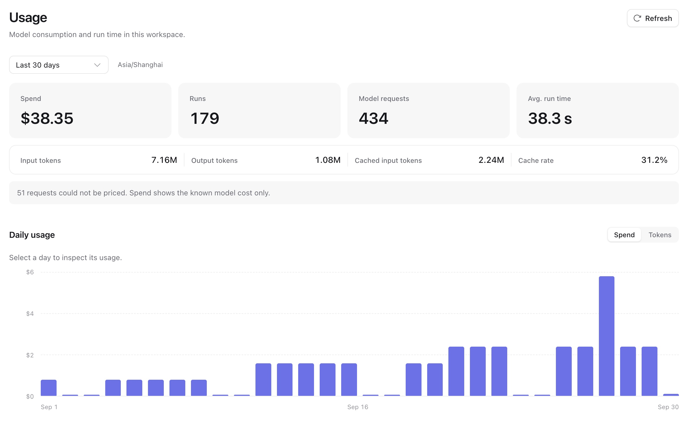

Start with the question you need to answer. For a failed request, follow its request ID into the logs. For a slow run, check the queue and the attempt. For cost, read the workspace's stored usage.

| Question                                  | Start here                                                        |
| ----------------------------------------- | ----------------------------------------------------------------- |
| Why did a request or run fail?            | [Request and run troubleshooting](#troubleshoot-a-request-or-run) |
| Are workers keeping up?                   | [Service metrics](#metrics)                                       |
| What did the agent do during an attempt?  | The attempt's [trace](agents-and-runs.md#traces)                  |
| Which agents or models used the most?     | [Workspace usage](#usage)                                         |
| Is an environment short of CPU or memory? | [Environment monitoring](environment-monitoring.md)               |

You need access to process logs for request troubleshooting. Metrics need a configured scrape endpoint; traces need a configured trace backend. Workspace usage comes from PostgreSQL and works independently of those backends.

## Troubleshoot a request or run

Keep the failing response's status, error body and `X-Request-Id`. The error body's `request_id` repeats that header. Then follow this sequence:

1. Search the process logs for `request_id`. `Request finished` gives the route template, status and duration.
2. Find `Run accepted` in the same request's records and copy `run_id`. If the request was refused, use its error code to fix the request; no run was accepted. If a message was queued behind an active run, follow its [inbox entry](agents-and-runs.md) until it names the run that took the message.
3. Search all relevant process logs for `run_id`, including worker logs. Use the records below to choose the next check, then read `GET /api/v1/runs/{run_id}` for the current saved status and failure message.
4. For an executing or failed attempt, inspect its trace when tracing is configured. Use `GET /api/v1/runs/{run_id}/attempts/{attempt_id}/trace`, or search the backend for `service_run_id` and `run_attempt_id`.

| Record            | What it tells you          | Next check                                                                                                                              |
| ----------------- | -------------------------- | --------------------------------------------------------------------------------------------------------------------------------------- |
| `Run accepted`    | Work was accepted.         | If no attempt follows, check worker readiness, free slots and queue age.                                                                |
| `Attempt claimed` | A worker began an attempt. | Inspect the attempt trace and subsequent attempt records.                                                                               |
| `Attempt ended`   | That attempt stopped.      | Read `status` and `reason`; a retry or continuation has another `Attempt claimed`, while a sealed run has ended.                        |
| `Run sealed`      | The run ended.             | Read its saved status and reason; a waiting result may need [human input and a successor run](agents-and-runs.md#resume-a-waiting-run). |

An endpoint-policy failure tells you which rule was refused, such as requiring HTTPS. Fix that configuration before starting again; the same refused configuration is not retried. A model authentication failure can include `HTTP 401`. Failure messages omit raw upstream response bodies.

For missing webhook or email delivery, search `Outbox` records by `kind` and then `outbox_id`. `Outbox delivery failed` will retry; `Outbox delivery dead` records the final reason. Check [outbox retention and capacity](operations.md#outbox-retention-and-capacity) when deliveries are accumulating.

## Logs

Use the default JSON stdout logs with your process supervisor or log collector. For local reading, set `telemetry.log_format = "pretty"`. If the deployment needs files, add a rotating JSON log to its configuration:

```toml
[telemetry]
log_level = "INFO"
log_file = "/var/log/a13n/service.log"
log_file_max_mb = 100
log_file_backups = 5
log_stdout = false
```

Choose a writable path unique to each process, then restart that process. This example keeps the active file and up to five backups and sends logs only to the file. Operator commands such as `migrate` continue to log to stdout.

Use the IDs that match the work you are following:

| Work               | Log fields                                                                           |
| ------------------ | ------------------------------------------------------------------------------------ |
| HTTP request       | `request_id`; `Request finished` also has `method`, `route`, `status`, `duration_ms` |
| Worker and attempt | `worker_id`, then `run_id` and `attempt_id`                                          |
| Background sweep   | `sweep`; `Sweep failed` includes `error_type` and bounded `exception_details`        |
| Webhook or email   | `outbox_id`, `kind`, and delivery `reason`                                           |

Health and readiness probes are omitted from request logs. Service logs and metrics exclude credentials, request and response bodies, raw URLs and query strings. Configure the reverse proxy's access logs separately to redact query strings. Trace content has its own [export settings](configuration.md#logs-metrics-and-traces); choose `telemetry.trace_content` before sending prompts, outputs or tool payloads to a backend.

## Metrics

To monitor Service processes:

1. Add a metrics port to the deployment configuration. It must differ from `server.port`:

```toml
[telemetry]
metrics_port = 9464
```

2. Restart the process. From the private monitoring network, read `/metrics` on `server.host` and the configured port. For a process reachable on the local machine:

```sh
curl --fail http://127.0.0.1:9464/metrics
```

3. Add **every control and worker process** to your Prometheus or VictoriaMetrics scrape configuration. Use job name `a13n-service` with the repository's [monitoring bundle](https://github.com/converge-ai-labs/agent-foundation/tree/main/deploy/monitoring).
4. Import the bundle's operations dashboard and alert rules. Confirm the targets are being scraped, then inspect requests, runs, worker capacity and deliveries.

The metrics listener is separate from the API listener. Keep it on a private network. The Helm chart enables port 9464 by default and supports a PodMonitor; the bundle describes operator and static-host setup.

| Operational question                   | Useful metrics                                                                                          |
| -------------------------------------- | ------------------------------------------------------------------------------------------------------- |
| Are requests slow or failing?          | `http_server_request_duration_seconds`, grouped by method, route template and status code               |
| Are runs being accepted and completed? | `a13n_runs_accepted_total`, `a13n_runs_sealed_total`, grouped by trigger or outcome                     |
| Are workers saturated?                 | `a13n_worker_slots` (`free`/`busy`), `a13n_attempt_queue_wait_seconds`, `a13n_attempt_duration_seconds` |
| Is due work accumulating?              | `a13n_backlog_size` and `a13n_backlog_oldest_age_seconds`, grouped by `queue`                           |
| Are deliveries failing?                | `a13n_outbox_deliveries_total`, `a13n_outbox_backlog_alert`, `a13n_outbox_dead`                         |
| Are background tasks failing?          | `a13n_sweep_passes_total`, grouped by `sweep` and `result`                                              |

Backlog means work that is due now; waiting runs and future scheduled work are excluded. `all` and `control` replicas refresh the same backlog values every 15 seconds. Take the **maximum across replicas**, rather than adding them. Counts are capped at the larger of 10,000 and the outbox kind's `backlog_count`.

The two outbox gauges also use the maximum across replicas. `a13n_outbox_backlog_alert` becomes 1 after a kind stays over its threshold for `backlog_alert_seconds`; restarting the process resets that timer. `a13n_outbox_dead` is 1 while dead deliveries are retained.

Workers also export [Harness metrics](../a13n-harness/observation.md), including `a13n_harness_run_duration_seconds` and model token usage as `gen_ai_client_token_usage`. Service metrics describe process health and global work; use the usage API for workspace-level numbers.

## Usage

Use Console or the API to read a workspace's stored run and model-usage facts. Operators who need organization-wide reporting can import the monitoring bundle's usage dashboard and connect it through a read-only PostgreSQL role.

For an API report, set `A13N_URL` and a workspace `A13N_API_KEY` with read access. Choose `START` and `END` as RFC 3339 timestamps for a positive range of at most 366 days; `END` is exclusive. This request groups days in UTC:

```sh
curl --get "$A13N_URL/api/v1/usage/overview" \
  -H "Authorization: Bearer $A13N_API_KEY" \
  --data-urlencode "start=$START" \
  --data-urlencode "end=$END" \
  --data-urlencode "timezone=UTC"
```

Read the overview totals and daily buckets. Use `GET /api/v1/usage/agents` or `/api/v1/usage/models` with the same time range for paginated breakdowns (`limit` and `cursor`). `GET /api/v1/usage` provides run, thread and session summaries; see [usage queries](agents-and-runs.md#usage).

### Workspace usage in the Console

1. Open **Insights → Usage** in the workspace.
2. Select the last 7 or 30 days, or a custom range of up to 366 days.
3. Compare spend, run count, model requests, average run time and token totals.
4. Switch the daily chart between **Spend** and **Tokens**, then compare the agent or model breakdown.



*The screenshot uses fictional history from local Seed data.*

Interpret the numbers together:

- **Cost:** recorded model cost is in USD. Unpriced requests are counted separately. A partial subtotal covers known costs only; entirely unknown costs display as unavailable.
- **Cache:** cached input is included in input tokens. Cache rate is total cached input divided by total input, not an average of request percentages.
- **Time:** usage is grouped by ingestion time, runs by start time. Average run time covers started runs that have sealed, from start to seal including intervening execution waits. A waiting run seals before human approval; a resumed successor counts as a separate run.

Late usage can update earlier totals. Console groups days in the browser's timezone; use the same timezone and time range when comparing an API report with the chart.

Workspace administrators can inspect usage by member:

1. Select a user or service account in the **Member** picker beside the time range. The overview, daily trend and agent/model breakdowns update together.
2. Choose **By member** in the breakdown to compare accounts, then **View usage** on a row to inspect that account.
3. Choose **Clear member filter** to return to workspace totals.

`GET /api/v1/usage/members` returns the paginated member breakdown. Overview, agent, model and member endpoints accept an optional `principal_id`. Member queries and any identity-filtered query require workspace `admin`; unfiltered overview, agent and model queries require `read`. Missing or foreign identities return empty usage without exposing their profile.

Usage belongs to the run's execution identity. Requests through a shared bot account remain grouped under that account, not external chat users. Disabled or removed members retain their historical usage; displayed names and status use current values.
