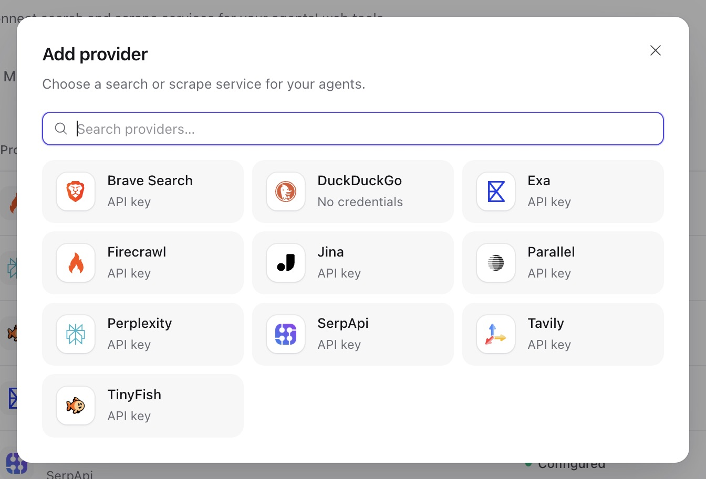
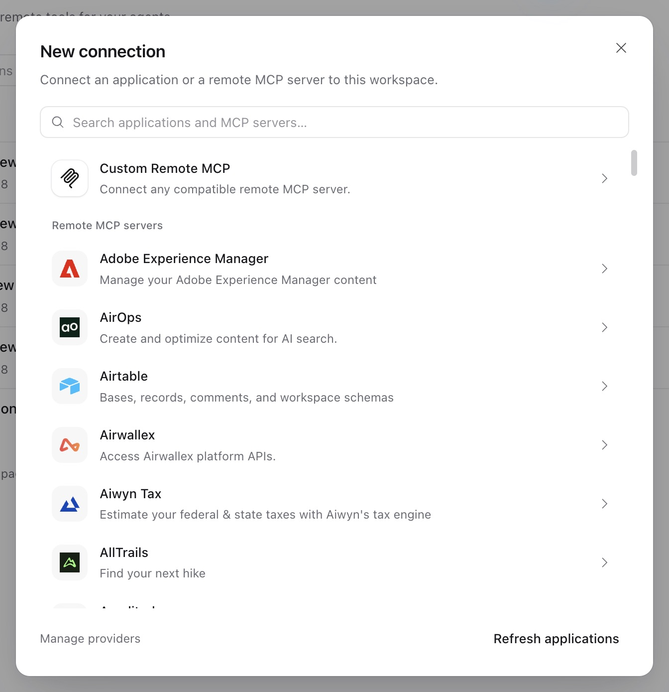

Start with an agent that can [answer a message](use-platform.md). Add one tool source, save the agent's [revision](agent-configuration.md#agent-configuration), then ask it to perform a small task and inspect the tool result.

Choose the source by where the operation runs:

| Task                                      | Source                            | Setup                                                                                                                         |
| ----------------------------------------- | --------------------------------- | ----------------------------------------------------------------------------------------------------------------------------- |
| Read files, run commands or use a desktop | Built-in toolsets                 | Mount an [environment](environments.md) and enable the required actions                                                       |
| Search or retrieve web content            | Web tools                         | Select a web provider for search and scrape                                                                                   |
| Read or change Service resources          | [Platform tools](#platform-tools) | Enable the relevant group and set tool permissions                                                                            |
| Call a remote MCP server or connected app | [Connections](#connections)       | Create, authorize and test a workspace connection                                                                             |
| Call a function in your application       | Client tools                      | Declare its schema, handle `pending.calls`, then [resume with the results](agent-configuration.md#client-tools-and-questions) |
| Teach an agent a workflow                 | [Skills](skills.md)               | Attach instructions and files alongside the tools the workflow needs                                                          |

Set [tool permissions](agent-configuration.md#tool-permissions) in the revision: allow, ask for approval, use model review, or deny. A selected tool also needs its underlying resource and runtime permissions.

## Built-in toolsets

Use `GET /api/v1/toolsets` to inspect your deployment's tool keys, model-visible names, defaults and configuration schemas. Select tools by those keys; for example, the terminal's `exec` key exposes `shell_exec` to the model.

| Toolset    | Use                                              | Default and prerequisite                                                                                   |
| ---------- | ------------------------------------------------ | ---------------------------------------------------------------------------------------------------------- |
| `files`    | Read, search, write and organize files           | Enabled; user files require an environment; built-in skill files use Host mounts                           |
| `shell`    | Start commands and inspect or control processes  | Enabled; user files require an environment; built-in skill files use Host mounts with the relevant actions |
| `computer` | Observe and interact with a desktop              | Disabled; requires a compatible desktop and explicit mount permissions                                     |
| `web`      | `search`, `scrape`, `fetch`, `download`          | Each tool disabled; enable individually                                                                    |
| `memory`   | Read and update file or record memories          | Enabled; requires a matching memory mount                                                                  |
| `assets`   | Publish an environment file with `publish_asset` | Disabled; produces a workspace asset                                                                       |
| `browser`  | Observe and operate a managed browser            | Disabled; requires a [browser binding](browsers.md) and a registered supplier                              |

For user files or terminal commands, mount an [environment](environments.md) before testing the agent. Built-in skill documents use read-only Host mounts and need no user environment. For desktop setup and screenshot previews, follow [Computer Use](computer-use.md#computer-use). A [memory](memory.md) mounted as `read` exposes only viewing, listing and searching; writable mounts offer the matching mutation tools. Published files become [assets](files-and-webhooks.md#assets).

## Platform tools

Enable the required group under **Advanced / Platform Features** in the agent's tools. Each group starts disabled. Enabling it enables its operations, so turn off operations the agent does not need.

| Group                   | Resources and operations                                             |
| ----------------------- | -------------------------------------------------------------------- |
| `agents`                | Agents, revisions and the toolset catalog                            |
| `models`                | Models and the model catalog                                         |
| `connections`           | Connections, connection tools and connector apps                     |
| `skills`                | Skills and their versions                                            |
| `environment_templates` | Environment templates                                                |
| `schedules`             | Create and manage schedules, dispatch them, and read trigger history |
| `providers`             | Providers and tests of saved connections                             |
| `execution`             | Read sessions, threads, runs, traces and findings; submit findings   |

Platform calls use the run's short-lived credential within the authority of the person or key that started it. Each operation uses its MCP tool name as its configuration key. The `inherit` permission means `allow` for reads and `ask` for writes. The only write in `execution` is `POST /api/v1/findings`; choose one primary [finding category](inspect-runs.md#find-and-improve-execution-issues) per issue.

Use the [Agent Composer example](agent-composer.md#use-the-toolset-in-your-own-agents) to pair platform tools with their operating skill. Verify a read first, then test the approval path for any writes you enabled.

## Web search and scrape

To add search to an agent:

1. Create a [web provider](resources.md#providers) in workspace settings. Choose a type that supports search and supply its credential when required.
2. Enable the `web` toolset and its `search` tool. Select the saved provider in the tool configuration.
3. Save the revision and ask the agent to search for a specific topic. Inspect the returned sources.

This agent-configuration fragment enables search and direct fetching. Replace `wprov_...` with your provider ID:

```json
{
  "toolsets": {
    "web": {
      "enabled": true,
      "tools": {
        "search": {
          "enabled": true,
          "config": {"provider_id": "wprov_...", "max_results": 5}
        },
        "fetch": {"enabled": true}
      }
    }
  }
}
```

`search` and `scrape` need a provider serving that operation; saving the revision checks this selection. `fetch` and `download` use Service's HTTP client and need no provider. Enabling only the toolset leaves all four tools disabled. All requests follow the deployment's [outbound policy](configuration.md#outbound-requests).

| Tool     | Configuration limit                |
| -------- | ---------------------------------- |
| `search` | `max_results`: 1–10                |
| `scrape` | `max_content_bytes`: up to 4 MiB   |
| `fetch`  | `max_content_bytes`: up to 256 KiB |

`allow_domains` and `deny_domains` constrain supported operations. A bare hostname includes its subdomains; empty lists add no domain restriction. Built-in scrape providers do not support domain restrictions, so `scrape` rejects nonempty domain lists. Use the provider catalog and tool schemas for the options available in your deployment.



## Connections

A connection gives agents access to one remote MCP server or one connector app account. It belongs to a workspace and holds one shared credential. Anyone with workspace `run` permission can use that account through an agent; keep a private account in a personal workspace. Creating or changing a connection requires `write`.

The setup path is: create the connection, authorize it if needed, [test its tools](#test-and-discover-tools), then [select it in an agent](#use-a-connection-in-an-agent). A connection is usable when its status is `ready`; `pending` means it lacks a usable credential, and `reauthorization_required` means authorization must be restored. Credentials are write-only; views report `credential_configured` and `client_secret_configured`.

To retire a connection, disable it with `PATCH {"enabled": false}` or revoke its credential with `POST …/revoke`. There is no delete operation. Disabling blocks subsequent use, including calls from active runs. Revoking clears local credentials immediately and reports best-effort remote revocation as `revoked`, `failed` or `skipped`. Revocation is also available for disabled connections and archived workspaces.

Read the connection's current ETag and send it as `If-Match` for updates, authorization and revocation. Configuration changes and completed or lost authorizations change the version; routine token renewal and test results leave it unchanged.

### Remote MCP servers

1. Open **Connections → New connection** in Console.
2. Choose a server from the directory, or **Custom Remote MCP** for your own Streamable HTTP endpoint.
3. Choose the server's authentication: `none`, `bearer`, `headers` or `oauth`. Supply credentials or complete the [OAuth flow](#oauth).
4. Test discovery and confirm the tool names you want to expose.



For an HTTP integration, send this body to `POST /api/v1/connections` using the [workspace authentication setup](connect-application.md#direct-http-integration). Replace the example endpoint, token and tool names with your server's values:

```json
{
  "type": "mcp",
  "name": "Docs search",
  "auth": "bearer",
  "config": {
    "url": "https://mcp.example.com/mcp",
    "tools": ["search_docs", "read_doc"]
  },
  "credential": {"token": "REPLACE_WITH_SERVER_TOKEN"}
}
```

`config.tools` limits the tools exposed by the connection. Omitting it exposes all listed tools; more than 128 exposed tools makes a run fail with `connection_tools_exceeded`. Put credentials in the authentication fields, not the URL. For static headers, list names in `config.headers` and supply values in `credential.headers`; transport and protocol headers are reserved.

Changing the endpoint, authentication or OAuth settings clears the saved credential. Changing only the name, enabled state, tool selection or startup policy preserves it. The endpoint must pass the [outbound policy](configuration.md#outbound-requests).

`config.on_error` is `raise` by default: initialization failure propagates to the existing Attempt recovery path. Set it to `skip` through the API when an agent can continue without this server. Startup then omits the server's tools for the current logical Run and tells the model, including with deferred ToolSearch. A later logical Run can retry initialization if this Attempt has not entered a client. If an already-entered client disconnects, `raise` fails later Run admission and `skip` omits the server for each later logical Run in that Attempt. Neither policy reopens that client; a fresh Attempt binding can create a new one. The policy is read from the live Connection when an Attempt opens its bindings.

Transient initialization failures get at most three attempts with cancellable 1s/2s backoff; each keeps the `providers.tool_call_seconds` timeout. A hanging server can therefore spend three initialization timeouts plus three seconds of backoff, in addition to SDK cleanup. Host authorization, credential decryption and initial OAuth renewal failures still propagate. Discovery and business-call errors during an admitted Run do not trigger startup retry or omission, and business calls are never replayed by this mechanism. Explicit discovery, connection tests and MCP Apps control requests report failure instead of skipping.

Service keeps the MCP client for one execution attempt and checks current connection availability and run authority before each call. For a durable human response, use client tools or agent questions; Service's MCP connection has no elicitation response channel.

### MCP Apps for embedding applications

- [Embed MCP Apps](mcp-apps.md)

### OAuth

Choose the grant for the account you want the workspace to share:

| Grant                          | How to authorize                                                                              |
| ------------------------------ | --------------------------------------------------------------------------------------------- |
| `authorization_code` (default) | Use a login session and finish authorization in the same browser                              |
| `client_credentials`           | Configure a client ID and secret authentication; `authorize` obtains a machine token directly |

For browser authorization, choose **Authorize connection** in Console. An integrating application calls `POST /api/v1/connections/{connection_id}/authorize` with the current `If-Match` and an optional `return_url`, then opens `redirect_url` before `expires_at`. API keys cannot start browser flows. A different browser fails with `browser_mismatch`; an expired flow fails with `authorization_expired`. Starting a new flow keeps the current credential until the replacement completes.

Without `config.oauth.client_id`, authorization dynamically registers a public client. For a pre-registered client, set `client_id` and `token_endpoint_auth_method` (`none`, `client_secret_basic` or `client_secret_post`), supplying `client_secret` for a secret method. Register the callback returned by `GET /api/v1/connections/redirect-uri`. A `client_credentials` grant requires a secret method, accepts API-key authorization, and returns `redirect_url: null`.

`config.oauth.scopes` selects scopes; an empty list requests those advertised by the server. The optional `return_url` must share the origin of [`server.public_url`](configuration.md#required-infrastructure) or exactly match an entry in [`providers.return_urls`](configuration.md#outbound-requests).

Tokens renew on use when supported by the grant. Concurrent callers share the renewal operation. If status becomes `reauthorization_required`, authorize again; inspect `failure` for the reason. A refused grant or an uncertain refresh outcome can clear the credential. An unsent request, such as one blocked by outbound policy, preserves it. A failed client-credentials renewal also requires authorization again.

### Composio connections

A Composio connection binds one app account; Composio holds and refreshes that account's tokens.

1. Add a `composio` connector provider with your Composio project API key in workspace settings.
2. Browse `GET /api/v1/connector-providers/{provider_id}/apps`, then the app's details and `/actions`.
3. Create a connection with `type: "composio"`, `auth: "account"`, and `connector_provider_id`. In `config`, specify `app`, 1–128 pinned `actions`, and `setup` with `auth_config_id` and a pinned `toolkit_version` (`YYYYMMDD_NN`). Use an existing auth config or a creation value such as `create:OAUTH2`.
4. Authorize from a login session and finish the hosted account setup in the same browser.
5. Test discovery and select the connection in the agent.

Create separate connections for separate accounts. Each connection exposes its pinned actions. Tool calls carry a stable request ID; if an action's outcome is unknown, inspect the external state before calling it again.

### Test and discover tools

Call `POST /api/v1/connections/{connection_id}/test` to discover tools with the current configuration and credentials. Inspect the returned `status` and `message`: a failed test can return a successful HTTP response with `status: "failed"`. The connection view records `last_test`.

Use `GET /api/v1/connections/{connection_id}/tools` to inspect names, input/output schemas and annotations. Results are cached for `providers.discovery_ttl`. Both operations require `run`. Before a connector account is bound, `/tools` shows the app's action catalog and `test` fails. Read-only annotations describe tools; they do not grant permission.

### Use a connection in an agent

Add `connection_tools` to the agent configuration. This fragment allows document search and asks for approval for other exposed tools. Replace `conn_...` with your connection ID and use tool names returned by discovery:

```json
{
  "connection_tools": [{
    "connection_id": "conn_...",
    "tools": null,
    "permission": "ask",
    "permissions": {"search_docs": "allow"}
  }]
}
```

`tools: null` selects all tools the connection exposes; a list selects at most 128 names. A revision can select up to 128 connections. Saving checks that each connection is enabled and exposes the selected tools. Per-tool `permissions` override the connection-wide `permission`.

Save the revision, start a run, and ask for a document search. Inspect the tool result before testing a write. The connection must be `ready`; every call checks that it is still enabled and authorized and that the run can dispatch. Calls use `providers.tool_call_seconds` and are never retried automatically.

### Native tool discovery

Select **Native tool discovery** under **Tool availability** to search for tools and then call them directly, without groups or `call_tool`:

```json
{"tool_search": {"mode": "native", "sources": {}}}
```

The default sources are Computer, Browser, Platform tools and connected tools. Add Files, Terminal, Web, Memory or Asset with **Add tool source**. In `sources`, use `capabilities` to select builtin sources, `connections: false` to leave all connections direct, `exclude_connections` to leave specific connection IDs direct, or `exclude_platform: true` to leave platform tools direct. These choices do not enable tools or change permissions. Plugins retain their own discovery settings; client tools and control tools retain their normal presentation. Source instructions and initialization remain active.

Harness uses provider-native search when supported and local `search_tools` otherwise. Once discovered, a tool is called under its original name with normal credentials, approval and resume behavior. Native configuration accepts no `groups`, proxy `config`, or custom search strategies. Named subagents use their own revisions; dynamically spawned subagents inherit this policy within their selected scope. Run overrides replace the whole block; an empty proxy plan (`{"groups": {}}`) returns Service tools to direct presentation.

Existing proxy configurations continue to work. Upgrade Control and all Workers before saving native configurations; old versions cannot read the new JSON variant. No database migration or backfill is needed.

### Grouped tool discovery

Select **Discover tools on demand** under **Tool availability** in Console. The **On-demand tools** list starts with **Computer**, **Browser**, **Platform tools** and **MCP tools**. Files, Terminal, Web, Memory and Asset stay directly available. Use **Add tool source** to include any of them in discovery, or remove a source to provide its definitions directly. This selection changes presentation only: disabled tools stay disabled and existing permissions still apply.

**Group by source** works without creating groups. MCP tools follows newly attached connections. Expand **Advanced grouping** to exclude individual MCP connections, or choose **Custom groups**, starting from your current source selection. Expand a group to edit its name, description or sources. Question-mark tooltips explain each setting. Plugins keep their own discovery settings unless explicitly included in a compatible custom group.

In JSON, use `"tool_search": {"automatic": {}}`. Automatic `capabilities` defaults to `["browser", "computer"]`; add `files`, `shell` (Terminal), `web`, `memory` or `assets` as needed. `connections` defaults to true; set it to false to keep all MCP connections direct. `exclude_connections` excludes specific connection IDs, and `exclude_platform: true` keeps platform tools direct. Omit `automatic` to use explicit `groups`. Use separate `files`, `shell` and `computer` selectors; `environment` is not accepted. `GET /toolsets` returns the current automatic policy as `discovery_defaults` and the source metadata as `discovery_sources`. Include `connection_ids` to obtain selected connection descriptions and stable group names. Reordering or renaming connections does not change these names. If any requested connection is unknown or outside the workspace, the catalog request returns `404 not_found`.

Upgrading an existing deployment? Check [Tool-discovery selectors](upgrade-notes.md#tool-discovery-selectors).

This fragment groups a selected connection. Replace `conn_...` in both places:

```json
{
  "connection_tools": [{"connection_id": "conn_...", "permission": "allow"}],
  "tool_search": {
    "groups": {
      "knowledge": {
        "description": "Search the team handbook and project documentation",
        "connections": ["conn_..."]
      }
    }
  }
}
```

The model searches with `discover_tools`, reads definitions with `describe_tool`, and calls members through `call_tool`. `list_tool_groups` lists groups; `list_tools(detail="full")` and `next_offset` page through definitions. Member schemas stay out of later model requests, while execution keeps the original credentials, caller headers and permissions.

Groups accept selected `connections`, `plugins` by instance name, `capabilities` (`files`, `shell`, `computer`, `browser`, `web`, `memory`, `assets`), and `platform: true` for enabled platform tools. A source belongs to at most one group. Names start with a letter, contain at most 32 letters, digits, underscores or hyphens, and exclude `__`.

Ungrouped sources stay directly exposed. `client_tools` retain their external-call protocol. Each child agent uses its own revision's groups. A run override replaces the whole `tool_search` block; `groups: {}` disables grouping. See [Harness ToolSearch](../a13n-harness/tool-search.md) for optional `config`, control names and pagination limits.

### Caller headers

Put non-credential context, such as a conversation ID, in the thread's `mcp_headers`: `{connection_id: {header: value}}`. A run captures the map when accepted; edits affect later runs. Connection authentication headers cannot be overridden. Follow the [caller headers example](execution-options.md#caller-headers).

## MCP server suggestions

Operators can prefill the connection form with their own server. Add an entry to deployment configuration; its `key` adds to or replaces the packaged catalog:

```toml
[[providers.mcp_servers]]
key = "handbook"
name = "Team handbook"
description = "Search the internal handbook."
url = "https://mcp.example.com/handbook"
auth = "oauth"
```

`GET /api/v1/mcp-servers?query=...` exposes the suggestions to Console and other clients. Replace the example endpoint with your server. A suggestion prefills a form; creating the connection still validates the endpoint and authentication.
