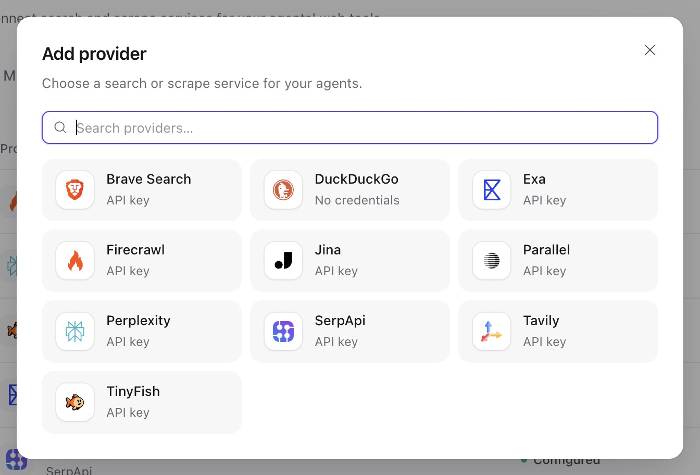
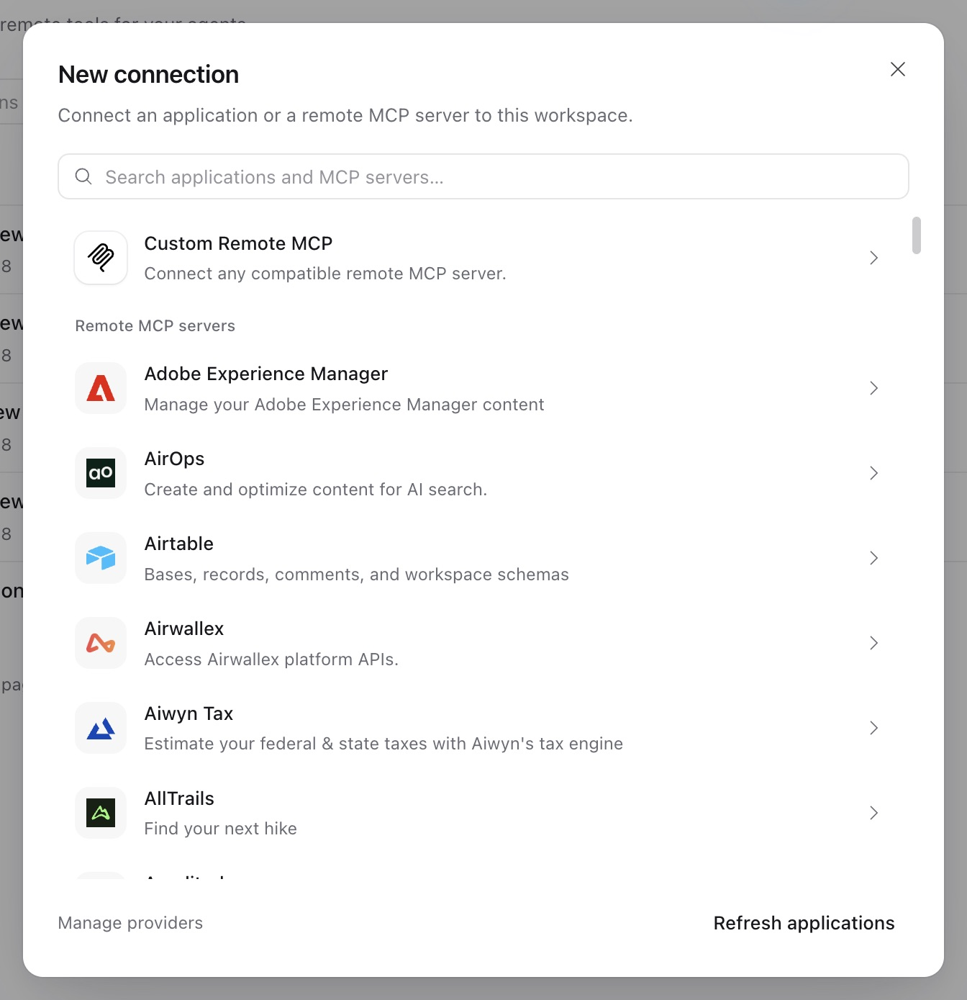

先准备一个能[回复消息](use-platform.md)的 agent。添加一个工具来源，保存 agent 的[修订版本](agents-and-runs.md#agent-configuration)，再让它执行一个小任务并检查工具结果。

按操作执行的位置选择来源：

| 任务                            | 来源                        | 配置                                                                                                 |
| ------------------------------- | --------------------------- | ---------------------------------------------------------------------------------------------------- |
| 读取文件、运行命令或操作桌面    | 内置工具集                  | 挂载[环境](environments.md)并启用所需动作                                                            |
| 搜索或获取网页内容              | Web 工具                    | 为搜索和抓取选择 Web provider                                                                        |
| 读取或修改 Service 资源         | [平台工具](#platform-tools) | 启用相关分组并设置工具权限                                                                           |
| 调用远程 MCP 服务器或已连接应用 | [连接](#connections)        | 创建、授权并测试工作空间连接                                                                         |
| 调用应用中的函数                | 客户端工具                  | 声明 schema，处理 `pending.calls`，再[提交结果并恢复](agents-and-runs.md#client-tools-and-questions) |
| 教 agent 执行工作流             | [Skill](skills.md)          | 添加指令和文件，同时配置工作流需要的工具                                                             |

在修订版本中设置[工具权限](agents-and-runs.md#tool-permissions)：允许、请求审批、由模型审核或拒绝。选中的工具还需要对应资源和运行时权限。

## 内置工具集

使用 `GET /api/v1/toolsets` 查看当前部署的工具 key、模型可见名称、默认值和配置 schema。按这些 key 选择工具；例如终端的 `exec` key 向模型提供 `shell_exec`。

| 工具集     | 用途                                    | 默认状态与前置条件                                  |
| ---------- | --------------------------------------- | --------------------------------------------------- |
| `files`    | 读取、搜索、写入和整理文件              | 启用；需要挂载环境                                  |
| `shell`    | 启动命令，检查或控制进程                | 启用；需要挂载环境并授予相关动作                    |
| `computer` | 观察和操作桌面                          | 禁用；需要兼容桌面及明确的挂载权限                  |
| `web`      | `search`、`scrape`、`fetch`、`download` | 各工具均禁用；逐个启用                              |
| `memory`   | 读取和更新文件型或记录型记忆            | 启用；需要相应的记忆挂载                            |
| `assets`   | 通过 `publish_asset` 发布环境文件       | 禁用；生成工作空间资产                              |
| `browser`  | 观察和操作托管浏览器                    | 禁用；需要[浏览器绑定](browsers.md)及已注册的供应商 |

选择文件或终端工具后，先挂载[环境](environments.md)，再测试 agent。桌面配置和截图预览参阅 [Computer Use](environments.md#computer-use)。以 `read` 挂载的[记忆](memory.md)只提供查看、列出和搜索；可写挂载提供相应修改工具。发布的文件成为[资产](files-and-webhooks.md#assets)。

## 平台工具

在 agent 工具的高级平台功能区域启用所需分组。各组默认禁用；启用分组会启用其中的操作，因此请关闭 agent 不需要的操作。

| 组                      | 资源与操作                                            |
| ----------------------- | ----------------------------------------------------- |
| `agents`                | Agent、修订版本和工具集目录                           |
| `models`                | 模型和模型目录                                        |
| `connections`           | 连接、连接工具和 connector 应用                       |
| `skills`                | Skill 及其版本                                        |
| `environment_templates` | 环境模板                                              |
| `schedules`             | 创建和管理计划、手动触发及读取触发历史                |
| `providers`             | Provider 及已保存连接的测试                           |
| `execution`             | 读取 session、thread、run、trace 和发现项；提交发现项 |

平台调用使用运行的短期凭据，权限不超过启动运行的人或密钥。各操作的配置 key 是其 MCP 工具名。`inherit` 对读取操作表示 `allow`，对写入操作表示 `ask`。`execution` 中唯一的写入是 `POST /api/v1/findings`；每个问题选择一种主要[发现类型](agents-and-runs.md#find-and-improve-execution-issues)。

按 [Agent Composer 示例](agent-composer.md#use-the-toolset-in-your-own-agents)为平台工具配上操作 skill。先验证一次读取，再测试已启用写入操作的审批流程。

## Web 搜索与抓取

为 agent 添加搜索：

1. 在工作空间设置中创建 [Web provider](resources.md#providers)。选择支持搜索的类型，并按需提供凭据。
2. 启用 `web` 工具集及其中的 `search` 工具，在工具配置中选择已保存的 provider。
3. 保存修订版本，让 agent 搜索一个具体主题，检查返回的来源。

以下 agent 配置片段启用搜索和直接获取网页。将 `wprov_...` 替换为你的 provider ID：

```json
{
  "toolsets": {
    "web": {
      "enabled": true,
      "tools": {
        "search": {
          "enabled": true,
          "config": {"provider_id": "wprov_...", "max_results": 5}
        },
        "fetch": {"enabled": true}
      }
    }
  }
}
```

`search` 和 `scrape` 需要支持相应操作的 provider；保存修订版本时会检查选择。`fetch` 和 `download` 使用 Service 的 HTTP 客户端，无需 provider。仅启用工具集时，四个工具仍全部禁用。所有请求都遵循部署的[出站策略](configuration.md#outbound-requests)。

| 工具     | 配置上限                          |
| -------- | --------------------------------- |
| `search` | `max_results`：1–10               |
| `scrape` | `max_content_bytes`：最多 4 MiB   |
| `fetch`  | `max_content_bytes`：最多 256 KiB |

`allow_domains` 和 `deny_domains` 限制支持它们的操作。裸主机名包含其子域；空列表不增加域名限制。内置抓取 provider 不支持域名限制，因此 `scrape` 拒绝非空域名列表。当前部署可用的选项以 provider 目录和工具 schema 为准。



## 连接

连接让 agent 访问一个远程 MCP 服务器或一个 connector 应用账号。连接属于工作空间，保存一份共享凭据。拥有工作空间 `run` 权限的人都能通过 agent 使用该账号；私人账号应放在个人工作空间。创建或修改连接需要 `write`。

配置顺序是：创建连接、按需授权、[测试工具](#test-and-discover-tools)，再[在 agent 中选择连接](#use-a-connection-in-an-agent)。状态为 `ready` 时连接可用；`pending` 表示尚无可用凭据，`reauthorization_required` 表示需要重新授权。凭据只写不读；视图返回 `credential_configured` 和 `client_secret_configured`。

停用连接时，使用 `PATCH {"enabled": false}` 禁用，或通过 `POST …/revoke` 撤销凭据。连接没有删除操作。禁用会阻止后续使用，包括活跃运行中的调用。撤销立即清除本地凭据，并以 `revoked`、`failed` 或 `skipped` 报告尽力执行的远程撤销结果。已禁用连接和已归档工作空间也支持撤销。

更新、授权和撤销前，读取连接当前的 ETag，并作为 `If-Match` 发送。配置变化以及完成或丢失授权会改变版本；常规 token 续期和测试结果不会改变版本。

### 远程 MCP 服务器

1. 在 Console 的连接页面新建连接。
2. 从目录选择服务器，或选择自定义远程 MCP，填写自己的 Streamable HTTP endpoint。
3. 按服务器要求选择认证方式：`none`、`bearer`、`headers` 或 `oauth`。提供凭据或完成 [OAuth 流程](#oauth)。
4. 测试发现结果，确认需要暴露的工具名称。



通过 HTTP 接入时，按[工作空间认证配置](connect-application.md#direct-http-integration)向 `POST /api/v1/connections` 发送以下请求体。将示例 endpoint、token 和工具名称替换为服务器的实际值：

```json
{
  "type": "mcp",
  "name": "Docs search",
  "auth": "bearer",
  "config": {
    "url": "https://mcp.example.com/mcp",
    "tools": ["search_docs", "read_doc"]
  },
  "credential": {"token": "REPLACE_WITH_SERVER_TOKEN"}
}
```

`config.tools` 限制连接暴露的工具。省略时暴露服务器列出的全部工具；超过 128 个会使运行以 `connection_tools_exceeded` 失败。将凭据放在认证字段中，不要放入 URL。使用静态请求头时，在 `config.headers` 列出名称，在 `credential.headers` 提供值；传输和协议请求头为保留字段。

修改 endpoint、认证方式或 OAuth 设置会清除已保存凭据。只修改名称、启用状态或工具选择会保留凭据。Endpoint 必须符合[出站策略](configuration.md#outbound-requests)。

Service 在一次执行尝试内保留 MCP 客户端，每次调用前检查连接当前可用性和运行权限。需要持久等待人工回应时，使用客户端工具或 agent 问题；Service 的 MCP 连接没有 elicitation 回应通道。

### 供接入方使用的 MCP Apps

接入应用可以根据工具结果渲染 MCP App。Service 保存原始参数、声明和完整结果，包括 `_meta`；应用打开 App 时才获取 HTML。Console 不渲染 App。

实时接入流程：

1. 订阅 `GET /api/v1/sessions/{session_id}/stream`。
2. 将含有 `a13n.mcp_apps` 的 delta 视为加载中的引用。此处即使 `unavailable: false`，也只是临时状态。
3. 等待 `app_ready`，确认原始数据和引用已提交。用 `(run_id, app_id)` 标识每个 App；重连后可能重复收到就绪事件。
4. 使用事件的 `run_id` 和 `apps[].app_id` 打开 App。

包含 App 的检查点提交后，事件跟在已提交的 `items` 后面；无需等待运行结束。发布失败时，引用标记为不可用，不发送就绪事件。通过 `GET /api/v1/runs/{run_id}/items` 加载的可用已提交引用可直接打开，包括断线期间已经结束的运行。Thread 事件流不发送 `app_ready`。

| 请求                                                      | 请求体                                | 结果                                |
| --------------------------------------------------------- | ------------------------------------- | ----------------------------------- |
| `POST /api/v1/runs/{run_id}/apps/{app_id}/open`           | 无                                    | 已保存的原始数据和当前 HTML         |
| `POST /api/v1/runs/{run_id}/apps/{app_id}/tools/call`     | `{"name":"increment","arguments":{}}` | `result` 中的原始 MCP 结果          |
| `POST /api/v1/runs/{run_id}/apps/{app_id}/resources/read` | `{"uri":"ui://counter/app.html"}`     | 已保存 App URI 的当前 HTML 和元数据 |

每次请求使用新的 MCP 客户端并检查当前访问权限。打开 App 不会重跑原始工具；不支持依赖 worker 原 MCP 会话的服务器。按钮调用必须满足原 agent 的工具选择与权限、当前连接的工具选择及 App 可见性。需要审批或模型审核的操作会被拒绝。部署配置了准入策略时，还需要显式支持 App 准入。

接入应用负责创建 iframe、执行资源 CSP 和隔离要求，并通过 MCP App bridge 提供原始参数和结果。应用自行保存视图状态，通过现有运行 API 提交上下文或消息。后续工具结果仅返回调用方，不替换原始结果，也不进入模型历史。调用不会自动重试：收到 `outcome_unknown` 后先检查外部状态，再决定是否重试。HTML 每次重新获取，可能与产生旧结果时的版本不同。升级到 checkpoint format 4 时，应先升级 control 进程和读取端，再启动新 worker。

### OAuth

按工作空间要共享的账号选择 grant：

| Grant                        | 授权方式                                                  |
| ---------------------------- | --------------------------------------------------------- |
| `authorization_code`（默认） | 使用登录会话，在同一浏览器完成授权                        |
| `client_credentials`         | 配置 client ID 和密钥认证；`authorize` 直接获取机器 token |

浏览器授权可在 Console 中发起。接入应用调用 `POST /api/v1/connections/{connection_id}/authorize`，携带当前 `If-Match` 和可选的 `return_url`，然后在 `expires_at` 前打开 `redirect_url`。API 密钥不能启动浏览器流程。更换浏览器会返回 `browser_mismatch`，流程过期会返回 `authorization_expired`。启动新流程会保留当前凭据，直到替代授权完成。

未配置 `config.oauth.client_id` 时，授权会动态注册公共客户端。使用预先注册的客户端时，设置 `client_id` 和 `token_endpoint_auth_method`（`none`、`client_secret_basic` 或 `client_secret_post`）；密钥认证方式还需提供 `client_secret`。注册 `GET /api/v1/connections/redirect-uri` 返回的回调地址。`client_credentials` grant 必须使用密钥认证，允许通过 API 密钥发起授权，并返回 `redirect_url: null`。

`config.oauth.scopes` 选择 scope；空列表请求服务器声明的 scope。可选的 `return_url` 必须与 [`server.public_url`](configuration.md#required-infrastructure) 同源，或与 [`providers.return_urls`](configuration.md#outbound-requests) 中某个条目完全一致。

Grant 支持续期时，token 在使用时续期，并发调用者共享同一次续期操作。状态变为 `reauthorization_required` 时重新授权，并查看 `failure` 了解原因。Grant 被拒绝或刷新结果不确定时，凭据可能被清除。未发送的请求，例如被出站策略阻止的请求，会保留凭据。Client-credentials 续期失败也需要重新授权。

### Composio 连接

一个 Composio 连接绑定一个应用账号；Composio 保存并刷新该账号的 token。

1. 在工作空间设置中添加 `composio` connector provider，提供 Composio 项目 API key。
2. 浏览 `GET /api/v1/connector-providers/{provider_id}/apps`，再查看应用详情和 `/actions`。
3. 创建连接，设置 `type: "composio"`、`auth: "account"` 和 `connector_provider_id`。在 `config` 中指定 `app`、1–128 个固定的 `actions`，以及含有 `auth_config_id` 和固定 `toolkit_version`（`YYYYMMDD_NN`）的 `setup`。使用已有 auth config，或 `create:OAUTH2` 等创建值。
4. 从登录会话发起授权，在同一浏览器完成托管账号设置。
5. 测试工具发现结果，在 agent 中选择该连接。

不同账号使用不同连接。每个连接暴露其固定操作。工具调用携带稳定的请求 ID；操作结果未知时，先检查外部状态，再决定是否重试。

### 测试与发现工具

调用 `POST /api/v1/connections/{connection_id}/test`，按当前配置和凭据发现工具。检查返回的 `status` 和 `message`：测试失败时，HTTP 响应仍可能成功，而正文为 `status: "failed"`。连接视图保存 `last_test`。

使用 `GET /api/v1/connections/{connection_id}/tools` 查看名称、输入输出 schema 和注解。结果缓存时长为 `providers.discovery_ttl`。两种操作都需要 `run`。Connector 账号尚未绑定时，`/tools` 显示应用操作目录，`test` 失败。只读注解用于描述工具，不授予权限。

### 在 agent 中使用连接

在 agent 配置中添加 `connection_tools`。以下片段允许文档搜索，对其他暴露的工具请求审批。将 `conn_...` 替换为连接 ID，并使用发现结果中的工具名称：

```json
{
  "connection_tools": [{
    "connection_id": "conn_...",
    "tools": null,
    "permission": "ask",
    "permissions": {"search_docs": "allow"}
  }]
}
```

`tools: null` 选择连接暴露的全部工具；列表最多选择 128 个名称。一个修订版本最多选择 128 个连接。保存时检查每个连接已启用，并暴露所选工具。逐工具的 `permissions` 覆盖连接级 `permission`。

保存修订版本、启动运行，并要求 agent 搜索文档。先检查工具结果，再测试写入。连接必须为 `ready`；每次调用都检查它仍启用且已授权，并确认运行允许发出调用。调用使用 `providers.tool_call_seconds`，不会自动重试。

### 分组工具发现

工具较多时，在 Console 的工具发现区域选择分组代理搜索。添加分组并选择来源。分组改变模型查找工具的方式；请先按普通方式启用并配置这些来源。

以下片段将一个已选连接加入分组。替换两处 `conn_...`：

```json
{
  "connection_tools": [{"connection_id": "conn_...", "permission": "allow"}],
  "tool_search": {
    "groups": {
      "knowledge": {
        "description": "Search the team handbook and project documentation",
        "connections": ["conn_..."]
      }
    }
  }
}
```

模型使用 `discover_tools` 搜索，通过 `describe_tool` 读取定义，并通过 `call_tool` 调用组内工具。`list_tool_groups` 列出分组；`list_tools(detail="full")` 配合 `next_offset` 分页读取定义。成员 schema 不会加入后续模型请求，执行仍保留原凭据、调用方请求头和权限。

分组接受已选的 `connections`、按实例名引用的 `plugins`、`capabilities`（`environment`、`web`），以及代表已启用平台工具的 `platform: true`。每个来源最多属于一个分组。名称以字母开头，最多包含 32 个字母、数字、下划线或连字符，不能包含 `__`。

未分组来源仍直接暴露。需要审批后恢复的工具应保持直接暴露；`client_tools` 保留外部调用协议。每个子 agent 使用自身修订版本的分组。运行覆盖会替换整个 `tool_search` 块；`groups: {}` 关闭分组。可选 `config`、控制工具名称和分页限制参阅 [Harness ToolSearch](../a13n-harness/tool-search.md)。

### 调用方请求头

将对话 ID 等非凭据上下文放入 thread 的 `mcp_headers`：`{connection_id: {header: value}}`。运行接受时捕获该映射，后续修改只影响之后的运行。连接的认证请求头不能被覆盖。参阅[调用方请求头示例](agents-and-runs.md#caller-headers)。

## MCP 服务器建议

运维人员可以用自有服务器预填连接表单。在部署配置中添加条目；`key` 用于添加或替换内置目录项：

```toml
[[providers.mcp_servers]]
key = "handbook"
name = "Team handbook"
description = "Search the internal handbook."
url = "https://mcp.example.com/handbook"
auth = "oauth"
```

`GET /api/v1/mcp-servers?query=...` 向 Console 和其他客户端提供建议。将示例 endpoint 替换为你的服务器。建议用于预填表单；创建连接时仍会验证 endpoint 和认证配置。
