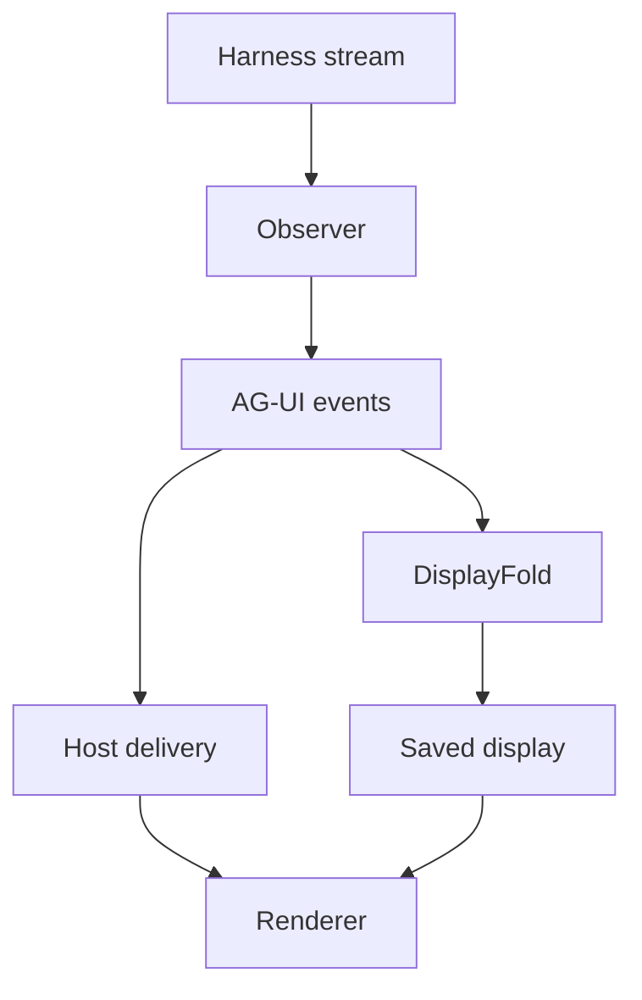

Stream Protocol connects Harness execution to your terminal or browser. An observer converts public Harness observations into typed AG-UI events. Your application delivers those events, and `DisplayFold` can accumulate them into messages, tool calls, and observations that survive a display restart when you save a checkpoint.

## Start here

Start with the [offline quickstart](getting-started.md). It runs an Agent and prints JSON events without credentials. Then choose the next step for your application:

| You want to                                    | Read                                                            |
| ---------------------------------------------- | --------------------------------------------------------------- |
| Send live output or filter visible content     | [Events and processors](events.md)                              |
| Restore a display or continue event conversion | [Replay and recovery](replay.md)                                |
| Look up imports, payloads, and limits          | [API and payload reference](api-reference.md)                   |
| Continue model and tool execution              | [Harness State and Resume](../a13n-harness/state-and-resume.md) |



## Install

Add the published package to an existing Python project:

```console
uv add a13n-stream-protocol
```

The package depends on the exact matching Harness release. The [source quickstart](getting-started.md) uses the repository lockfile for the API described by this documentation.

## One observer, one Run

Choose `HarnessAguiStreamObserver` for a root stream that includes inline children. It keeps each child's conversion state separate and attributes output with `subagentRunId`. Use a separate observer for each independently executed root or asynchronous child Run. For a source that contains exactly one Run, use `HarnessAguiObserver`.

Publish the batch returned by `observe(item)`. Keep the default event journal only when you need `snapshot()`; use `retain_events=False` when your Host already stores events or uses `DisplayFold`. The [events guide](events.md) shows both choices.

## Ownership Summary

An application embedding Harness is the Host. Divide the integration into three parts:

| Part                   | Responsibility                                                                                         |
| ---------------------- | ------------------------------------------------------------------------------------------------------ |
| Harness                | Execute the Agent and produce public observations, results, and execution State                        |
| Stream Protocol        | Convert events, apply your processor, and accumulate or restore display content                        |
| Your Host and renderer | Store checkpoints, assign durable delivery IDs, retain history, handle reconnects, and present content |

Choose SSE, WebSocket, or in-process delivery to fit your application. Keep transport ordering and replay cursors in the Host. Display checkpoints restore presentation; `HarnessState` restores execution through a new Run.

## Next Steps

Follow [Events and processors](events.md) to connect an existing Harness stream, or [Replay and recovery](replay.md) to save an unfinished display. The [Harness guide](../a13n-harness/index.md) teaches Agent construction and execution. Package and contract details are in the [package README](https://github.com/converge-ai-labs/agent-foundation/tree/main/packages/a13n-stream-protocol) and [Stream Protocol specification](https://github.com/converge-ai-labs/agent-foundation/tree/main/spec/a13n-stream-protocol).

## Upgrade to AG-UI 1.0

Upgrade the Host and renderer together. Python uses `ag-ui-protocol>=1,<2`; browser consumers use upstream `@ag-ui/core` types and schemas with the Host's transport. Standard wire fields use camelCase, and consumers must handle the 1.0 format directly.

Check these changes in an existing integration:

- Handle `RUN_STARTED` once per logical Run, after preparation and before public output.
- Read cancellation and interruption from `RUN_FINISHED.outcome`; handle failure through `RUN_ERROR`.
- Read input role and message ID from CUSTOM `value.event.role` and `value.event.message_id`, with metadata at the top level.
- Support ordered tool-result content parts and payload-omitted media descriptors. Provider file handles remain references without an invented download URL.
- Namespace inline-child display keys by `subagentRunId` and keep child replies separate from the root answer. Historical child display requires its retained observations.

Keep existing Harness continuation State and usage ledgers. The wire-format upgrade changes their presentation, not their storage ownership.

## Reference topics

| Topic                                                                   | Guide                                                                    |
| ----------------------------------------------------------------------- | ------------------------------------------------------------------------ |
| <span id="observe-a-harness-run"></span>Connect a stream                | [Observe a Harness Run](events.md#observe-a-harness-run)                 |
| <span id="read-the-accumulated-snapshot"></span>Read retained events    | [Read the Accumulated Snapshot](events.md#read-the-accumulated-snapshot) |
| <span id="apply-a-host-processor"></span>Filter or replace content      | [Apply a Host Processor](events.md#apply-a-host-processor)               |
| <span id="resume-from-source-history"></span>Rebuild conversion         | [Resume from Source History](replay.md#resume-from-source-history)       |
| <span id="resume-is-not-agent-recovery"></span>Continue Agent execution | [Resume Is Not Agent Recovery](replay.md#resume-is-not-agent-recovery)   |
| <span id="errors-and-atomicity"></span>Handle conversion failure        | [Errors and Atomicity](replay.md#errors-and-atomicity)                   |
