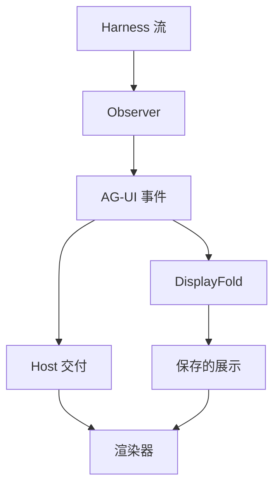

Stream Protocol 将 Harness 执行连接到终端或浏览器。Observer 把 Harness 公开观测转换为结构化 AG-UI 事件，由应用负责交付。`DisplayFold` 可将事件累积为消息、工具调用和观测条目；保存检查点后，展示进程重启也能恢复这些内容。

## 从这里开始

先运行[离线快速入门](getting-started.md)：无需凭据，即可执行 Agent 并打印 JSON 事件。随后按应用需求选择下一步：

| 你要做什么                 | 阅读                                                      |
| -------------------------- | --------------------------------------------------------- |
| 发送实时输出或过滤可见内容 | [事件与处理器](events.md)                                 |
| 恢复展示或继续转换事件     | [重放与恢复](replay.md)                                   |
| 查找导入名称、载荷与限制   | [API 与载荷参考](api-reference.md)                        |
| 继续模型和工具执行         | [Harness 状态与恢复](../a13n-harness/state-and-resume.md) |



## 安装

在现有 Python 项目中添加发布包：

```console
uv add a13n-stream-protocol
```

该包依赖精确匹配的 Harness 版本。[源码快速入门](getting-started.md)使用仓库锁文件，对应本文档描述的 API。

## 一个 observer 对应一次执行

根流包含内联子执行时，选择 `HarnessAguiStreamObserver`。它分别维护各子执行的转换状态，并通过 `subagentRunId` 标识输出归属。每次独立运行的根执行或异步子执行使用独立 observer。源中严格只有一次执行时，使用 `HarnessAguiObserver`。

发布 `observe(item)` 返回的批次。需要 `snapshot()` 时保留默认事件日志；Host 已存储事件或使用 `DisplayFold` 时，设置 `retain_events=False`。[事件指南](events.md)展示这两种选择。

## 职责归属

嵌入 Harness 的应用就是 Host。将集成分为三部分：

| 部分            | 职责                                                      |
| --------------- | --------------------------------------------------------- |
| Harness         | 执行 Agent，产生公开观测、结果和执行状态                  |
| Stream Protocol | 转换事件、应用处理器、累积或恢复展示内容                  |
| Host 与渲染器   | 保存检查点、分配持久交付 ID、保留历史、处理重连和呈现内容 |

按应用需求选择 SSE、WebSocket 或进程内交付。传输顺序与重放游标由 Host 管理。展示检查点恢复呈现内容；`HarnessState` 通过新的执行继续 Agent 运行。

## 下一步

通过[事件与处理器](events.md)连接现有 Harness 流，或通过[重放与恢复](replay.md)保存尚未结束的展示。[Harness 指南](../a13n-harness/index.md)介绍 Agent 构建和执行。软件包与契约详情见[包 README](https://github.com/converge-ai-labs/agent-foundation/tree/main/packages/a13n-stream-protocol) 和 [Stream Protocol 规范](https://github.com/converge-ai-labs/agent-foundation/tree/main/spec/a13n-stream-protocol)。

## 升级到 AG-UI 1.0

同步升级 Host 和渲染器。Python 使用 `ag-ui-protocol>=1,<2`；浏览器消费上游 `@ag-ui/core` 类型和 schema，并使用 Host 的传输。标准线上字段采用 camelCase，消费端需要直接处理 1.0 格式。

更新现有集成时，检查以下变化：

- 每次逻辑执行处理一次 `RUN_STARTED`，它出现在准备完成后、公开输出前。
- 从 `RUN_FINISHED.outcome` 读取取消与中断，通过 `RUN_ERROR` 处理失败。
- 从 CUSTOM `value.event.role` 和 `value.event.message_id` 读取输入角色与消息 ID，元数据位于顶层。
- 支持有序工具结果内容 part 和省略载荷的媒体描述。Provider 文件句柄保持为引用，不会凭空生成下载 URL。
- 按 `subagentRunId` 隔离内联子执行的展示键，将子回答与根回答分开。历史子执行展示依赖保留的观测。

保留现有 Harness 续接状态和用量账本。线上格式升级改变展示方式，不改变这些数据的存储归属。

## 参考主题

| 主题                                                           | 指南                                                                       |
| -------------------------------------------------------------- | -------------------------------------------------------------------------- |
| <span id="observe-a-harness-run"></span>连接流                 | [观测 Harness 执行](events.md#observe-a-harness-run)                       |
| <span id="read-the-accumulated-snapshot"></span>读取保留事件   | [读取累积快照](events.md#read-the-accumulated-snapshot)                    |
| <span id="apply-a-host-processor"></span>过滤或替换内容        | [应用 Host 处理器](events.md#apply-a-host-processor)                       |
| <span id="resume-from-source-history"></span>重建转换状态      | [从源历史恢复](replay.md#resume-from-source-history)                       |
| <span id="resume-is-not-agent-recovery"></span>继续 Agent 执行 | [observer 恢复与 agent 恢复的区别](replay.md#resume-is-not-agent-recovery) |
| <span id="errors-and-atomicity"></span>处理转换失败            | [错误与原子性](replay.md#errors-and-atomicity)                             |
