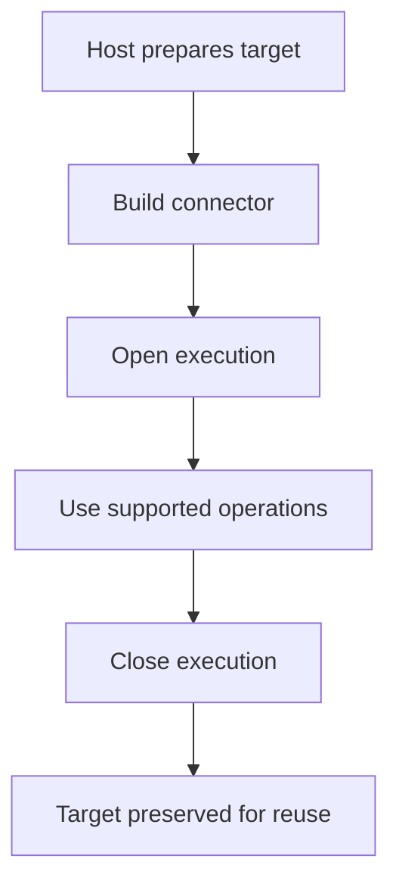

Environment APIs let your application read files and run commands on a target you choose. Start with an existing local directory, then use the same operation interfaces with a container or remote target. The execution APIs ship in `a13n-harness` and work without an Agent or model.

## Start here

Follow the [file quickstart](getting-started.md) to open a workspace, write a file, read it back, and close the execution. Then choose the next step for your application:

| Task                                                | Guide                                                  |
| --------------------------------------------------- | ------------------------------------------------------ |
| Select local, container, cloud, or remote execution | [Choose a backend](#choose-a-backend)                  |
| Set configuration, credentials, and runtime objects | [Provider configuration](configuration.md)             |
| Look up fields and defaults                         | [Configuration reference](configuration-reference.md)  |
| Run commands and inspect their output               | [Commands and processes](commands.md)                  |
| Use file paths, searches, and bounded reads         | [Operations](operations.md)                            |
| Create a target and reconnect to it                 | [Lifecycle and state](lifecycle.md)                    |
| Try complete programs                               | [Runnable examples](examples.md)                       |
| Connect an existing daemon                          | [Remote Envd](remote-envd.md)                          |
| Expose operations as Agent tools                    | [Harness integration](../a13n-harness/environments.md) |

## Choose a backend

Choose **Native Execution** for Files & Shell through the target's native APIs: Direct Local, Docker, E2B, Vercel, Sprites, or Runloop. Shell covers command execution and the process, stdin, and output operations the backend supports.

Choose **Envd Execution** when you need the general execution interface, including OS sandbox and Egress policy, Computer use, or Device metrics. This path connects to a compatible Envd daemon over EIP. The Host selects the policy; the daemon enforces it within the target's available OS boundary. Metrics are read through the Host's Device connection.

| Execution path | Provider         | Connects to                                                  |
| -------------- | ---------------- | ------------------------------------------------------------ |
| Native         | `direct_local`   | An existing directory on the Host                            |
| Native / Envd  | `docker`         | A Docker container; select HTTP EIP for the Envd route       |
| Native / Envd  | `e2b`            | An E2B sandbox; select HTTP EIP for the Envd route           |
| Envd           | `local_envd`     | A Host-owned local daemon over stdio                         |
| Envd           | `daytona`        | A compatible daemon in a Daytona sandbox                     |
| Envd           | `modal`          | A compatible daemon in a Modal sandbox                       |
| Native / Envd  | `vercel`         | A Vercel sandbox; select HTTP EIP for the Envd route         |
| Native / Envd  | `sprites`        | A Sprite; its Envd route uses a private tunnel               |
| Native         | `runloop`        | A Runloop Devbox; Envd is not integrated                     |
| Envd           | `http_envd`      | An existing daemon over HTTP(S)                              |
| Envd           | `websocket_envd` | A daemon reverse-connected to a Host-owned WebSocket ingress |

For cloud account and runtime choices, see [Cloud Providers](providers.md#cloud-providers). Docker, E2B, Daytona, Modal, Vercel, and Sprites can provide desktop access with compatible Envd runtimes. Follow [desktop setup](../a13n-service/environments.md#computer-use) to prepare the image, template, snapshot, or Sprite installation. You can also [try HTTP and WebSocket locally](remote-envd.md) before using a cloud account.

## Management, connection, and execution

Keep these three steps separate in your application:

1. **Prepare the target.** Use an existing directory or daemon, or manage a target through a Service `EnvironmentProvider`. Save the returned `EnvironmentState` when the provider uses state.
2. **Build a connector.** An `EnvironmentConnector` describes that fixed target. Construction performs no I/O.
3. **Open an execution.** Each `open()` returns a ready `EnvironmentExecution` with its own `execution_id` and supported operations. Close it when the work is done.

Opening and checking readiness use the selected target; they do not start or recreate it. Closing releases execution-owned resources while preserving the target. To reconnect later, open a new execution. [Lifecycle and state](lifecycle.md) explains management and execution cleanup in detail.

## Use with Harness

Supply an `EnvironmentSource` whose `ensure_ready()` prepares the target and returns its connector. The [complete source example](../a13n-harness/environments.md#supply-a-source) wraps a Direct Local connector in a Host-owned `PreparedSource`.

Set mount paths and permission ceilings with `EnvironmentMount`, and enable `DynamicEnvironmentCapability` to expose model-visible tools. Harness publishes the static mounts, opens a mount on first use, and closes opened executions at Run exit. An unused mount stays unopened.

## Use Local Envd

For Local Envd, create a `LocalEnvdProviderRuntime` with a compatible executable and a private-runtime allocator. Keep that Host-owned runtime alive while executions borrow it. Each execution opens an independent EIP Session; close the runtime when all borrowers have finished. See [Providers and runtime](providers.md#local-envd-runtime).

Use Direct Local for access under the Host account; its directory mapping provides no OS isolation. With Local Envd, select the sandbox and network policy at daemon launch. For an already registered remote Device, use the HTTP or WebSocket path in [Remote Envd](remote-envd.md).

## Retain targets and manage state

To reuse a managed target across Runs, save the result of creation or start under the Host's concurrency control, then build connectors from that state. Execution does not produce new management state to save after each Run. Stop, renewal, and destruction remain explicit Host actions.

[Service environments](../a13n-service/environments.md) adds templates, managed instances, and Run mounts. An embedding application can use Service's management providers or supply its own lifecycle implementation. Continue to [Harness environments](../a13n-harness/environments.md) for Agent integration.
