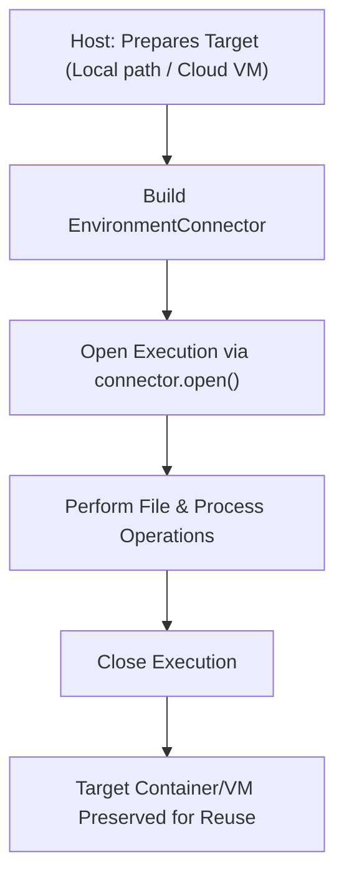

The **Environments** subsystem provides a portable, uniform execution interface for interacting with filesystems and operating system processes. With Environments, your application or agent uses the exact same API whether it is editing a file on the local host machine, compiling code inside an isolated Docker container, or driving a browser in an ephemeral cloud micro-VM.

Environments ships as part of `a13n-harness` and can be used directly as a standalone execution library without an LLM.

## Start here

Get started with the [Environment quickstart](getting-started.md) to open a workspace, write a file, read it back, and safely release resources. Then explore specific execution patterns:

| Operational task | Reference guide |
| :--- | :--- |
| **Select an execution target** | [Choose a backend](#choose-a-backend) (Local, Docker, E2B, cloud sandboxes) |
| **Configure runtime credentials & options** | [Provider configuration](configuration.md) |
| **Execute commands & inspect streams** | [Commands and processes](commands.md) |
| **File inspection, search & bounded reads** | [Operations](operations.md) |
| **Manage target lifecycles & reconnect** | [Lifecycle and state](lifecycle.md) |
| **Connect an existing daemon over EIP** | [Remote Envd](remote-envd.md) |
| **Expose execution to agents as tools** | [Harness integration](../a13n-harness/environments.md) |

## Choose a backend

Environments supports two complementary execution pathways:

- **Native Execution:** Uses backend-native APIs for standard filesystem access and shell processes. Available for Direct Local paths, Docker containers, E2B micro-VMs, Vercel sandboxes, Sprites, and Runloop Devboxes.
- **Envd Execution:** Connects over the Environment Inter-Process (EIP) protocol to an Envd daemon. This path unlocks full OS sandboxing, network egress enforcement policies, desktop GUI Computer Use, and real-time device metrics.

| Target provider | Execution type | Backend mechanism |
| :--- | :--- | :--- |
| `direct_local` | Native | Accesses an existing local path under the host process identity |
| `docker` | Native / Envd | Executes inside a managed Docker container |
| `e2b` | Native / Envd | Spawns an isolated cloud sandbox on E2B |
| `local_envd` | Envd | Connects to a local native Rust Envd daemon via stdio |
| `daytona` | Envd | Runs inside a secure Daytona cloud workspace |
| `modal` | Envd | Executes within a serverless Modal sandbox |
| `vercel` | Native / Envd | Uses a secure Vercel micro-VM environment |
| `sprites` | Native / Envd | Connects to an ephemeral Sprite container via tunnel |
| `http_envd` | Envd | Connects to an existing remote daemon over HTTP/HTTPS |
| `websocket_envd` | Envd | Connects to an Envd daemon reverse-tunneled via WebSocket |

## Management, connection, and execution

Environments cleanly decouples infrastructure provisioning from active task execution:



1. **Prepare the target:** The host provisions a directory, launches a Docker container, or acquires an existing remote daemon.
2. **Build a connector:** An `EnvironmentConnector` represents a fixed, addressable target. Construction performs zero network I/O.
3. **Open an execution:** Calling `connector.open()` allocates an active `EnvironmentExecution` session. Your application reads files or starts commands through this handle, closing it cleanly when finished. The underlying container or VM remains preserved for subsequent connections.

## Use with Harness

To grant an agent access to an environment, define an `EnvironmentSource` and attach `DynamicEnvironmentCapability`:

```python
from a13n_harness.capabilities import DynamicEnvironmentCapability
from a13n_harness.environments import EnvironmentMount, PreparedSource

# 1. Wrap a local connector in a prepared source
source = PreparedSource(connector)

# 2. Configure mount and permission ceilings
mount = EnvironmentMount(
    source=source,
    mount_path="/workspace",
    read_only=False,
)

# 3. Attach capability to builder
builder.add_capability(
    DynamicEnvironmentCapability(mounts=[mount])
)
```

Harness automatically exposes model-visible file and shell tools (`read_file`, `write_file`, `exec_command`) scoped to the mounted path.

## Use Local Envd

For environments requiring hard OS process isolation, network egress restriction, or desktop computer interaction on a single machine, launch a local Envd daemon:

```python
from a13n_harness.environments.providers.local_envd import LocalEnvdProviderRuntime

runtime = LocalEnvdProviderRuntime(binary_path="/usr/local/bin/envd")
connector = runtime.create_connector(workspace_path="/tmp/sandbox")
```

The daemon enforces OS kernel namespaces and cgroups, isolating agent-generated code from your primary host system.

## Retain targets and manage state

To reuse a managed target across multiple turns or distributed workers:

1. Save the provider's serialized `EnvironmentState` in your application database alongside `HarnessState`.
2. When launching subsequent runs, re-instantiate the connector using the saved state without re-creating the target container from scratch.
3. Explicitly terminate or delete the underlying VM or container only when the entire business session is permanently closed.
