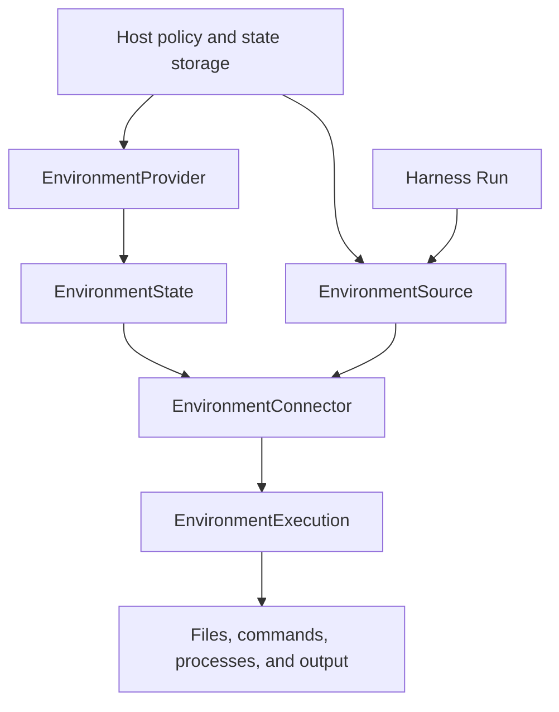

`a13n-harness` provides files, commands, processes, output, and ports without requiring an Agent or a model. Service owns managed target creation, stop, renewal, and destruction. Use an `EnvironmentConnector` directly for standalone operations. For an Agent, supply an `EnvironmentSource`; Harness opens its connector on first use and closes the execution at Run exit. Optional SDKs belong to this package's `docker`, `e2b`, and `modal` extras.

## Start here

| Task                                                        | Guide                                                  |
| ----------------------------------------------------------- | ------------------------------------------------------ |
| Read and write a file with no network dependencies          | [Getting started](getting-started.md)                  |
| Choose local, sandbox, container, or remote execution       | [Choose a backend](#choose-a-backend)                  |
| Understand close, state, re-entry, and destruction          | [Lifecycle and state](lifecycle.md)                    |
| Configure built-ins, credentials, and runtime collaborators | [Provider configuration](configuration.md)             |
| Compare the six cloud Providers                             | [Cloud Providers](providers.md#cloud-providers)        |
| Implement a Provider or supply Host runtimes                | [Providers and runtime](providers.md)                  |
| Run commands, inspect processes, and read retained output   | [Commands and processes](commands.md)                  |
| Understand paths, search patterns, and output limits        | [Operations](operations.md)                            |
| Run a complete built-in lifecycle                           | [Runnable examples](examples.md)                       |
| Connect HTTP or reverse WebSocket Envd                      | [Remote Envd](remote-envd.md)                          |
| Expose Environment tools to an Agent                        | [Harness integration](../a13n-harness/environments.md) |

## Choose a backend

**Native Execution** is the lightweight path for quick deployment and applications that need only **Files & Shell**. It has three forms: **Local** for direct local access, **Docker** for local containerization, and **E2B** for a remote sandbox. Shell includes command execution, process control, stdin, and output handling.

**Envd Execution** is the general execution path. It provides Files & Shell, execution policy enforcement through **OS sandbox** and **Egress**, and advanced capabilities such as **Computer use** and **metrics collection**. The Host selects policy; Envd enforces it within the target's available OS boundary. Device metrics use the Host's Device connection rather than Agent tools.

**Environment Providers** manage resources independently of the execution path. Each managed infrastructure vendor retains its own `EnvironmentProvider` subclass for allocation, inspection, start/stop, destruction, renewal, and connection preparation. Service or the embedding Host orchestrates these providers; Harness opens fixed-target executions.

| Execution path | Provider         | Execution scope                                               | Resource management             |
| -------------- | ---------------- | ------------------------------------------------------------- | ------------------------------- |
| Native         | `direct_local`   | Files & Shell on the local Host                               | Host-owned directory            |
| Native / Envd  | `docker`         | Native Files & Shell; explicit HTTP EIP for general execution | Docker provider                 |
| Native         | `e2b`            | Files & Shell in a remote sandbox                             | E2B provider                    |
| Envd           | `local_envd`     | Local daemon over stdio                                       | Host-owned daemon               |
| Envd           | `daytona`        | EIP to a compatible sandbox daemon                            | Daytona provider                |
| Envd           | `modal`          | EIP to a compatible sandbox daemon                            | Modal provider                  |
| Native / Envd  | `vercel`         | Native Files & Shell / explicit HTTP EIP                      | Vercel provider                 |
| Native         | `sprites`        | Vendor Files & Shell; EIP not integrated                      | Sprites provider                |
| Native         | `runloop`        | Vendor Files & Shell; EIP not integrated                      | Runloop provider                |
| Envd           | `http_envd`      | HTTP(S) EIP                                                   | Connect-only                    |
| Envd           | `websocket_envd` | Reverse WebSocket EIP                                         | Connect-only; Host owns ingress |

> Implementation status: Docker, E2B, Daytona, Modal and Vercel support Envd/EIP and desktop access with compatible runtimes. Service can automatically prepare E2B desktop templates and Modal desktop images; the other providers retain their documented image or snapshot setup. Sprites and Runloop currently provide native Files & Shell. See the [configuration reference](configuration-reference.md) for existing fields.

[Try the remote examples locally](remote-envd.md) without a model, Docker or cloud account.

## Management, connection, and execution

The Host explicitly manages targets through `EnvironmentProvider` and saves `EnvironmentState`. An `EnvironmentConnector` describes one fixed target with no construction-time I/O; each `open()` returns a new, ready `EnvironmentExecution`.

Executions expose operations and have distinct `execution_id` values. Closing an execution releases its resources without destroying the target. Readiness never creates, starts, replaces, or renews a target. Later reconnection requires an explicit new execution.

## Use with Harness

Supply an `EnvironmentSource` that prepares the target and returns its connector. For an existing directory, the [complete source example](../a13n-harness/environments.md#supply-a-source) wraps a Direct Local connector in a Host-owned `PreparedSource`.

Harness publishes the static mounts before opening executions. First use activates the selected mount; Run exit closes opened executions while preserving their targets. Enable `DynamicEnvironmentCapability` for model-visible tools, and use `EnvironmentMount` for mount paths and permission ceilings.

## Use Local Envd

Local Envd requires a borrowed `LocalEnvdProviderRuntime`. The Host chooses a compatible executable and private-runtime allocator. Each execution opens an independent EIP Session, while the Host closes the shared Device. See [Providers and runtime](providers.md#local-envd-runtime).

Direct Local uses the Host account without OS isolation. For Local Envd, the Host selects sandbox and network policy at launch, and Envd enforces it for each Session. Remote HTTP and WebSocket Envd connect only to registered devices; see [Remote Envd](remote-envd.md).

## Retain targets and manage state

Create or start a target explicitly, publish the result under Host concurrency control, then generate a connector. Execution produces no new management state to write back after a Run. Stop, renewal, and destruction are explicit Host actions; see [Lifecycle and state](lifecycle.md).

Service builds templates, managed instances, and Run mounts on this library; see [Service environments](../a13n-service/environments.md). For more embedding patterns, see [Harness environments](../a13n-harness/environments.md).
