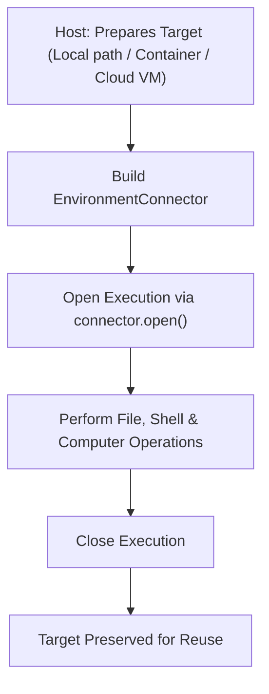

**Environments** provides a portable execution interface for filesystems, OS processes, and desktop GUI operations. Your application or Agent uses the exact same API whether working in a local directory, a Docker container, or a cloud microVM.

Environments ships inside `a13n-harness` and can also be used directly as a standalone Python library without an LLM.

## Start here

Follow the [Environment quickstart](getting-started.md) to open a workspace, write and read a file, and release resources cleanly, then continue by task:

| Task                                        | Guide                                                                       |
| :------------------------------------------ | :-------------------------------------------------------------------------- |
| **Select an execution target**              | [Choose a backend](#choose-a-backend) (Local, Docker, E2B, cloud sandboxes) |
| **Configure runtime credentials & options** | [Provider configuration](configuration.md)                                  |
| **Execute commands & inspect streams**      | [Commands and processes](commands.md)                                       |
| **File inspection, search & bounded reads** | [Operations](operations.md)                                                 |
| **Manage target lifecycles & reconnect**    | [Lifecycle and state](lifecycle.md)                                         |
| **Connect an existing daemon over EIP**     | [Remote Envd](remote-envd.md)                                               |
| **Expose execution to agents as tools**     | [Harness integration](../a13n-harness/environments.md)                      |

## Choose a backend

Environments offers two execution pathways:

- **Native execution:** Uses backend-native file and shell APIs (`direct_local`, `docker`, `e2b`, `vercel`, `sprites`, `runloop`, `boxd`).
- **Envd execution:** Connects over the Environment Interaction Protocol (EIP) to `a13n-envd`—unlocking OS sandboxing, controlled network egress, desktop Computer Use, and live telemetry.

| Provider         | Execution type | Backend mechanism                                               |
| :--------------- | :------------- | :-------------------------------------------------------------- |
| `direct_local`   | Native         | Accesses an existing local path under the Host process identity |
| `local_envd`     | Envd           | Connects to a Host-spawned native `a13n-envd` daemon over stdio |
| `docker`         | Native / Envd  | Executes inside a managed Docker container                      |
| `e2b`            | Native / Envd  | Runs inside an isolated E2B cloud sandbox                       |
| `daytona`        | Envd           | Runs inside a Daytona cloud sandbox                             |
| `modal`          | Envd           | Runs inside a serverless Modal sandbox                          |
| `vercel`         | Native / Envd  | Runs inside a Vercel Sandbox                                    |
| `sprites`        | Native / Envd  | Runs inside a Fly.io Sprite                                     |
| `runloop`        | Native         | Runs inside a Runloop Devbox                                    |
| `boxd`           | Native         | Runs inside an isolated boxd VM                                 |
| `http_envd`      | Envd           | Connects to an existing remote Envd daemon over HTTP(S)         |
| `websocket_envd` | Envd           | Connects to an Envd daemon reverse-tunneled over WebSocket      |

## Management, connection, and execution



1. **Prepare the target:** The Host creates a directory, container, or cloud sandbox (or selects a registered Device).
2. **Build a connector:** `EnvironmentConnector` describes a fixed target without performing network I/O.
3. **Open an execution:** `await connector.open()` returns an active `EnvironmentExecution` handle; closing it releases execution resources while preserving the target.

## Use with Harness

Supply an `EnvironmentSource` (returning an `EnvironmentConnector` from `ensure_ready()`, see [Supply a source](../a13n-harness/environments.md#supply-a-source)), optionally restrict paths with `EnvironmentMount`, and attach `DynamicEnvironmentCapability` on `HarnessBuilder`:

```python
from a13n_harness import AgentSpec, HarnessBuilder
from a13n_harness.environment import DynamicEnvironmentCapability, DynamicEnvironmentConfiguration

executable = HarnessBuilder().build(
    AgentSpec(),
    output_type=str,
    model=model,
    capabilities=(
        DynamicEnvironmentCapability(
            DynamicEnvironmentConfiguration(files_enabled=True, shell_enabled=True)
        ),
    ),
)
# Pass environment=source when calling await executable.run("...", environment=source)
```

## Use Local Envd

Construct a Host-owned `LocalEnvdProviderRuntime` when running local workloads with native OS isolation, controlled egress, or desktop Computer Use (see [Providers and runtime](providers.md#local-envd-runtime)):

```python
from a13n_harness.providers.environment.local_envd.runtime import (
    LocalEnvdProviderRuntime,
    TemporaryLocalEnvdRuntimeAllocator,
    resolve_a13n_envd_executable,
)

runtime = LocalEnvdProviderRuntime(
    executable=resolve_a13n_envd_executable(),
    allocate_private_runtime=TemporaryLocalEnvdRuntimeAllocator(),
)
```

## Retain targets and manage state

Persist the provider's returned `EnvironmentState` under your Host's concurrency control after creation or start, rebuild connectors from that saved state on later Runs, and stop or destroy the target explicitly when the session ends. See [Service environments](../a13n-service/environments.md) for managed templates and lifecycle orchestration.
