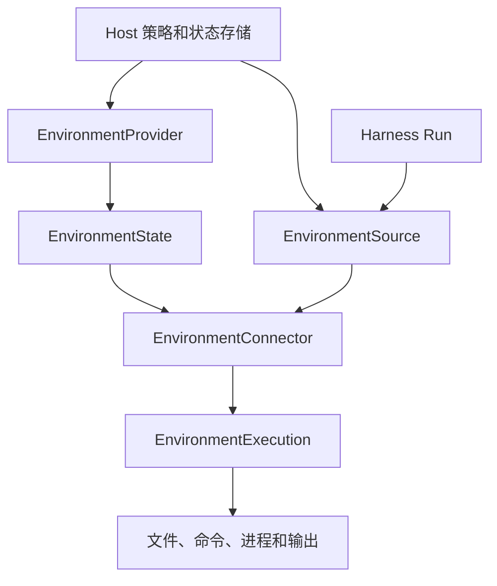

`a13n-harness` 提供文件、命令、进程、输出和端口操作，无需创建 Agent 或调用模型。Service 负责目标创建、停止、续期和销毁。独立操作直接使用 `EnvironmentConnector`。接入 Agent 时，提供 `EnvironmentSource`；Harness 在首次使用时打开其 connector，并在 Run 退出时关闭 execution。可选 SDK 位于该包的 `docker`、`e2b` 和 `modal` extras 中。

## 从这里开始

| 任务                                    | 指南                                            |
| --------------------------------------- | ----------------------------------------------- |
| 无需网络依赖读写文件                    | [快速入门](getting-started.md)                  |
| 选择本地、沙箱、容器或远程执行          | [选择后端](#choose-a-backend)                   |
| 理解关闭、状态、重新进入和销毁          | [生命周期与状态](lifecycle.md)                  |
| 配置内置 provider、凭据和运行时协作对象 | [Provider 配置](configuration.md)               |
| 比较六个云 provider                     | [云 provider](providers.md#cloud-providers)     |
| 实现 provider 或提供 Host 运行时        | [Provider 与运行时](providers.md)               |
| 运行命令、检查进程和读取保留输出        | [命令与进程](commands.md)                       |
| 理解路径、搜索模式和输出限制            | [操作](operations.md)                           |
| 运行完整的内置生命周期                  | [可运行示例](examples.md)                       |
| 连接 HTTP 或反向 WebSocket Envd         | [Remote Envd](remote-envd.md)                   |
| 向 agent 提供环境工具                   | [Harness 集成](../a13n-harness/environments.md) |

## 选择后端

**Native Execution** 面向快速部署和只需要基础能力的应用，提供 **Files & Shell**。本地直连使用 **Local**，本地容器使用 **Docker**，厂商托管目标可使用 **E2B**、**Vercel**、**Sprites** 或 **Runloop**。Shell 包括命令执行、进程控制、标准输入和输出处理。

**Envd Execution** 是通用执行路径，提供 Files & Shell、通过 **OS sandbox** 和 **Egress** 实施的执行策略控制，以及 **Computer use**、**metrics 采集**等进阶能力。Host 选择策略，Envd 在目标可用的操作系统边界内实施策略。设备指标通过 Host 的 Device 连接读取，而不是 agent 工具。

**Environment Provider** 独立承担资源管理。每个托管基础设施供应商保留自己的 `EnvironmentProvider` 子类，负责资源分配、检查、启停、销毁、续期和连接准备。Service 或嵌入 Harness 的 Host 编排这些 provider；Harness 打开指向固定目标的 execution。

| 执行路径      | Provider         | 执行能力                                             | 资源管理              |
| ------------- | ---------------- | ---------------------------------------------------- | --------------------- |
| Native        | `direct_local`   | 本地 Host 上的 Files & Shell                         | Host 管理的已有目录   |
| Native / Envd | `docker`         | Native Files & Shell；显式选择 HTTP EIP 使用通用执行 | Docker provider       |
| Native / Envd | `e2b`            | Native Files & Shell；显式选择 HTTP EIP              | E2B provider          |
| Envd          | `local_envd`     | 通过 stdio 连接本地守护进程                          | Host 管理的守护进程   |
| Envd          | `daytona`        | 通过 EIP 连接兼容的沙箱守护进程                      | Daytona provider      |
| Envd          | `modal`          | 通过 EIP 连接兼容的沙箱守护进程                      | Modal provider        |
| Native / Envd | `vercel`         | Native Files & Shell；显式选择 HTTP EIP              | Vercel provider       |
| Native / Envd | `sprites`        | Native Files & Shell；私有隧道 EIP                   | Sprites provider      |
| Native        | `runloop`        | 厂商 Files & Shell；尚未接入 EIP                     | Runloop provider      |
| Envd          | `http_envd`      | HTTP(S) EIP                                          | 仅连接                |
| Envd          | `websocket_envd` | 反向 WebSocket EIP                                   | 仅连接；Host 管理入口 |

> Docker、E2B、Daytona、Modal、Vercel 和 Sprites 支持兼容运行环境下的 Envd/EIP 与桌面访问。Service 可准备 E2B 模板、Modal 镜像、Daytona 和 Vercel 快照，并在每个新 Sprite 内安装桌面。Docker 按文档配置镜像和宿主机。Runloop 仅提供 Native Files & Shell。参阅[桌面设置](../a13n-service/environments.md#computer-use)和[配置参考](configuration-reference.md)。

[在本地试用远程示例](remote-envd.md)，无需模型、Docker 或云账号。

## 管理、连接与执行

Host 通过 `EnvironmentProvider` 显式管理目标并保存 `EnvironmentState`。`EnvironmentConnector` 只描述固定目标，构造时不进行 I/O；每次 `open()` 返回一个新的、已就绪的 `EnvironmentExecution`。

执行对象提供操作并拥有自己的 `execution_id`。关闭执行会释放其资源，但不销毁目标。检查就绪不会创建、启动、替换或续期目标。后续重新连接必须显式打开新执行。

## 与 Harness 一起使用

提供负责准备目标并返回 connector 的 `EnvironmentSource`。对于已有目录，[完整来源示例](../a13n-harness/environments.md#supply-a-source)使用 Host 自有的 `PreparedSource` 包装 Direct Local connector。

Harness 先发布静态挂载，再打开 execution。首次使用激活所选挂载；Run 退出时关闭已打开的 execution，并保留目标。通过 `DynamicEnvironmentCapability` 向模型提供工具，通过 `EnvironmentMount` 设置挂载路径和权限上限。

## 使用 Local Envd

Local Envd 必须借用 Host 提供的 `LocalEnvdProviderRuntime`。Host 选择兼容的可执行文件和私有运行目录分配器；执行对象分别打开独立 EIP Session，Host 负责关闭共享 Device。具体配置见 [Provider 与运行时](providers.md#local-envd-runtime)。

Direct Local 使用 Host 账号，不提供 OS 隔离。Local Envd 的隔离和网络策略由 Host 在启动时选择，Envd 为每个 Session 执行这些策略。远程 HTTP 和 WebSocket Envd 只连接已注册设备，见 [Remote Envd](remote-envd.md)。

## 保留目标与管理状态

先通过管理方法创建或启动目标，在 Host 的并发控制下保存结果，再生成连接配置。执行不产生新的管理状态，Run 完成后无需回写目标引用。停止、续期和销毁由 Host 显式发起，见[生命周期与状态](lifecycle.md)。

Service 在此基础上提供模板、托管实例和 Run 挂载，见 [Service 环境](../a13n-service/environments.md)。更多接入方式见 [Harness 环境](../a13n-harness/environments.md)。
