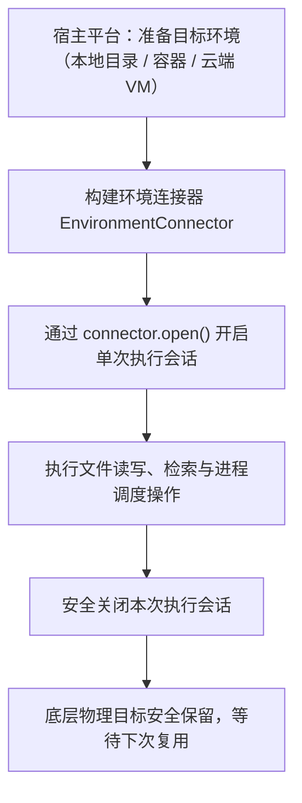

\*\*Environments（执行环境）\*\*子系统为与文件系统和操作系统进程交互提供了统一、高度可移植的抽象接口。无论您的应用或 Agent 是在本地宿主机上修改源码、在隔离的 Docker 容器中编译二进制，还是在云端临时沙箱微虚拟机中驱动浏览器交互，Environments 均提供完全一致的操作 API。

Environments 作为 `a13n-harness` 的核心基础模块发布，完全可以作为独立的无大模型依赖执行库在普通 Python 项目中使用。

## 从这里开始

建议从[环境快速入门](getting-started.md)开始，体验打开工作空间、写入文件、读取并安全释放资源的完整流程，随后探索进阶场景：

| 运维场景                             | 参考指南                                                               |
| :----------------------------------- | :--------------------------------------------------------------------- |
| **挑选具体的执行目标**               | [选择后端](#choose-a-backend)（覆盖本地路径、Docker、E2B、云端沙箱等） |
| **配置运行时鉴权凭证与选项**         | [Provider 配置手册](configuration.md)                                  |
| **执行命令与消费输出流**             | [命令与进程管理](commands.md)                                          |
| **文件检索、遍历与受控读取**         | [文件操作](operations.md)                                              |
| **管理目标生命周期并跨轮重连**       | [生命周期与状态](lifecycle.md)                                         |
| **通过 EIP 协议连接已有守护进程**    | [远程 Envd 指南](remote-envd.md)                                       |
| **将环境能力以工具形式暴露给 Agent** | [Harness 集成规范](../a13n-harness/environments.md)                    |

## 选择后端

Environments 支持两大互为补充的执行路径：

- **原生执行（Native Execution）：** 直接使用底层后端的原生系统接口进行文件读写与 Shell 调度。原生支持 Direct Local 本地路径、Docker 容器、E2B 云端微虚拟机、Vercel 沙箱、Sprites 以及 Runloop Devbox。
- **Envd 守护进程执行（Envd Execution）：** 基于高效的 Environment Inter-Process (EIP) 协议同 Envd 守护程序通信。此路径可开启操作系统内核级强隔离沙箱、网络出网白名单拦截审计（Egress Policy）、桌面图形界面自动化（Computer Use）以及硬件监控指标采集。

| 目标提供商       | 执行路径    | 底层机制说明                                                      |
| :--------------- | :---------- | :---------------------------------------------------------------- |
| `direct_local`   | 原生执行    | 直接在宿主机当前操作系统进程身份下读写指定目录                    |
| `docker`         | 原生 / Envd | 在受管的独立 Docker 容器内执行                                    |
| `e2b`            | 原生 / Envd | 在 E2B 托管的安全云端微虚拟机沙箱中运行                           |
| `local_envd`     | Envd        | 基于标准输入输出（stdio）与本地 Rust 编写的原生 Envd 守护进程通信 |
| `daytona`        | Envd        | 在隔离的 Daytona 云端工作区中执行                                 |
| `modal`          | Envd        | 在 Serverless 架构的 Modal 安全容器中运行                         |
| `vercel`         | 原生 / Envd | 调度至 Vercel 托管的安全沙箱环境中                                |
| `sprites`        | 原生 / Envd | 通过私有隧道连接至临时的 Sprite 沙箱实例                          |
| `http_envd`      | Envd        | 通过 HTTP/HTTPS 协议连接远程已部署的守护程序                      |
| `websocket_envd` | Envd        | 通过 WebSocket 反向长连接隧道穿透至 Envd 实例                     |

## 管理、连接与执行

Environments 将物理环境的编排配置与单次业务任务的执行完全解耦：



1. **准备目标（Target）：** 宿主环境分配本地目录、启动 Docker 容器或绑定已有的远程守护进程。
2. **构建连接器（Connector）：** 实例化 `EnvironmentConnector`。该对象仅代表一个确定的可寻址目标，构造过程不发生任何网络 I/O。
3. **开启执行（Execution）：** 调用 `connector.open()` 会生成一个活跃的 `EnvironmentExecution` 会话。业务应用通过该句柄安全操作文件或执行进程，任务结束后关闭该会话。底层的容器或云端虚拟机依然完好保留，等待下一次会话秒级复用。

## 与 Harness 一起使用

若需将执行环境挂载给 Agent，只需声明一个 `EnvironmentSource` 并注入 `DynamicEnvironmentCapability`：

```python
from a13n_harness.capabilities import DynamicEnvironmentCapability
from a13n_harness.environments import EnvironmentMount, PreparedSource

# 1. 将 Connector 包装为就绪源
source = PreparedSource(connector)

# 2. 配置挂载路径与操作权限上限
mount = EnvironmentMount(
    source=source,
    mount_path="/workspace",
    read_only=False,
)

# 3. 为智能体构建器挂载能力
builder.add_capability(
    DynamicEnvironmentCapability(mounts=[mount])
)
```

Harness 会自动在模型侧生成受权限约束的 `read_file`、`write_file`、`exec_command` 等操作工具，模型只能在挂载的路径范围内工作。

## 使用 Local Envd

当在单台宿主机上运行不可信的智能体代码，需要硬件级的 Linux 内核隔离（Namespaces / Cgroups）、出网 IP 白名单封锁或桌面截屏操作时，推荐使用本地 Envd 运行时：

```python
from a13n_harness.environments.providers.local_envd import LocalEnvdProviderRuntime

runtime = LocalEnvdProviderRuntime(binary_path="/usr/local/bin/envd")
connector = runtime.create_connector(workspace_path="/tmp/sandbox")
```

Envd 会在操作系统内核层面实施严格隔离，杜绝 Agent 代码越权访问主宿主系统。

## 保留目标与管理状态

为了在分布式集群中跨多轮会话复用同一个沙箱容器：

1. 将提供商返回的 `EnvironmentState` 序列化，并与 `HarnessState` 一同持久化至应用数据库中。
2. 下次发起后续轮次时，直接基于该状态重新生成连接器，无需重复冷启动容器。
3. 仅在整个业务流程彻底完结或租约超期时，再发起显式的销毁释放操作。
