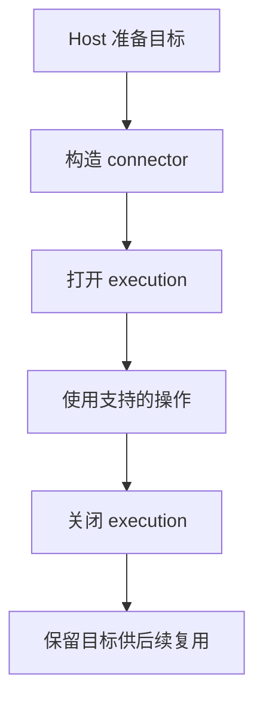

Environment API 让应用在选定的目标上读写文件、执行命令。可以从已有本地目录开始，再通过同一套操作接口连接容器或远程目标。执行 API 随 `a13n-harness` 提供，无需创建 Agent 或调用模型。

## 从这里开始

先按[文件快速入门](getting-started.md)打开工作区、写入文件、读回内容并关闭执行，再根据应用需要选择下一步：

| 任务                           | 指南                                            |
| ------------------------------ | ----------------------------------------------- |
| 选择本地、容器、云端或远程执行 | [选择后端](#choose-a-backend)                   |
| 设置配置、凭据和运行时对象     | [Provider 配置](configuration.md)               |
| 查找字段和默认值               | [配置参考](configuration-reference.md)          |
| 运行命令并检查输出             | [命令与进程](commands.md)                       |
| 使用文件路径、搜索和有界读取   | [操作](operations.md)                           |
| 创建目标并重新连接             | [生命周期与状态](lifecycle.md)                  |
| 运行完整程序                   | [可运行示例](examples.md)                       |
| 连接已有守护进程               | [Remote Envd](remote-envd.md)                   |
| 将操作作为 Agent 工具提供      | [Harness 集成](../a13n-harness/environments.md) |

## 选择后端

需要通过目标原生 API 使用 Files & Shell 时，选择 **Native Execution**：Direct Local、Docker、E2B、Vercel、Sprites 或 Runloop。Shell 包含命令执行，以及该后端支持的进程、stdin 和输出操作。

需要通用执行接口，包括 OS sandbox 和 Egress 策略、Computer use 或 Device 指标时，选择 **Envd Execution**。该路径通过 EIP 连接兼容的 Envd 守护进程。Host 选择策略，守护进程在目标可用的操作系统边界内执行策略。指标通过 Host 的 Device 连接读取。

| 执行路径      | Provider         | 连接目标                                 |
| ------------- | ---------------- | ---------------------------------------- |
| Native        | `direct_local`   | Host 上的已有目录                        |
| Native / Envd | `docker`         | Docker 容器；Envd 路径选择 HTTP EIP      |
| Native / Envd | `e2b`            | E2B 沙箱；Envd 路径选择 HTTP EIP         |
| Envd          | `local_envd`     | 通过 stdio 连接 Host 管理的本地守护进程  |
| Envd          | `daytona`        | Daytona 沙箱内的兼容守护进程             |
| Envd          | `modal`          | Modal 沙箱内的兼容守护进程               |
| Native / Envd | `vercel`         | Vercel 沙箱；Envd 路径选择 HTTP EIP      |
| Native / Envd | `sprites`        | Sprite；Envd 路径使用私有隧道            |
| Native        | `runloop`        | Runloop Devbox；尚未接入 Envd            |
| Envd          | `http_envd`      | 通过 HTTP(S) 连接已有守护进程            |
| Envd          | `websocket_envd` | 反向连接到 Host WebSocket 入口的守护进程 |

云账号和运行时选择见[云 Provider](providers.md#cloud-providers)。Docker、E2B、Daytona、Modal、Vercel 和 Sprites 可通过兼容的 Envd 运行环境提供桌面访问。按[桌面设置](../a13n-service/environments.md#computer-use)准备镜像、模板、快照或 Sprite 安装。使用云账号前，也可以[在本地试用 HTTP 和 WebSocket](remote-envd.md)。

## 管理、连接与执行

在应用中将以下三个步骤分开：

1. **准备目标。** 使用已有目录或守护进程，或通过 Service `EnvironmentProvider` 管理目标。provider 使用状态时，保存返回的 `EnvironmentState`。
2. **构造 connector。** `EnvironmentConnector` 描述这个固定目标，构造时不进行 I/O。
3. **打开 execution。** 每次 `open()` 返回已就绪的 `EnvironmentExecution`，拥有独立的 `execution_id` 和支持的操作。工作结束后关闭它。

打开执行和检查就绪都使用选定的目标，不会启动或重新创建目标。关闭执行会释放它拥有的资源，保留目标。以后重新连接时，打开新的 execution。管理与执行清理的详情见[生命周期与状态](lifecycle.md)。

## 与 Harness 一起使用

提供 `EnvironmentSource`，由其 `ensure_ready()` 准备目标并返回 connector。[完整来源示例](../a13n-harness/environments.md#supply-a-source)使用 Host 自有的 `PreparedSource` 包装 Direct Local connector。

通过 `EnvironmentMount` 设置挂载路径和权限上限，启用 `DynamicEnvironmentCapability` 提供模型可见的工具。Harness 先发布静态挂载，在首次使用时打开相应挂载，并在 Run 退出时关闭已打开的 execution。未使用的挂载保持未打开状态。

## 使用 Local Envd

为 Local Envd 创建 `LocalEnvdProviderRuntime`，提供兼容的可执行文件和私有运行目录分配器。execution 借用运行时期间，Host 应保持它存活。每个 execution 打开独立的 EIP Session；所有借用者结束后，再关闭运行时。见 [Provider 与运行时](providers.md#local-envd-runtime)。

使用 Direct Local 可直接以 Host 账号访问文件；其目录映射不提供 OS 隔离。使用 Local Envd 时，在启动守护进程时选择沙箱和网络策略。连接已注册的远程 Device 则使用 [Remote Envd](remote-envd.md) 中的 HTTP 或 WebSocket 路径。

## 保留目标与管理状态

要跨 Run 复用托管目标，在 Host 的并发控制下保存创建或启动结果，再从该状态构造 connector。执行不会产生需要在每次 Run 后保存的新管理状态。停止、续期和销毁仍由 Host 显式发起。

[Service 环境](../a13n-service/environments.md)提供模板、托管实例和 Run 挂载。嵌入应用可以使用 Service 的管理 provider，也可以自行实现生命周期管理。Agent 接入方式见 [Harness 环境](../a13n-harness/environments.md)。
