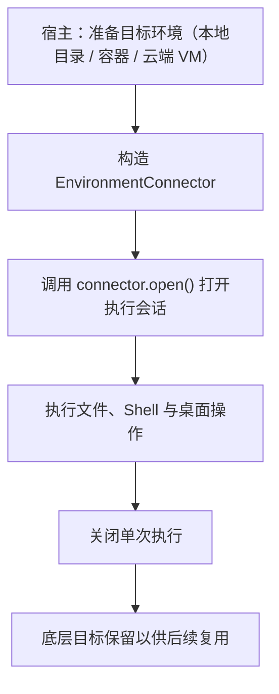

\*\*Environments（执行环境）\*\*为文件系统、操作系统进程与桌面图形界面操作提供统一的可移植接口。无论应用或智能体是在本地目录修改源码、在 Docker 容器中编译构建，还是在云端微虚拟机中操控桌面，均使用同一套 API。

Environments 随 `a13n-harness` 发布，也可在不接入大模型的情况下作为独立 Python 执行库直接使用。

## 从这里开始

建议先跟随[环境快速开始](getting-started.md)体验打开工作区、读写文件并安全释放资源的完整流程，再按任务查阅：

| 任务                                 | 指南                                                               |
| :----------------------------------- | :----------------------------------------------------------------- |
| **挑选具体的执行目标**               | [选择后端](#choose-a-backend)（本地路径、Docker、E2B、云端沙箱等） |
| **配置运行时鉴权凭据与选项**         | [提供方配置](configuration.md)                                     |
| **执行命令与消费输出流**             | [命令与进程](commands.md)                                          |
| **文件检索、遍历与有界读取**         | [文件操作](operations.md)                                          |
| **管理目标生命周期并跨轮重连**       | [生命周期与状态](lifecycle.md)                                     |
| **通过 EIP 协议连接已有守护进程**    | [远程 Envd](remote-envd.md)                                        |
| **将环境能力以工具形式暴露给智能体** | [Harness 集成](../a13n-harness/environments.md)                    |

## 选择后端

Environments 支持两条互补的执行路径：

- **原生执行（Native）：** 直接调用底层后端的原生文件与 Shell 接口（支持 `direct_local`、`docker`、`e2b`、`vercel`、`sprites`、`runloop`、`boxd`）。
- **Envd 守护进程执行（Envd）：** 基于环境交互协议（EIP）与 `a13n-envd` 通信，支持原生内核沙箱隔离、受控出站网络（Controlled Egress）、桌面图形操控（Computer Use）与实时设备监控。

| 提供方           | 执行路径    | 底层机制                                           |
| :--------------- | :---------- | :------------------------------------------------- |
| `direct_local`   | 原生        | 以宿主机当前进程身份直接访问本地目录               |
| `local_envd`     | Envd        | 通过 stdio 连接宿主拉起的本地 `a13n-envd` 守护进程 |
| `docker`         | 原生 / Envd | 在受管 Docker 容器内执行                           |
| `e2b`            | 原生 / Envd | 在隔离的 E2B 云沙箱中运行                          |
| `daytona`        | Envd        | 在 Daytona 云工作区中运行                          |
| `modal`          | Envd        | 在 Serverless Modal 沙箱中运行                     |
| `vercel`         | 原生 / Envd | 在 Vercel Sandbox 中运行                           |
| `sprites`        | 原生 / Envd | 在 Fly.io Sprite 实例中运行                        |
| `runloop`        | 原生        | 在 Runloop Devbox 中运行                           |
| `boxd`           | 原生        | 在网络隔离的 boxd 虚拟机中运行                     |
| `http_envd`      | Envd        | 通过 HTTP(S) 连接已部署的远程 Envd 守护进程        |
| `websocket_envd` | Envd        | 通过反向 WebSocket 隧道连接内网 Envd 守护进程      |

## 管理、连接与执行



1. **准备目标：** 宿主分配目录、容器或云沙箱（或选择已注册的设备）。
2. **构造连接器：** `EnvironmentConnector` 描述固定可寻址目标，构造过程不发生网络 I/O。
3. **打开执行：** `await connector.open()` 返回活跃的 `EnvironmentExecution` 句柄；关闭句柄会释放本次执行资源，同时保留底层容器或虚拟机。

## 与 Harness 配合使用

提供实现 `ensure_ready()` 的 `EnvironmentSource`（见[提供环境源](../a13n-harness/environments.md#supply-a-source)），按需配合 `EnvironmentMount` 限定挂载路径与权限上限，并在 `HarnessBuilder` 上注册 `DynamicEnvironmentCapability`：

```python
from a13n_harness import AgentSpec, HarnessBuilder
from a13n_harness.environment import DynamicEnvironmentCapability, DynamicEnvironmentConfiguration

executable = HarnessBuilder().build(
    AgentSpec(),
    output_type=str,
    model=model,
    capabilities=(
        DynamicEnvironmentCapability(
            DynamicEnvironmentConfiguration(files_enabled=True, shell_enabled=True)
        ),
    ),
)
# 调用 await executable.run("...", environment=source) 时传入环境源
```

## 使用 Local Envd

在单机需要原生沙箱隔离、受控出站网络或桌面操控时，构造由宿主管理的 `LocalEnvdProviderRuntime`（详见[提供方与运行时](providers.md#local-envd-runtime)）：

```python
from a13n_harness.providers.environment.local_envd.runtime import (
    LocalEnvdProviderRuntime,
    TemporaryLocalEnvdRuntimeAllocator,
    resolve_a13n_envd_executable,
)

runtime = LocalEnvdProviderRuntime(
    executable=resolve_a13n_envd_executable(),
    allocate_private_runtime=TemporaryLocalEnvdRuntimeAllocator(),
)
```

## 保留目标与管理状态

在创建或启动目标后持久化返回的 `EnvironmentState`，后续运行直接从保存的状态重建连接器，并在业务会话结束时显式停止或销毁底层实例。托管模板与生命周期编排详见 [Service 执行环境](../a13n-service/environments.md)。
