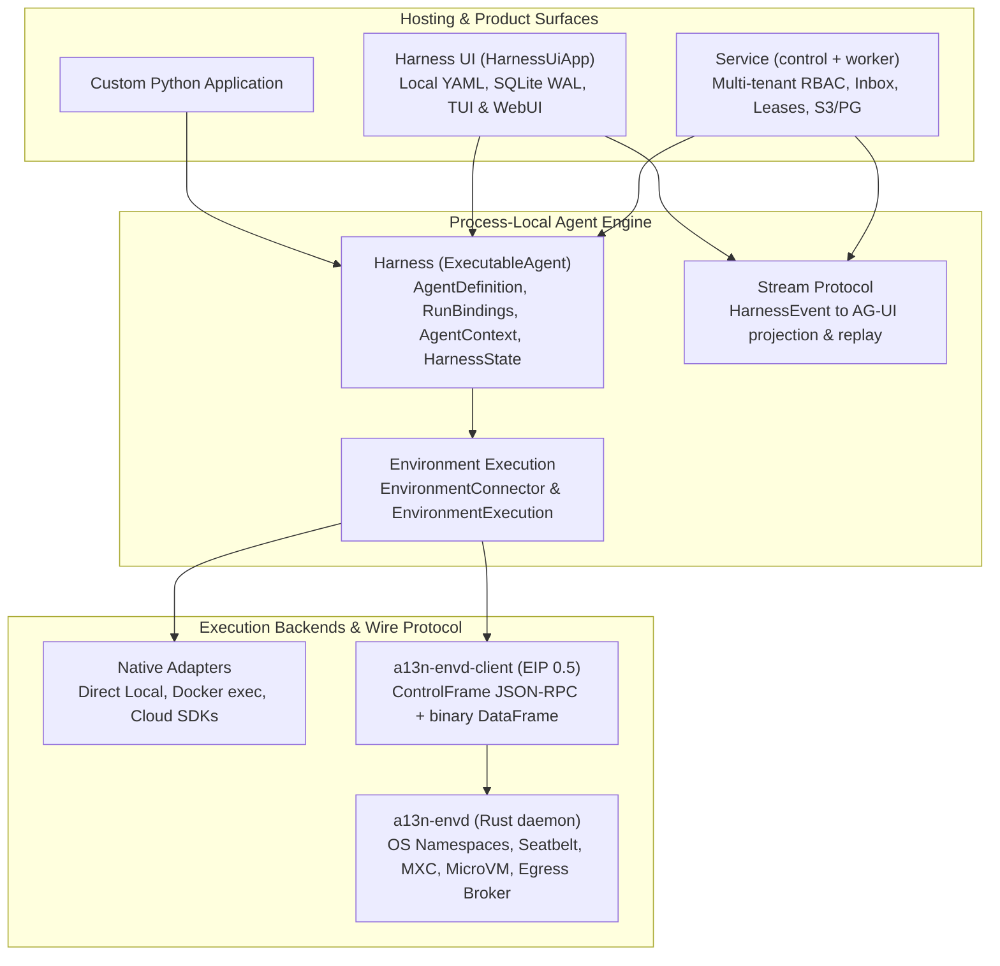
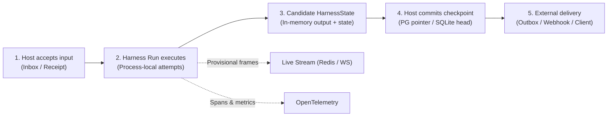

Everyday guides show how to configure and run agents. This page looks **beneath the surface**: how Agent Foundation's components compose in one direction, why every durable fact has a single owner, and how seven distinct recovery layers handle transient faults, context overflows, and worker crashes without corrupting state or silently replaying side effects.

## One-way component layering

Every interactive workbench and distributed runtime in Agent Foundation embeds the exact same core execution engine (`a13n-harness`). Dependencies flow strictly downward—`a13n-harness` never imports `a13n-harness-ui` or `a13n-service`, holds no database connections, and assumes no specific deployment topology:

| Layer                | Component                                                                       | Core invariant                                                                                                                                 |
| -------------------- | ------------------------------------------------------------------------------- | ---------------------------------------------------------------------------------------------------------------------------------------------- |
| **Execution loop**   | [Harness](../a13n-harness/architecture.md)                                      | Pure in-memory execution: takes an immutable `AgentDefinition`, fresh `RunBindings`, and optional `HarnessState`; returns one terminal result. |
| **Event framing**    | [Stream Protocol](../a13n-stream-protocol/index.md)                             | Stateless projection from `HarnessEvent` items into standardized AG-UI frames (`TEXT_MESSAGE_*`, `TOOL_CALL_*`, `STATE_SNAPSHOT`).             |
| **Sandbox runtime**  | [Environments](../environments/index.md) & [Envd](../a13n-envd/architecture.md) | Separates **target lifecycle** (creating/stopping VMs or containers) from **per-Run execution** (`connector.open()` over Native or EIP).       |
| **Local host**       | [Harness UI](../a13n-harness-ui/architecture.md)                                | Single-owner local workbench combining human-editable YAML/Markdown, SQLite WAL metadata heads, and content-addressed checkpoints.             |
| **Managed platform** | [Service](../a13n-service/architecture.md)                                      | Multi-tenant distributed runtime splitting stateless `control` APIs from leased `worker` attempts backed by PostgreSQL, S3, and Redis.         |

## Single authority per fact

Distributed agent systems fail when caches, event streams, or telemetry pipelines compete with transactional storage to decide whether a turn completed. Agent Foundation enforces **one authoritative owner per fact**:

1. **Input acceptance != execution:** Recording a message in Service's `inbox_entries` or issuing a `RootRunReceipt` in Harness UI proves admission, not model observation.
2. **Harness terminal result != durable commit:** `ExecutableAgent.run()` produces a *candidate* `HarnessRunResult` and `HarnessState`. The conversation advances only when the Host's fenced storage write commits that pointer.
3. **Live streams are provisional:** Browser WebSockets and Service Redis SSE streams (`GET /api/v1/sessions/{id}/stream`) optimize for low-latency rendering. If a stream drops or a worker crashes mid-generation, clients reconcile against committed PostgreSQL/SQLite state—never by guessing from partial stream frames.
4. **Usage accounting != telemetry spans:** OpenTelemetry spans can be sampled or dropped under collector backpressure. Usage ledgers (`usage_records` in Service, `UsageSnapshot` in Harness) track token consumption and dispatch-time price snapshots independently.

## Three-lifetime separation and immutable pinning

Across every host, state is partitioned into three non-overlapping lifetimes so credentials and live sockets never leak into checkpoints, and mid-flight config edits never destabilize active Runs:

| Lifetime                      | Harness primitive               | Harness UI realization                           | Service realization                                         |
| ----------------------------- | ------------------------------- | ------------------------------------------------ | ----------------------------------------------------------- |
| **1. Build-time definition**  | `AgentDefinition` / `AgentSpec` | Accepted YAML generation + resolved Run snapshot | Numbered immutable `agent_revisions` & `skill_revisions`    |
| **2. Per-Run live authority** | `RunBindings` (`AgentContext`)  | Freshly resolved credentials, MCPs & mounts      | Leased worker `Attempt` + decrypted provider/egress secrets |
| **3. Portable continuation**  | `HarnessState` (JSON bytes)     | Immutable checkpoint file referenced by SQLite   | zstd-compressed S3 object referenced by `runs.checkpoint`   |

When Service accepts a Run (or Harness UI starts an operation), it **freezes** the resolved revision IDs, execution policy, and `RunConfiguration` (`allowed_hosts`, extensions). Updating an Agent's prompt or rotating a default model affects subsequent Runs immediately while in-flight Runs finish deterministically against their pinned snapshot.

## The seven-layer failure and recovery stack

Instead of a single coarse "retry the whole agent" loop, recovery is handled at the lowest layer that actually owns the fault—and **never** Fabricates rollback or silently replays non-idempotent tool mutations:

| Layer (innermost to outermost)          | Owner                        | Fault handled                                                       | Mechanism & safety invariant                                                                                                                        |
| --------------------------------------- | ---------------------------- | ------------------------------------------------------------------- | --------------------------------------------------------------------------------------------------------------------------------------------------- |
| **1. HTTP transport retry**             | Provider SDK / `RetryConfig` | TCP resets, HTTP `429` / `502` / `503` before stream commit         | Exponential backoff at the HTTP request boundary before any tool executes.                                                                          |
| **2. Provider history repair**          | Harness `SelfHealingModel`   | Provider-rejected malformed or orphaned tool-call message sequences | Deterministically normalizes history once per request so strict provider validators accept continuation.                                            |
| **3. Semantic `ModelAttempt` retry**    | Harness Run coordinator      | Mid-stream provider drop during model generation                    | Retries up to the `ModelRecoveryPolicy` budget inside the *same* Harness Run without re-running completed tools.                                    |
| **4. Context-overflow recovery**        | Harness `ContextRecovery`    | Provider `context_length_exceeded` rejection                        | Compacts history (requiring Host checkpoint commit when `context_recovery_pending` is set) and retries cleanly.                                     |
| **5. Unanswered tool reconciliation**   | Harness `tool_recovery`      | Crash while tool calls were in flight                               | Re-executes only `idempotency="read_only"` tools under fresh permissions; marks side-effecting calls interrupted so the model inspects state first. |
| **6. EIP operation & Session recovery** | `a13n-envd` + client         | Network blip between Host and sandbox daemon                        | `terminal_evidence` receipts replay completed results by `operation_id`; `session.attach` increments `owner_epoch` to fence stale clients.          |
| **7. Distributed worker takeover**      | Service `control` + `worker` | Worker pod OOM, node preemption, or expired lease                   | Allocates a new leased `Attempt` on another worker from the last committed `runs.checkpoint` + unincorporated Inbox entries.                        |

## Deep-dive index

Continue into the internals of each subsystem:

- **[Harness execution engine](../a13n-harness/architecture.md):** Lazy stream preparation, `ModelAttempt` coordination, immediate steering vs. Host-held tool executions, prompt-cache prefix stability, and zero-redecode `HarnessState` serialization.
- **[Harness UI App & storage](../a13n-harness-ui/architecture.md):** Five-tier local persistence, SQLite WAL POSIX advisory-lock guards, sticky Thread heads vs. immutable Run compositions, and CRDT collaborative drafts.
- **[Service distributed runtime](../a13n-service/architecture.md):** `accept` → `claim` → `execute` → `seal` state machine, S3 lease-fenced checkpoint publication, owner-driven outbox GC, and monotonic delta usage accounting.
- **[Envd & EIP wire protocol](../a13n-envd/architecture.md):** Dual-plane JSON-RPC + binary data framing, operation replay classes, OS sandbox backends (`bubblewrap`, `Seatbelt`, `MXC`, microVMs), and kernel-routed HTTPS secret injection.
