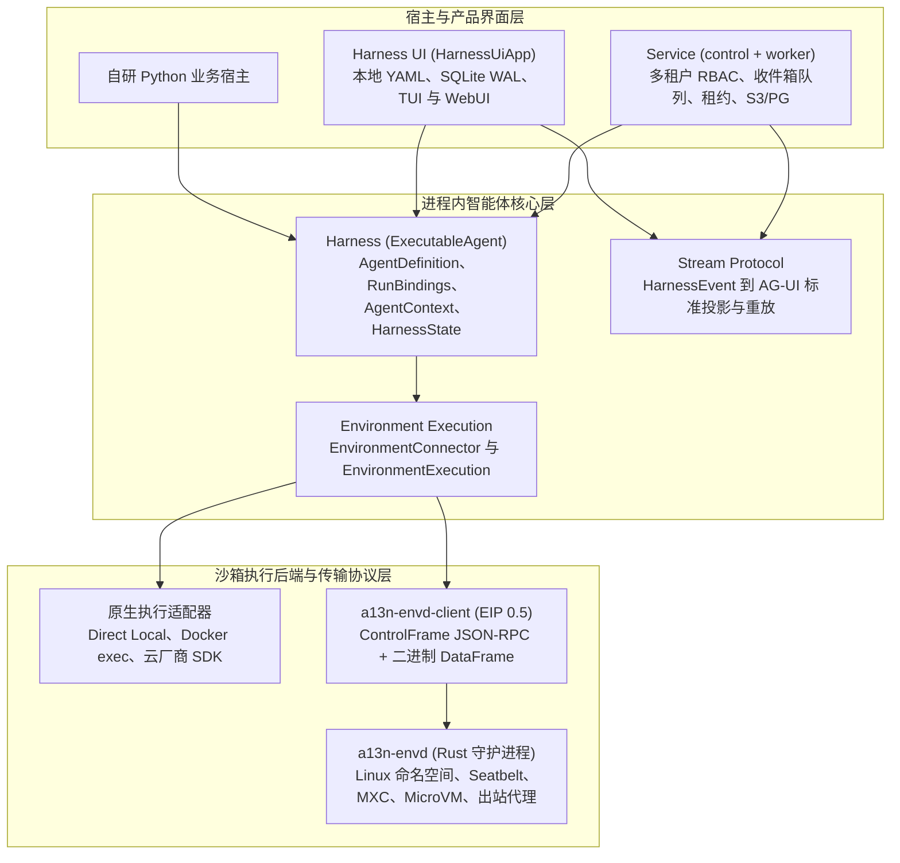
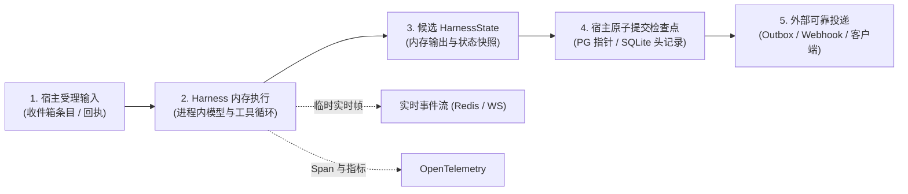

日常使用指南聚焦“如何配置与调用智能体”；本文则深入**水面之下**，解析 Agent Foundation 各核心组件如何单向组合、为什么每一类持久化事实只允许唯一权威所有者，以及七层故障恢复栈如何在网络抖动、上下文溢出与节点崩溃时保障状态一致性且绝不盲目重放副作用。

## 单向组件分层

无论是本地交互工作台还是分布式多租户平台，底层均嵌入同一个核心执行引擎（`a13n-harness`）。依赖方向严格单向向下——`a13n-harness` 从不反向依赖 `a13n-harness-ui` 或 `a13n-service`，不持有任何数据库连接，也不绑定任何特定部署形态：

| 层级             | 组件                                                                             | 核心架构不变量                                                                                                          |
| ---------------- | -------------------------------------------------------------------------------- | ----------------------------------------------------------------------------------------------------------------------- |
| **执行闭环核心** | [Harness](../a13n-harness/architecture.md)                                       | 纯内存执行引擎：输入不可变 `AgentDefinition`、单次运行 `RunBindings` 与可选 `HarnessState`，产出唯一终态结果。          |
| **事件流投影**   | [Stream Protocol](../a13n-stream-protocol/index.md)                              | 无状态协议转换层，将内部 `HarnessEvent` 实时映射为前端可直接渲染的标准 AG-UI 事件帧。                                   |
| **沙箱执行抽象** | [Environments](../environments/index.md) 与 [Envd](../a13n-envd/architecture.md) | 严格分离**目标生命周期管理**（创建/销毁容器或云沙箱）与**单次运行附着**（通过原生接口或 EIP 执行 `connector.open()`）。 |
| **本地交互宿主** | [Harness UI](../a13n-harness-ui/architecture.md)                                 | 单实例工作台，融合人类可编辑 YAML/Markdown、SQLite WAL 可变头指针与内容寻址不可变检查点文件。                           |
| **多租户托管层** | [Service](../a13n-service/architecture.md)                                       | 水平扩展分布式运行时，分离无状态 `control` 副本与带租约的 `worker` 执行尝试，底层依托 PostgreSQL、S3 与 Redis。         |

## 单一事实权威原则（Single Authority per Fact）

分布式智能体系统最常见的架构缺陷，是让流式缓存、消息队列或遥测链路与事务存储争夺“某轮对话是否已完成”的裁决权。Agent Foundation 为每一类事实确立**唯一权威所有者**：

1. **受理输入不等于已被模型读取：** 写入 Service 的 `inbox_entries` 或拿到 Harness UI 的 `RootRunReceipt` 仅代表宿主已受理请求，直到某次运行的已提交检查点显式记录消费序号后才算正式纳入历史。
2. **Harness 终态返回不等于持久化提交：** `ExecutableAgent.run()` 产出的只是内存中的**候选**结果与 `HarnessState`；只有宿主的带栅栏（Fenced）存储事务成功推进检查点指针，会话历史才真正前进。
3. **实时事件流仅作低延迟预览：** WebUI WebSocket 与 Service 的 Redis SSE 流（`GET /api/v1/sessions/{id}/stream`）专注于毫秒级界面反馈。一旦断线重连或 Worker 崩溃，客户端始终以 PostgreSQL/SQLite 中已提交的检查点为准，绝不依赖残缺流分片拼凑状态。
4. **用量记账独立于遥测链路：** OpenTelemetry Span 可能因采样或采集器背压被丢弃；用量账本（Service 的 `usage_records` 与 Harness 的 `UsageSnapshot`）在独立事务通道中记录 Token 消耗与请求派发时的价格快照。

## 三层生命周期隔离与不可变版本锁定

所有宿主均将运行数据切分为三个互不越界的生命周期，既防止密钥或活跃套接字泄漏进持久化检查点，也确保运行期间修改配置不会干扰在途任务：

| 生命周期                | Harness 原语                    | Harness UI 实现形态                       | Service 实现形态                                          |
| ----------------------- | ------------------------------- | ----------------------------------------- | --------------------------------------------------------- |
| **1. 构建期静态定义**   | `AgentDefinition` / `AgentSpec` | 已生效配置世代索引 + 单次运行固化组合快照 | 带递增编号的不可变 `agent_revisions` 与 `skill_revisions` |
| **2. 单次运行实时授权** | `RunBindings`（`AgentContext`） | 实时解析的本地密钥、MCP 连接与目录挂载    | 带租约的 Worker `Attempt` + 实时解密的提供方/出站凭据     |
| **3. 跨轮可移植状态**   | `HarnessState`（JSON 字节）     | SQLite 头指针指向的不可变检查点文件       | `runs.checkpoint` 指向的 S3 zstd 压缩对象                 |

当 Service 受理一次 Run（或 Harness UI 启动一次操作）时，会立即**冻结**所选智能体修订版、执行策略与 `RunConfiguration`（域名白名单及扩展配置）。此后修改提示词或默认模型会立即作用于新发起的运行，而在途运行在原有快照上确定性收敛。

## 七层精细化故障恢复栈

平台没有采用粗暴的“出错就从头重跑整个智能体”，而是由真正拥有对应故障边界的层级就地恢复，且严格遵守**缺失证据绝不伪造回滚、不确定副作用绝不静默重放**：

| 恢复层级（由内向外）              | 负责组件                     | 处理的典型故障                                  | 恢复机制与安全不变量                                                                                                  |
| --------------------------------- | ---------------------------- | ----------------------------------------------- | --------------------------------------------------------------------------------------------------------------------- |
| **1. HTTP 传输层重试**            | 提供商 SDK / `RetryConfig`   | 流开始前的 TCP 重置、HTTP `429` / `502` / `503` | 在触发任何工具副作用前，于单次 HTTP 请求边界执行指数退避重试。                                                        |
| **2. 提供商消息历史自愈**         | Harness `SelfHealingModel`   | 因中断遗留孤立工具调用导致提供商校验拒绝        | 在发送请求前对异常消息序列执行单次确定性修复，满足严格提供商格式要求。                                                |
| **3. 语义级 `ModelAttempt` 重试** | Harness 运行协调器           | 模型流式生成中途断流                            | 在**同一次**逻辑 Run 内按 `ModelRecoveryPolicy` 发起新 `ModelAttempt`，已完成工具结果直接保留、绝不重跑。             |
| **4. 上下文窗口溢出恢复**         | Harness `ContextRecovery`    | 提供商返回 `context_length_exceeded`            | 自动触发历史压缩（配合 `context_recovery_pending` 确保宿主先落盘检查点），再无缝重发请求。                            |
| **5. 未完成工具调用对账**         | Harness `tool_recovery`      | 工具批次执行期间进程崩溃                        | 恢复时仅在全新权限检查下重跑声明为 `idempotency="read_only"` 的工具；非幂等调用标记为已中断，交由模型先核查外部状态。 |
| **6. EIP 操作账本与会话重附着**   | `a13n-envd` 与客户端         | 宿主与远程沙箱守护进程之间网络闪断              | `terminal_evidence` 方法按 `operation_id` 直接重放已保留回执；`session.attach` 递增 `owner_epoch` 隔离旧连接。        |
| **7. 分布式 Worker 租约接管**     | Service `control` + `worker` | Worker 容器 OOM、节点抢占或租约超时             | 调度新 Worker 创建后继 `Attempt`，从最近已提交的 `runs.checkpoint` 与未消费收件箱条目处精确续跑。                     |

## 各子系统深入内部指南

继续阅读各核心子系统的水下实现解析：

- **[Harness 执行引擎内部原理](../a13n-harness/architecture.md)：** 惰性流初始化、`ModelAttempt` 内部循环、即时引导（Immediate Steering）与宿主驻留工具执行、Prompt 缓存前缀保护，以及零二次解码的 `HarnessState` 序列化。
- **[Harness UI 应用引擎与混合存储](../a13n-harness-ui/architecture.md)：** 五层本地持久化架构、SQLite WAL POSIX 文件锁读取守卫、粘性会话头与不可变运行快照、后台 Envd 进程跨重启接管及 CRDT 协同草稿。
- **[Service 分布式运行时架构](../a13n-service/architecture.md)：** `accept` → `claim` → `execute` → `seal` 四阶段状态机、S3 租约栅栏写入与基于 Outbox 的对象回收、双平面观测以及单调增量用量记账。
- **[Envd 与 EIP 协议内部原理](../a13n-envd/architecture.md)：** 控制帧与二进制数据帧双平面复用、三类操作重放等级、多平台原生沙箱（`bubblewrap`、`Seatbelt`、`MXC`、MicroVM）以及内核路由级 HTTPS 占位符密钥注入。
