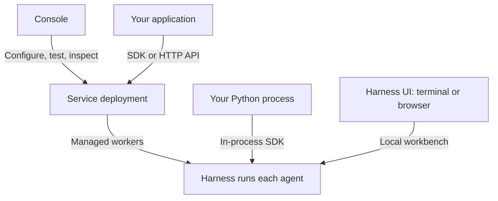

Agent Foundation provides one core execution engine—**Harness**—and three ways to use it: as an embeddable Python SDK, as an interactive developer workbench (**Harness UI**), or as a self-hosted team platform (**Service**).

Pick the entry point that matches what you want to build or run first:

| Your goal                                                    | What you need                                              | Start here                                                          |
| ------------------------------------------------------------ | ---------------------------------------------------------- | ------------------------------------------------------------------- |
| **Deploy a shared agent platform for your team**             | Docker Compose and a model provider API key                | [Service quickstart](../a13n-service/get-started.md)                |
| **Use agents on an existing team deployment**                | Console URL, an account, and workspace `run` permission    | [Use Console](../a13n-service/use-platform.md)                      |
| **Call managed agents from your application**                | Service URL, workspace API key, and a saved agent          | [Connect your application](../a13n-service/connect-application.md)  |
| **Deliver a self-hosted agent workflow in a customer cloud** | Customer infrastructure access and approved model accounts | [Forward deployed engineering](../a13n-service/forward-deployed.md) |
| **Embed agent execution inside your Python application**     | Python 3.13+ and `uv` (starts with an offline model)       | [Harness quickstart](../a13n-harness/getting-started.md)            |
| **Work interactively with an agent in your repository**      | Harness UI and a model subscription or API key             | [Harness UI setup](../a13n-harness-ui/setup.md)                     |

## Compare execution models

All three products run agents with Harness, but they divide responsibility for identity, storage, and process lifecycle differently:

| Dimension                     | Service                                                                       | Harness                                                                              | Harness UI                                                                      |
| ----------------------------- | ----------------------------------------------------------------------------- | ------------------------------------------------------------------------------------ | ------------------------------------------------------------------------------- |
| **Primary audience**          | Platform engineers, team admins, and application teams                        | Python developers building custom agent backends                                     | Individual developers, DIY builders, and trusted small teams                    |
| **Where agents run**          | Dedicated worker processes leasing runs from PostgreSQL                       | Directly inside your Python application process                                      | Your local machine or connected Environment                                     |
| **Who owns state & auth**     | Service manages organizations, workspaces, RBAC, credentials, and checkpoints | Your application owns authentication, authorization, and database persistence        | Local SQLite database and YAML configuration shared within the trusted instance |
| **When a client disconnects** | Workers keep accepted runs executing in the background                        | Your application controls task cancellation and background execution                 | WebUI server keeps active runs going when a browser tab closes                  |
| **Browser interface**         | **Console** (multi-tenant workspace management and debugging)                 | Your own frontend (or AG-UI via [Stream Protocol](../a13n-stream-protocol/index.md)) | **WebUI** (shared conversations, files, Git changes, and terminals)             |

To call a running Service deployment from your product, install a **[Service SDK](../a13n-service/sdks.md)** (Python, TypeScript, Go, or Rust). To execute agents inside your own Python process, install **`a13n-harness`**.

## Use standalone building blocks

You can also use Agent Foundation's lower-level packages independently in any Python or Rust system:

| Need                                                                                                       | Component & Guide                                   |
| ---------------------------------------------------------------------------------------------------------- | --------------------------------------------------- |
| Read files, run shell commands, and manage processes across local directories, Docker, and cloud sandboxes | [Environments](../environments/index.md)            |
| Enforce OS-level sandboxing, egress domain policies, computer use, and device telemetry over EIP           | [Envd](../a13n-envd/index.md)                       |
| Translate Harness execution events into typed AG-UI streams with checkpoint replay                         | [Stream Protocol](../a13n-stream-protocol/index.md) |
| Configure structured JSON and console logging across libraries and executables                             | [Logging](../a13n-logging/index.md)                 |
| Look up PyPI distribution names, Python import paths, and runnable example applications                    | [Package catalog](packages.md)                      |
