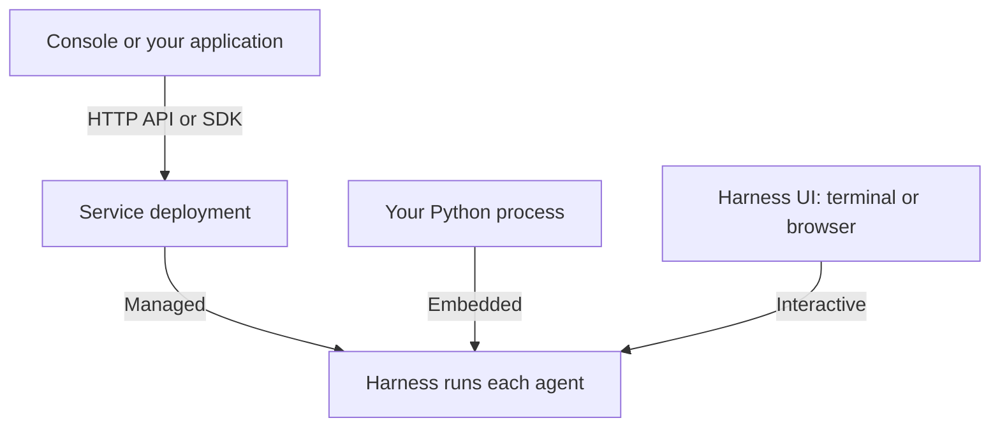

Choose the guide for your first task. You can run an agent inside a Python application, work with one interactively, or use a Service deployment that manages execution for you.

| Your goal                              | What you need                                                   | Start here                                                          |
| -------------------------------------- | --------------------------------------------------------------- | ------------------------------------------------------------------- |
| Deploy a shared agent platform         | Docker Compose and a model provider account for the local trial | [Service quickstart](../a13n-service/get-started.md)                |
| Use your team's agents                 | Console URL, an account, and permission to run an agent         | [Use an existing platform](../a13n-service/use-platform.md)         |
| Call remote agents from an application | Service URL, workspace API key, and a configured agent          | [Connect your application](../a13n-service/connect-application.md)  |
| Deliver agents in a customer's cloud   | Access to the customer's infrastructure and model accounts      | [Forward deployed engineering](../a13n-service/forward-deployed.md) |
| Run agents inside your Python process  | Python 3.13+ and uv; the first example uses an offline model    | [Harness quickstart](../a13n-harness/getting-started.md)            |
| Work interactively in a repository     | Harness UI and a supported model subscription or API key        | [Harness UI setup](../a13n-harness-ui/setup.md)                     |

## Choose where execution lives

- **Service:** submit work through Console or an application. Service manages identities, saved conversations, and durable execution in a running deployment.
- **Harness:** construct and run the agent in your Python process. Supply storage, access policy, and result delivery in your application.
- **Harness UI:** configure an agent and work with it through the terminal or WebUI. Share the instance only with trusted collaborators: its configuration, conversations, and environment access have no per-user isolation.

Both Service and Harness UI embed Harness. To call a Service deployment from another application, install a **Service SDK**. To execute agents in that application's own process, install the **Harness library**. Use Console for Service and WebUI for Harness UI.

## Use individual components

Add a component when the integration needs it:

| Need                                                  | Guide                                               |
| ----------------------------------------------------- | --------------------------------------------------- |
| Portable files and commands, with or without an agent | [Environments](../environments/index.md)            |
| Environment operations through a daemon               | [Envd](../a13n-envd/index.md)                       |
| AG-UI events from Harness observations                | [Stream Protocol](../a13n-stream-protocol/index.md) |
| Distribution names, imports, and runnable examples    | [Package catalog](packages.md)                      |

Follow a Service conversation in [Core concepts](core-concepts.md), or use [Operate the Service](../a13n-service/operations.md) to manage a deployment. When choosing a Service client version, match its [supported contract](../a13n-service/sdks.md#keep-version-ownership-clear) to that deployment.
