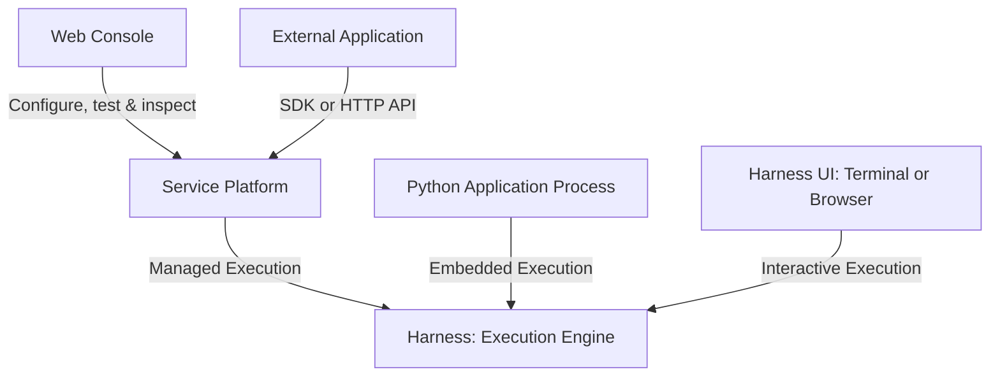

Agent Foundation offers three distinct ways to run and interact with agents. Whether you are embedding execution logic in Python, collaborating hands-on with a local assistant, or establishing a central enterprise platform, pick the path tailored to your workflow.

| Primary goal | Target audience | Prerequisites | Quickstart |
| :--- | :--- | :--- | :--- |
| **Embed agents in Python** | Python developers & backend engineers | Python 3.13+, `uv` package manager | [Harness quickstart](../a13n-harness/getting-started.md) |
| **Interactive workbench** | Developers & DIY builders | Terminal or modern browser, model API key/subscription | [Harness UI setup](../a13n-harness-ui/setup.md) |
| **Self-host team platform** | Platform engineers & administrators | Docker Compose or Kubernetes, model provider account | [Service quickstart](../a13n-service/get-started.md) |
| **Access shared workspace** | Team members & operators | Browser, Console URL, workspace account | [Use an existing platform](../a13n-service/use-platform.md) |
| **Integrate remote agents** | Application developers | Workspace API key, Service endpoint | [Connect your application](../a13n-service/connect-application.md) |
| **Customer cloud delivery** | Forward deployed engineers (FDE) | Target cloud infrastructure, customer model credentials | [Forward deployed engineering](../a13n-service/forward-deployed.md) |

## Choose where execution lives

The three products address different execution boundaries, persistence models, and isolation requirements:

- **Harness (Embedded Library):** Runs directly within your own Python process. You define the instruction lifecycle, attach Python native tools and MCP servers, and retain full programmatic control over state serialization, concurrency, and persistence.
- **Harness UI (Local & Collaborative Workbench):** Operates as a focused, high-productivity workbench in your terminal (TUI) or browser (WebUI). It directly mounts your workspace directory, supports rich file inspection and Git diffing, enables real-time Live voice streaming, and accepts modular extensions via Skills and Content Plugins.
- **Service (Distributed Multi-Tenant Platform):** Operates as a self-hosted, resilient backend with dedicated control and worker tiers. It manages authentication, fine-grained workspace RBAC, background task queues, periodic schedules, long-term memory spaces, and durable checkpoint recovery across worker failovers.

Both Service and Harness UI build upon the foundational Harness runtime. When you need to interact with a centralized Service deployment, integrate using the official **Service SDKs** or HTTP API. When building an agentic service from scratch in Python, import the **Harness library**.

## Use individual components

You can also incorporate Agent Foundation building blocks independently into existing architectures:

| Capability | Underlying component | Integration guide |
| :--- | :--- | :--- |
| **Portable environment execution** | Environments (`a13n-harness`) | [Environments overview](../environments/index.md) |
| **Remote execution daemon** | Envd (`crates/a13n-envd`) | [Envd operations](../a13n-envd/index.md) |
| **Streaming UI protocol** | Stream Protocol (`a13n-stream-protocol`) | [Stream Protocol guide](../a13n-stream-protocol/index.md) |
| **Distribution mapping** | All repository packages | [Package catalog](packages.md) |

To understand how high-level conversations translate into durable runs and checkpoint attempts, explore [Service core concepts](../a13n-service/core-concepts.md). To design and scale a production deployment, consult [Service operations](../a13n-service/operations.md).
