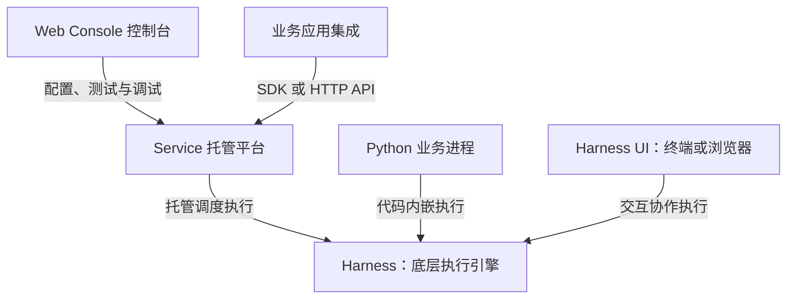

Agent Foundation 提供三种不同形态的 Agent 运行与交互方式。无论您是在 Python 微服务中以代码级嵌入执行引擎，还是在个人工作流中通过终端/Web 深度协作，亦或是搭建面向全团队的企业级集中托管平台，都能快速找到清晰的切入点。

| 核心目标 | 适用角色 | 前置条件 | 快速开始 |
| :--- | :--- | :--- | :--- |
| **在 Python 中内嵌 Agent** | Python 开发者与后端架构师 | Python 3.13+，`uv` 包管理器 | [Harness 快速入门](../a13n-harness/getting-started.md) |
| **交互式工作台协作** | 工程师与 DIY 极客 | 现代终端或浏览器，模型 API 密钥或订阅 | [Harness UI 快速上手](../a13n-harness-ui/setup.md) |
| **自建团队托管平台** | 平台运维与系统工程师 | Docker Compose 或 Kubernetes，模型账号 | [Service 快速部署](../a13n-service/get-started.md) |
| **加入团队已有平台** | 业务团队成员与操作人员 | 浏览器、Console 访问地址与工作区账号 | [使用已有平台](../a13n-service/use-platform.md) |
| **集成远程托管 Agent** | 业务应用开发者 | 工作区 API 密钥、Service 端点 | [连接您的应用程序](../a13n-service/connect-application.md) |
| **交付客户私有云** | 现场部署工程师（FDE） | 目标基础设施、客户授权的模型资源 | [前线部署工程指南](../a13n-service/forward-deployed.md) |

## 选择执行位置

三种产品形态针对不同的系统边界、持久化要求与隔离场景：

- **Harness（内嵌库）：** 直接在您的 Python 应用程序主进程内运行。由您完全掌控 Agent 的生命周期、挂载的原生函数与 MCP 工具集，并享有对状态序列化、并发控制和持久化存储的完全编程自由。
- **Harness UI（本地与协作工作台）：** 针对高频工程交互优化的沉浸式工作台，支持命令行终端（TUI）与现代 WebUI。可直接挂载本地工作空间，提供丰富的文件审查、Git 变更比对、Live 实时语音通话等功能，并能通过自定义 Skill 与 Content Plugin 随心定制。
- **Service（分布式多租户平台）：** 专为团队与多系统打造的分布式后端平台，具备独立的控制面（Control）与计算节点（Worker）。提供组织与工作区级 RBAC 权限体系、后台异步任务队列、周期性 Cron 调度、长期记忆空间（Memory Spaces）以及在节点故障时基于检查点的持久化状态恢复能力。

Service 与 Harness UI 均以内嵌 Harness 作为其核心执行引擎。如果您的业务需要接入统一集中的 Service 平台，推荐使用官方 **Service SDK** 或标准 HTTP 接口；如果您需要从零自研深度定制的 Python Agent 架构，请直接导入 **Harness 核心库**。

## 单独使用组件

您亦可将 Agent Foundation 的底层技术积木独立抽离并无缝集成至现有系统中：

| 核心能力 | 底层支撑组件 | 集成参考指南 |
| :--- | :--- | :--- |
| **可移植的环境执行抽象** | Environments (`a13n-harness`) | [Environments 概览](../environments/index.md) |
| **高性能远程沙箱守护进程** | Envd (`crates/a13n-envd`) | [Envd 运维指南](../a13n-envd/index.md) |
| **标准流式 UI 协议** | Stream Protocol (`a13n-stream-protocol`) | [Stream Protocol 规范](../a13n-stream-protocol/index.md) |
| **全库发行版与依赖映射** | 仓库全部组件包 | [软件包目录清单](packages.md) |

深入理解一次业务交互如何转化为底层的 Thread、Run 与恢复 Attempt，请查阅 [Service 核心概念](../a13n-service/core-concepts.md)；如需评估生产高可用架构与扩缩容方案，请参阅 [Service 运维手册](../a13n-service/operations.md)。
