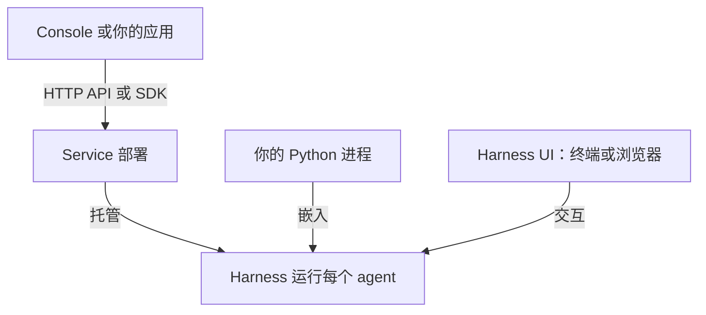

根据第一个任务选择指南：在 Python 应用内运行 agent，与 agent 交互式协作，或使用负责管理执行的 Service 部署。

| 你的目标                   | 所需条件                                         | 从这里开始                                             |
| -------------------------- | ------------------------------------------------ | ------------------------------------------------------ |
| 部署共享 agent 平台        | 本地试用需要 Docker Compose 和模型 provider 账号 | [Service 快速入门](../a13n-service/get-started.md)     |
| 使用团队的 agent           | Console 地址、账号和运行 agent 的权限            | [使用已有平台](../a13n-service/use-platform.md)        |
| 从应用调用远程 agent       | Service 地址、工作空间 API 密钥和已配置的 agent  | [连接你的应用](../a13n-service/connect-application.md) |
| 在客户的云中交付 agent     | 客户基础设施和模型账号的访问权限                 | [前线部署工程](../a13n-service/forward-deployed.md)    |
| 在 Python 进程内运行 agent | Python 3.13+ 和 uv；首个示例使用离线模型         | [Harness 快速入门](../a13n-harness/getting-started.md) |
| 在仓库中交互式工作         | Harness UI 和受支持的模型订阅或 API 密钥         | [配置 Harness UI](../a13n-harness-ui/setup.md)         |

## 选择执行位置

- **Service：** 通过 Console 或应用提交任务。Service 在已运行的部署中管理身份、保存对话并提供持久执行。
- **Harness：** 在 Python 进程中构建并运行 agent。由你的应用提供存储、访问策略和结果交付。
- **Harness UI：** 配置 agent，通过终端或 WebUI 与其协作。只与可信协作者共享实例：配置、对话和环境访问没有按用户隔离。

Service 和 Harness UI 都内嵌 Harness。从其他应用调用 Service 部署时，安装 **Service SDK**；在该应用自己的进程中执行 agent 时，安装 **Harness 库**。Service 的浏览器界面是 Console，Harness UI 的浏览器界面是 WebUI。

## 单独使用组件

根据集成需要添加组件：

| 需求                                       | 指南                                                |
| ------------------------------------------ | --------------------------------------------------- |
| 可移植的文件和命令操作，无论是否使用 agent | [Environments](../environments/index.md)            |
| 通过守护进程操作环境                       | [Envd](../a13n-envd/index.md)                       |
| 将 Harness 观测转换为 AG-UI 事件           | [Stream Protocol](../a13n-stream-protocol/index.md) |
| 发行包名、导入路径和可运行示例             | [软件包目录](packages.md)                           |

在[核心概念](core-concepts.md)中跟随一次 Service 对话，或通过[运维 Service](../a13n-service/operations.md)管理部署。选择 Service 客户端版本时，核对其[支持的协议约定](../a13n-service/sdks.md#keep-version-ownership-clear)是否匹配该部署。
