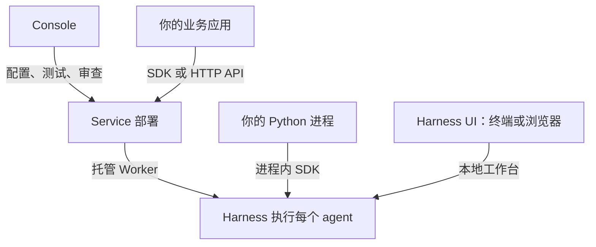

Agent Foundation 提供统一的核心执行引擎 **Harness**，以及三种使用形态：可嵌入的 Python SDK（**Harness**）、交互式开发者工作台（**Harness UI**）和自托管的团队级平台（**Service**）。

根据你当前的首要任务选择入口：

| 你的目标                                | 准备工作                                        | 从这里开始                                                |
| --------------------------------------- | ----------------------------------------------- | --------------------------------------------------------- |
| **为团队部署共享的 agent 平台**         | Docker Compose 与模型提供方 API key             | [Service 快速入门](../a13n-service/get-started.md)        |
| **在团队现有的平台上使用 agent**        | Console 地址、登录账号及工作空间 `run` 权限     | [使用 Console](../a13n-service/use-platform.md)           |
| **从业务应用调用远程托管 agent**        | Service 地址、工作空间 API key 及已配置的 agent | [接入你的应用](../a13n-service/connect-application.md)    |
| **在客户云环境中驻场交付 agent 工作流** | 客户基础设施访问权限与获批的模型账号            | [前线驻场工程 (FDE)](../a13n-service/forward-deployed.md) |
| **在自有 Python 进程内嵌入 agent 执行** | Python 3.13+ 与 `uv`（首个示例使用离线模型）    | [Harness 快速入门](../a13n-harness/getting-started.md)    |
| **在代码仓库中与 agent 交互式协作**     | Harness UI 与支持的模型订阅或 API key           | [Harness UI 初始设置](../a13n-harness-ui/setup.md)        |

## 对比三种执行模式

三款产品底层均由 Harness 驱动，但在身份权限、状态存储和进程生命周期的分工上各司其职：

| 维度                   | Service                                                         | Harness                                                                           | Harness UI                                           |
| ---------------------- | --------------------------------------------------------------- | --------------------------------------------------------------------------------- | ---------------------------------------------------- |
| **目标受众**           | 平台工程师、团队管理员、业务应用研发团队                        | 构建自定义 agent 后端的 Python 开发者                                             | 个人开发者、DIY 玩家、可信小团队                     |
| **运行位置**           | 独立 Worker 进程从 PostgreSQL 租约队列领取并执行任务            | 直接运行在你的 Python 应用进程内                                                  | 本机或已连接的 Environment                           |
| **状态与权限归属**     | Service 托管组织、工作空间、RBAC 权限、外部凭证与对象存储检查点 | 你的宿主应用自主管理用户认证、权限校验与数据库持久化                              | 实例内共享本地 SQLite 数据库与 YAML 配置文件         |
| **客户端断开时的行为** | Worker 在后台继续完成已接受的运行任务                           | 由宿主应用控制协程取消与后台调度                                                  | 关闭浏览器标签页后，WebUI 服务端继续执行运行中的任务 |
| **前端界面**           | **Console**（多租户工作空间管理与执行调试）                     | 自建前端（或通过 [Stream Protocol](../a13n-stream-protocol/index.md) 接入 AG-UI） | **WebUI**（共享对话、文件树、Git 变更与终端）        |

如果要在业务应用中调用已部署的 Service，请安装 **[Service SDK](../a13n-service/sdks.md)**（支持 Python、TypeScript、Go 和 Rust）。如果要在应用自身的 Python 进程内直接运行 agent，请安装 **`a13n-harness`**。

## 独立使用底层构建模块

你也可以在任何 Python 或 Rust 系统中单独引入 Agent Foundation 的底层组件：

| 需求场景                                                                     | 组件与指南                                          |
| ---------------------------------------------------------------------------- | --------------------------------------------------- |
| 跨本地目录、Docker 容器与云沙箱执行统一的文件读写、命令与进程管理            | [Environments](../environments/index.md)            |
| 通过 EIP 协议执行操作系统级沙箱隔离、出站域名白名单、桌面 GUI 控制与设备监控 | [Envd](../a13n-envd/index.md)                       |
| 将 Harness 运行观测流转换为类型化 AG-UI 事件并支持检查点重放                 | [Stream Protocol](../a13n-stream-protocol/index.md) |
| 为 Python 库与可执行程序配置统一的结构化日志                                 | [Logging](../a13n-logging/index.md)                 |
| 查询 PyPI 发行包名称、Python 导入路径与完整可运行示例工程                    | [软件包目录](packages.md)                           |
