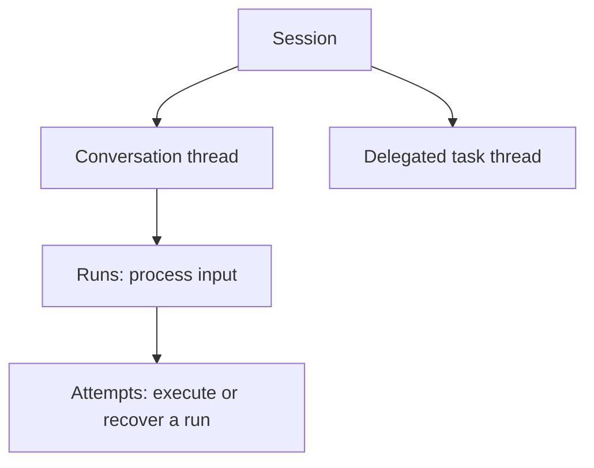

Follow one conversation in **Service**: give an agent project notes, read its reply, and return with a follow-up. You need access to a Service deployment through **Console** or an SDK. For embedded Python execution or the interactive workbench, see [Choose your path](choose-your-path.md).

## Choose an agent

Select your team's **workspace**, then choose an agent you have permission to run. The workspace groups agents, resources, and conversations. An administrator assigns organization and workspace roles that determine your access.

The **agent** configuration tells the model how to work and which tools it can use. For a project-update agent, the instructions might be: “Summarize the supplied notes and list two next steps.” Add other resources as the task needs them:

| Part            | Role in the agent's work                                                   |
| --------------- | -------------------------------------------------------------------------- |
| **Model**       | Interprets requests and produces responses or tool calls                   |
| **Tool**        | Looks up a task, reads a file, or performs another configured action       |
| **Connection**  | Gives access to external tools through MCP or an app account               |
| **Environment** | Provides the files and command execution used by tools                     |
| **Memory**      | Holds project decisions the agent can read and update across conversations |

A model and instructions are enough to summarize notes you supply. To fetch progress from a project system, configure [a tool or connection](../a13n-service/tools.md) that can read that system.

## Start a conversation

1. In Console, open **Sessions → New session** and choose the agent.
2. Send: “Summarize these notes and list two next steps: draft ready; review pending; release planned for Friday.”
3. Read the reply as it arrives. Configured tool activity appears alongside the response.
4. Follow up with “Make the first step more specific.”

An application follows the same exchange through a [Service SDK](../a13n-service/connect-application.md). During active work, you can send guidance or stop the run. Compatible guidance joins the next model request; other messages stay queued.

## Answer a question or approve a tool call

When work pauses for your input, complete each question or approval card. Choose **Approve once** or **Deny** for tool approvals, then select **Submit responses** after completing all pending items. The accepted batch continues the work. Applications [collect and submit the same complete batch](../a13n-service/agents-and-runs.md#waits-approvals-and-questions).

## Continue later

Return to **Sessions**, choose **Continue thread**, and ask another question. Service saves the conversation history, and execution continues if you disconnect. An application sends follow-ups to the thread reference returned by Service.

Choose storage according to what you need to keep:

| Information       | Purpose                                            |
| ----------------- | -------------------------------------------------- |
| Thread history    | Continue this thread                               |
| Memory            | Save and retrieve information across conversations |
| Environment files | Store documents and other working files for tools  |

Attach [memory](../a13n-service/memory.md) to the thread or agent defaults to share decisions across conversations. Choose the [environment's storage and lifecycle](../a13n-service/environments.md) to control how long working files remain available.

## Understand execution when you need it

The conversation lives in a **thread**, which has its own history and inbox. Related threads belong to a **session**. Service processes input in a **run** using the agent's model and tools. Each execution of the run is an **attempt**; recovery starts another attempt.

Select **Inspect execution** to open Console's Debug view. Here you can distinguish guidance that joined an active run from a submitted answer batch that created a successor run.

Agent configuration changes produce immutable **revisions**, listed under **Versions**. New messages use the default revision unless they specify another; active runs and approval continuations retain their original revision.

Continue with [Console's user guide](../a13n-service/use-platform.md) or the [application integration guide](../a13n-service/connect-application.md). Use [Agents, threads and runs](../a13n-service/agents-and-runs.md) when you need to select revisions or inspect execution behavior.
