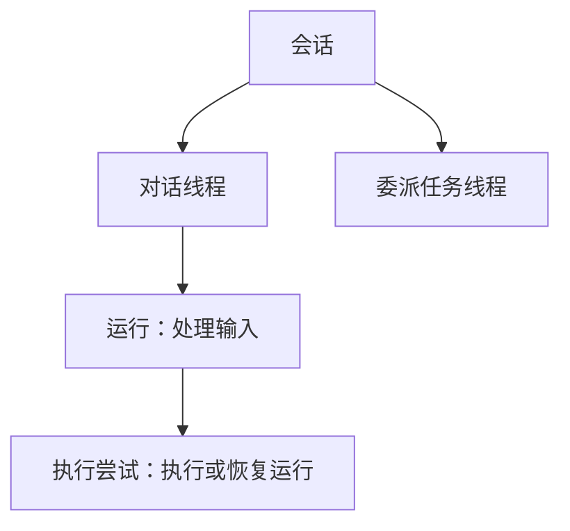

跟随一次 **Service** 对话：给 agent 项目笔记，阅读回复，再回来追问。你需要通过 **Console** 或 SDK 访问一个 Service 部署。嵌入式 Python 执行和交互式工作台的用法见[选择使用方式](choose-your-path.md)。

## 选择 agent

选择团队的**工作空间**，再选择你有权运行的 agent。工作空间将 agent、资源和对话组织在一起。管理员分配组织和工作空间角色，确定你的访问权限。

**agent** 配置告诉模型如何工作，以及可以使用哪些工具。项目进展 agent 的指令可以是：“总结提供的笔记，列出两个下一步行动。”根据任务需要添加其他资源：

| 组成部分 | 在 agent 工作中的作用                         |
| -------- | --------------------------------------------- |
| **模型** | 理解请求，生成回复或工具调用                  |
| **工具** | 查找任务、读取文件或执行其他已配置的操作      |
| **连接** | 通过 MCP 或应用账号访问外部工具               |
| **环境** | 为工具提供文件访问和命令执行能力              |
| **记忆** | 保存项目决策，让 agent 在不同对话中读取和更新 |

总结你提供的笔记只需要模型和指令。要从项目系统获取进展，配置能读取该系统的[工具或连接](../a13n-service/tools.md)。

## 开始对话

1. 在 Console 中打开**会话 → 新建会话**并选择 agent。
2. 发送：“总结这些笔记，列出两个下一步行动：草稿已完成；等待评审；计划周五发布。”
3. 阅读逐步显示的回复。已配置的工具活动会与回复一起显示。
4. 追问：“把第一步写得更具体一些。”

应用通过 [Service SDK](../a13n-service/connect-application.md)完成同样的交互。执行期间，可以发送补充说明或停止运行。兼容的补充说明会加入下一次模型请求，其他消息继续排队。

## 回答问题或审批工具调用

执行暂停等待输入时，完成每张问题或审批卡片。工具审批选择**批准本次**或**拒绝**；处理完全部待办后，选择**提交回应**。批次被接受后，任务继续执行。应用也需要[收集并提交同样的完整批次](../a13n-service/agents-and-runs.md#waits-approvals-and-questions)。

## 稍后继续

回到**会话**列表，选择**继续线程**并追问。Service 会保存对话历史，断开连接后执行仍会继续。应用向 Service 返回的线程引用发送后续消息。

根据需要保留的信息选择存储方式：

| 信息     | 用途                             |
| -------- | -------------------------------- |
| 线程历史 | 继续当前线程                     |
| 记忆     | 在不同对话之间保存和检索信息     |
| 环境文件 | 保存文档和工具使用的其他工作文件 |

在线程或 agent 默认配置中挂载[记忆](../a13n-service/memory.md)，跨对话共享决策。通过[环境的存储方式和生命周期](../a13n-service/environments.md)控制工作文件的保留时间。

## 需要时再了解执行细节

对话保存在 **线程（thread）** 中，线程有自己的历史和收件箱。相关线程归入一个 **会话（session）**。Service 在一次 **运行（run）** 中使用 agent 的模型和工具处理输入。运行的每次实际执行称为 **执行尝试（attempt）**；恢复时会开始新的尝试。

选择**检查执行**打开 Console 的 Debug 视图。在这里，可以区分加入当前运行的补充说明，以及提交后创建后继运行的回答批次。

修改 agent 配置会生成不可变的 **修订版本**，可在 **版本** 中查看。新消息默认使用默认修订，也可以指定其他修订；正在执行的运行和审批后继续的运行沿用原修订。

接下来阅读 [Console 用户指南](../a13n-service/use-platform.md)或[应用集成指南](../a13n-service/connect-application.md)。需要选择修订版本或检查执行行为时，参阅 [Agent、线程与运行](../a13n-service/agents-and-runs.md)。
