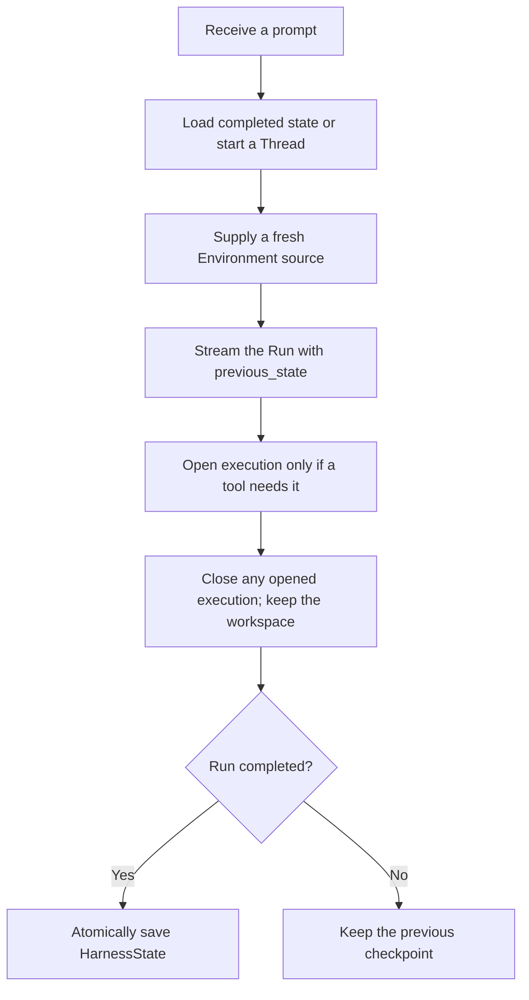

# Agent Application Example

This project is one small, complete application: an offline streaming chat that keeps one conversation across multiple turns, persists `HarnessState`, and resumes the same Thread after the process is restarted.

The demo uses an offline Model, a fresh local Environment per Run, and one state file.

## Run It

From the repository root:

```bash
cd examples/agent-app
uv sync --locked
uv run agent-app-example
```

Enter several messages and use `/quit` to stop. The default state file is `.agent-app/conversation-state.json`; the demo Environment workspace is `.agent-app/workspace`.

Start the command again and the next turn resumes the same Harness Thread and message history.

The same lifecycle can be demonstrated non-interactively:

```bash
uv run agent-app-example \
  --state ./conversation-state.json \
  "Remember that the release is Friday." \
  "When is the release?"

uv run agent-app-example \
  --state ./conversation-state.json \
  "Continue after the application restart."
```

Use `--workspace PATH` only when you want the single demo Environment rooted somewhere else.

## Application Flow



Conversation history resumes from the last completed `HarnessState`, passed as `previous_state`. The Host supplies fresh credentials and runtime collaborators for each independent Run. It also selects any portable Provider state saved in the checkpoint; this Direct Local example is stateless.

## Main API

```python
from pathlib import Path

from a13n_agent_app_example import (
    ConversationApplication,
    create_demo_environment,
)

state_path = Path("conversation-state.json")
workspace = Path("workspace").resolve()

application = ConversationApplication(
    model=model,
    state_path=state_path,
    environment_factory=lambda: create_demo_environment(workspace),
)
async with application.stream_turn("Hello") as stream:
    async for text in stream:
        print(text, end="", flush=True)
```

`ConversationApplication` caches one reusable `ExecutableAgent` for its process lifetime. For each turn it:

1. serializes turn execution with an async lock;
2. loads the last successfully committed `HarnessState` if present;
3. constructs one fresh Direct Local Environment and opens one explicitly scoped turn stream with `previous_state`;
4. yields text start and delta events immediately;
5. closes the Harness stream and any opened Environment execution non-destructively if the consumer stops early;
6. requires a successful terminal result;
7. atomically replaces the state file with the returned continuation state.

The executable is immutable build output and has no independent resource lifecycle. The application supplies a Host source per turn. On first use, Harness opens a fresh execution for Run-local operations and closes it without deleting the Host workspace. Harness never calls Provider destruction.

A failed or abandoned turn does not replace the last completed state. Callers must enter `stream_turn()` with `async with`; leaving that scope closes the Harness stream and any opened Environment execution. The next application instance can therefore recover only from a committed checkpoint.

## Source Layout

```text
src/a13n_agent_app_example/
  application.py  # Multi-turn streaming and HarnessState persistence
  environment.py  # The single offline demo Environment
  cli.py          # Interactive and non-interactive entry point

tests/
  test_application.py  # Multi-turn chat, restart recovery, failure, and cleanup
```

## Using a Real Model

The runnable CLI uses an offline `FunctionModel`, but `ConversationApplication` accepts any native Pydantic AI `Model`:

```python
from a13n_harness import infer_model

model = infer_model(
    "openai-responses:gpt-5",
    provider_factory=provider_factory,
    patches=(apply_provider_patch,),
)
```

The caller owns model credentials, SDK clients, retry policy, and client cleanup.

## Boundaries

- `HarnessState` is portable conversation continuation data, not live Environment authority.
- The state file is a small single-process example, not a distributed checkpoint store or lease protocol.
- The local demo Environment is intentionally the only Environment in this application.
- Advanced multi-Environment routing and mixed ownership remain documented in the [Environment guide](../../docs/a13n-harness/environments.md).
- Production Host lifecycle and checkpoint authority are documented in [Embedding in a Host](../../docs/a13n-harness/hosting.md).
