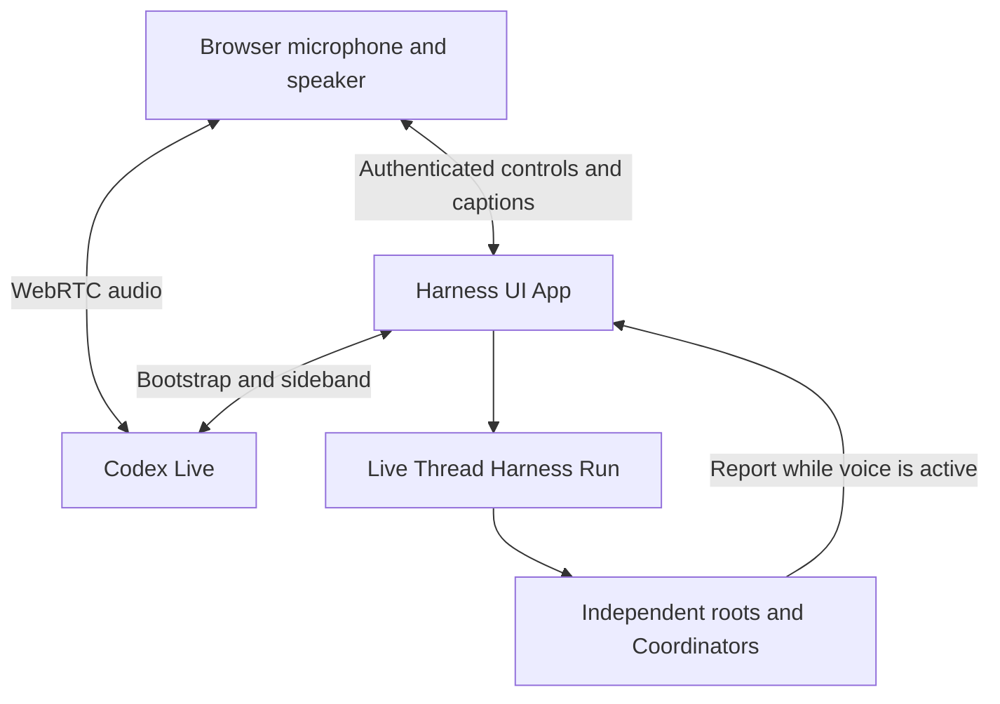

# Live Mode

## Design Position

Live Mode adds continuous voice interaction to the WebUI. The browser owns microphone capture and WebRTC audio. The App owns one process-local voice call and a persistent projectless Live Thread. The [Harness Codex Live transport](../a13n-harness/16c-codex-live.md) owns upstream signaling and client-delegation events; ordinary Harness Runs execute tasks.

## Configuration and Executor

The optional root `live` mapping contains `enabled` (default false), `model` (existing Model ID), `voice` (Codex V3 voice, default `cove`), `files_enabled` (default true), and `instructions` (default empty). Enabling requires an existing `codex_subscription` Model. That Model supplies both the ordinary executor and the captured subscription group. Voice admission selects an eligible native account through the [account-group policy](02a-model-authentication-and-account-stores.md#native-accounts-and-groups) and pins its credential source for the call. Account selection failure rejects admission without starting a call; an established call is never replayed on another account. There is no separate Live Model or Agent resource file. Legacy `marin` and `cedar` values remain readable in configuration and immutable generations; starting voice rejects them before provider access with an instruction to select a V3 voice. Reading history does not rewrite those values.

WebUI first-use setup offers a disclosed, initially checked Live opt-in for Codex. Adding a Model from Settings leaves Live unchanged. Publication seeds Live only when the root has no explicit Live setting. Existing settings, including disabled settings, remain authoritative. Loading or upgrading does not rewrite configuration. General settings can enable, disable, or change Live; no save starts microphone capture or an Agent Run.

The built-in Live executor has notes, tasks, Thread collaboration, optional files, and enabled global file memory. Its workspace is `<configuration-directory>/live-workspace`. It does not inherit the default Agent, Project, shell, MCP, plugins, Skills, CodeAct, or subagent roster. Requests to perform broader work use existing root/Coordinator collaboration. Human decisions use ordinary Thread decision handling.

The Live Thread uses the internal `agent_source.kind=live`, is unique per selected configuration root in the data root, and retains ordinary Harness continuation and task history. It cannot be archived, promoted to Coordinator, assigned to a Project, or changed through ordinary Agent/Model/Environment overrides. Its next Run uses current Live settings; an active Run retains its captured composition. Settings and Thread identity do not depend on a browser tab or provider call ID.

## Voice Lifetime

Opening `/live` leaves the microphone off. A user Start action claims authenticated controls before requesting microphone permission, then submits one SDP offer with fresh owner and start IDs. Only one browser owns voice in an App. Other tabs are rejected rather than replacing that owner.

The process-local lifecycle is `idle → starting → connecting → active`, followed by `idle` on Stop or `failed` on failure. The App publishes the SDP answer while connecting. The browser applies it and reports media connection; the App becomes active only after the sideband also attaches. Media ownership, settings, and executor admission are checked at their authority boundaries. Reusing a known start ID reconciles its receipt without creating another call.

Navigation within the WebUI retains the same microphone and peer. The workspace provides a one-click Start voice control without leaving the current page, plus a microphone indicator, Stop control, and link to the full Live page while connecting or active. The sidebar Live link and idle workspace Start control appear only when `live.enabled` is true; loading or unavailable settings do not expose an entry. A disabled workspace offers no setup prompt; users enable Live in General settings. An already starting, connecting, or active call retains its microphone indicator and Stop control even if Live is disabled, until the call ends. Connection errors remain visible beside the workspace controls. Both presentations share the same tab-owned voice session; neither navigation nor rendering starts capture. Full reload, owner-control disconnect, page exit, or Stop releases media and ends voice. Reopening requires a new user action. Voice Stop leaves executor and delegated Runs running; their ordinary cancellation controls remain separate. Unsaved Host-file warnings remain active on the Live route.

## Tasks and Reports

A client delegation is processed once per provider item ID within its call. Its text and bounded recent speech context enter the ordinary Live Thread. An inactive executor starts a Run; a compatible active executor receives steering addressed to its exact receipt. A preparing executor, a pending decision, or a conflicting Model is rejected without fallback dispatch. Live settings changes require restarting voice before admitting another task.

After the Live executor saves a selected successful continuation, its final string output is appended once as session-level speech. A pending decision produces status directing the human to the Live Thread. Partial text, private reasoning, and tool chatter are not automatically spoken.

Root and Coordinator tools can send to the well-known `thread_id="live"` or the actual Live Thread ID. `kind="report"` directly appends source-attributed speech context; `kind="task"` uses ordinary executor admission. This is a message-only exception for Coordinators, not authority to inspect or control unrelated roots. Managed workers and children do not gain this destination. Reports require an active call, sideband, and media owner. Offline reports return `skipped/live_offline` without starting a Run, provider write, call, queue, or later replay. There are no single-use reply grants or request registries. Source results remain in their ordinary Threads.

## Persistence and API

Final speech turns have an independent immutable transcript value selected by a SQLite voice-transcript head. This display/context history never mutates `HarnessState` and is not a delivery ledger. Appends use the existing immutable-object and compare-and-select storage pattern. A nullable unique Live-scope identity and transcript head are added by the ordinary SQLite migration; existing Threads retain their identities and checkpoints.

The authenticated `/api/voice` status, `/api/voice/start` admission, `/api/voice/stop` control, and `/api/voice/connect` WebSocket adapt the same App authority. Start returns an asynchronous 202 snapshot, not proof of connection. The control socket uses listener Origin/authentication rules, bounded text frames, owner identity, snapshots, and keepalive. SDP is restricted to the owner snapshot and cleared after media activation. Audio never passes through this WebSocket. Public status cannot claim ownership or expose the SDP answer.

Voice transport loss is terminal for that call. Saved task completion, spoken delivery, and browser connection are separate facts. Ambiguous delivery is reported without automatic retries. Reconnection does not replay tasks or reports, and process restart does not resume microphone capture. Separate Apps sharing a data root do not share a voice lease or process-local call.
